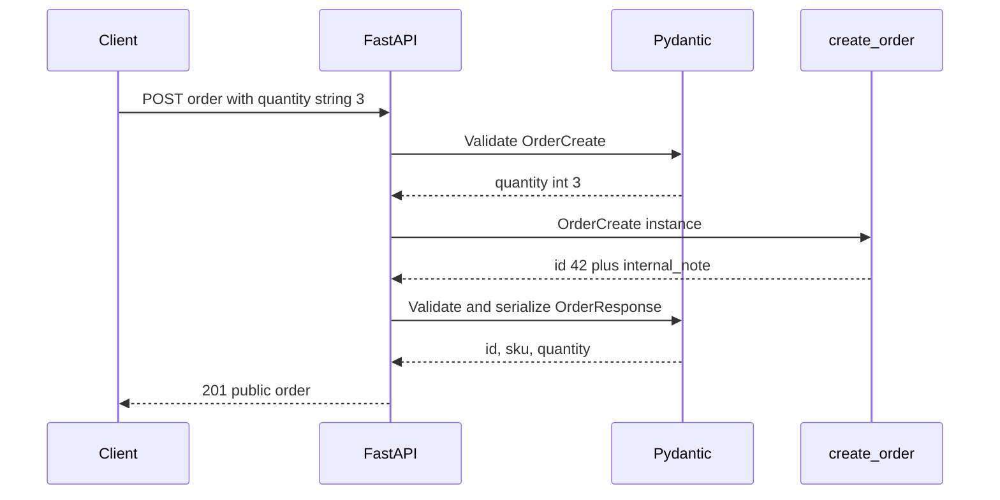

# Pydantic at FastAPI boundaries

> **Role:** tutorial. **Prerequisites:** [HTTP and parameter mapping](01_http_and_parameter_mapping.md),
> [Pydantic models and fields](../core_concepts/data_models/pydantic/01_models_and_fields.md),
> [validation](../core_concepts/data_models/pydantic/02_validation.md), and
> [serialization](../core_concepts/data_models/pydantic/03_serialization_and_schema.md).
> Python 3.11+, Pydantic v2, and a FastAPI release supporting that combination.

Pydantic owns the data contract. FastAPI connects that contract to HTTP: it extracts input, reports
request validation failures, applies the declared output shape, and generates OpenAPI documentation.
The general Pydantic material now lives under core concepts; this chapter owns the HTTP integration.

Install `fastapi` and `httpx` in the same isolated environment as Pydantic. Each Python block below
is a complete local test using `TestClient`; it needs no listening server or external database.
The examples have no persistence or authentication and exercise data boundaries only. For an actual
service, continue into [database sessions](../database/03_sqlalchemy_orm.md) and
[authentication](04_authentication.md) before adding protected writes.

## 1. FastAPI Integration

### Request Body

A Pydantic model parameter is normally interpreted as a JSON request body. Explicit markers such as
`Query`, `Form`, or `Depends` can give a model another source; the annotation alone is not a universal
rule that every model always comes from the body.

The request model below accepts order data. The response model adds a server-owned ID and leaves
an internal field out of the response. Run the complete block:

```python
from fastapi import FastAPI
from fastapi.testclient import TestClient
from pydantic import BaseModel, ConfigDict, Field

app = FastAPI()

class OrderCreate(BaseModel):
    model_config = ConfigDict(extra="forbid")
    sku: str = Field(min_length=1, max_length=30)
    quantity: int = Field(ge=1)

class OrderResponse(BaseModel):
    id: int
    sku: str
    quantity: int

@app.post("/orders", response_model=OrderResponse, status_code=201)
def create_order(order: OrderCreate):
    return {"id": 42, **order.model_dump(), "internal_note": "not public"}

with TestClient(app) as client:
    accepted = client.post("/orders", json={"sku": "BOOK", "quantity": "3"})
    rejected = client.post("/orders", json={"sku": "BOOK", "quantity": 0})
    assert accepted.status_code == 201
    assert accepted.json() == {"id": 42, "sku": "BOOK", "quantity": 3}
    assert rejected.status_code == 422
    error = rejected.json()["detail"][0]
    assert error["loc"] == ["body", "quantity"]
    print(accepted.status_code, accepted.json())
    print(rejected.status_code, error["loc"], error["type"])
# 201 {'id': 42, 'sku': 'BOOK', 'quantity': 3}
# 422 ['body', 'quantity'] greater_than_equal
```

FastAPI obtains the JSON data and asks Pydantic to validate the parameter's schema before calling the
endpoint. The ordinary integer parser accepts `"3"`; the range rule rejects zero. Because rejection
happens before the endpoint, no code in `create_order` runs for that invalid request.

Trace the request and response as separate boundaries:



The internal note disappears because the output contract contains only the three public fields.
Request validity does not prove response validity: the endpoint could return an invalid quantity or
forget an ID after doing its work. FastAPI treats an invalid response as an application error, not
as a client request-validation failure. [Request bodies](https://fastapi.tiangolo.com/tutorial/body/).

### Response Model

Use separate input and output models when ownership differs. A create request should not require a
server-generated ID or timestamp; a public response should not contain a password or internal token.
One model can serve both directions when the contracts actually coincide, but do not force that
coincidence through inheritance.

A response model filters ordinary returned data according to its declared schema. This protection
has boundaries: custom serializers, duck-typed serialization, and returning a `Response` directly
can change or bypass the usual serialization path. Test the actual HTTP output for secret fields;
do not rely on a comment saying a field is private. [Response models](https://fastapi.tiangolo.com/tutorial/response-model/).

When fields are shared, a base model can own them while create/update/public models keep their own
requiredness and exclusions. A PATCH model often needs a different shape, so making it inherit all
required create fields is usually the wrong relationship.

### Validation Error Responses

For invalid request data, the standard response is HTTP 422 with an error list. The tested failure
above contains a location of `["body", "quantity"]` and type `greater_than_equal`. A nested list
can add an index to the location. Inspect structured locations/types in tests instead of pinning
all human-readable wording across dependency versions.

Default validation responses can include submitted values. If inputs include credentials or personal
data, define a response/logging policy in [error handling](07_error_handling.md). A schema rejecting
bad data is not permission to record the raw payload in logs.

## 2. Partial Update Models

A partial update distinguishes omission from explicit null. Omission means “keep the existing value”;
null means whatever your field contract specifies, often “clear this optional value.”

Start from order 42 with quantity 3 and a note. The route below is a stateless demonstration: it
returns a validated proposed replacement for the fixed seed and deliberately does not store it.
This keeps the test focused on merge semantics before database transactions are introduced.

```python
from fastapi import FastAPI, HTTPException
from fastapi.testclient import TestClient
from pydantic import BaseModel, ConfigDict, Field, ValidationError

app = FastAPI()

class Order(BaseModel):
    id: int
    sku: str
    quantity: int = Field(ge=1)
    note: str | None = None

class OrderUpdate(BaseModel):
    model_config = ConfigDict(extra="forbid")
    quantity: int | None = Field(default=None, ge=1)
    note: str | None = None

seed = Order(id=42, sku="BOOK", quantity=3, note="gift wrap")

@app.patch("/orders/{order_id}", response_model=Order)
def preview_update(order_id: int, changes: OrderUpdate):
    if order_id != seed.id:
        raise HTTPException(status_code=404, detail="order not found")
    submitted = changes.model_dump(exclude_unset=True)
    try:
        return Order.model_validate({**seed.model_dump(), **submitted})
    except ValidationError as exc:
        # Do not send input values or exception context back to the client.
        detail = [{"loc": list(error["loc"]), "type": error["type"]} for error in exc.errors()]
        raise HTTPException(status_code=422, detail=detail) from exc

with TestClient(app) as client:
    unchanged = client.patch("/orders/42", json={})
    cleared = client.patch("/orders/42", json={"note": None})
    invalid = client.patch("/orders/42", json={"quantity": None})
    assert unchanged.json()["note"] == "gift wrap"
    assert cleared.json()["note"] is None
    assert cleared.json()["quantity"] == 3
    assert invalid.status_code == 422
    assert client.patch("/orders/42", json={"id": 99}).status_code == 422
    print(unchanged.json()["note"], cleared.json()["note"], invalid.status_code)
# gift wrap None 422
```

The update model allows fields to be omitted. It temporarily accepts `quantity=None` so that omission
can use a simple default, but the complete order contract rejects an explicitly supplied null during
reconstruction. This is an intentional two-stage contract: extraction of changes, then validation of
the proposed full state. More specialized APIs can reject forbidden explicit null earlier with a
validator; keep the distinction visible in documentation either way.

Compare the mappings before applying them:

| Submitted JSON | `exclude_unset` mapping | Proposed result |
|---|---|---|
| `{}` | `{}` | Keep quantity 3 and existing note |
| `{"note": null}` | `{"note": None}` | Clear the note |
| `{"quantity": null}` | `{"quantity": None}` | Reject: complete order requires an integer |

`exclude_none=True` would erase the explicit clearing operation. Conversely, dumping every default
would make omitted fields look like submitted nulls. The chosen flag preserves the caller's intent.
Also avoid `model_copy(update=submitted)` for untrusted updates: it trusts the mapping and skips
validation. Reconstructing a full model makes cross-field rules run again.

For persistence, fetch the authorized row, build and validate the proposed state, then write through
an owned transaction. Add a version or conditional update when concurrent writers must not overwrite
one another. Schema validation alone cannot prevent a lost update or establish permission to mutate
that order. [Partial-update mechanics](https://fastapi.tiangolo.com/tutorial/body-updates/),
[API update semantics](10_api_design.md#partial-updates).

### response_model_exclude_unset

This response option affects emitted fields; it does not select which database columns to update.
It relies on the returned data's supplied-field information, not knowledge of database history:

```python
from fastapi import FastAPI
from fastapi.testclient import TestClient
from pydantic import BaseModel

app = FastAPI()

class OrderResponse(BaseModel):
    id: int
    note: str | None = None

@app.get("/orders/42", response_model=OrderResponse, response_model_exclude_unset=True)
def read_order():
    return OrderResponse(id=42)

with TestClient(app) as client:
    print(client.get("/orders/42").json())
# {'id': 42}
```

Returning `OrderResponse(id=42, note=None)` instead includes `note: null`, because it was explicitly
set. The effect is valid for GET as well as other methods and is separate from PATCH merge policy.

### Pydantic 2.14: an explicit absent sentinel

The `exclude_unset=True` pattern above remains valid. Pydantic 2.14 also exposes stable `MISSING` for a typed absent value, distinct from `None`:

```python
from pydantic import BaseModel, MISSING

class NotePatch(BaseModel):
    note: str | None | MISSING = MISSING

assert NotePatch().note is MISSING
assert NotePatch().model_dump() == {}
assert NotePatch(note=None).model_dump() == {"note": None}
```

An omitted note is excluded during serialization; explicit null remains a requested clear operation. This sentinel does not authorize fields or validate a merged database row: retain the update allowlist and final model validation. Pin Pydantic 2.14+ before using the public import; older course baselines should keep their existing `exclude_unset` implementation. [Pydantic changelog](https://pydantic.dev/docs/validation/latest/get-started/changelog/), checked and executed on 2.14.2, 2026-10-30. Parameter-model and form extraction changes belong to [FastAPI's request boundary](01_http_and_parameter_mapping.md#version-sensitive-request-boundaries), not Pydantic's absent/null rule alone.

## 3. ORM results and reusable response shapes

To explicitly convert an object through `Model.model_validate`, configure `from_attributes=True`
on the Pydantic output model. That tells Pydantic to read attributes rather than require a mapping.
The [framework-independent example](../core_concepts/data_models/pydantic/01_models_and_fields.md#orm-mode-from_attributes)
shows the mechanism without a database.

Load the attributes needed by serialization before the session closes. If an async ORM property
requires I/O, reading it during response serialization can fail or perform unexpected queries. The
response contract does not own session lifetime. See [async SQLAlchemy](../database/04_async_sqlalchemy.md)
for eager-loading and session ownership.

For paginated responses, parameterize a shared `Page[ProductResponse]` rather than leaving `items`
untyped. The [generic page example](../core_concepts/data_models/pydantic/03_serialization_and_schema.md#reusable-response-shapes-with-generics)
owns that model; FastAPI can use the specialized type as `response_model`. Request bounds for page
size and the database count/query policy still belong to the endpoint.

## Production-readiness checklist

- Test accepted and rejected requests, unknown-field behavior, missing versus null, and strictness.
- Test the full public response, including absence of internal fields and validity of server values.
- Keep request errors distinct from invalid application responses; redact submitted secrets in both logs and errors.
- Validate complete proposed state for updates, then enforce authorization and concurrency at the persistence boundary.
- Load ORM attributes before serialization and keep schema conversion free of unexpected I/O.
- Pin compatible dependency versions and run the contract tests when upgrading Pydantic or FastAPI.

## Recap

- FastAPI validates the request before invoking the endpoint, then applies a separate output contract.
- Input and output models follow ownership; public filtering must be tested at the HTTP boundary.
- `exclude_unset` retains explicit null and default-valued updates while preserving omitted fields.
- Response exclusion flags change serialization, not database writes or update authorization.
- Pydantic validity does not replace transaction, session, or concurrency management.

## Check yourself

**The request validates, but the endpoint returns an object missing the response model's required ID.
Is this another client 422 error?**

<details><summary>Answer</summary>

No. The client satisfied the input contract. The application broke its output contract, so FastAPI
handles it as a server-side response validation error. Fix the returned shape rather than blaming
request input.

</details>

**A PATCH body is `{"note": null}`. Why is `exclude_none=True` incorrect if null means clear?**

<details><summary>Answer</summary>

It removes the key and turns the explicit clearing action into omission. `exclude_unset=True` keeps
submitted null because it tracks whether the caller supplied the field, not whether its value is null.

</details>

**Two clients read quantity 3 and each submit a validated replacement. Does validating both changes
prevent one from overwriting the other?**

<details><summary>Answer</summary>

No. Both states may satisfy the schema while one was computed from stale data. A conditional write,
version check, or appropriate transaction/locking policy must enforce the concurrency contract.

</details>

## Try it

Extend the PATCH example with an omittable `gift: bool` change. The complete order should default it
to `False`. Add assertions showing that `{}` preserves the existing value, while an explicitly
submitted `False` is kept even when it equals a default. Hint: inspect the changes mapping before the
merge; do not use `exclude_defaults` to decide which operations the caller requested.

<details><summary>Worked solution and reasoning</summary>

This independent probe isolates the field-selection rule before adding it to the earlier route:

```python
from pydantic import BaseModel

class Order(BaseModel):
    gift: bool = False

class OrderUpdate(BaseModel):
    gift: bool | None = None

stored = Order(gift=True)
omitted = OrderUpdate.model_validate({})
supplied = OrderUpdate.model_validate({"gift": False})
assert omitted.model_dump(exclude_unset=True) == {}
assert supplied.model_dump(exclude_unset=True) == {"gift": False}

kept = Order.model_validate({**stored.model_dump(), **omitted.model_dump(exclude_unset=True)})
changed = Order.model_validate({**stored.model_dump(), **supplied.model_dump(exclude_unset=True)})
assert kept.gift is True and changed.gift is False
print(kept.gift, changed.gift)
# True False
```

Start from `True` so omission and an explicit `False` produce visibly different results. The
update's supplied-field set retains `False`; equality with the complete model's default does
not erase the requested operation. Add these fields and the same assertions to the PATCH
test, then leave full-state validation in place to reject an explicitly supplied null.

</details>
