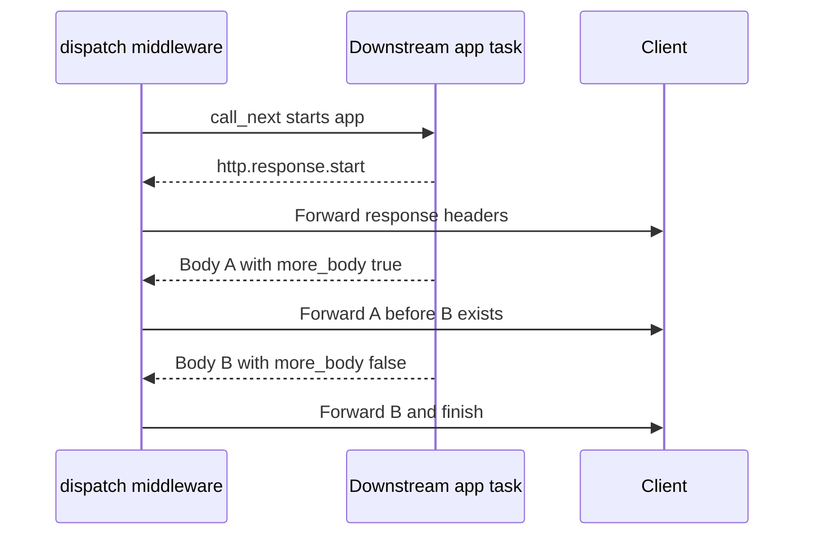

# FastAPI Middleware

<!-- length-justification: This is the canonical FastAPI middleware reference; request/response ordering, ASGI behavior, CORS, observability, security, and composition remain together because outer-layer order changes every downstream route. -->

> **Who this is for**: FastAPI engineers who can build routes and need cross-cutting request/response behavior with predictable ordering and failure handling.

A complete guide to middleware in FastAPI -- from mental model to production patterns.

> **Key insight**: Middleware owns a nested request/response lifetime, so registration order determines which layer observes, transforms, or loses each failure and response.

---

## 1. What Is Middleware?

Middleware is a **request/response interceptor**. It sits between the client and your route handlers, processing every request before it reaches an endpoint and every response before it leaves the server.

### The Onion Model

Middleware forms layers around your application, like an onion. Each request passes **inward** through every middleware layer, hits the route handler, then passes **outward** through the same layers in reverse.

```
Request  -->  Middleware A  -->  Middleware B  -->  Route Handler
Response <--  Middleware A  <--  Middleware B  <--  Route Handler
```

Each middleware can:

- Modify the request before passing it inward
- Modify the response before passing it outward
- Short-circuit the chain (return early without calling the route)
- Execute code before **and** after the route handler

### What Middleware Is For

- Cross-cutting concerns that apply to **every** request
- Request/response transformation
- Observability (logging, metrics, tracing)
- Security headers
- Error normalization

### What Middleware Is NOT For

- Per-route logic (use dependencies)
- Authentication checks on specific endpoints (use dependencies)
- Request validation (use Pydantic models)

---

## 2. Two Kinds of Middleware

FastAPI supports two middleware styles. Understanding the difference is critical.

### `@app.middleware("http")` -- The Simple Way

```python
from fastapi import FastAPI, Request

app = FastAPI()

@app.middleware("http")
async def my_middleware(request: Request, call_next):
    # Before route handler
    response = await call_next(request)
    # After route handler
    return response
```

This uses `BaseHTTPMiddleware` internally. FastAPI wraps your function for you.

### ASGI Middleware -- The Standard Way

```python
from starlette.types import ASGIApp, Receive, Scope, Send

class MyMiddleware:
    def __init__(self, app: ASGIApp):
        self.app = app

    async def __call__(self, scope: Scope, receive: Receive, send: Send):
        if scope["type"] == "http":
            # Your logic here
            pass
        await self.app(scope, receive, send)

app.add_middleware(MyMiddleware)
```

This is the raw ASGI protocol. No abstractions, no wrappers.

### Choose the interface by the boundary you need

| Feature | `@app.middleware("http")` / BaseHTTPMiddleware | Pure ASGI middleware |
|---|---|---|
| Interface | `Request`, `call_next`, returned response | `scope`, `receive`, `send` |
| Body forwarding | Incremental unless your middleware explicitly collects it | Incremental unless your wrapper collects it |
| Protocol scope | HTTP | HTTP and WebSocket if the wrapper handles both |
| Task/context boundary | Downstream app runs in a separate task; ContextVar updates do not propagate upward | Can preserve the same task when it directly awaits the app |
| Timing boundary | Around `call_next`: downstream headers become available | Can observe response start, each body and final body separately |

Choose BaseHTTPMiddleware for request/response-oriented behavior whose task/context semantics fit. It can forward streaming bodies. Choose pure ASGI when you need direct message ownership, WebSockets, precise body-completion timing or same-task context propagation. Measure overhead for the actual stack; neither interface guarantees constant memory if application code retains chunks. See the full message trace in Section 9.

---

## 3. Request ID Middleware

Every production service needs request tracing. Inject a unique ID into every request and propagate it to logs, downstream services, and the response.

> **Note**: Sections 3–5 use `BaseHTTPMiddleware`; Section 12 supplies pure ASGI alternatives when direct message/context ownership is needed. Test the selected interface against your response lifetimes.

### Implementation

```python
import uuid
from fastapi import FastAPI, Request
from starlette.middleware.base import BaseHTTPMiddleware

class RequestIDMiddleware(BaseHTTPMiddleware):
    async def dispatch(self, request: Request, call_next):
        # Use incoming header if present (from API gateway / load balancer)
        candidate = request.headers.get("X-Request-ID", "")
        request_id = candidate if (1 <= len(candidate) <= 64 and candidate.isascii()
            and all(c.isalnum() or c in "_-" for c in candidate)) else str(uuid.uuid4())

        # Store in request state for access in route handlers
        request.state.request_id = request_id

        response = await call_next(request)

        # Echo back in response headers
        response.headers["X-Request-ID"] = request_id
        return response

app = FastAPI()
app.add_middleware(RequestIDMiddleware)
```

### Accessing in Route Handlers

```python
@app.get("/orders")
async def list_orders(request: Request):
    request_id = request.state.request_id
    logger.info("Listing orders", extra={"request_id": request_id})
    return {"orders": []}
```

### Propagating to Structured Logging

For production, use contextvars so **every** log line in the request automatically includes the request ID -- no manual passing required.

```python
import contextvars
import logging
import uuid
from fastapi import FastAPI, Request
from starlette.middleware.base import BaseHTTPMiddleware

request_id_ctx: contextvars.ContextVar[str] = contextvars.ContextVar(
    "request_id", default=""
)

class RequestIDFilter(logging.Filter):
    def filter(self, record):
        record.request_id = request_id_ctx.get("")
        return True

class RequestIDMiddleware(BaseHTTPMiddleware):
    async def dispatch(self, request: Request, call_next):
        candidate = request.headers.get("X-Request-ID", "")
        request_id = candidate if (1 <= len(candidate) <= 64 and candidate.isascii()
            and all(c.isalnum() or c in "_-" for c in candidate)) else str(uuid.uuid4())
        request.state.request_id = request_id
        token = request_id_ctx.set(request_id)
        try:
            response = await call_next(request)
            response.headers["X-Request-ID"] = request_id
            return response
        finally:
            request_id_ctx.reset(token)

# Configure logging
handler = logging.StreamHandler()
handler.addFilter(RequestIDFilter())
formatter = logging.Formatter(
    "%(asctime)s [%(request_id)s] %(levelname)s %(name)s: %(message)s"
)
handler.setFormatter(formatter)
logging.root.addHandler(handler)
```

Now every log line produced during a request includes the request ID automatically:

```
2024-03-15 10:22:01 [a1b2c3d4-...] INFO app: Listing orders
2024-03-15 10:22:01 [a1b2c3d4-...] INFO db: Executing query SELECT ...
```

---

## 4. Timing Middleware

Measure and expose request duration for every endpoint.

```python
import time
import logging
from fastapi import FastAPI, Request
from starlette.middleware.base import BaseHTTPMiddleware

logger = logging.getLogger(__name__)

class TimingMiddleware(BaseHTTPMiddleware):
    async def dispatch(self, request: Request, call_next):
        start = time.perf_counter()
        response = await call_next(request)
        duration_ms = (time.perf_counter() - start) * 1000

        logger.info(
            "Request completed",
            extra={
                "method": request.method,
                "path": request.url.path,
                "status": response.status_code,
                "duration_ms": round(duration_ms, 2),
            },
        )

        # Expose as response header for client-side observability
        response.headers["X-Process-Time-Ms"] = str(round(duration_ms, 2))
        return response

app = FastAPI()
app.add_middleware(TimingMiddleware)
```

### Why `time.perf_counter()` and Not `time.time()`

| Function | Monotonic | Resolution | Use Case |
|----------|-----------|------------|----------|
| `time.time()` | No (reflects wall-clock adjustments) | Microseconds | Wall clock / timestamps |
| `time.perf_counter()` | Yes (OS-level monotonic source) | Nanoseconds | Measuring durations |

Always use `perf_counter()` for duration measurement. `time.time()` reflects wall-clock adjustments — NTP step corrections, manual operator changes, or OS-level clock events in some setups — any of which can make a "later" timestamp read as earlier than an "earlier" one. `perf_counter` is immune because it reads a monotonic source.

### Production Enhancement: Prometheus Metrics

For real production services, emit histograms instead of (or in addition to) logs:

```python
from prometheus_client import Histogram

REQUEST_DURATION = Histogram(
    "http_request_duration_seconds",
    "Request duration in seconds",
    labelnames=["method", "path", "status"],
    buckets=[0.01, 0.05, 0.1, 0.25, 0.5, 1.0, 2.5, 5.0, 10.0],
)

class PrometheusTimingMiddleware(BaseHTTPMiddleware):
    async def dispatch(self, request: Request, call_next):
        start = time.perf_counter()
        response = await call_next(request)
        duration = time.perf_counter() - start

        REQUEST_DURATION.labels(
            method=request.method,
            path=getattr(request.scope.get("route"), "path", "unmatched"),
            status=response.status_code,
        ).observe(duration)

        return response
```

---

## 5. Error Handling Middleware

Catch unhandled exceptions and return consistent, safe error responses. Never leak stack traces to clients.

### The Problem

Without error handling middleware:

```python
# Unhandled exception -> Uvicorn returns plain text "Internal Server Error"
# Different format than your normal JSON responses
# Stack trace might leak in debug mode
```

Clients get inconsistent error shapes. Some errors are JSON, some are plain text.

### The Solution

```python
import logging
import traceback
from fastapi import FastAPI, Request
from fastapi.responses import JSONResponse
from starlette.middleware.base import BaseHTTPMiddleware

logger = logging.getLogger(__name__)

class ErrorHandlingMiddleware(BaseHTTPMiddleware):
    async def dispatch(self, request: Request, call_next):
        try:
            return await call_next(request)
        except Exception as exc:
            # Log the full traceback -- this stays server-side
            logger.error(
                "Unhandled exception",
                extra={
                    "method": request.method,
                    "path": request.url.path,
                    "request_id": getattr(request.state, "request_id", "unknown"),
                    "traceback": traceback.format_exc(),
                },
            )

            # Return a safe, consistent error response
            return JSONResponse(
                status_code=500,
                content={
                    "error": "internal_server_error",
                    "message": "An unexpected error occurred.",
                    "request_id": getattr(
                        request.state, "request_id", "unknown"
                    ),
                },
            )

app = FastAPI()
app.add_middleware(ErrorHandlingMiddleware)
```

### What Clients See

Every error response has the same shape:

```json
{
    "error": "internal_server_error",
    "message": "An unexpected error occurred.",
    "request_id": "a1b2c3d4-e5f6-..."
}
```

### Anti-Patterns

The following are isolated exception clauses illustrating anti-patterns, not standalone Python programs:

```text
# ❌ Leaking implementation details to clients
except Exception as exc:
    return JSONResponse(
        status_code=500,
        content={"error": str(exc), "traceback": traceback.format_exc()},
    )

# ❌ Catching too broadly and swallowing errors
except Exception:
    return JSONResponse(status_code=500, content={"error": "error"})
    # No logging! You will never know what went wrong.

# ❌ Constructing a response and discarding it
except Exception as exc:
    response = JSONResponse(status_code=500, content={"error": "failed"})
    raise exc  # Construction did not send headers; this response object is discarded.
```

Inside a `try/except` boundary before response start, log the exception and return a safe public message. Avoid logging credentials or raw request bodies. Clause excerpt:

```text
except Exception as exc:
    logger.error("Unhandled exception", exc_info=True)
    return JSONResponse(
        status_code=500,
        content={
            "error": "internal_server_error",
            "message": "An unexpected error occurred.",
        },
    )
```

---

## 6. CORS Middleware

Cross-Origin Resource Sharing controls which cross-origin responses browser JavaScript may
read. A disallowed safelisted request can still reach the server and change state; CORS
is not authentication, authorization or a replacement for CSRF defenses.

### Basic Configuration

```python
from fastapi import FastAPI
from fastapi.middleware.cors import CORSMiddleware

app = FastAPI()

app.add_middleware(
    CORSMiddleware,
    allow_origins=["https://app.example.com", "https://admin.example.com"],
    allow_credentials=True,
    allow_methods=["GET", "POST", "PUT", "DELETE"],
    allow_headers=["Authorization", "Content-Type"],
    expose_headers=["X-Request-ID", "X-Process-Time-Ms"],
    max_age=600,  # Cache preflight responses for 10 minutes
)
```

### Parameters Explained

| Parameter | Purpose | Default |
|-----------|---------|---------|
| `allow_origins` | Which origins can make requests | `[]` |
| `allow_credentials` | Allow cookies/auth headers | `False` |
| `allow_methods` | Allowed HTTP methods | `["GET"]` |
| `allow_headers` | Allowed request headers | `[]` |
| `expose_headers` | Headers the browser can read from the response | `[]` |
| `max_age` | Seconds the browser caches preflight responses | `600` |

### Common Mistakes

```python
# ❌ Using wildcard with credentials -- browsers REJECT this
app.add_middleware(
    CORSMiddleware,
    allow_origins=["*"],
    allow_credentials=True,  # Cannot combine * origins with credentials
)

# ❌ Forgetting to expose custom headers -- browser cannot read them
app.add_middleware(
    CORSMiddleware,
    allow_origins=["https://app.example.com"],
    # Missing: expose_headers=["X-Request-ID"]
    # Frontend JS cannot access X-Request-ID from response
)

# ❌ Overly permissive for production
app.add_middleware(
    CORSMiddleware,
    allow_origins=["*"],
    allow_methods=["*"],
    allow_headers=["*"],
    # Fine for development, dangerous for production
)
```

```python
# ✅ Explicit origins, methods, and headers
app.add_middleware(
    CORSMiddleware,
    allow_origins=[
        "https://app.example.com",
        "https://staging.example.com",
    ],
    allow_credentials=True,
    allow_methods=["GET", "POST", "PUT", "DELETE"],
    allow_headers=["Authorization", "Content-Type"],
    expose_headers=["X-Request-ID"],
)
```

### Environment-Aware Configuration

```python
import os

ALLOWED_ORIGINS = {
    "production": [
        "https://app.example.com",
    ],
    "staging": [
        "https://staging.example.com",
        "https://preview.example.com",
    ],
    "development": [
        "http://localhost:3000",
        "http://localhost:5173",
    ],
}

env = os.getenv("ENVIRONMENT", "development")

app.add_middleware(
    CORSMiddleware,
    allow_origins=ALLOWED_ORIGINS.get(env, []),
    allow_credentials=True,
    allow_methods=["GET", "POST", "PUT", "DELETE"],
    allow_headers=["Authorization", "Content-Type"],
)
```

---

## 7. Trusted Host Middleware

Prevents **host header attacks** by rejecting requests with unexpected `Host` headers. This protects against DNS rebinding, cache poisoning, and password reset link hijacking.

```python
from starlette.middleware.trustedhost import TrustedHostMiddleware

app.add_middleware(
    TrustedHostMiddleware,
    allowed_hosts=["api.example.com", "*.example.com"],
)
```

### How It Works

1. Reads the `Host` header from every incoming request
2. Compares against `allowed_hosts`
3. Returns `400 Bad Request` if the host is not allowed

### When to Use

| Scenario | Needed? |
|----------|---------|
| Public API behind a load balancer | Yes -- LB may pass through the original Host |
| Internal microservice | Depends on network trust model |
| Behind a reverse proxy that sets Host | Yes -- defense in depth |
| Local development | No |

```python
# ❌ Allowing all hosts defeats the purpose
app.add_middleware(TrustedHostMiddleware, allowed_hosts=["*"])

# ✅ Explicit allowed hosts
app.add_middleware(
    TrustedHostMiddleware,
    allowed_hosts=["api.example.com", "api-internal.example.com"],
)
```

---

## 8. GZip Middleware

Compresses responses to reduce bandwidth. The client must send `Accept-Encoding: gzip`.

```python
from starlette.middleware.gzip import GZipMiddleware

app.add_middleware(GZipMiddleware, minimum_size=1000)
```

### Parameters

| Parameter | Purpose | Default |
|-----------|---------|---------|
| `minimum_size` | Minimum response size (bytes) before compression kicks in | `500` |

### When to Use

| Scenario | Recommendation |
|----------|----------------|
| JSON API responses > 1KB | Use GZip |
| Small responses (< 500 bytes) | Skip -- compression overhead not worth it |
| Binary / already compressed (images, video) | Skip -- already compressed |
| Behind a CDN/reverse proxy that compresses | Skip -- let the proxy handle it |
| High-throughput, CPU-constrained service | Be cautious -- compression uses CPU |

### Important

GZip middleware compresses the response in the application process. In most production setups, **the reverse proxy (Nginx, Caddy, CloudFlare) handles compression**, making application-level GZip unnecessary and wasteful.

```python
# ❌ Double compression -- proxy compresses already-compressed response
# Nginx gzip on + GZipMiddleware = wasted CPU, no benefit

# ✅ Let the reverse proxy handle compression
# Only use GZipMiddleware if your app serves responses directly to clients
```

---

## 9. Custom Middleware Class (ASGI)

### Using BaseHTTPMiddleware

The easiest way to write a class-based middleware:

```python
from starlette.middleware.base import BaseHTTPMiddleware
from fastapi import Request

class MyMiddleware(BaseHTTPMiddleware):
    def __init__(self, app, custom_value: str = "default"):
        super().__init__(app)
        self.custom_value = custom_value

    async def dispatch(self, request: Request, call_next):
        # Pre-processing
        request.state.custom = self.custom_value

        response = await call_next(request)

        # Post-processing
        response.headers["X-Custom"] = self.custom_value
        return response

app.add_middleware(MyMiddleware, custom_value="production")
```

### Choose middleware from its actual ASGI boundaries

`BaseHTTPMiddleware` exposes a request/response interface and runs the downstream app in
a separate task. After receiving `http.response.start`, `call_next` returns a streaming
response whose body forwards downstream messages. It does **not** inherently buffer the
whole body or wait for an infinite SSE stream to finish. A middleware that explicitly
reads and collects the body can introduce buffering, but that is a different operation.



A generator can send A and then wait on an event before B; pass-through middleware still
forwards A. `call_next` duration therefore measures time until the response starts, not
necessarily body completion. Measure total duration at the final ASGI body message if
that is the metric you intend.

The important limitation is task context: ContextVar changes made downstream do not
propagate back upward through the task boundary. BaseHTTPMiddleware also operates on HTTP,
so WebSockets bypass its dispatch method. Pure ASGI middleware gives explicit scope/message
ownership and can support both protocols. Neither style makes disconnect observation
instantaneous or proves cleanup without tests. Benchmark overhead on the actual workload.
[Starlette middleware behavior](https://starlette.dev/middleware/) (checked 2026-10-30).

### Pure ASGI Middleware

For full control, write directly against the ASGI spec:

```python
import time
import logging
from starlette.types import ASGIApp, Receive, Scope, Send
from starlette.requests import Request
from starlette.responses import Response

logger = logging.getLogger(__name__)

class PureASGITimingMiddleware:
    """
    Measures request duration without buffering the response body.
    Works with streaming responses and WebSockets.
    """

    def __init__(self, app: ASGIApp):
        self.app = app

    async def __call__(self, scope: Scope, receive: Receive, send: Send):
        if scope["type"] != "http":
            # Pass through non-HTTP connections (WebSocket, lifespan)
            await self.app(scope, receive, send)
            return

        start = time.perf_counter()
        status_code = 500  # Default if no response is sent

        async def send_wrapper(message):
            nonlocal status_code
            if message["type"] == "http.response.start":
                status_code = message["status"]
                # Inject header into the response
                headers = list(message.get("headers", []))
                duration_ms = (time.perf_counter() - start) * 1000
                headers.append(
                    (b"x-process-time-ms", str(round(duration_ms, 2)).encode())
                )
                message["headers"] = headers
            await send(message)

        try:
            await self.app(scope, receive, send_wrapper)
        finally:
            duration_ms = (time.perf_counter() - start) * 1000
            request = Request(scope)
            logger.info(
                "Request completed",
                extra={
                    "method": request.method,
                    "path": request.url.path,
                    "status": status_code,
                    "duration_ms": round(duration_ms, 2),
                },
            )

app.add_middleware(PureASGITimingMiddleware)
```

### BaseHTTPMiddleware vs Pure ASGI

The choice is about message and task ownership. BaseHTTPMiddleware receives the downstream
`response.start` through its internal channel and returns a streaming response to `dispatch`.
The outer client has not yet received that returned response: dispatch may still add headers or
change its status before returning it. Body forwarding then proceeds incrementally.

A pure ASGI wrapper can intercept the actual outgoing `response.start` immediately before
`await send(message)`. After that send succeeds, its status and headers are committed.
Disconnect observation depends on the server, receive/send path and transport; neither style
can detect a disappeared peer instantaneously. Always test your chosen server/framework versions
with a stalled body and a disconnect. [The runtime regression](./examples/test_runtime_contracts.py)
proves pass-through BaseHTTPMiddleware forwards body A before the producer releases body B.

---

## 10. Middleware Ordering

### Why Order Matters

Middleware is executed in **reverse registration order** for requests and **registration order** for responses. The **last** middleware added with `add_middleware()` is the **outermost** layer.

```python
app = FastAPI()

app.add_middleware(MiddlewareA)  # Added first  -> innermost
app.add_middleware(MiddlewareB)  # Added second -> outermost
```

Execution order:

```
Request  -->  B  -->  A  -->  Route Handler
Response <--  B  <--  A  <--  Route Handler
```

This is because FastAPI/Starlette wraps the app: `B(A(app))`. The outer wrapper executes first.

### Recommended Order

Register middleware from **innermost to outermost** (most specific first, most general last):

```python
app = FastAPI()

# 1. Innermost -- app-specific logic
app.add_middleware(ErrorHandlingMiddleware)

# 2. Observability -- timing and tracing
app.add_middleware(TimingMiddleware)

# 3. Request context -- request ID for logs
app.add_middleware(RequestIDMiddleware)

# 4. Security -- CORS, trusted hosts
app.add_middleware(
    CORSMiddleware,
    allow_origins=["https://app.example.com"],
    allow_methods=["GET", "POST", "PUT", "DELETE"],
    allow_headers=["Authorization", "Content-Type"],
)

# 5. Outermost -- infrastructure concerns
app.add_middleware(TrustedHostMiddleware, allowed_hosts=["api.example.com"])
app.add_middleware(GZipMiddleware, minimum_size=1000)
```

This produces the execution order:

```
Request  --> GZip --> TrustedHost --> CORS --> RequestID --> Timing --> ErrorHandler --> Route
Response <-- GZip <-- TrustedHost <-- CORS <-- RequestID <-- Timing <-- ErrorHandler <-- Route
```

### Why This Order

| Middleware | Why This Position |
|------------|-------------------|
| GZip (outermost) | Compresses the final response after all headers are set |
| TrustedHost | Rejects bad hosts early, before any processing |
| CORS | Handles preflight OPTIONS requests early |
| RequestID | Available to all inner middleware and route handlers |
| Timing | Measures duration of actual request processing, not infra overhead |
| ErrorHandler (innermost) | Catches exceptions from route handlers |

### Common Pitfalls

```python
# ❌ Error handler outside timing -- unhandled exceptions bypass timing
app.add_middleware(TimingMiddleware)        # Inner
app.add_middleware(ErrorHandlingMiddleware) # Outer -- catches errors before timing logs them

# ❌ Request ID inside timing -- timing logs have no request ID
app.add_middleware(RequestIDMiddleware)  # Inner
app.add_middleware(TimingMiddleware)     # Outer -- request ID not set yet when timing logs

# ❌ CORS inside error handler -- CORS headers missing on error responses
app.add_middleware(CORSMiddleware, ...)     # Inner
app.add_middleware(ErrorHandlingMiddleware) # Outer -- error responses skip CORS headers
```

---

## 11. Common Mistakes

### Mistake 1: Blocking the Event Loop

```python
# ❌ Synchronous I/O in async middleware -- blocks ALL concurrent requests
class BadMiddleware(BaseHTTPMiddleware):
    async def dispatch(self, request, call_next):
        import requests  # sync HTTP library
        result = requests.get("https://auth.example.com/verify")  # BLOCKS
        response = await call_next(request)
        return response
```

```python
# ✅ Use async I/O or run in a thread pool
import httpx
from asyncio import to_thread

class GoodMiddleware(BaseHTTPMiddleware):
    async def dispatch(self, request, call_next):
        # Option A: Async HTTP client
        async with httpx.AsyncClient() as client:
            result = await client.get("https://auth.example.com/verify")

        # Option B: Run sync code in thread pool (last resort)
        # result = await to_thread(sync_verify_function)

        response = await call_next(request)
        return response
```

### Mistake 2: Confusing the internal header event with the outgoing one

Changing a response after `call_next` is valid in BaseHTTPMiddleware because `dispatch` still
owns the returned response before it is sent to the caller:

```python
class HeaderMiddleware(BaseHTTPMiddleware):
    async def dispatch(self, request, call_next):
        response = await call_next(request)
        response.headers["X-Example"] = "present"
        return response
```

This does not depend on buffering the body. Changing `response.status_code` here also changes
the outgoing status, although arbitrarily converting errors to 200 would break the API contract.
In pure ASGI middleware, change a copy of `http.response.start` **before** forwarding it to `send`.
Changing an old message or constructing another response after the actual start was sent cannot
replace the public status. The irreversible boundary is the outgoing ASGI event, not the return
from `call_next` inside dispatch.

### Mistake 3: Creating Resources Per Request in Middleware

```python
# ❌ Creating an HTTP client on every request
class BadMiddleware(BaseHTTPMiddleware):
    async def dispatch(self, request, call_next):
        client = httpx.AsyncClient()  # New client every request!
        request.state.client = client
        response = await call_next(request)
        await client.aclose()
        return response
```

```python
# ✅ Use lifespan to create shared resources
from contextlib import asynccontextmanager

@asynccontextmanager
async def lifespan(app):
    app.state.client = httpx.AsyncClient()
    yield
    await app.state.client.aclose()

app = FastAPI(lifespan=lifespan)

class GoodMiddleware(BaseHTTPMiddleware):
    async def dispatch(self, request, call_next):
        # Access the shared client
        client = request.app.state.client
        response = await call_next(request)
        return response
```

### Mistake 4: Middleware vs Dependencies -- Using the Wrong One

This is the most common architectural mistake. Middleware and dependencies serve different purposes.

| Concern | Middleware | Dependency |
|---------|-----------|------------|
| Scope | Every request | Specific endpoints/routers |
| Access to route info | No (runs before routing) | Yes (knows which endpoint) |
| Can inject into endpoint | No (only `request.state`) | Yes (`Depends()`) |
| Can short-circuit | Yes (return response early) | Yes (raise `HTTPException`) |
| Testability | Harder (integration test) | Easy (`dependency_overrides`) |
| Use for | Global, cross-cutting | Per-route, business logic |

```python
# ❌ Using middleware for per-route authentication
class AuthMiddleware(BaseHTTPMiddleware):
    async def dispatch(self, request, call_next):
        if request.url.path.startswith("/admin"):
            token = request.headers.get("Authorization")
            if not verify_token(token):
                return JSONResponse(status_code=401, content={"error": "Unauthorized"})
        return await call_next(request)
# Problems: route matching logic duplicated, hard to test, no access to route metadata
```

```python
# ✅ Using dependencies for per-route authentication
from fastapi import Depends, HTTPException
from fastapi.security import OAuth2PasswordBearer

oauth2_scheme = OAuth2PasswordBearer(tokenUrl="token")

async def require_admin(token: str = Depends(oauth2_scheme)):
    user = await verify_token(token)
    if not user or not user.is_admin:
        raise HTTPException(status_code=403, detail="Admin access required")
    return user

@app.get("/admin/users", dependencies=[Depends(require_admin)])
async def list_admin_users():
    ...
```

### Mistake 5: Heavy Logic in Middleware

```python
# ❌ Database queries in middleware for every request
class BadMiddleware(BaseHTTPMiddleware):
    async def dispatch(self, request, call_next):
        # This runs on EVERY request, including health checks, static files, etc.
        user = await db.query("SELECT * FROM users WHERE token = ?", request.headers.get("auth"))
        request.state.user = user
        return await call_next(request)
```

```python
# ✅ Keep middleware lightweight -- defer heavy work to dependencies
class GoodMiddleware(BaseHTTPMiddleware):
    async def dispatch(self, request, call_next):
        # Lightweight: just extract and attach the token
        request.state.auth_token = request.headers.get("Authorization")
        return await call_next(request)

# Heavy work happens only on routes that need it
async def get_current_user(request: Request):
    token = request.state.auth_token
    if not token:
        raise HTTPException(status_code=401)
    return await verify_and_load_user(token)
```

---

## 12. Putting It All Together

A production middleware stack using **pure ASGI middleware**. No BaseHTTPMiddleware — streaming works, WebSockets work, and there is no extra Task overhead per request.

```python
import json
import logging
import time
import uuid
import contextvars
from contextlib import asynccontextmanager

import httpx
from fastapi import FastAPI
from fastapi.middleware.cors import CORSMiddleware
from starlette.middleware.gzip import GZipMiddleware
from starlette.middleware.trustedhost import TrustedHostMiddleware
from starlette.types import ASGIApp, Receive, Scope, Send

logger = logging.getLogger(__name__)
request_id_ctx: contextvars.ContextVar[str] = contextvars.ContextVar("request_id", default="")


# --- Pure ASGI Middleware Classes ---


class RequestIDMiddleware:
    """Injects a request ID into every request and echoes it in the response."""

    def __init__(self, app: ASGIApp):
        self.app = app

    async def __call__(self, scope: Scope, receive: Receive, send: Send):
        if scope["type"] not in ("http", "websocket"):
            await self.app(scope, receive, send)
            return

        # Extract or generate request ID
        headers = dict(scope.get("headers", []))
        raw_id = headers.get(b"x-request-id", b"")
        allowed = b"abcdefghijklmnopqrstuvwxyzABCDEFGHIJKLMNOPQRSTUVWXYZ0123456789_-"
        request_id = (raw_id.decode("ascii") if 1 <= len(raw_id) <= 64
                      and all(byte in allowed for byte in raw_id) else str(uuid.uuid4()))

        # Store in scope state so route handlers can access it
        scope.setdefault("state", {})["request_id"] = request_id

        # Bind to contextvars for automatic log propagation
        token = request_id_ctx.set(request_id)

        async def send_with_request_id(message):
            if message["type"] == "http.response.start":
                headers = list(message.get("headers", []))
                headers.append((b"x-request-id", request_id.encode()))
                message["headers"] = headers
            await send(message)

        try:
            await self.app(scope, receive, send_with_request_id)
        finally:
            request_id_ctx.reset(token)


class TimingMiddleware:
    """Measures request duration, logs it, and adds an X-Process-Time-Ms header."""

    def __init__(self, app: ASGIApp):
        self.app = app

    async def __call__(self, scope: Scope, receive: Receive, send: Send):
        if scope["type"] != "http":
            await self.app(scope, receive, send)
            return

        start = time.perf_counter()
        status_code = 500

        async def send_with_timing(message):
            nonlocal status_code
            if message["type"] == "http.response.start":
                status_code = message["status"]
                headers = list(message.get("headers", []))
                duration_ms = (time.perf_counter() - start) * 1000
                headers.append(
                    (b"x-process-time-ms", str(round(duration_ms, 2)).encode())
                )
                message["headers"] = headers
            await send(message)

        try:
            await self.app(scope, receive, send_with_timing)
        finally:
            duration_ms = (time.perf_counter() - start) * 1000
            logger.info(
                "Request completed",
                extra={
                    "request_id": request_id_ctx.get(""),
                    "method": scope.get("method", ""),
                    "path": scope.get("path", ""),
                    "status": status_code,
                    "duration_ms": round(duration_ms, 2),
                },
            )


class ErrorHandlingMiddleware:
    """Catches unhandled exceptions, logs them, returns consistent JSON error."""

    def __init__(self, app: ASGIApp):
        self.app = app

    async def __call__(self, scope: Scope, receive: Receive, send: Send):
        if scope["type"] != "http":
            await self.app(scope, receive, send)
            return

        response_started = False

        async def send_wrapper(message):
            nonlocal response_started
            if message["type"] == "http.response.start":
                response_started = True
            await send(message)

        try:
            await self.app(scope, receive, send_wrapper)
        except Exception:
            request_id = request_id_ctx.get("unknown")
            logger.error(
                "Unhandled exception",
                exc_info=True,
                extra={
                    "request_id": request_id,
                    "method": scope.get("method", ""),
                    "path": scope.get("path", ""),
                },
            )

            # Only send error response if headers haven't been sent yet
            if not response_started:
                body = json.dumps({
                    "error": "internal_server_error",
                    "message": "An unexpected error occurred.",
                    "request_id": request_id,
                }).encode()

                await send({
                    "type": "http.response.start",
                    "status": 500,
                    "headers": [
                        (b"content-type", b"application/json"),
                        (b"content-length", str(len(body)).encode()),
                    ],
                })
                await send({
                    "type": "http.response.body",
                    "body": body,
                })
            else:
                raise  # The started response cannot be replaced; preserve server failure reporting.


# --- Application Setup ---

@asynccontextmanager
async def lifespan(app: FastAPI):
    app.state.http_client = httpx.AsyncClient(timeout=30.0)
    try:
        yield
    finally:
        await app.state.http_client.aclose()


app = FastAPI(lifespan=lifespan)

# Register middleware: innermost first, outermost last
app.add_middleware(ErrorHandlingMiddleware)     # Innermost: catches route exceptions
app.add_middleware(TimingMiddleware)            # Measures processing time
app.add_middleware(RequestIDMiddleware)         # Sets request ID for all inner middleware
app.add_middleware(                             # Handles CORS preflight
    CORSMiddleware,
    allow_origins=["https://app.example.com"],
    allow_credentials=True,
    allow_methods=["GET", "POST", "PUT", "DELETE"],
    allow_headers=["Authorization", "Content-Type"],
    expose_headers=["X-Request-ID", "X-Process-Time-Ms"],
)
app.add_middleware(                             # Rejects bad hosts
    TrustedHostMiddleware,
    allowed_hosts=["api.example.com"],
)
app.add_middleware(GZipMiddleware, minimum_size=1000)  # Outermost: compresses final response
```

### What this ASGI stack makes explicit

| Concern | Boundary to test |
|---|---|
| Streaming | Forward each body message without collecting the whole body |
| Context | Bind/reset request context in the scope owner |
| WebSockets | Handle the WebSocket scope explicitly where needed |
| Request IDs | Validate bounded ASCII before reflecting/logging caller data |
| Total timing | Observe final body, not only response start |
| Post-start errors | Log and re-raise; never send a second response start |

Constructing `JSONResponse` alone sends nothing. The irreversible boundary is the actual
`http.response.start` event, after which status and headers cannot be replaced. Even a
middleware that handles a pre-start error safely must preserve a post-start failure so
the server can abort/report the incomplete response.

---

## Quick Reference

| Middleware | Purpose | Built-in? |
|-----------|---------|-----------|
| `CORSMiddleware` | Cross-origin request handling | Yes (Starlette) |
| `TrustedHostMiddleware` | Host header validation | Yes (Starlette) |
| `GZipMiddleware` | Response compression | Yes (Starlette) |
| `HTTPSRedirectMiddleware` | Redirect HTTP to HTTPS | Yes (Starlette) |
| Request ID | Trace requests across logs/services | Write your own |
| Timing | Measure request duration | Write your own |
| Error handling | Consistent error responses | Write your own |

---

## Key Takeaways

1. **Middleware is for cross-cutting concerns** -- things that apply to every request. Use dependencies for per-route logic.
2. **Order matters** -- register innermost first, outermost last. The last `add_middleware` call is the outermost layer.
3. **Choose the needed message/context boundary** -- BaseHTTPMiddleware streams but creates a task-context boundary and dispatches only HTTP; pure ASGI gives explicit scope and send/receive control.
4. **Never block the event loop** -- all I/O in middleware must be async.
5. **Keep middleware lightweight** -- it runs on every request, including health checks and preflight requests.
6. **Use contextvars for request-scoped data** -- this propagates context to all code in the request without manual passing.

## Check your understanding

ASGI response.start commits status and headers. Body messages can follow incrementally; timing call_next normally measures header arrival.

**Prediction:** The generator sends A and waits before B. Must BaseHTTPMiddleware collect B before A reaches the client?

<details><summary>Answer</summary>
No. Its message channel forwards a streaming response after response.start. The separate task boundary has real ContextVar implications, but does not imply whole-body buffering.
</details>

**Diagnosis:** An exception occurs after response.start. Can middleware return a replacement 500?

<details><summary>Answer</summary>
No. Preserve observability and propagate the failure. A second response start violates the response protocol.
</details>


**Try it:** Instrument the final-body boundary in an ASGI send wrapper. Start with `if message["type"] == "http.response.body" and ...:` and leave the completion condition blank. Record header time separately on response.start.

Hint: The final message omits more_body or sets it false.

<details><summary>Solution</summary>
`not message.get("more_body", False)` identifies the final body. Record duration after successfully awaiting the wrapped send. A failure before that point belongs in aborted-stream metrics; a header-time measurement cannot stand in for total stream duration.
</details>
