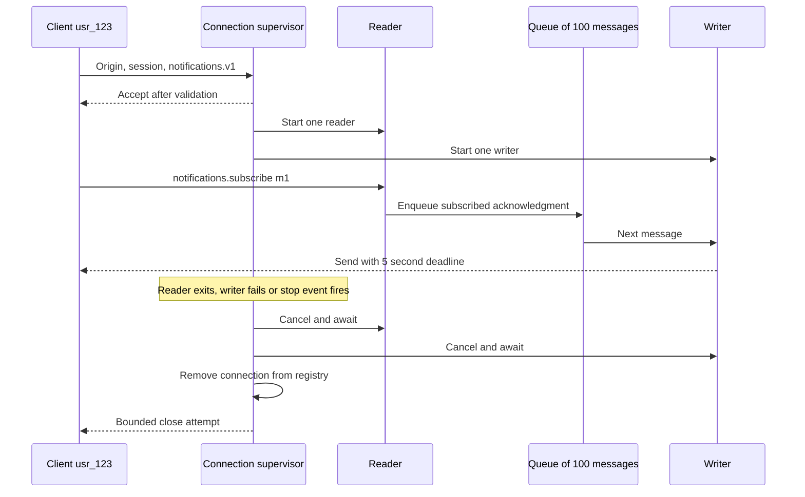
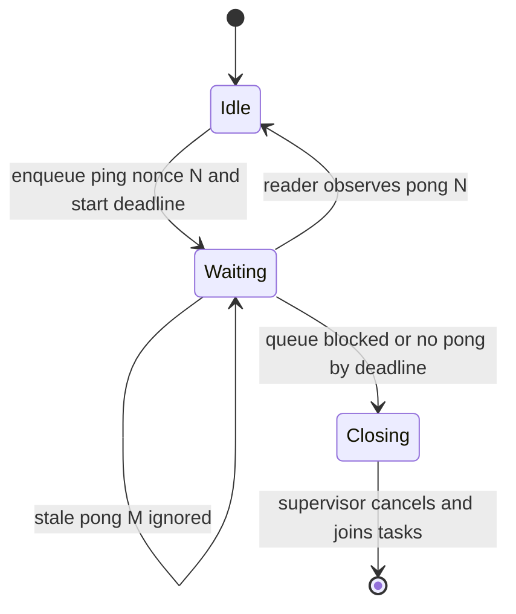
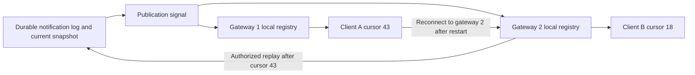

# WebSockets in FastAPI

> **Role:** implementation guide. Prerequisites: HTTP requests, async tasks, cancellation, and [authentication](./04_authentication.md). The [API WebSocket path](../../apis/websockets/README.md) develops protocol selection and durable recovery. This lesson owns the FastAPI connection lifetime.

A notification client needs to receive updates after its initial request ends. An ordinary HTTP response completes a request; that does **not** imply closing its TCP connection, because HTTP can reuse persistent connections. A WebSocket upgrade instead establishes a long-lived bidirectional conversation with message framing. The application must now own authentication, one reader, one writer, bounded queues and cleanup for the whole conversation.

## Start with the complete bounded endpoint

Use the shared [notification implementation](../../apis/examples/websocket_notifications/app.py), rather than combining disconnected manager sketches. Its tests cover a signed subscription and ping, invalid credentials, queue saturation, send timeout, and removal from the connection registry. From the repository root:

```bash
python3 -m venv /tmp/notes-ws
/tmp/notes-ws/bin/python -m pip install fastapi==0.162.0 starlette==1.10.0 httpx==0.28.1 pytest==9.2.0 uvicorn==0.34.0 websockets==15.0.1
/tmp/notes-ws/bin/python -m pytest -q apis/examples/websocket_notifications fundamentals/fastapi/examples/test_ws_heartbeat.py
export WS_SESSION_SECRET="$(openssl rand -hex 32)"
/tmp/notes-ws/bin/python -m uvicorn apis.examples.websocket_notifications.app:app --ws websockets --ws-max-size 16384 --ws-max-queue 16 --ws-ping-interval 20 --ws-ping-timeout 10 --ws-per-message-deflate false
```

Five tests should pass. The server endpoint is `/ws/notifications`; the [API implementation lesson](../../apis/websockets/06_implementation_testing_and_operations.md) gives the browser/test-client protocol. Tests use a local signed session; a real application obtains identity from its established login/session flow and rotates keys. The endpoint is a single-process notification transport. It does not pretend that its in-memory registry or test session provides durable notification storage.

The chosen Uvicorn WebSocket backend enforces frame/message limits and protocol Ping/Pong handling. These options are backend-specific; test them against the exact deployed backend. The application-level size check happens after the server has assembled the message, so it is defense in depth, not the earliest memory bound. See [Uvicorn settings](https://www.uvicorn.dev/settings/) (checked 2026-10-30).

## Trace one connection from admission to cleanup

Before `accept()`, the endpoint checks the browser Origin, requested `notifications.v1` subprotocol, and signed session expiry. Origin validation protects a cookie-authenticated browser boundary; it does not authenticate non-browser callers, who can choose their own Origin header. A pre-accept close becomes a rejected handshake; after acceptance a close is a WebSocket protocol message.

The accepted connection has a user ID, an outbound queue of at most 100 messages, a stop event, and a close reason. The supervisor starts exactly one reader and one writer. Every application send passes through the writer; the supervisor only sends close after the writer stops.



If a reader receives `WebSocketDisconnect`, the owner stops the writer. If the writer times out while sending, it sets the independent stop event, so the supervisor can cancel a reader blocked on receive. If the endpoint itself is cancelled, its `finally` still cancels and joins all owned tasks. Merely calling `task.cancel()` without awaiting it leaves cleanup and exceptions unresolved.

The tests observe that the registry is empty after closing a subscription. They also give the writer a socket whose send never completes: its five-second policy is shortened in the test, the stalled send is cancelled, and close code 1013 is selected. A restart drops the registry and connections; clients must reconnect and reconstruct state from an authoritative store, as developed below.

## Bound fan-out without sharing one slow client's delay

A broadcast that awaits each socket send in a loop lets the slowest client hold up every later client. Starting one send task per recipient removes serial waiting but creates an unbounded task burst and still waits for the slowest task. Neither mechanism is a bounded per-client queue.

The canonical hub takes a recipient snapshot while holding its registry lock, releases the lock, then calls `put_nowait` on each client's queue. If a queue is full, it sets that client's stop event. The close decision does not have to fit into the already-full queue. One writer per client drains messages with a send deadline.

For a room with 1,000 members, queue capacity 100 and a 2 KiB serialized message limit, retained payloads alone can approach 195 MiB before Python object overhead. Bound bytes as well as count for production variable-sized messages. A process also needs a maximum accepted connection count and admission policy; bounding each connection does not bound an unlimited number of connections.

For local room membership, keep `room_id -> set[connection]`. Authorize the join against tenant membership before adding it. Snapshot `tuple(members)` before any awaited broadcast work: a disconnect may mutate the original set during an await. Removal must be idempotent because disconnect, timeout and shutdown can race. Return copies from inspection helpers instead of exposing mutable internal sets.

Decide what a slow client loses. Presence/typing updates can often be coalesced to the latest state. An invoice-paid notification needs durable event identity and a recovery read. Closing with 1013 tells a client to retry; it does not preserve the dropped event.

## Distinguish sending a ping from receiving its pong

A successful `send_json({"type": "ping"})` proves only that the local send completed. It does not prove that the peer application replied. Browser JavaScript cannot directly send WebSocket protocol Ping frames, although the browser handles protocol Ping/Pong internally. Application heartbeats are ordinary messages and need an explicit acknowledgment contract.

The runnable [Heartbeat state machine](./examples/ws_heartbeat.py) creates a unique nonce, puts its ping into the single writer queue, and waits for the single reader to observe a matching pong. Queue admission and acknowledgment share one ten-second deadline. An old pong cannot satisfy a new probe. On expiry it signals the supervisor; it does not become a second socket writer.



A peer that reads all pings but never sends pong reaches `Closing`. The test exercises that precise condition. To integrate periodic application probes, the supervisor owns an additional heartbeat task, the reader calls `heartbeat.observe(message)` for validated pong messages, and shutdown cancels/joins that task too. The minimal notification endpoint uses the selected server's transport heartbeat; this separate primitive demonstrates stronger application-level acknowledgment without silently adding a second reader or writer.

Browser-side application reply, for the nonce protocol:

```javascript
socket.onmessage = ({data}) => {
    const message = JSON.parse(data);
    if (message.type === 'ping') {
        socket.send(JSON.stringify({type: 'pong', nonce: message.nonce}));
        return;
    }
    // Validate and dispatch other application messages here.
};
```

Heartbeat interval plus reply deadline must fit inside the proxy's idle policy with margin. Heartbeats do not eliminate an absolute connection lifetime limit. Reauthenticate or expire long sessions according to policy; validating a token once does not keep it valid forever.

## Scale the same ownership model across processes

An established upgraded connection already stays on its selected backend. Load-balancer sticky sessions across *new connections* are a separate choice, not a WebSocket requirement. A reconnect may land on another process. Prefer shared authoritative state and cursor-based recovery when that must work.

The following topology has two process-local registries and a shared durable notification log:



Redis Pub/Sub can carry the publication signal, but disconnected subscribers miss messages. Persist the business event before signaling, make clients apply event IDs idempotently, and recover by querying after their last applied cursor. If retention no longer covers the cursor, send an explicit resync requirement and load a snapshot. Never infer durable delivery from successful `publish()` or socket send.

A gateway's Redis listener belongs to lifespan: retain its task handle, surface unexpected listener termination as degraded readiness, cancel and await the task at shutdown, then unsubscribe and close Pub/Sub and the client. An unreferenced `asyncio.create_task(listener())` can die while HTTP health remains green. The [distributed architecture lesson](../../apis/websockets/05_scaling_and_distributed_architecture.md) develops directory generations, replay ordering, cross-region choices and why a full broadcast mesh multiplies traffic.

A WebSocket-capable reverse proxy forwards the upgrade and sets idle timeouts deliberately. This Nginx location is a configuration excerpt inside a configured server; it needs no `ip_hash` for an already-upgraded connection:

```nginx
location /ws/ {
    proxy_pass http://notifications_backend;
    proxy_http_version 1.1;
    proxy_set_header Upgrade $http_upgrade;
    proxy_set_header Connection "upgrade";
    proxy_read_timeout 60s;
    proxy_send_timeout 60s;
}
```

## Diagnose and operate the service

| Symptom | Evidence to inspect | Action |
|---|---|---|
| One user lags, other users healthy | That connection's queued bytes, send duration, cursor lag | Disconnect/coalesce by policy; recover durable state |
| All connections on one pod stop updating | Broker listener state and publication lag | Mark degraded, restart owned listener safely, reconcile missed events |
| Reconnect succeeds but updates disappear | Cursor persistence and replay retention | Repair replay/snapshot contract; affinity alone cannot restore a dead process |
| Memory grows while connection count stays flat | Queue bytes and inbound decompression/message limits | Enforce byte budgets and server ingress limits |
| Shutdown hangs | Reader/writer/listener task stacks and close deadlines | Cancel, join and bound close; test with a stalled send |

During rollout, stop new admissions, allow a bounded drain, then close remaining clients with a retry policy. Clients reconnect with jitter to avoid a connection/authentication storm. Check that the new version can read old protocol messages/cursors before switching traffic; retain compatibility for the longest supported reconnect window. Separate live connection gauges, authentication failures, close reasons, queue occupancy, send latency, missed heartbeat counts and replay lag. Avoid per-user metric labels.

Production checklist:

- [ ] Origin and identity validated before acceptance; authorization per action/room.
- [ ] Message schema, protocol version, server byte limits and connection admission configured.
- [ ] One reader/writer; bounded per-client count and byte queues; explicit overload policy.
- [ ] Heartbeat observes the intended kind of reply; all tasks cancelled and joined.
- [ ] Durable events recover through cursor replay or snapshot after restart.
- [ ] Broker listener failures affect health; shutdown and rollout are bounded.
- [ ] Load tests include slow readers, malformed input, reconnect storms and one failed gateway.

## Recap and practice

- The supervisor owns every task from acceptance through disconnect; the registry is only a local routing index.
- Queue bounds isolate slow clients, but need a defined loss/recovery policy.
- A send completion, matching application pong and durable application acknowledgment prove different things.

**Prediction:** The peer receives ping N but never replies. A send-only timeout succeeds. Is the peer healthy?

<details><summary>Answer</summary>
Not according to an application acknowledgment contract. The matching-pong deadline must expire and signal closure; timing only send cannot establish that the peer application processed the ping.
</details>

**Diagnosis:** A client reconnects to a different pod after a restart. Does enabling sticky sessions restore its missing events?

<details><summary>Answer</summary>
No. The original process may be gone, and affinity does not create durable state. Use an authorized replay cursor or snapshot. Existing upgraded connections already stay on their chosen backend.
</details>

**Try it:** Extend `test_ws_heartbeat.py` to cancel a probe while it is waiting for a pong. Scaffold: start `probe`, consume its queued ping, call `task.cancel()`, then fill in the expected exception and pending-state assertion. Hint: the primitive's `finally` clears the nonce, while its supervisor owns socket cleanup.

<details><summary>Solution</summary>
Await the task and assert `asyncio.CancelledError`, then assert `heartbeat.pending is None`. Do not swallow cancellation and start another probe. In the endpoint, cancel/join the reader and writer before attempting close; otherwise the new close can race an active send.
</details>
