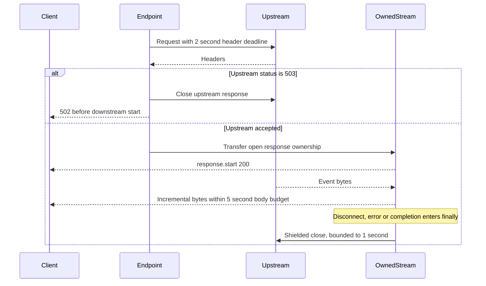

# Streaming in FastAPI

> **Role:** implementation guide. Prerequisites: async iteration, [response handling](./01_http_and_parameter_mapping.md), and [HTTPX client ownership](../httpx/README.md). Baseline: Python 3.14, FastAPI 0.162.0, Starlette 1.10.0 and HTTPX 0.28.1, checked 2026-10-30.

An export can produce its first row before its last row exists. Streaming lets the client consume that row immediately, but the request still owns the generator, database cursor or upstream response until completion or cancellation. This guide develops that lifetime, including fragmented records, failure after headers and cleanup. Fleet admission and multi-stream composition continue in [streaming patterns](./safe_and_scalable_api_calls/07_streaming_patterns.md) and [advanced streaming](./safe_and_scalable_api_calls/08_streaming_advanced.md).

## Run one owned stream

The complete [app](./examples/streaming_mechanics/app.py) uses a local mock provider: event 1 contains `café`, then a `done` event arrives after a delay. It opens and validates the upstream response **before** returning the downstream response. Its response object owns upstream closure even if sending the downstream headers fails.

From the repository root, in a disposable environment:

```bash
python3 -m venv /tmp/notes-streaming
/tmp/notes-streaming/bin/python -m pip install fastapi==0.162.0 starlette==1.10.0 httpx==0.28.1 pytest==9.2.0 uvicorn==0.34.0
/tmp/notes-streaming/bin/python -m pytest -q fundamentals/fastapi/examples/streaming_mechanics
node fundamentals/fastapi/examples/streaming_mechanics/test_sse.mjs
/tmp/notes-streaming/bin/python -m uvicorn fundamentals.fastapi.examples.streaming_mechanics.app:app --port 8000
```

In a second terminal:

```bash
curl --no-buffer http://127.0.0.1:8000/events
curl -i 'http://127.0.0.1:8000/events?fail=true'
```

Expect an SSE event with `id: 1` and then `event: done`; the second request returns 502 before any successful stream starts. Three Python tests prove pre-start status mapping, body A arriving while B is blocked, cancellation closure, and post-start failure propagation. The Node test splits an event at **every byte position**, including inside the UTF-8 encoding of `é`. HTTPX's in-process ASGI transport buffers bodies, so the incremental test observes ASGI messages directly. Use the live curl path to inspect network timing; these tests do not establish proxy buffering behavior.

## Follow data through the layers

A generator yield is an application production boundary. Starlette converts it into an ASGI `http.response.body` message. The ASGI server then chooses transport framing. An unknown-length HTTP/1.1 response commonly uses chunked transfer coding; HTTP/2 carries DATA frames and does not use HTTP/1.1 chunked coding. A known-length file can stream with `Content-Length`. Streaming does not require omitting that header.

The event below can be split or combined at each transport layer:


The client may receive half of event 42 in one read and its remainder together with event 43 in another. TCP, HTTP chunks, and browser reads do not preserve application record boundaries. Parse records only after reconstructing their protocol delimiter. This is also why one `yield` does not promise one visible browser update.

`StreamingResponse` sends `http.response.start` before iterating its body. It then forwards each yielded string/bytes value, and finally sends a body message with `more_body=False`. Async generators must await blocking I/O; a synchronous generator is advanced using Starlette's thread-pool machinery. An async generator that performs a long CPU loop still blocks the event loop. Streaming keeps memory bounded only when producers, parsers and downstream queues are also bounded.

## Choose a record contract

| Representation | Record boundary | Client behavior |
|---|---|---|
| Plain bytes/file | Known length or end of stream | Write chunks without assuming semantic boundaries |
| NDJSON (`application/x-ndjson`) | Newline after each complete JSON value | Retain an incomplete line; parse complete lines |
| SSE (`text/event-stream`) | Blank line after event fields | Join `data:` lines, honor event type and optional cursor |
| One JSON document | Complete JSON grammar | Incremental parser or collect a bounded document |

Labeling multiple JSON values `application/json` does not turn them into a valid single JSON document. For SSE, an event can contain `id`, `event`, multiple `data` lines and a reconnect `retry` value. A comment line beginning `:` can keep an idle connection active without creating a data event.

```text
id: 42
event: progress
data: {"completed": 7,
data: "total": 10}

```

Joining the two data lines with a newline produces valid JSON. The blank line finishes this event. An ID is only a cursor: recovery also requires a retained event log and a server implementation that honors `Last-Event-ID`, checks tenant access, and handles expired cursors with a snapshot/resync contract.

### Decode a fragmented response

The complete [SSE parser](./examples/streaming_mechanics/sse.mjs) accepts an async iterable of byte chunks. It keeps the UTF-8 decoder state between reads and a carry buffer between event boundaries. It enforces a 65,536-character record limit and rejects a truncated final event. Its contract deliberately supports LF/CRLF records from this server; use a standards-complete parser when accepting arbitrary SSE producers, including their line ending, retry and reconnect rules.

A browser integration is:

```javascript
import {events} from './sse.mjs';

const controller = new AbortController();
const response = await fetch('/events', {signal: controller.signal});
if (!response.ok || !response.body) throw new Error(`HTTP ${response.status}`);
try {
    for await (const event of events(response.body)) {
        if (event.type === 'done') break;
        console.log(JSON.parse(event.data));
    }
} finally {
    controller.abort();
}
```

Native `EventSource` already supplies SSE parsing and reconnect behavior for GET. It does not offer an arbitrary request body or arbitrary authorization headers. Cookie authentication needs the normal origin/CSRF design; putting bearer credentials in URLs exposes them to URL logging. `fetch` allows POST and headers but makes parsing, retry, cursor management and cancellation your responsibility. See the [HTML event-stream specification](https://html.spec.whatwg.org/multipage/server-sent-events.html) for the full wire contract.

## Own the upstream before and after response start

Suppose the upstream returns 503. Opening it inside the body generator is too late: the downstream response may already say 200. The runnable app performs `client.send(..., stream=True)`, validates status and media type, and only then transfers ownership to `OwnedStream`.



The client is lifespan-owned; each response is request-owned. Closing one response releases its stream or connection slot without shutting down the shared client. Header and body deadlines are separate in this example: at most 2 seconds opening plus 5 seconds forwarding plus a bounded cleanup allowance. For one original end-to-end budget, carry a monotonic deadline through both phases as taught in [safe calls](./safe_and_scalable_api_calls/02_concurrency_and_timeouts.md).

A plain generator `finally` is useful after iteration begins, but it cannot guarantee closure of a resource acquired outside the generator if the response fails before iteration starts. The response object's `__call__` owns that broader lifetime. In AnyIO cancellation scopes, shield asynchronous cleanup and give it its own limit; `finally: await close()` alone does not make that await immune to cancellation. Cleanup timeout must remain observable and may require discarding the underlying resource rather than returning it as healthy.

After `response.start`, an exception cannot change 200 to 500. A typed SSE `error` event can report a recoverable application failure while the stream is writable. A broken transport cannot deliver even that event. Require an explicit `done` event or equivalent terminal record so clients distinguish successful completion from a truncated connection. The regression test asserts one response start and no successful final body after an injected failure.

A generator path operation is not automatically a dependency with `yield`. Returning `StreamingResponse` explicitly selects raw body streaming. Current FastAPI also has typed streaming APIs: since 0.135.0, `fastapi.sse.EventSourceResponse` and `ServerSentEvent` can serialize SSE streams. That newer convenience does not remove response ownership, cursor storage or failure semantics. See the dated [FastAPI SSE tutorial](https://fastapi.tiangolo.com/tutorial/server-sent-events/) and [release notes](https://fastapi.tiangolo.com/release-notes/) (checked 2026-10-30).

## Files and uploads use the same lifetime rules

Use `FileResponse` for a server-selected existing file when its range and metadata behavior fit. It normally reads file chunks through the framework's file I/O facilities; zero-copy `sendfile` depends on the exact server/framework extension support and is not a universal guarantee. Use `StreamingResponse` when producing or transforming content incrementally. Never trust a route filename to authorize a storage path: resolve an authenticated document ID to a server-owned path, prevent traversal/symlink escapes, and set a safe download filename independently. See [Starlette response source](https://github.com/Kludex/starlette/blob/main/starlette/responses.py) for version-specific implementation details.

An upload needs its own unique storage key, byte limit, partial-file cleanup and publication decision. Writing every request to `raw_upload.bin` races concurrent writers; writing to `file.filename` grants the client path control. Multipart `UploadFile` may already have spooled bytes before your endpoint reads chunks. The complete [upload and object storage lesson](./12_file_uploads_and_object_storage.md) owns ingress limits, quarantine, immutable versions and scanner-gated publication. Streaming a request body is not evidence that every earlier proxy/parser avoided buffering.

## Diagnose buffering and slow consumers

Awaiting ASGI `send` lets server flow control slow the producer when downstream buffers fill. An unbounded intermediate queue defeats that feedback: 100 events/second produced and 20 consumed adds 80 queued events/second. At 2 KiB/event that grows about 9.4 MiB/minute per connection, before object overhead. Bound the queue, stop production, drop an explicitly disposable update, or close and recover from a durable cursor. Do not silently drop state transitions.

`Cache-Control: no-cache` permits caching with revalidation; it does not universally disable proxy buffering. `X-Accel-Buffering: no` targets compatible Nginx behavior, and intermediaries may ignore it. Compression may also delay small outputs. Measure first-event latency and inter-event gaps through the actual ingress. Compare direct-to-app versus proxy: if direct events arrive every 100 ms but the proxy delivers one batch after 5 seconds, investigate proxy buffering/compression before changing the generator.

| Symptom | Measurement | Response |
|---|---|---|
| 200 followed by abrupt EOF | Completed/done event absent; upstream error after start | Surface incomplete result, close resources, retry only with a recovery contract |
| Memory rises with slow clients | Per-client queue depth/bytes and active streams | Bound queues and stream admission; close lagging consumers |
| Open upstream responses grow after disconnect | Active responses versus live downstream streams | Inspect owner `finally`, cancellation and cleanup timeouts |
| Healthy stream dies at fixed interval | Proxy idle/absolute timeout versus heartbeat cadence | Configure both sides; heartbeats do not defeat absolute lifetime limits |
| Only deployed path batches events | First-event timings at each hop | Verify ingress/compression settings and retest |

For rollout, stop accepting new long streams, drain for a bounded interval, close the remainder with a documented reconnect policy, and retain old cursors for the compatibility window. Record active streams, queue bytes, first-event latency, completed versus aborted streams, cleanup failures and egress cost. Do not label metrics with user IDs or event IDs.

Production readiness:

- [ ] Authenticate and authorize before streaming; define reauthorization for long lifetimes.
- [ ] Bound admission, records, queues, upstream waits and total stream lifetime.
- [ ] Validate upstream status before starting the downstream response.
- [ ] Prove normal, cancellation, pre-start and post-start cleanup.
- [ ] Test fragmentation and explicit completion through the deployed proxy.
- [ ] Define cursor expiry, reconnect recovery and rollout drain behavior.

## Recap and practice

- Streaming moves the response completion boundary later; resources remain owned until that boundary or cancellation.
- Application records must survive arbitrary network fragmentation.
- Before headers, return an HTTP error. After headers, report within the protocol if possible and preserve failure observability.

**Prediction:** The browser receives `caf` plus the first byte of `é`, then its remaining byte and the event terminator. Can it decode and parse each read separately?

<details><summary>Answer</summary>
No. The UTF-8 decoder must retain partial character state, and the parser must retain incomplete records. Only the complete blank-line-delimited event is eligible for JSON parsing.
</details>

**Diagnosis:** The producer emits one event each second, but clients see all ten at once. Does `Cache-Control: no-cache` prove the proxy is innocent?

<details><summary>Answer</summary>
No. It controls caching/revalidation, not all buffering. Compare direct and proxied first-event/inter-event timings and inspect proxy buffering and compression.
</details>

**Try it:** Copy `test_sse.mjs`, replace the two-chunk split loop with one-byte chunks, and keep the same assertions. Scaffold: `async function* chunks() { for (const byte of bytes) { /* yield a one-byte Uint8Array */ } }`. Hint: `Uint8Array.of(byte)` preserves byte values.

<details><summary>Solution</summary>
Use `yield Uint8Array.of(byte)`. The parser must still emit exactly one event, cursor `42`, with JSON text `café`; no partial event is emitted. Then remove the final blank line and assert the truncation error. This tests a changed transport schedule without changing the application record.
</details>
