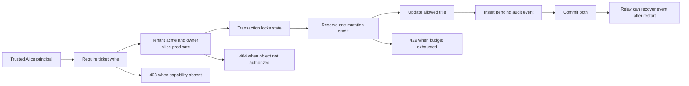
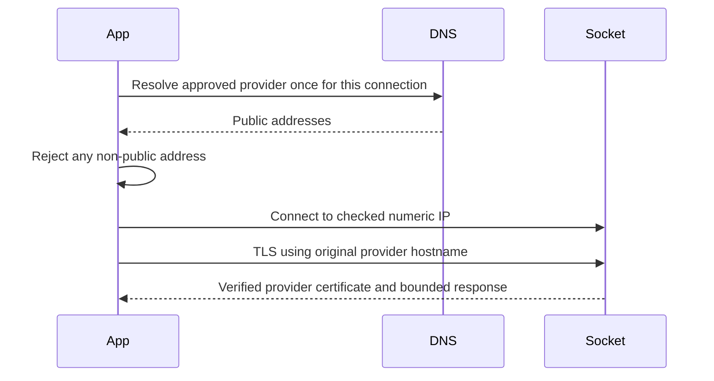
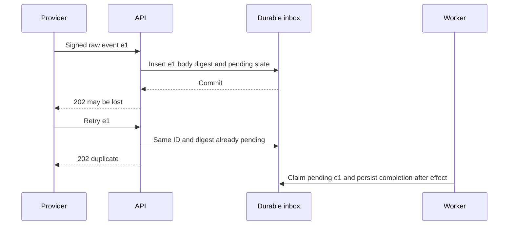

# 11 - API Security

<!-- length-justification: This is the canonical FastAPI endpoint-security survey; object, function, and property authorization, abuse controls, browser boundaries, SSRF, uploads, and audit evidence remain together because reviews must trace one request through all of them. -->

> **Who this is for**: FastAPI engineers who already authenticate callers and need to enforce authorization and abuse controls at each endpoint boundary.

> **Purpose**: Build FastAPI endpoints that refuse the wrong caller, the wrong object, the wrong field, the wrong origin, the wrong cost, and the wrong evidence trail by default.

> **Key insight**: Authentication supplies a principal; security is the repeated decision that binds that principal to this operation, object, property, state, and resource budget.

For a framework-neutral threat model and review checklist, see **[REST API Security](../../apis/restful/08_security.md)**. For callback-specific signing and SSRF controls, see **[Webhook Signatures, Security, and SSRF](../../apis/webhooks/04_signatures_security_and_ssrf.md)**.

Authentication answers "who is calling?" That is necessary, but it is not API security.

Production API security is the set of decisions every endpoint makes after identity exists:

1. Can this principal call this function?
2. Can this principal act on this object?
3. Can this principal set or see this property?
4. Can this request abuse resources, cost, or business workflows?
5. Can we prove what happened later without leaking secrets now?

OWASP's API Security Top 10 puts broken object-level authorization, broken authentication, broken object-property authorization, unrestricted resource consumption, and broken function-level authorization at the top because most API incidents are boring access-control failures. The fix is not a magical middleware. It is a disciplined endpoint shape.

This guide complements [04 - Authentication & Security](04_authentication.md). That chapter covers JWTs, OAuth2, CORS, API keys, password hashing, and headers. This chapter covers the production layer around them.


## First result: one ticket mutation with recoverable evidence

Start with [auth_ticket_service.py](examples/auth_ticket_service.py), a complete SQLite/FastAPI lab,
and run the [shared local regression command](04_authentication.md#first-result-a-complete-local-boundary).
It creates ticket `42`, tenant `acme`, owner `alice` and a mutation budget of two. The authenticated
principal resolver is injected: chapter 04 tests credential validation, while this fixture changes
principals explicitly to test authorization without making fake headers into authentication.

Bob has `ticket:read:any`, `ticket:read` and `ticket:write`. Reading Alice's ticket succeeds, but
changing it returns 404 because Bob lacks write-any. Alice in another tenant also receives 404.
Alice in `acme` can update the title; attempting to send `owner` fails model validation. A later
principal refresh with no write capability returns 403. The resolver must derive current policy
from trusted state; if production caches token capabilities, define revocation latency explicitly.



The actual fixture holds one SQLite write transaction across authorization, budget decrement,
mutation and outbox insertion. A crash before commit leaves none of them changed. A crash after
commit loses the HTTP response but leaves the title and pending event recoverable in a new database
connection. The tests verify both cases; they do not claim an external broker delivered the event.
A relay retries using the stable event ID and the consumer deduplicates it. Add an idempotency key
before automatic client retries of a mutation, otherwise a lost response can consume another
credit. This budget counts committed mutations; external paid work instead needs reservation and
reconciliation of actual usage, with its own idempotent recovery protocol.

The remaining sections derive this operation's gates and then cover conditional browser, network,
webhook and upload integrations. SQLite's serialized writer is a local teaching boundary; a
production database needs equivalent row locks/conditional updates and the documented isolation
level, with policy revocation and concurrent membership updates tested explicitly.

---

## 1. The Security Decision Stack

Think of an endpoint as a stack of gates:

```text
request
  -> authenticate caller
  -> authorize function
  -> load object through tenant/owner/member scope
  -> authorize object relationship
  -> authorize writable/readable properties
  -> validate payload and external data
  -> apply rate, quota, and abuse controls
  -> execute
  -> filter response
  -> audit sensitive outcome
```

If a gate is missing, the endpoint is probably relying on hope.

| Gate | Question | Common failure |
|------|----------|----------------|
| Authentication | Who is this? | Accepting invalid, expired, wrong-audience tokens |
| Function authorization | May this caller use this route? | Any user can call admin or support endpoints |
| Object authorization | May this caller access this row/blob/job? | IDOR/BOLA: changing `{id}` accesses another user's object |
| Property authorization | May this caller set/read this field? | Mass assignment, leaking `password_hash`, exposing internal status |
| Abuse control | Is this use allowed at this rate/cost? | Account takeover attempts, ticket hoarding, LLM bill spikes |
| Auditability | Can we reconstruct sensitive events? | No actor, target, decision, request ID, or denial signal |

### AuthN, AuthZ, and auditability

Keep the concepts separate:

| Concept | Answers | Stored where |
|---------|---------|--------------|
| Authentication | "Who are you?" | Token/session/API key validation |
| Authorization | "What are you allowed to do now?" | Policy code, database relationships, entitlements |
| Auditability | "What happened, by whom, to what, and why was it allowed or denied?" | Structured logs/audit table/security events |

Do not hide authorization inside "get current user" unless every endpoint has exactly the same permissions. Real systems rarely do.

---

## 2. Principal Model

Give authorization code one clear object to reason about. A principal can represent a human user, an API client, a service account, or a background worker.

```python
from dataclasses import dataclass
from enum import StrEnum


class PrincipalKind(StrEnum):
    USER = "user"
    API_CLIENT = "api_client"
    SERVICE = "service"


@dataclass(frozen=True)
class Principal:
    id: str
    kind: PrincipalKind
    tenant_id: str | None
    roles: frozenset[str]
    capabilities: frozenset[str]
    token_id: str | None = None

    def has(self, capability: str) -> bool:
        return capability in self.capabilities
```

Prefer capabilities in endpoint code:

```text
ticket:read
ticket:write
ticket:delete
ticket:assign
admin:user:disable
webhook:deliver
```

Roles are useful for administration, but endpoint checks should usually ask for capabilities. Roles such as `admin`, `support`, and `billing_manager` can compile into capabilities at login or during token introspection.

Why capabilities help:

- They are specific enough for code review.
- They avoid `if role == "admin"` spreading across the app.
- They work for users, API clients, and service accounts.
- They are easy to document in OpenAPI and audit logs.

---

## 3. Deny by Default in FastAPI

Use dependencies to make security visible at the route boundary.

```python
from typing import Annotated

from fastapi import Depends, HTTPException, status


async def get_principal() -> Principal:
    """Authenticate a JWT, API key, or service token and return one Principal."""
    ...


CurrentPrincipal = Annotated[Principal, Depends(get_principal)]


def require_capability(capability: str):
    async def dependency(principal: CurrentPrincipal) -> Principal:
        if not principal.has(capability):
            raise HTTPException(
                status_code=status.HTTP_403_FORBIDDEN,
                detail="Insufficient permissions",
            )
        return principal

    return dependency
```

Endpoint:

```python
from typing import Annotated

from fastapi import APIRouter, Depends


router = APIRouter(prefix="/tickets", tags=["tickets"])


@router.post("")
async def create_ticket(
    body: TicketCreate,
    principal: Annotated[Principal, Depends(require_capability("ticket:write"))],
):
    ...
```

Router-level dependency for an admin surface:

```python
admin_router = APIRouter(
    prefix="/admin",
    tags=["admin"],
    dependencies=[Depends(require_capability("admin:access"))],
)
```

FastAPI's `Security()` and OAuth2 scopes are useful when your auth model is scope-based and you want OpenAPI to show required scopes:

```python
from typing import Annotated

from fastapi import Security


@router.get("/me")
async def read_me(
    principal: Annotated[Principal, Security(get_principal, scopes=["profile:read"])],
):
    ...
```

But scopes are still just strings from a credential. You must enforce the real business policy in code and database queries.

---

## 4. Object-Level Authorization: BOLA and IDOR

Broken Object Level Authorization (BOLA), also called IDOR in many codebases, happens when an endpoint accepts an object identifier and forgets to prove the caller can use that object.

```text
GET /tickets/ticket_123
GET /tickets/ticket_124  # should this caller see it?
```

The vulnerable pattern:

```python
@router.get("/tickets/{ticket_id}")
async def get_ticket(ticket_id: str, principal: CurrentPrincipal, db: AsyncSession):
    ticket = await db.get(Ticket, ticket_id)
    if ticket is None:
        raise HTTPException(404, "Ticket not found")
    return ticket
```

The endpoint authenticated the user but never scoped the object.

### Scope the query, not just the `if`

Prefer loading the object through the authorization boundary:

```python
from sqlalchemy import select
from sqlalchemy.ext.asyncio import AsyncSession


async def get_ticket_for_action(
    db: AsyncSession,
    *,
    ticket_id: str,
    principal: Principal,
    action: str,  # server-selected "read" or "write", never taken from the request
) -> Ticket | None:
    if action not in {"read", "write"}:
        raise ValueError("unsupported ticket action")
    if principal.tenant_id is None or not principal.has(f"ticket:{action}"):
        return None

    stmt = select(Ticket).where(
        Ticket.id == ticket_id,
        Ticket.tenant_id == principal.tenant_id,
    )
    if not principal.has(f"ticket:{action}:any"):
        stmt = stmt.where(Ticket.owner_id == principal.id)

    return await db.scalar(stmt)
```

The action is part of the scope: `ticket:read:any` expands visibility within the tenant but grants
no mutation or upload privilege. A write needs `ticket:write` and either ownership or the separate
`ticket:write:any`. Tenant boundaries still apply to both. If ownership/state can change during a
write, lock the row or put the authorization predicate into the mutation transaction and check its
row count; a stale earlier read is not a permanent grant.

Then the endpoint has one decision:

```python
@router.get("/tickets/{ticket_id}", response_model=TicketRead)
async def read_ticket(
    ticket_id: str,
    principal: Annotated[Principal, Depends(require_capability("ticket:read"))],
    db: AsyncSession = Depends(get_db),
):
    ticket = await get_ticket_for_action(db, ticket_id=ticket_id, principal=principal, action="read")
    if ticket is None:
        raise HTTPException(status_code=404, detail="Ticket not found")
    return ticket
```

Why return `404`? For many user-owned resources, revealing that another user's object exists is itself a leak. Use `403` when the caller is allowed to know the object exists but cannot perform this action, such as an admin console showing a disabled button.

### Tenant checks are not optional

Every multi-tenant table should have a tenant boundary in the query:

```sql
WHERE id = :id
  AND tenant_id = :principal_tenant_id
```

Do not rely on globally unique IDs as the access control. UUIDs reduce guessing; they do not authorize access.

### Relationship checks beat role checks

This is weak:

```python
if "user" in principal.roles:
    return ticket
```

This is meaningful:

```python
if ticket.owner_id == principal.id:
    return ticket

if await is_project_member(db, project_id=ticket.project_id, user_id=principal.id):
    return ticket

raise HTTPException(404, "Ticket not found")
```

Authorization is usually about the relationship between subject, object, action, and context:

```text
subject: principal u_123
object: ticket t_456 in tenant acme
action: ticket:write
context: project membership, plan, object state, time, MFA freshness
```

---

## 5. Function-Level Authorization

Function-level authorization asks whether the caller can invoke the route at all.

Risky examples:

```text
POST /admin/users/{user_id}/disable
POST /billing/plans/{plan_id}/activate
POST /reports/{report_id}/rerun
POST /support/impersonate
```

Rules:

- Put admin/support/internal routes in separate routers.
- Require an explicit capability on every mutating route.
- Never expose internal routes just because the UI does not link to them.
- Keep service-to-service permissions separate from human permissions.
- Require step-up authentication for highly sensitive actions when the product needs it.

Example:

```python
@admin_router.post("/users/{user_id}/disable", status_code=204)
async def disable_user(
    user_id: str,
    principal: Annotated[
        Principal,
        Depends(require_capability("admin:user:disable")),
    ],
    db: AsyncSession = Depends(get_db),
):
    await audit(db, principal, action="admin:user:disable", target_id=user_id)
    await users.disable(db, user_id=user_id)
```

Avoid this:

```python
if principal.roles:
    ...
```

Non-empty roles do not mean permission.

---

## 6. Object-Property Authorization

Object-property authorization asks which fields the caller may set or see.

Two classic bugs live here:

- **Over-posting / mass assignment**: client sends a field you did not intend to make writable.
- **Excessive data exposure**: server returns fields the caller should not see.

### Use separate request models

Do not accept your ORM model or domain object as input. Create DTO-style Pydantic models for each command.

```python
from pydantic import BaseModel, ConfigDict, Field


class TicketCreate(BaseModel):
    model_config = ConfigDict(extra="forbid")

    title: str = Field(min_length=1, max_length=200)
    description: str = Field(max_length=10_000)
    project_id: str


class TicketPatch(BaseModel):
    model_config = ConfigDict(extra="forbid")

    title: str | None = Field(default=None, min_length=1, max_length=200)
    description: str | None = Field(default=None, max_length=10_000)


class TicketAdminPatch(BaseModel):
    model_config = ConfigDict(extra="forbid")

    status: str | None = None
    priority: str | None = None
    assignee_id: str | None = None
```

`extra="forbid"` turns surprise input into a 422 instead of silently ignoring it. That is useful for security-sensitive APIs because it catches clients attempting fields such as `is_admin`, `tenant_id`, `owner_id`, or `price_cents`.

### Assign fields explicitly

Avoid this:

```python
# Dangerous if body contains fields you did not intend to bind.
for key, value in body.model_dump().items():
    setattr(ticket, key, value)
```

Do this:

```python
@router.patch("/tickets/{ticket_id}", response_model=TicketRead)
async def patch_ticket(
    ticket_id: str,
    body: TicketPatch,
    principal: Annotated[Principal, Depends(require_capability("ticket:write"))],
    db: AsyncSession = Depends(get_db),
):
    ticket = await get_ticket_for_action(db, ticket_id=ticket_id, principal=principal, action="write")
    if ticket is None:
        raise HTTPException(404, "Ticket not found")

    changes = body.model_dump(exclude_unset=True)

    if "title" in changes:
        ticket.title = changes["title"]
    if "description" in changes:
        ticket.description = changes["description"]

    await db.commit()
    return ticket
```

For response leaks, always use a response model:

```python
class TicketRead(BaseModel):
    id: str
    title: str
    description: str
    status: str


@router.get("/tickets/{ticket_id}", response_model=TicketRead)
async def read_ticket(
    ticket_id: str,
    principal: Annotated[Principal, Depends(require_capability("ticket:read"))],
    db: AsyncSession = Depends(get_db),
):
    ticket = await get_ticket_for_action(db, ticket_id=ticket_id, principal=principal, action="read")
    if ticket is None:
        raise HTTPException(404, "Ticket not found")
    return ticket  # FastAPI projects only the declared public fields.
```

Response models are a safety net, not a substitute for correct queries. Do not query columns the caller should never touch if you can avoid it.

---

## 7. Browser Boundaries: CORS, CSRF, Cookies, Bearer Tokens

CORS is not authorization. It is a browser rule that decides whether frontend JavaScript may read a cross-origin response.

Server-to-server clients, curl, mobile apps, and attackers' scripts are not stopped by CORS.

### If the browser sends credentials automatically, think CSRF

Cookies are sent by the browser according to cookie rules. If a cookie authenticates a state-changing request, a malicious site may be able to trigger that request from the victim's browser unless you add CSRF defenses.

For cookie-backed sessions or refresh-token cookies:

- Use `Secure`, `HttpOnly`, and `SameSite=Lax` or `SameSite=Strict` where the product allows it.
- Prefer `__Host-` cookies for host-only secure cookies.
- Validate CSRF tokens or origin/fetch metadata on state-changing requests.
- Never put state changes behind `GET`.
- Keep CORS origins explicit.

```python
from fastapi import Response


def set_refresh_cookie(response: Response, token: str) -> None:
    response.set_cookie(
        key="__Host-refresh_token",
        value=token,
        httponly=True,
        secure=True,
        samesite="lax",
        path="/",
        max_age=60 * 60 * 24 * 7,
    )
```

If access tokens are sent in an `Authorization: Bearer ...` header controlled by JavaScript, classic CSRF is less direct because another site cannot force the browser to add that header. XSS becomes more important: injected JavaScript can read in-memory tokens, call APIs, and bypass CSRF tokens.

### CORS configuration

```python
from fastapi import FastAPI
from fastapi.middleware.cors import CORSMiddleware


app = FastAPI()

app.add_middleware(
    CORSMiddleware,
    allow_origins=["https://app.example.com"],
    allow_credentials=True,
    allow_methods=["GET", "POST", "PATCH", "DELETE"],
    allow_headers=["Authorization", "Content-Type", "X-CSRF-Token"],
    expose_headers=["Request-Id", "Retry-After"],
)
```

Rules:

- Do not use `allow_origins=["*"]` with credentials.
- Do not reflect arbitrary `Origin` values.
- Do not rely on CORS for API clients that are not browsers.
- Treat `localhost` and preview deployments as explicit environment config, not production defaults.

---

## 8. Rate Limits, Quotas, Cost Controls, and Business Abuse

Rate limiting is about throughput. Abuse control is broader.

| Control | Protects | Example |
|---------|----------|---------|
| IP rate limit | Edge and anonymous endpoints | Login attempts per IP |
| Principal rate limit | Fairness between users/clients | 600 requests/minute per API key |
| Endpoint limit | Hot routes | 10 export jobs/hour |
| Concurrency limit | Worker and DB saturation | 2 active report runs per tenant |
| Quota | Product entitlement or cost budget | 1M tokens/month |
| Business-flow guard | Scarce or sensitive workflows | Ticket purchase, invite spam, password reset |

For FastAPI, put simple per-principal controls in dependencies. Put high-volume global enforcement at the API gateway, load balancer, Redis, or a dedicated rate-limit service.

```python
from typing import Annotated

from fastapi import Depends, HTTPException, status
from redis.asyncio import Redis


async def require_request_budget(
    principal: CurrentPrincipal,
    redis: Annotated[Redis, Depends(get_redis)],
) -> Principal:
    key = f"rate:v1:{principal.kind}:{principal.id}:minute"
    count = await redis.incr(key)
    if count == 1:
        await redis.expire(key, 60)

    if count > 600:
        raise HTTPException(
            status_code=status.HTTP_429_TOO_MANY_REQUESTS,
            detail="Rate limit exceeded",
            headers={"Retry-After": "60"},
        )

    return principal
```

The `INCR` + `EXPIRE` shape is teachable, but production limiters should use atomic Lua scripts or a library so the increment, TTL, and metadata are updated as one operation.

Cost controls are especially important for LLM, email, SMS, payment, and report-generation endpoints:

- Reserve budget before expensive work starts.
- Reconcile actual cost after the call completes.
- Cap retries with retry budgets.
- Reject or queue work when a tenant exceeds plan limits.
- Audit who triggered expensive operations.

See the Safe API Calls guides for admission control, idempotency, and token economics.

---

## 9. SSRF Defenses

Server-Side Request Forgery (SSRF) appears when your API fetches a URL supplied by a caller:

```text
POST /imports
{"url": "https://example.com/feed.json"}
```

The dangerous version lets a caller make your server request internal services:

```text
http://169.254.169.254/
http://localhost:8000/admin
http://10.0.0.5:5432/
file:///etc/passwd
```

Rules:

- Prefer IDs or provider names over arbitrary URLs.
- Use an allowlist of trusted hosts whenever possible.
- Allow only `https` unless there is a specific reason.
- Reject IP literals, private networks, loopback, link-local, multicast, and reserved ranges.
- Resolve DNS and validate every address.
- Disable redirects or revalidate every redirect target.
- Set short timeouts and small response-size limits.
- Use network egress controls so the app cannot reach metadata services or private networks even if code misses something.

### Validate at the socket boundary

Resolving a hostname, checking the result, then calling ordinary HTTPX with the original hostname
is insufficient: the HTTP client can resolve it again and connect to a different address. That
check/connect gap is DNS rebinding. Blocking `socket.getaddrinfo` also must not run directly on the
async event loop.

The complete [auth_egress.py](examples/auth_egress.py) uses HTTPCore 1.0.9's network-backend hook.
It resolves asynchronously inside `connect_tcp`, rejects the entire answer set if any address is
non-public, and passes an approved **numeric IP** to the real backend. HTTPCore retains the
original URL hostname for TLS SNI, certificate validation and the HTTP Host header. There is no
second hostname lookup between the check and connection. [HTTPCore network backends](https://www.encode.io/httpcore/network-backends/).

```python
from auth_egress import fetch_import_source

body = await fetch_import_source(
    "https://api.github.com/repos/encode/httpcore",
    allowed_hosts={"api.github.com"},
)
```

Copy the local module beside the importer. It rejects userinfo, non-443 ports, unapproved hosts and
fragments, preserves TLS verification, follows no redirects, applies a ten-second total deadline
plus phase timeouts, accepts identity encoding only, and enforces a one-megabyte body budget.
The one-address strategy fails closed if that address cannot connect; an availability enhancement
can try other **already checked** addresses within the same total budget. Recheck policy on each
new connection; a connection pool is not a license to reuse a connection after policy changes.



The numeric connect closes the race; TLS still proves the provider identity. Production also needs
egress policy denying internal/metadata destinations, a trusted resolver, request and decompression
budgets, and authorized interpretation of fetched data. The local fixture tests DNS changes and
connection arguments without contacting providers; it does not certify the deployment firewall or
live certificate chain. Rehearse those integration boundaries in the deployed environment.

---

## 10. Webhook Verification

Webhook endpoints are public by design. They must authenticate the sender without relying on IP addresses alone.

Most providers use the same pattern:

1. Provider signs the raw request body with an HMAC secret.
2. Provider sends the signature in a header.
3. Your endpoint reads the raw body bytes.
4. Your endpoint computes the expected signature.
5. Your endpoint compares signatures with constant-time comparison.
6. Your endpoint checks a timestamp/replay window when the provider includes one.
7. Your endpoint deduplicates event IDs.

Generic HMAC verifier:

```python
import hashlib
import hmac
import time
import re

from fastapi import Header, HTTPException, Request, status


WEBHOOK_SECRET = b"load-from-secret-manager"
MAX_SKEW_SECONDS = 300


def _expected_signature(timestamp: str, body: bytes) -> str:
    signed_payload = timestamp.encode("utf-8") + b"." + body
    digest = hmac.new(WEBHOOK_SECRET, signed_payload, hashlib.sha256).hexdigest()
    return f"sha256={digest}"


async def verify_webhook(
    request: Request,
    x_webhook_signature: str | None = Header(default=None),
    x_webhook_timestamp: str | None = Header(default=None),
) -> bytes:
    if not x_webhook_signature or not x_webhook_timestamp:
        raise HTTPException(status.HTTP_401_UNAUTHORIZED, "Missing webhook signature")

    if (not re.fullmatch(r"[0-9]{1,12}", x_webhook_timestamp)
            or not re.fullmatch(r"sha256=[0-9a-f]{64}", x_webhook_signature)):
        raise HTTPException(status.HTTP_401_UNAUTHORIZED, "Malformed webhook signature")
    timestamp = int(x_webhook_timestamp)

    if abs(time.time() - timestamp) > MAX_SKEW_SECONDS:
        raise HTTPException(status.HTTP_401_UNAUTHORIZED, "Webhook timestamp is too old")

    chunks, size = [], 0
    async for chunk in request.stream():
        size += len(chunk)
        if size > 1_000_000:
            raise HTTPException(413, "Webhook body too large")
        chunks.append(chunk)
    body = b"".join(chunks)
    expected = _expected_signature(x_webhook_timestamp, body)
    if not hmac.compare_digest(expected, x_webhook_signature):
        raise HTTPException(status.HTTP_401_UNAUTHORIZED, "Invalid webhook signature")

    return body
```

### Commit durable acceptance before acknowledging

The authenticated event ID lives **inside the signed body**. A record-once flag followed by a
separate broker enqueue loses work if the process crashes between them: retry sees the flag and
never enqueues. Make the inbox row itself durable pending work, or insert inbox plus outbox in one
database transaction.

The local [auth_inbox.py](examples/auth_inbox.py) provides an actual SQLite pending inbox. Initialize
its schema once at startup on durable storage; a separate worker polls/claims pending rows:

```python
import os
from typing import Annotated
from fastapi import Depends
from pydantic import BaseModel, Field, ValidationError
from auth_inbox import admit, initialize

INBOX_PATH = os.environ["WEBHOOK_INBOX_PATH"]
initialize(INBOX_PATH)  # application startup; use migrations for a production database


class EventIdentity(BaseModel):
    id: str = Field(min_length=1, max_length=200)


@router.post("/webhooks/acme", status_code=202)
def receive_acme_webhook(body: Annotated[bytes, Depends(verify_webhook)]):
    try:
        event = EventIdentity.model_validate_json(body)
    except ValidationError:
        raise HTTPException(400, "Invalid event envelope") from None
    try:
        inserted = admit(INBOX_PATH, "acme:configured-account", event.id, body)
    except ValueError:
        raise HTTPException(409, "Event identity conflicts with stored body") from None
    return {"status": "accepted" if inserted else "duplicate"}
```

The synchronous route runs SQLite outside the event loop. Scope the provider/account key from the
verified signing registration, not a caller-selected tenant header. Uniqueness plus a body digest
rejects the same authenticated ID with conflicting content. A duplicate pending row remains work;
202 means committed acceptance, not completed business processing. Before commit, a crash rolls
back and the provider can retry. After commit, a lost response produces a safe duplicate. Worker
claims, retries and completion must be durable, with idempotent effects or an outbox when delivery
crosses another system; see [long-running task recovery](../../architecture/long_running_tasks/05_advanced_patterns.md).



The worker does not depend on the HTTP process surviving after commit. The
[local regression command](04_authentication.md#first-result-a-complete-local-boundary) injects a crash before
commit, reopens the database, retries, and checks that only one pending row survives.

Rules:

- Verify before JSON parsing or business logic.
- Use the exact raw body bytes; re-encoding JSON breaks signatures.
- Store webhook secrets in a secret manager.
- Rotate secrets with an overlap window when the provider supports it.
- Deduplicate with a unique key such as `(provider, event_id)`.
- Return quickly; process in a job.
- Make handlers idempotent because providers retry.

---

## 11. File Upload Safety

`UploadFile` makes uploads convenient. It does not make uploaded content trustworthy.

Risks:

- Huge files exhaust memory, disk, or object storage.
- Content-Type and filename are attacker-controlled.
- Images, PDFs, Office docs, SVGs, ZIPs, and archives can carry parser exploits or active content.
- Public downloads can become stored XSS, malware hosting, or data leakage.

Rules:

- Enforce size limits at the reverse proxy and application.
- Require authentication and object-level authorization before accepting the file.
- Allowlist extensions and expected media types.
- Treat `UploadFile.content_type` as a hint, not proof.
- Generate storage names; do not trust user filenames.
- Store outside the app server filesystem when possible, usually private object storage.
- Scan or sandbox before making files available.
- Serve downloads through an authorization check or short-lived signed URL.

Streaming size guard:

```python
from pathlib import Path
from typing import Annotated
from uuid import uuid4

from fastapi import Depends, File, HTTPException, UploadFile, status


MAX_UPLOAD_BYTES = 10 * 1024 * 1024
ALLOWED_EXTENSIONS = {".png", ".jpg", ".jpeg", ".pdf"}


def safe_extension(filename: str) -> str:
    suffix = Path(filename).suffix.lower()
    if suffix not in ALLOWED_EXTENSIONS:
        raise HTTPException(status.HTTP_415_UNSUPPORTED_MEDIA_TYPE, "File type not allowed")
    return suffix


@router.post("/tickets/{ticket_id}/attachments", status_code=201)
async def upload_attachment(
    ticket_id: str,
    upload: Annotated[UploadFile, File()],
    principal: Annotated[Principal, Depends(require_capability("ticket:write"))],
    db: AsyncSession = Depends(get_db),
):
    ticket = await get_ticket_for_action(db, ticket_id=ticket_id, principal=principal, action="write")
    if ticket is None:
        raise HTTPException(404, "Ticket not found")

    suffix = safe_extension(upload.filename or "")
    storage_key = f"attachments/{ticket_id}/{uuid4().hex}{suffix}"

    total = 0
    async with object_storage_writer(storage_key) as writer:
        while chunk := await upload.read(1024 * 1024):
            total += len(chunk)
            if total > MAX_UPLOAD_BYTES:
                raise HTTPException(status.HTTP_413_REQUEST_ENTITY_TOO_LARGE, "File too large")
            await writer.write(chunk)

    await mark_attachment_pending_scan(db, ticket_id=ticket_id, storage_key=storage_key)
    return {"id": storage_key, "status": "pending_scan"}
```

Do not publish the object until the scanner/validator marks it safe for the intended use.

---

## 12. Secrets Handling

Secrets include API keys, OAuth client secrets, JWT signing keys, webhook secrets, database passwords, encryption keys, and service account credentials.

Rules:

- Do not commit secrets.
- Use `.env` only for local development.
- Use a secret manager in deployed environments.
- Inject secrets at runtime; do not bake them into images.
- Redact secrets from logs, traces, exceptions, and metrics.
- Rotate secrets and design for overlap where possible.
- Prefer short-lived workload identity over long-lived cloud keys in CI/CD.

JWT and webhook rotation often need multiple active keys:

```python
from dataclasses import dataclass


@dataclass(frozen=True)
class SigningKey:
    kid: str
    secret: str
    active: bool


class KeyRing:
    def __init__(self, keys: list[SigningKey]) -> None:
        self._by_kid = {key.kid: key for key in keys}
        self._active = next(key for key in keys if key.active)

    @property
    def active(self) -> SigningKey:
        return self._active

    def get(self, kid: str) -> SigningKey | None:
        return self._by_kid.get(kid)
```

Rotation shape:

1. Add new key as active signer.
2. Keep old key as verifier until old tokens/webhook retries expire.
3. Remove old key after the maximum token lifetime plus clock skew.

---

## 13. Safe Error Responses

Good errors help clients recover without teaching attackers your internals.

Do not expose:

- Stack traces.
- SQL text or database constraint internals.
- Token claims.
- Authorization policy details.
- Internal hostnames, URLs, bucket names, or provider request IDs unless they are meant for support.
- Full upstream error bodies from vendors.

Use the same error envelope from [07 - Error Responses](07_error_handling.md):

```json
{
  "code": "FORBIDDEN",
  "message": "Insufficient permissions",
  "request_id": "req_abc123"
}
```

Status-code guidance:

| Situation | Status |
|-----------|--------|
| Missing/invalid credentials | `401 Unauthorized` |
| Valid credentials, action forbidden | `403 Forbidden` |
| Object hidden or not found | `404 Not Found` |
| Payload invalid for API contract | `422 Unprocessable Content` |
| Rate/quota exceeded | `429 Too Many Requests` |
| Suspicious but syntactically valid webhook | `401` or `403` |

Log internal details server-side with a request ID. Return the request ID to the client.

---

## 14. Third-Party API Consumption

OWASP calls this "Unsafe Consumption of APIs": teams often validate user input carefully, then blindly trust provider responses.

Treat upstream responses as untrusted input.

Rules:

- Use timeouts and response-size limits.
- Validate `Content-Type` before parsing.
- Parse into strict Pydantic models.
- Reject unknown enum values deliberately.
- Do not relay upstream error bodies directly to clients.
- Do not store or execute provider-supplied URLs without SSRF checks.
- Pin webhook/provider API versions when the provider supports it.
- Track provider request IDs in logs, not user-visible errors by default.

```python
from pydantic import BaseModel, ConfigDict, Field, ValidationError


class VendorUser(BaseModel):
    model_config = ConfigDict(extra="forbid")

    id: str
    email: str
    status: str = Field(pattern="^(active|disabled)$")


async def load_vendor_user(client: httpx.AsyncClient, user_id: str) -> VendorUser:
    response = await client.get(f"https://vendor.example/users/{user_id}")
    response.raise_for_status()

    if response.headers.get("content-type", "").split(";")[0] != "application/json":
        raise VendorProtocolError("Vendor returned non-JSON response")

    try:
        return VendorUser.model_validate(response.json())
    except ValidationError as exc:
        raise VendorProtocolError("Vendor response did not match expected schema") from exc
```

The caller should see a stable `502 Bad Gateway` or `503 Service Unavailable`, not a provider stack trace.

---

## 15. Security Observability

Security controls need evidence. An audit log is not the same thing as a debug log.

Audit security-sensitive events:

- Login success/failure and MFA changes.
- Token refresh, revocation, suspicious reuse.
- API key creation, last use, scope changes, deletion.
- Authorization denials for sensitive resources.
- Admin/support actions.
- Tenant plan, entitlement, billing, and ownership changes.
- Webhook verification failures and duplicate event IDs.
- File upload accepted, rejected, scanned, published.
- Quota exceeded, burst limited, abuse rules triggered.
- Secret/key rotation.

Event shape:

```python
from datetime import datetime, timezone
from typing import Any

from pydantic import BaseModel, Field


class AuditEvent(BaseModel):
    occurred_at: datetime = Field(default_factory=lambda: datetime.now(timezone.utc))
    event_type: str
    actor_id: str | None
    actor_kind: str | None
    tenant_id: str | None
    target_type: str | None
    target_id: str | None
    action: str
    decision: str
    request_id: str
    ip_hash: str | None = None
    metadata: dict[str, Any] = Field(default_factory=dict)
```

Do not log raw access tokens, refresh tokens, API keys, passwords, full session IDs, payment data, or unnecessary PII. Hash identifiers such as IP addresses when exact values are not needed.

Alert examples:

```text
High-severity:
- Many authorization denials across many object IDs by the same principal.
- Refresh token reuse detected.
- Admin capability used from unusual geography or device.
- Sudden spike in webhook signature failures.
- Tenant exceeds normal LLM/SMS/payment spend rate.

Medium-severity:
- Repeated 413 upload rejections.
- Many 404s over sequential-looking object IDs.
- API key calling endpoints outside its normal pattern.
```

Logs are part of the security boundary. Restrict who can read them and monitor log access.

---

## 16. Testing Security

Security tests should be ordinary automated tests, not a once-a-year ritual.

### Authorization matrix tests

For every important endpoint, test at least:

| Case | Expected |
|------|----------|
| Anonymous caller | `401` |
| Authenticated user without capability | `403` |
| User with capability, wrong tenant | `404` or `403` by policy |
| User with capability, not object member/owner | `404` or `403` by policy |
| User with capability and relationship | Success |
| Admin/support role | Success only for documented actions |

Example:

```python
import pytest


@pytest.mark.parametrize(
    ("user_fixture", "ticket_fixture", "expected_status"),
    [
        ("alice", "alice_ticket", 200),
        ("alice", "bob_ticket", 404),
        ("alice", "other_tenant_ticket", 404),
        ("viewer_without_ticket_read", "alice_ticket", 403),
    ],
)
async def test_ticket_read_authorization(
    async_client,
    request,
    user_fixture,
    ticket_fixture,
    expected_status,
):
    user = request.getfixturevalue(user_fixture)
    ticket = request.getfixturevalue(ticket_fixture)

    response = await async_client.get(
        f"/tickets/{ticket.id}",
        headers=auth_headers(user),
    )

    assert response.status_code == expected_status
```

### Property tests

```python
async def test_user_cannot_mass_assign_admin_fields(async_client, alice):
    response = await async_client.patch(
        "/users/me",
        headers=auth_headers(alice),
        json={"display_name": "Alice", "is_admin": True, "tenant_id": "other"},
    )

    assert response.status_code == 422
```

### Abuse and boundary tests

Add tests for:

- CSRF failure on cookie-backed state changes.
- CORS preflight for allowed and disallowed origins.
- Rate limit returns `429` and `Retry-After`.
- Webhook invalid signature, old timestamp, replayed event ID.
- SSRF blocks localhost, private IPs, metadata IP, non-HTTPS, redirect to blocked host.
- Upload rejects bad extension, oversized stream, and unauthorized object.
- Vendor response schema mismatch becomes `502` or your chosen upstream error.

---

## 17. Endpoint Security Checklist

Use this before merging a new endpoint:

- [ ] Route has an explicit authentication story.
- [ ] Route has an explicit capability/function-level check.
- [ ] Object IDs are loaded through tenant/owner/member scope.
- [ ] Cross-tenant and other-user access tests exist.
- [ ] Request model is separate from ORM/domain model.
- [ ] Request model rejects unexpected fields when appropriate.
- [ ] Response model excludes sensitive fields.
- [ ] Unsafe actions do not use `GET`.
- [ ] Cookie-backed state changes have CSRF protection.
- [ ] CORS origins are explicit and environment-specific.
- [ ] Rate/quota/cost control exists for expensive or abusable routes.
- [ ] `POST` retries are safe through idempotency keys where needed.
- [ ] Webhooks verify raw body signatures and deduplicate event IDs.
- [ ] URL-fetching code has SSRF defenses and egress restrictions.
- [ ] File uploads enforce size, type, authorization, storage, and scanning rules.
- [ ] Secrets are not logged, committed, embedded in images, or returned in errors.
- [ ] Upstream API responses are validated before use.
- [ ] Security-sensitive outcomes emit audit events.
- [ ] Error responses do not leak internals.
- [ ] Tests cover denial paths, not only successful paths.

---

## References

- [OWASP API Security Top 10 2023](https://owasp.org/API-Security/editions/2023/en/0x11-t10/)
- [OWASP Authorization Cheat Sheet](https://cheatsheetseries.owasp.org/cheatsheets/Authorization_Cheat_Sheet.html)
- [OWASP Mass Assignment Cheat Sheet](https://cheatsheetseries.owasp.org/cheatsheets/Mass_Assignment_Cheat_Sheet.html)
- [OWASP CSRF Prevention Cheat Sheet](https://cheatsheetseries.owasp.org/cheatsheets/Cross-Site_Request_Forgery_Prevention_Cheat_Sheet.html)
- [OWASP SSRF Prevention Cheat Sheet](https://cheatsheetseries.owasp.org/cheatsheets/Server_Side_Request_Forgery_Prevention_Cheat_Sheet.html)
- [OWASP File Upload Cheat Sheet](https://cheatsheetseries.owasp.org/cheatsheets/File_Upload_Cheat_Sheet.html)
- [OWASP Logging Cheat Sheet](https://cheatsheetseries.owasp.org/cheatsheets/Logging_Cheat_Sheet.html)
- [NIST Secure Software Development Framework](https://csrc.nist.gov/Projects/ssdf)
- [OAuth 2.0 Security Best Current Practice, RFC 9700](https://www.rfc-editor.org/rfc/rfc9700.html)
- [FastAPI OAuth2 scopes](https://fastapi.tiangolo.com/advanced/security/oauth2-scopes/)
- [GitHub webhook signature validation](https://docs.github.com/en/webhooks/using-webhooks/validating-webhook-deliveries)
- [Stripe webhook signature guidance](https://docs.stripe.com/webhooks/signature)

---

## Next

- [04 - Authentication & Security](04_authentication.md) - JWTs, OAuth2, CORS, API keys, and security headers.
- [07 - Error Responses](07_error_handling.md) - consistent error envelopes.
- [10 - API Design Conventions](10_api_design.md) - HTTP shape, pagination, and OpenAPI hygiene.
- [Safe API Calls / 11 - Idempotency Keys](safe_and_scalable_api_calls/11_idempotency.md) - safe retries for mutating operations.


## Retention and transfer

**Recap:** a trusted principal is the beginning of the decision. Bind function, action, tenant,
object, writable fields and cost before executing, then project the response and record evidence.
Network destination checks and durable acceptance must hold at the boundary where the effect occurs.

**Check yourself:** support has `ticket:read:any` and `ticket:write`. Can it attach a file to another
user's ticket in the same tenant?
<details><summary>Answer</summary>No. Read-any expands visibility only. Mutation needs ownership or
`ticket:write:any`, as well as base write authority; the tenant predicate still applies.</details>

**Try it:** the provider received no 202 after your database committed the event. Design what the
retry and worker see, then explain why an in-memory queue changes the answer.
<details><summary>Answer</summary>The retry finds the same ID/digest and acknowledges existing
pending work; the worker recovers it from the database. An in-memory queue can vanish after commit,
so a deduplication flag alone cannot guarantee processing.</details>
