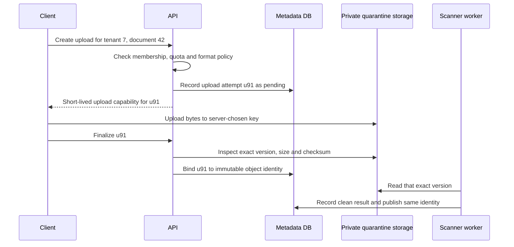
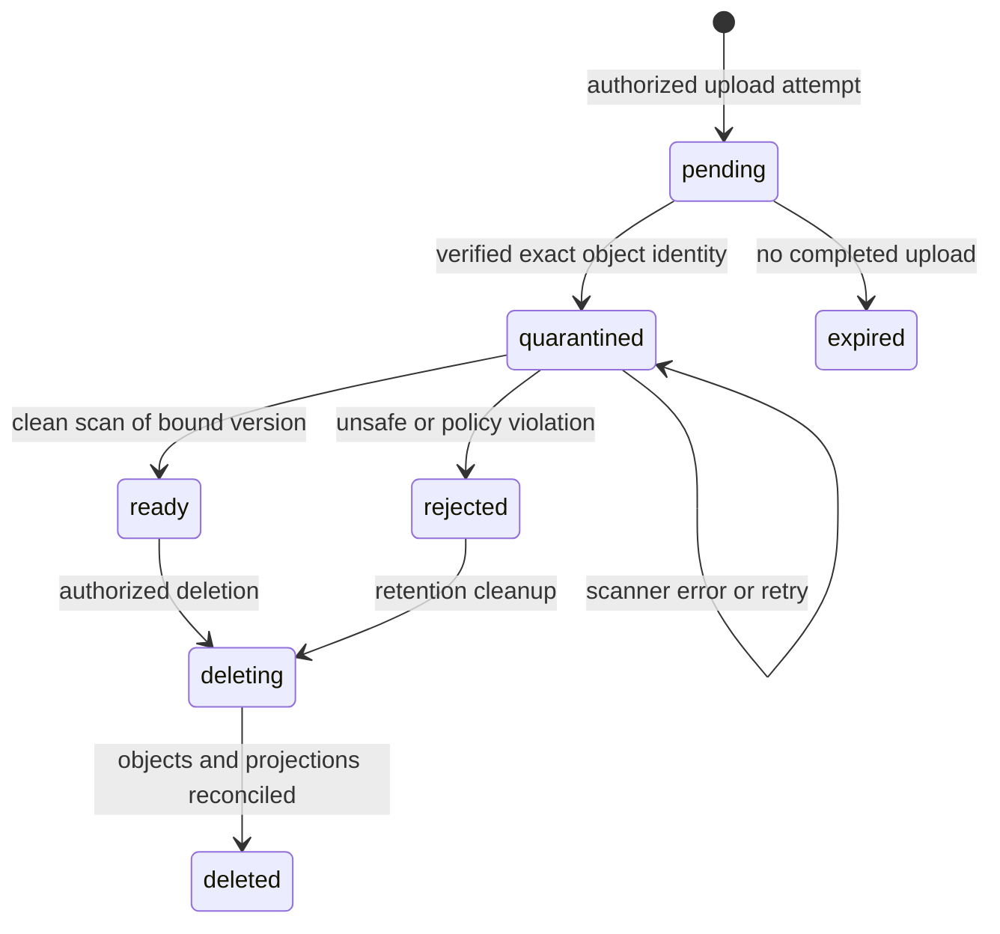

# Accept bytes without publishing unsafe documents

**Role: deep dive.** Read [HTTP mapping](01_http_and_parameter_mapping.md), [authentication and authorization](04_authentication.md), and [API security](11_api_security.md) first. Examples use Python 3.11+ and FastAPI's Starlette request model. Amazon S3 is the concrete object-storage example; an S3-compatible service must be tested for the exact signing, checksum, versioning and lifecycle features used.

Tenant 7 uploads document 42. Receiving all its bytes does not prove the document is safe, authorized for download, or even the same object a scanner will inspect later. Treat upload as a lifecycle: authorize an intended object, accept bytes into quarantine, inspect an immutable identity, then publish a database reference to that inspected version.

## First prove the byte boundary locally

The self-contained [quarantine example](examples/upload_quarantine.py) uses only Python's standard library. It writes chunks into a private temporary file, hashes the exact bytes, rejects input that exceeds a byte limit, and always closes the file. It never serves or parses the content. From the repository root:

```bash
python3 fundamentals/fastapi/examples/upload_quarantine.py
```

Expected output:

```text
accepted 6 bytes into quarantine
rejected 7 bytes at limit 6
disconnect did not publish a result
```

The six-byte case demonstrates that a limit is inclusive; the seventh byte is rejected before it is written. The exception case proves an interrupted source does not reach the accepted-result boundary. This is a byte-ingestion test, not a web server, virus scanner or durable-storage integration. Its temporary file is intentionally discarded; production durability and publication are developed below.

The important part of the algorithm is this **excerpt** from the complete file:

```python
size += len(chunk)
if size > limit:
    raise UploadTooLarge("upload exceeds configured byte limit")
staged.write(chunk)
digest.update(chunk)
```

Count actual bytes, not only `Content-Length`. A declared length is useful for early rejection, but may be absent and is controlled by the sender. A gateway and application must also bound duration, concurrency and temporary storage; a 20 MiB cap alone still permits 1,000 simultaneous requests to consume substantial disk and worker capacity.

## Choose whether the API carries the bytes

For a small internal attachment, routing through FastAPI keeps authorization and validation near the application. For large or numerous files, uploading directly to object storage avoids making application instances the bandwidth and buffering bottleneck. In both cases, the application owns metadata and authorization; object storage owns the bytes.

| Situation | Starting approach | What still needs enforcement |
|---|---|---|
| Small, infrequent attachments | FastAPI multipart `UploadFile` with gateway/parser/body limits | Actual size, temporary disk, scan and ownership |
| Raw streaming protocol under your control | `Request.stream()` into a bounded staging sink | Byte counting, disconnect cleanup, timeouts, backpressure |
| Large browser uploads | Authorized short-lived presigned POST/PUT into quarantine | Key scope, size policy, checksum, finalization and exact-version scan |
| Large resumable transfer | Object-store multipart upload with tracked upload ID | Part limits, completion checks and abort/expiry cleanup |

FastAPI `UploadFile` exposes a spooled file: small content can remain in memory and larger content spills to temporary disk. That helps memory use, but does not mean the file is arriving directly in your route chunk by chunk. Multipart parsing usually happens before the route receives the `UploadFile`. Reading it in chunks afterward does not undo parser memory/disk consumption. Bound request size at the ingress and enforce applicable parser limits for the installed framework versions. `bytes = File(...)` loads the entire file into memory. [FastAPI file handling](https://fastapi.tiangolo.com/tutorial/request-files/), checked 2026-10-30.

With `Request.stream()`, process the body incrementally without calling `.body()` first. After consuming the stream, calling `.body()`, `.json()` or `.form()` is not an alternate way to reread it. This is a raw-body route; applying it to a multipart request gives you multipart framing as well as file bytes unless you use a bounded streaming multipart parser. [Starlette request documentation](https://raw.githubusercontent.com/Kludex/starlette/main/docs/requests.md).

This **explanatory excerpt** shows the asynchronous boundary inside a route after authentication, tenant authorization and creation of a unique staging sink. `sink.write()` and `sink.abort()` here represent an async storage adapter, not synchronous disk methods:

```python
from fastapi import HTTPException

received = 0
try:
    async for chunk in request.stream():
        received += len(chunk)
        if received > max_upload_bytes:
            raise HTTPException(status_code=413, detail="Upload too large")
        await sink.write(chunk)
    await sink.finish_quarantine(received)
except BaseException:
    await sink.abort()
    raise
```

Waiting for each write provides backpressure: the route does not accumulate an unbounded list of chunks while the sink is slow. A real adapter must make cleanup cancellation-safe and put a timeout around abort; a cancelled task can interrupt another await. Use a bounded shielded cleanup scope or a durable orphan-reaper, preferably both. Temporary-file writes are blocking operations; offload them through an appropriate thread boundary instead of copying the synchronous teaching helper into an async event loop.

## A filename and a MIME type are claims made by the sender

An attacker can send a file named `invoice.pdf` with `Content-Type: application/pdf` whose bytes are a script, malformed parser input or a compressed archive that expands enormously. Do not use the submitted filename as a filesystem path or object key. Generate the storage key on the server and retain a sanitized display name separately.

File signatures/content sniffing help detect obvious mismatches, but a magic prefix does not prove safety. Permit only necessary formats, parse with maintained libraries in an isolated worker with CPU, memory, time and decompression limits, and run your chosen malware scanning/content-disarm process before publication. Scanner timeouts and errors leave the object quarantined. A failed scan must not become “safe because scanning was unavailable.” [OWASP upload guidance](https://cheatsheetseries.owasp.org/cheatsheets/File_Upload_Cheat_Sheet.html).

Do not render user-provided HTML/SVG or active document content under the application's trusted origin merely because the upload succeeded. For downloads, set a deliberate media type and attachment disposition; use a separate origin where appropriate and avoid content sniffing by clients. The product's preview renderer is another parser/security boundary.

## Presigning delegates one bounded storage action

A presigned URL is a bearer capability: anyone possessing it may perform the signed operation until its validity ends, subject to the signer's permissions and storage policy. It is not a one-time token. A client may reuse a still-valid upload URL and replace the same key; expiration does not revoke bytes already uploaded. Avoid URLs in logs, traces, analytics and support screenshots. [S3 presigned URL behavior](https://docs.aws.amazon.com/AmazonS3/latest/userguide/using-presigned-url.html).

The control flow deliberately separates the metadata transaction from the byte transfer:



The finalize request is a claim that transfer finished; the API verifies storage state. It does not trust a client-supplied size, key or checksum as an observation of what was stored. A forged finalize request for tenant 8's key must fail the metadata ownership check even if the object exists.

This **Boto3 excerpt** assumes an authenticated authorized upload record, a private quarantine bucket, a server-generated random `upload_id`, and a workload identity limited to that bucket/prefix:

```python
key = f"quarantine/tenants/{authorized_tenant_id}/uploads/{upload_id}"
post = s3.generate_presigned_post(
    Bucket=quarantine_bucket,
    Key=key,
    Fields={"Content-Type": "application/pdf"},
    Conditions=[
        {"Content-Type": "application/pdf"},
        ["content-length-range", 1, 20 * 1024 * 1024],
    ],
    ExpiresIn=300,
)
```

The response contains a URL and form fields the browser submits. The POST policy constrains the object-size range and declared content type. It does not prove PDF content. For PUT, do not assume POST policy conditions apply: enforce the selected API's supported headers/policies and recheck actual object size before accepting the upload. Configure bucket CORS narrowly for the intended browser origin; CORS is not storage authorization. [Presigned POST API](https://docs.aws.amazon.com/boto3/latest/reference/services/s3/client/generate_presigned_post.html).

Do not set a public-read ACL. Keep bucket public access blocked and grant the upload signer only the operations/prefix it needs. Use short expirations derived from a bounded transfer window; credentials expiring earlier can invalidate the URL sooner. Revoking application membership stops new URL issuance but may not revoke a previously issued URL immediately, so design the permitted lifetime accordingly.

## Bind scanning and downloading to the same immutable bytes

The most dangerous race is: upload good bytes, pass the scan, then reuse the upload URL to overwrite the key with bad bytes. If downloads read “the latest object at this key,” the clean result now refers to different content.

Use an exact version ID when the storage service supports versioning, and bind metadata, scanning and download signing to that version. Alternatively, finalize into a new immutable destination that upload credentials cannot overwrite, using a source-identity condition and a controlled promotion step. Conditional writes can prevent key replacement when the selected API supports them; verify the precise behavior, especially with versioned delete markers. [S3 versioning](https://docs.aws.amazon.com/AmazonS3/latest/userguide/Versioning.html) and [conditional writes](https://docs.aws.amazon.com/AmazonS3/latest/userguide/conditional-writes.html).

A useful metadata record makes the identity explicit:

```json
{
  "tenant_id": 7,
  "document_id": 42,
  "upload_id": "u91",
  "object_key": "quarantine/tenants/7/uploads/u91",
  "object_version": "version-returned-by-storage",
  "size_bytes": 1048576,
  "sha256": "server-verified-digest",
  "state": "quarantined",
  "scan_policy_version": "pdf-policy-3"
}
```

This is an illustrative record; the digest and version strings are placeholders, not accepted API values. A checksum proves byte integrity, not that the content is harmless. S3 ETags are not universally MD5 digests, especially with multipart uploads or encryption; use an explicit supported checksum and its documented full-object/composite semantics. [S3 checksum behavior](https://docs.aws.amazon.com/AmazonS3/latest/userguide/checking-object-integrity-upload.html).

The business lifecycle contains no direct transition from “client says done” to downloadable:



Only `ready` objects can receive download capabilities. Repeated finalize and scan deliveries must be idempotent for the same upload/version; a scan result for an old version must not mark a newer version ready. Update metadata with a guarded predicate on upload ID, object version and expected state.

## Download authorization happens when access is granted

A download endpoint resolves `(tenant_id, document_id)` from authorized context, confirms the object is `ready`, and signs a short-lived GET for its exact stored version. Never accept an arbitrary storage key from the browser and sign it. This would turn the API's broad storage credentials into a read oracle.

A signed GET continues to work for its validity window even if application access changes, unless a storage-level revocation defeats it. If immediate revocation is mandatory, proxy authenticated downloads or use a suitable revocable access layer. Range requests, CDN caches and preview URLs must preserve the same authorization/version contract. See [tenant isolation](../database/13_multi_tenancy.md) for why database filtering does not automatically secure object storage.

## Reconcile two systems instead of pretending they share a transaction

PostgreSQL and S3 do not share an ordinary database transaction. If bytes arrive but the metadata commit fails, the object is orphaned. If a metadata row commits but the upload fails, it remains pending. Neither case should become a broken ready document.

Periodically reconcile pending uploads by age and storage evidence. Expire incomplete attempts, remove orphaned quarantine objects according to a deliberate retention window, and retry metadata finalization only when identity checks succeed. Multipart uploads also retain uploaded parts until completed or aborted; track upload IDs and configure an abort-incomplete-upload lifecycle rule. [Multipart upload lifecycle](https://docs.aws.amazon.com/AmazonS3/latest/userguide/mpuoverview.html).

Lifecycle policies can expire or transition objects and old versions; they must agree with the metadata retention contract. In a versioned bucket, a delete marker does not remove all historical object versions. Deleting a tenant may require enumerating and deleting the relevant versions under your retention rules, while legal retention/Object Lock can intentionally prevent that deletion. Verify actual deletion and report retained exceptions, rather than setting the database state to deleted after a single key delete. [Object lifecycle](https://docs.aws.amazon.com/AmazonS3/latest/userguide/object-lifecycle-mgmt.html).

Storage cost includes old versions, abandoned parts, scanning reads, request counts, egress and retrieval fees after tier transitions. A small current-object total can hide a large bill if repeated uploads retain every old version. Measure those categories separately before changing retention or storage class.

## Operate the upload path with failure evidence

| Symptom | Likely boundary | First useful check |
|---|---|---|
| Memory/disk rises before the route runs | Multipart parsing or ingress buffering | Framework/parser versions, total body limits, temporary-volume use |
| `SignatureDoesNotMatch` | Signed method, headers, key or expiration differs | Compare expected signing inputs without logging the secret URL |
| Upload succeeds but document remains pending | Finalization/metadata transaction | Upload ID, exact version, durable job/outbox delivery |
| Clean document changes after scan | Mutable key read or reused upload capability | Version bound to scan versus version bound to GET |
| Many quarantined objects age indefinitely | Scanner outage/backlog | Queue age, failure category and bounded retry policy |
| Costs rise after deletion | Old versions or incomplete multipart parts | Version inventory and incomplete upload lifecycle rules |

Production readiness and test strategy:

- Test the byte limit at `limit-1`, `limit`, and `limit+1`, with missing/misleading length headers and interrupted transfers.
- Bound body size, number of parts/fields, upload duration, concurrency, temporary disk and parser resource use before exposing the endpoint.
- Test cross-tenant upload finalization and downloads; require refusal before signing any storage capability.
- Test MIME mismatch, malformed files, scanner timeout and scan-result replay; all unsafe/unknown cases stay quarantined.
- Reuse an upload capability after a clean scan and prove downloads still bind to the inspected immutable version.
- Inject failure between storage completion and database commit; prove reconciliation repairs or expires the attempt.
- Monitor accepted/rejected bytes, 413s, disk pressure, incomplete attempts, quarantine age, scan failures, authorization denials and storage/egress costs.
- Rehearse exact-version restore and tenant deletion, including search/preview derivatives and multipart leftovers.

**What's changing — GA:** Starlette 1.6.0 added `max_body_size` to Starlette and route classes. Check the installed FastAPI/Starlette compatibility range before relying on that API; a newer Starlette API is not automatically available through an older FastAPI lockfile. Modern S3 SDKs support explicit checksum handling; test those requests against each S3-compatible endpoint rather than assuming wire-level equivalence. This chapter relies on actual byte counting and inspected object identity, so neither a parser default nor an ETag convention is its safety boundary. Sources checked 2026-10-30: [FastAPI release notes](https://fastapi.tiangolo.com/release-notes/), [Starlette release notes](https://raw.githubusercontent.com/Kludex/starlette/main/docs/release-notes.md), [Starlette maintained request source](https://raw.githubusercontent.com/Kludex/starlette/main/docs/requests.md), [S3 checksums](https://docs.aws.amazon.com/AmazonS3/latest/userguide/checking-object-integrity-upload.html).

## Recap

- Accepting bytes, validating content and publishing a downloadable document are separate transitions.
- Spooling and streaming change resource use; neither replaces explicit limits and cleanup.
- A presigned URL delegates an operation and can be reused while valid.
- Scan results and downloads must bind to the same immutable object identity.
- Metadata and object storage need reconciliation because one cannot roll back the other's committed operation.

## Check yourself

**The scanner reports clean, but the client uploads again to the same still-valid URL. What must the download use?**

<details><summary>Answer</summary>

The exact version that was inspected, or an immutable promoted copy of it. Reading the latest key substitutes uninspected bytes. A clean flag attached only to a mutable key is insufficient.

</details>

**The route reads `UploadFile` in 64 KiB chunks, yet temporary disk fills before it runs. Why?**

<details><summary>Answer</summary>

The multipart parser may already have spooled the request before constructing the route parameter. Chunked reads inside the route bound later application buffering, not earlier parser storage. Enforce ingress/parser limits and concurrency, or use a deliberately bounded streaming/direct-to-storage design.

</details>

**A database transaction rolls back after a successful object upload. Should the object immediately become downloadable?**

<details><summary>Answer</summary>

No. The authoritative metadata record did not complete its acceptance transition. Leave the object quarantined and let a reconciliation process verify ownership/identity and finish safely or expire it. Storage existence alone grants no application access.

</details>
