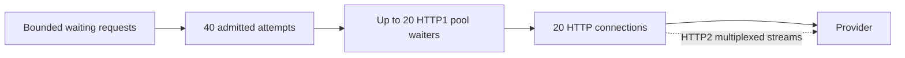

# Part 1: Core Concepts

> **Who this is for**: Backend engineers making concurrent outbound HTTP or model-provider calls who need to distinguish admission, transport, rate, and deadline limits.

> **Principle**: Every concurrency limit protects one boundary; name whether it caps admitted work,
> in-flight attempts, connections, protocol streams, or provider-wide capacity.

> **Key insight**: Capacity controls answer different questions—how much work may enter, execute, wait, or start per interval—and none substitutes for the others.

---

## 1. One request crosses several independently bounded queues

Suppose a service admits at most 40 provider attempts with a semaphore while HTTPX permits 20
connections. Both limits are strict at their own boundary. With HTTP/1.1, a connection normally
carries one active request at a time; with HTTP/2, one connection can multiplex several concurrent
streams. A socket count therefore is not a protocol-independent request count.

- An **admission limit** caps how many application attempts may enter the protected region.
- A **connection-pool limit** caps physical connections and bounds file descriptors and peer sockets.
- A protocol's **stream limit** affects how many requests those connections can carry concurrently.
- A provider-wide quota remains external unless the fleet coordinates one shared decision.

If the client does not limit connections, sockets can grow until another resource fails. If the
application does not bound admission, coroutines can still accumulate while waiting for a limited
pool. The controls compose; neither makes the other advisory.

---

### Replay the same workload as arrivals change



With 40 admitted HTTP/1.1 attempts and 20 occupied connections, up to 20 admitted attempts
wait inside the transport pool. With 1,000 arrivals and an ordinary semaphore, another
960 tasks may wait *before* admission. A five-second wait timeout shortens their lifetime
but does not reduce that instantaneous allocation. Add a bounded ingress/queue or reject
new waiters once its separate cap is reached. The [tested gate](examples/bounded_calls.py)
tracks active owners and waiters separately.

Now negotiate HTTP/2. Twenty connections can carry more than 20 streams if the peers allow
it, while the 40-attempt gate remains strict. Removing the gate because the pool is bounded
changes the protected resource. Finally introduce retries: each retry re-enters the same
gate and rate decision, so it consumes capacity that otherwise serves new requests. A
separate retry budget bounds that extra demand.

## 2. The Four Independent Dimensions

You must manage **four orthogonal concerns**:

| Dimension | Question | Mechanism | Scope |
|-----------|----------|-----------|-------|
| **Concurrency** | How many calls in flight? | Client limits + Semaphore | Transport + Application |
| **Throughput** | How many calls per time? | Rate limiter | Application |
| **Latency** | How long to wait? | Timeouts | Transport + Application |
| **Failures** | What when wrong? | Retry logic | Application |

Each dimension requires its **own control mechanism**. They cannot be mixed or substituted.

---

## 3. Precise Definitions

### Concurrency (In-Flight Requests)

How many requests have:
- Started
- Not yet finished (success, failure, or timeout)

**The concurrency that matters** is the number of active attempts at the downstream bottleneck,
plus the bounded queue waiting to enter it.

> **Concurrency at the downstream bottleneck** (the vendor, database, etc.)

This can be limited by:

1. An application semaphore or admission controller (strict attempt cap at that scope)
2. Client connection and protocol-stream capacity (transport cap)
3. A provider or fleet-wide shared limiter (external/global cap)

---

### Throughput (Rate)

How many requests are **allowed to start** per unit of time.

```
60 requests / minute
```

This applies to:
- First attempts
- Retries (critically important)

**Control mechanism**: Rate limiter

---

### Vendor Response Latency

How long the vendor **actually takes** to respond.

Important facts:
- This is **variable** (has a distribution: p50, p95, p99)
- You **do not control it**
- You can only **measure it**

---

### Call Timeout

The **maximum latency you are willing to tolerate** for a single attempt.

This is a **client-side budget**, not a measurement.

> Call timeout is an *upper bound you choose*, not the vendor's average latency.

---

## 4. Rate and service time estimate demand; an explicit cap enforces it

For steady traffic, Little's Law gives the planning estimate:

```
average_in_flight ≈ admitted_rate × average_attempt_duration
```

**Example**:

```
admitted_rate = 1 request/sec
average_attempt_duration = 4 sec

average_in_flight ≈ 4 requests
```

The attempt deadline replaces an unbounded duration with a maximum, but `rate × deadline` is not a
universal hard cap: token buckets can release bursts, arrivals are discrete, and retries add new
attempts. Enforce the required maximum with a semaphore/admission policy and size it from measured
latency, bursts, and downstream capacity.

Retries must pass through the same rate and concurrency admission as first attempts. Then they
consume the configured capacity instead of bypassing it, although they still increase total demand
and can crowd out new work during a dependency failure.

---

## 5. Why Rate Limiting Does NOT Control Concurrency

Rate limiters:
- Control **when requests may start**
- Do **not** control how many are in-flight
- Provide statistical, not hard, concurrency bounds

For stable admitted traffic use measured average service time, not the configured timeout:

```text
10 admitted starts/second × 2 seconds average duration = 20 average active attempts
```

A 30-second deadline does not imply 300 active attempts. Conversely a permitted burst can
instantaneously fill all 40 slots even when the average is 20. Rate and duration estimate
demand; the explicit admission gate enforces the maximum.

Rate limiting is necessary for vendor quota compliance, but insufficient for concurrency control.

---

## 6. Client Connection Limits Are Mandatory

Every HTTP / LLM client **must** explicitly configure connection pool limits.

```python
httpx.Limits(
    max_connections=50,
    max_keepalive_connections=20,
)
```

These limits:
- Prevent excessive open sockets
- Protect file descriptors, TLS state, buffers
- Define the **physical connection** ceiling

Choose the application attempt limit and connection limit together. They need not be numerically
equal: HTTP/2 can carry multiple streams per connection, while HTTP/1.1 may queue attempts waiting
for a connection. What matters is that both queues are bounded and their timeout signals are
distinguishable.

Without client limits:
- A semaphore can still cap attempts in its protected region
- Other clients or unprotected call sites can still grow connection usage
- Socket exhaustion is possible

---

## 7. What a Semaphore Actually Does

Semaphores:
- Prevent new requests from **starting**
- Act **before** sockets are opened
- Provide a **logical concurrency gate**

They do **NOT**:
- Close sockets
- Enforce transport-level limits
- Guarantee resource cleanup

The semaphore is strict for code that acquires it. It does not protect a call site that bypasses it
and it does not close connections already owned by the client.

```python
sem = asyncio.Semaphore(50)

async with sem:
    # At most 50 attempts can execute this protected call concurrently.
    # The client separately controls how those attempts obtain connections/streams.
    await client.get(...)
```

---

## 8. Correct layering assigns one failure to each control

Use the controls whose failure they actually address:

| Layer | Mechanism | Purpose |
|-------|-----------|---------|
| 1 | Client connection limits | Hard physical cap on sockets |
| 2 | Client transport timeouts | Bound connect, pool, write, and read inactivity |
| 3 | Semaphore | Strict attempt cap at this call site |
| 4 | Rate limiter | Vendor or policy throughput compliance |
| 5 | Application deadline | Bound total attempt/task wall time through cancellation |
| 6 | Queue timeout | Fail fast under overload |

> **Core:** Connection limits, a total deadline, and bounded admission address different exhaustion
> paths. Add a rate limiter only when a throughput quota exists; add a separate queue deadline when
> waiting for admission must fail before the request's total budget expires.

---

## 9. When a Semaphore May Be Omitted

Remove a semaphore only when another owner bounds the same application work and its
waiters. For example, a fixed worker pool reading a bounded queue may already enforce
20 active operations and 40 waiting entries. A socket pool alone does not: with HTTP/2
it can serve many streams, and with HTTP/1.1 arbitrarily many coroutines can wait outside it.
Name the replacement owner and test its overload boundary before removing a duplicate gate.

---

## 10. How to Choose `call_timeout`

### What It Represents

`call_timeout` is **NOT**:
- Average vendor latency
- Expected latency
- "How long it usually takes"

It **IS**:

> The maximum vendor latency you are willing to wait before giving up.

---

### Derive the deadline from the product and observed distribution

Continue the 40-attempt/20-connection case. Suppose the provider's p95 is 18 seconds and
p99 is 25 seconds. A 30-second attempt budget would allow most observed calls, but a
10-second product deadline cannot offer it. Decide whether the product should reject,
return a durable job ID, or accept a shorter success window; selecting p99 alone cannot
resolve that requirement conflict.

If the product allows 75 seconds, two 30-second attempts leave at most 15 seconds for
admission, transport setup, backoff and cleanup. Three full attempts cannot fit. Measure
attempt duration, failure rate and abandoned remote work, then choose a budget. Increasing
the timeout may improve completion while retaining capacity longer and increasing queueing.

---

## 11. Global, Shared Primitives

Long-lived clients and process-local controls should be created during application startup and
closed during shutdown. Per-request construction still executes, but it fragments capacity and
throws away connection reuse, so no one limit describes the process.

```python
import asyncio
from contextlib import asynccontextmanager

import httpx
from aiolimiter import AsyncLimiter
from fastapi import FastAPI


@asynccontextmanager
async def lifespan(app: FastAPI):
    app.state.llm_sem = asyncio.Semaphore(50)
    app.state.llm_rate = AsyncLimiter(60, 60)
    app.state.http = httpx.AsyncClient(
        limits=httpx.Limits(
            max_connections=50,
            max_keepalive_connections=20,
        ),
        timeout=httpx.Timeout(
            connect=5.0,
            read=30.0,
            write=10.0,
            pool=5.0,
        )
    )
    try:
        yield
    finally:
        await app.state.http.aclose()


app = FastAPI(lifespan=lifespan)
```

⚠️ Creating a fresh client or limiter per request is a silent scope failure: each request obeys its
own limit, so the process total is not bounded by that value, and the client cannot reuse connections.

---

## 12. Mental Model Summary

| Mechanism | What it limits | Scope |
|-----------|----------------|-------|
| Client `max_connections` | Physical connections | Transport |
| Semaphore | In-flight attempts through one protected region | Application/process |
| Rate limiter | Starts per time | Application |
| HTTPX phase timeouts | Individual transport waits | Transport |
| Application deadline | Total wall time | Application task |

**The Formula**:

```
average_in_flight ≈ admitted_rate × average_attempt_duration
attempts_in_protected_region ≤ semaphore_size
connections_in_client_pool ≤ max_connections
```

---

## Check yourself

**With 1,000 simultaneous callers, 40 permits and 20 HTTP/1.1 connections, how many tasks
can wait outside the semaphore immediately?**

<details><summary>Reasoned answer</summary>

Up to 960. Another 20 admitted attempts can wait for connections. A timeout limits waiting
time, not the number of waiting tasks; a separate waiter cap is necessary.

</details>

**If the average duration doubles from two to four seconds at 10 starts/s, what changes?**

<details><summary>Reasoned answer</summary>

Steady demand rises from 20 to 40 active attempts. The enforced ceiling stays 40; further
demand queues or rejects. Increasing sockets cannot create provider capacity.

</details>

## Key Principles

1. **Every limit has a scope** — name attempts, connections, streams, or fleet-wide work
2. **Rate limiting ≠ concurrency control** — they serve different purposes
3. **Semaphores are strict gates for participating code** — they do not close sockets or protect bypasses
4. **Timeouts define budgets** — not expected behavior
5. **Resource ownership must match the promised scope** — per-request controls cannot promise a process-wide cap

---

**Next**: [Part 2: Concurrency and Timeouts](02_concurrency_and_timeouts.md) — detailed timeout layers and their purposes.
