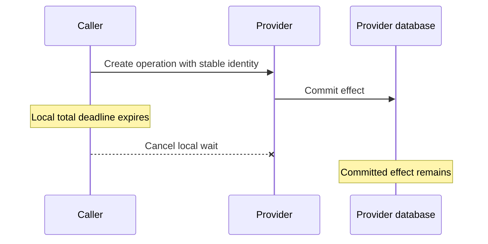

# Part 2: Give admission, execution and the whole operation separate clocks

> **Who this is for**: Readers of [capacity boundaries](01_core_concepts.md) who can use async
> context managers. Python 3.11+ and HTTPX 0.28.1 are the teaching baseline.

One request can spend two seconds waiting for a permit and ten seconds reading its result.
If admission has a five-second budget and execution has thirty seconds, the result should
arrive at t=12. An admission timeout still surrounding the HTTP call would incorrectly
cancel it at t=5. The boundary between the two scopes is the mechanism of this lesson.

## Follow one operation through three scopes

```mermaid
sequenceDiagram
 participant R as Total operation deadline at t60
 participant A as Admission deadline after 5 seconds
 participant V as Attempt deadline after 30 seconds
 R->>A: t0 acquire capacity
 A-->>R: t2 acquired; admission timer exits
 R->>V: t2 begin provider attempt
 V-->>R: t12 response body complete and closed
 Note over R: Release ownership before any retry sleep
```

The total clock surrounds everything. Admission and execution are consecutive clocks
inside it. A retry starts a new admission and attempt clock but keeps the original total
deadline. Time already spent is never refunded by entering another helper.

The [canonical caller](examples/bounded_calls.py) makes that order executable. Its relevant
shape is this excerpt; `_admit` also bounds waiters and releases any acquired ownership:

```python
async with asyncio.timeout_at(deadline):
    for attempt in range(max_attempts):
        async with caller._admit(operation_id, attempt):
            async with asyncio.timeout(caller.attempt_timeout):
                result = await caller._send(method, path, payload, headers)
        # A successful result returns; retry classification runs after resource release.
```

The full implementation translates each clock's expiration into a distinct exception.
Run its changed-condition checks from the repository root in the
[configured environment](03_call_patterns.md#run-one-operation-before-studying-the-policy):

```bash
python -m pytest -q fundamentals/fastapi/safe_and_scalable_api_calls/examples/test_bounded_calls.py
```

`test_admission_scope_ends_before_execution` scales the example to 10 ms admission and
50 ms execution; it succeeds because the permit is available immediately. Keeping the
admission timer open would make this test fail before the response arrives.

## Transport inactivity is a fourth, different clock

HTTPX controls pool acquisition, connection establishment, writes and reads:

```python
import httpx

phase_limits = httpx.Timeout(connect=1.0, pool=0.1, write=1.0, read=2.0)
```

A read timeout includes waiting for response headers while the server computes. It also
limits later network-read waits. If the peer emits a byte every second, a two-second read
limit may never fire even though a finite response takes a minute. An outer ten-second
operation deadline still ends that wait. `test_total_deadline_closes_trickling_body`
uses a controlled byte stream and checks both deadline failure and response closure.

There is no universal `connect <= pool <= write <= read` rule. A pool wait might need to
fail in 100 ms while an upload legitimately takes longer to write than its response takes
to read. A total deadline shorter than a phase limit is also meaningful: whichever applies
first ends the operation. Configure limits from the workload rather than relative magnitude.
[HTTPX timeout definitions](https://www.python-httpx.org/advanced/timeouts/), checked 2026-10-30.

## Classify the owner before choosing a response or retry

| Failure | What happened | Default action in the local lab |
|---|---|---|
| `AdmissionTimeout` | Waiter cap, local/shared admission timer or pool capacity refused work | Return 503 overload; no local retry |
| `httpx.PoolTimeout` | An admitted attempt could not acquire transport capacity | Convert to local overload |
| `AttemptDeadlineExceeded` | One admitted attempt exceeded its cancellation budget | Retry only a safe/deduplicated operation within remaining budget |
| Connect/read/write failure | A transport phase failed; remote outcome may be unknown | Apply operation safety and exact failure policy |
| `TotalDeadlineExceeded` | The original logical budget is spent | Stop attempts; return 504 |
| Caller `CancelledError` | Caller or owner exited | Propagate cancellation after cleanup |

A bare `TimeoutError` cannot identify the owner. Catch and translate it immediately outside
the scope that created it. Do not catch `BaseException` to turn cancellation into a retry.
A local `PoolTimeout` is not evidence of a vendor outage, so adding another provider attempt
would amplify the queue that caused the failure.

The [FastAPI app](examples/safe_call_app.py) maps these typed failures explicitly. Raising
`TimeoutError` from a route without an exception mapper does not automatically produce 504.
Use 429 for an authenticated caller's quota policy; process saturation is a different 503
condition. Clients still apply their own deadlines and bounded retry policy.

## An expired deadline requests cancellation; it does not undo a commit



`asyncio.timeout` delivers cancellation to the current task and converts its own expiration
to `TimeoutError` outside the scope. Awaited code must cooperate. Cleanup can take time and
remote work may continue after the local connection closes. Thus this is a cancellation
deadline, not a guarantee that all physical work disappears at the exact millisecond.
[Python timeout semantics](https://docs.python.org/3/library/asyncio-task.html#timeouts).

Keep permits until the owned response/iterator is closed. Releasing first can admit another
attempt while the previous owner still uses local resources. Streaming adds upstream,
producer-task and downstream-send lifetimes; [Part 7](07_streaming_patterns.md) extends
ownership through those lifetimes rather than ending it when response headers arrive.

## Spend the remaining budget, not a new budget per helper

Take a 60-second total operation. Admission uses 2 seconds, attempt one uses 30, and backoff
uses 3. At t=35 only 25 seconds remain. A second nominal 30-second attempt can receive at
most those 25 seconds under the original outer clock. It is false that 60 seconds always
fits two full 30-second attempts: that ignores both admission and sleep.

For a 90-second product budget and a 60-second attempt limit, a second attempt may still
be useful after an early first failure. It is not guaranteed a full 60 seconds. Decide how
much remaining time makes a retry useful for this provider, and refuse a Retry-After delay
that extends past the total deadline. Never shorten a server's required delay simply to
squeeze in another attempt.

## Recap

- Admission ends when ownership is acquired; it must not continue timing the permitted call.
- Transport limits measure individual waits; the original total clock bounds the complete operation.
- Typed local overload is not a retryable provider failure.
- Cancellation unwinds local ownership but cannot retract a remote commit.

## Check yourself

**Admission succeeds at t=2; execution lasts 10 seconds. Admission=5, attempt=30, total=60.
Does the operation fail at t=5?**

<details><summary>Reasoned answer</summary>

No. Admission's scope ended at t=2; execution can finish at t=12. A t=5 failure exposes
incorrect nesting rather than a slow provider.

</details>

**A provider sends one byte every four seconds under read=5 and total=20. What stops it?**

<details><summary>Reasoned answer</summary>

The total deadline around 20 seconds, despite continued read progress. If the provider
instead remains silent before headers for six seconds, ReadTimeout can fail first.

</details>

### Try it

Change the admission test to acquire the only local permit before starting the operation.
Leave the assertion on `attempts_started` to complete. Hint: failure must happen before I/O.

<details><summary>Solution</summary>

Expect `AdmissionTimeout`, `attempts_started == 0`, and zero remaining waiters. Release the
fixture's held permit in `finally`; the timed-out caller never owned it and must not release it.

</details>

**Next**: [One tested call and retry policy](03_call_patterns.md).
