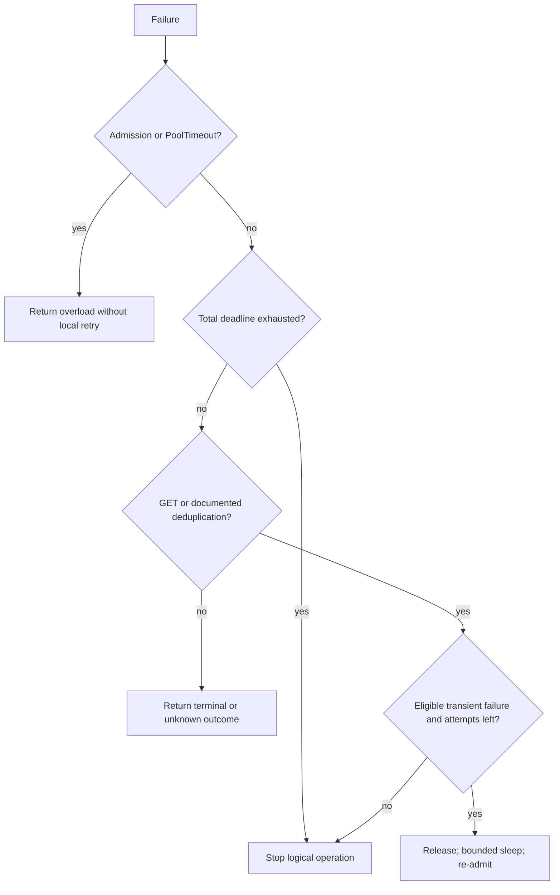

# Part 3: One tested call owner from admission through retry

> **Who this is for**: Readers of [capacity](01_core_concepts.md) and
> [deadline scopes](02_concurrency_and_timeouts.md). The runnable baseline uses Python 3.11+
> and HTTPX 0.28.1; it makes no external provider call.

A GET for `ord_42` receives 503, releases its resources, and retries once successfully.
A locally saturated caller never reaches the provider. Both outcomes use the same implementation,
so the production continuation does not quietly introduce another exception policy.

## Run one operation before studying the policy

From the repository root:

```bash
python -m venv /tmp/notes-calls-env
source /tmp/notes-calls-env/bin/activate
python -m pip install 'httpx==0.28.1' 'fastapi==0.162.0' 'starlette==1.10.0' pytest
python fundamentals/fastapi/safe_and_scalable_api_calls/examples/demo.py
python -m pytest -q fundamentals/fastapi/safe_and_scalable_api_calls/examples
```

The demo prints:

```text
{'order': 'ord_42', 'status': 'paid'}
attempts 2 active 0
local_overload; provider_attempts 2
```

The complete [caller](examples/bounded_calls.py), [demo](examples/demo.py),
[behavioral checks](examples/test_bounded_calls.py) and [FastAPI app](examples/safe_call_app.py)
are ordinary files. The mock establishes application policy and resource ownership, not DNS,
TLS or HTTP connection-pool behavior. Use a loopback/provider staging test for those boundaries.
The pinned Starlette stack currently warns about its HTTPX TestClient backend; see the
[HTTPX2 migration discussion](../../httpx/05_httpx_vs_aiohttp.md).

## Derive the retry sequence from the first failure

```mermaid
sequenceDiagram
 participant U as Logical operation Q1
 participant G as Local and optional shared admission
 participant P as Provider
 U->>G: Acquire attempt 0 within admission budget
 G-->>U: Own permits; admission timer ends
 U->>P: GET ord_42
 P-->>U: 503
 U->>G: Close response and release ownership
 Note over U: Sleep full jitter or valid Retry-After
 U->>G: Re-admit attempt 1 under original total clock
 U->>P: GET ord_42
 P-->>U: 200 paid
 U->>G: Close response and release
```

The failed response is closed before retry sleep. Otherwise even a sleeping retry could
retain a scarce transport connection or application permit. Ten sleeping owners in a
20-slot gate leave only ten slots for useful work. That wastes capacity; it is not by
itself a deadlock, and no fixed `size / retry_count` formula predicts effective throughput.

The loop re-enters admission for each actual provider attempt. It does not reset the total
clock or receive a new logical operation identity. A failed admission is returned immediately;
there is no useful downstream attempt to recover by repeating local contention.

## Inspect the narrow owner rather than copying a second version

`BoundedCaller` receives the lifespan-owned `AsyncClient`. Its gate counts active owners
and pending waiters; a full waiting budget rejects immediately. `_admit` acquires local
capacity, optional start spacing and optional external admission inside one short deadline.
The deadline exits before yielding the admitted region. An exit stack owns the external
lease through response closure, and `finally` returns the local permit.

Inside that region, the attempt deadline encloses request and complete body consumption.
The JSON response has a byte budget and must decode to an object. The caller closes the
response on success, status failure, body failure or cancellation. It logs no credentials,
request body or full query URL. Production metrics should count attempts, overload,
timeouts and bounded status categories; add route/provider labels with finite values.

The public invocation is small because the complete owner is in the linked source file:

```python
# Excerpt: caller is created once in the application's lifespan.
result = await caller.request_json(
    "GET", "/orders/ord_42", total_timeout=5.0, max_attempts=3,
)
```

For POST, passing `max_attempts=3` does not grant retry safety. The implementation makes
one attempt unless the adapter explicitly asserts a documented provider deduplication
contract and supplies the stable key:

```python
# Only for a provider whose documented operation honors this header and retention window.
result = await caller.request_json(
    "POST", "/reports", payload={"order_id": "ord_42"},
    idempotency_key="tenant7:report:op42", provider_deduplicates=True,
    operation_id="op42",
)
```

The key must survive caller/process retries of the same operation; creating a fresh UUID
for each inbound retry loses this guarantee. A header ignored by a provider does nothing.
[Part 11](11_idempotency.md) owns durable local identity, request fingerprints, stale owners
and provider-key namespacing. A locally cancelled POST can have an unknown remote outcome.

## Retry only the failure classes this operation can recover



The baseline retries 408, 429, 502, 503 and 504, plus selected connection/read/write failures
and an attempt deadline, **only** under the safe-operation condition. It does not assume
all 500s are transient. Authentication, validation, malformed provider data and local
pool/admission failures stop. Caller cancellation is propagated rather than converted
into a retry. Extend the exact status/exception list only from the provider contract and
observed failure, with a regression test for the new decision.

A third attempt that fails raises its retained failure immediately. It neither returns
`None` nor sleeps after exhaustion. The FastAPI adapter maps admission to 503, deadline
to 504, and provider failures to a sanitized 502. Tenant quota exhaustion, owned later by
the shared admission policy, can instead map to the documented 429 response.

## Make backoff and rate policies explicit

For attempt index n, full jitter draws uniformly from zero to
`min(base * 2**n, cap)`. It spreads retry starts over an interval. Decorrelated jitter uses
the previous delay to choose the next range; it is an alternative distribution, not a
universal improvement. Choose one policy and measure retry amplification.

`Retry-After` can be integer delay-seconds or an HTTP-date. The supplied parser handles
both, and the caller waits at least that delay and its jitter. If that wait cannot fit
inside the original total budget, it fails without starting the next request. A malformed
header uses the local jitter policy. Clock skew affects HTTP-date interpretation, so keep
hosts synchronized and bound the logical operation independently.

`StartSpacing` is optional process-local smoothing without a token-bucket burst. Other
limiters may permit bursts and favor smaller weighted acquisitions; neither mechanism
alone promises tenant fairness. Holding a local permit while waiting for start permission
makes ownership simple but can reduce utilization. Bound that wait and measure it before
introducing a more complex atomic admission scheduler. [Part 9](09_distributed_admission_control.md)
provides the shared policy boundary; local counters cannot protect a fleet quota.

## Prevent retry multiplication across SDK layers

If the application makes three attempts and the SDK internally makes three, the provider
can see nine, while application metrics might report only three. Prefer one retry owner.
When wrapping a provider SDK, disable its automatic retries through that SDK's documented
configuration and retain the outer policy. If that is impossible, include internal attempts
in rate, token and retry budgets and verify the observed provider request count under a
forced failure. A new SDK default is an upgrade gate, not an implementation detail.

## Verify changed conditions, then harden the boundary

The tests exercise admission finishing before execution, waiter cancellation, overload,
unsafe POST, stable operation keys, resource release before backoff, trickled responses,
HTTP-date parsing and caller cancellation. The app tests inject a provider-wide 503 while
`/live`, `/ready` and `/local` continue succeeding. A remote outage should not automatically
remove every otherwise healthy pod from service.

Before replacing the mock, supply verified TLS, a fixed/allowlisted provider origin,
secret-manager credentials, endpoint authorization, a total body limit, and the provider's
actual retry/idempotency profile. Never forward arbitrary user-supplied URLs or credentials.
Exercise real pool exhaustion, connection closure and nonresponsive peers in staging.
A mock-backed pass does not certify those transport behaviors.

## Recap

- One owner closes each response and releases all permits before retry sleep.
- Local overload stops locally; operation safety and remaining budget govern provider retries.
- Stable identity crosses attempts, while each attempt consumes its own provider capacity.
- The executable source, adapter and tests share one exception policy.

## Check yourself

**The first POST times out after the provider may have committed, but that provider ignores
Idempotency-Key. Does setting the header make a retry safe?**

<details><summary>Reasoned answer</summary>

No. The provider must implement the contract. Keep `provider_deduplicates=False` and
reconcile the remote operation through a supported status/identity mechanism.

</details>

**A 429 asks for 20 seconds of delay but only three seconds remain. Should the caller sleep
three seconds and send anyway?**

<details><summary>Reasoned answer</summary>

No. That would violate the server's delay and exceed the useful operation budget. Stop
without another attempt; a later user retry remains subject to the same logical identity.

</details>

### Try it

Change the demo's second response to 401. Add assertions for the final attempt count and
remaining active permits. Hint: status failures still pass through response cleanup.

<details><summary>Solution</summary>

Expect `ProviderFailure(status=401)`, two starts total and `caller.gate.active == 0`.
The first 503 is eligible; the second 401 is terminal and must not cause a third attempt.

</details>

**Next**: [Preserve a quota across replicas](04_kubernetes.md).
