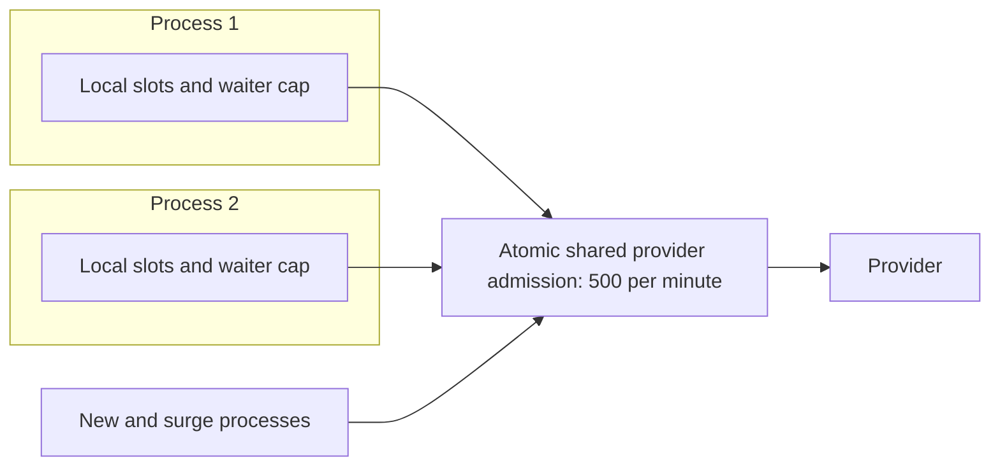

# Part 4: Preserve the provider budget while replicas change

> **Who this is for**: Readers who have run [the caller](03_call_patterns.md) and understand
> process-local ownership. Kubernetes controller mechanics are taught in the
> [runtime chapter](../../../operations/deployment/03_kubernetes_runtime.md).

The provider allows 500 starts per minute. Ten processes each create a local limiter of
500/minute. Each limiter is correct locally, yet the fleet can start 5,000/minute. The
error is the owner of the counter, not an insufficiently strict local implementation.

## Trace one burst before scaling it

One process receives 500 requests at t=0. It has 50 active slots; each admitted operation
lasts 30 seconds; admission may wait five seconds. Assume the rate policy initially permits
80 starts. Only 50 can start: thirty extra rate permissions cannot create execution slots.
No slot frees before t=30, so all remaining 450 requests exceed the five-second wait budget
unless they were rejected earlier by a waiter cap.

With a cap of 100 waiting callers, the result is sharper: 50 active, 100 waiting, 350 rejected
immediately. At t=5 the 100 waiters time out; at t=30 the 50 active operations finish.
An ordinary semaphore without that waiter cap would initially allocate all 450 waiting tasks.

| Time | Active | Waiting | Completed | Rejected so far |
|---|---:|---:|---:|---:|
| t0 after admission | 50 | 100 | 0 | 350 |
| t5 after wait deadline | 50 | 0 | 0 | 450 |
| t30 | 0 | 0 | 50 | 450 |

The provider start allowance and execution concurrency answer different questions. Measure
both before increasing either. A rejection can be a successful capacity-control decision,
but it is still a user outcome that must appear in the product's SLI.

## Local controls protect a process; shared controls conserve a fleet allowance



Every actual attempt, including retries, passes through the same shared decision. Scaling
to 20 processes increases local capacity and placement choices; it does not change the
provider's 500/minute contract. Two workers in each pod are two independent local owners,
so count processes, not just pod objects, when calculating local capacity.

A gateway's per-replica counter has the same multiplication problem. Its location at the
front of the fleet does not prove that its state is shared. Test with two replicas and
observe total admitted provider starts, rather than looking only at one pod's metric.

## Three allocation strategies and their trade-offs

| Strategy | One shared quota stays conserved when… | Main cost |
|---|---|---|
| Atomic shared admission | Every attempt consults one authoritative decision | Extra latency and dependency availability |
| Static partition | All disjoint allocations sum to at most 500, including overlap | Idle allocations cannot move automatically |
| Leased allocation | Grant/renew/expiry and generation fencing prevent double-spending | More ownership and recovery logic |

Static partitioning is not inherently wrong. Ten processes can each own 50/minute, but
adding ten more cannot independently grant another 50 to each. Transfer allocations only
when old owners stop spending them, or issue nonoverlapping leases with explicit expiry.
Partitioned budgets can waste spare capacity; a shared authority pools it more flexibly.

For a 10-to-15 rolling overlap, ten old allocations of 50 already consume the complete
500. Giving each new process 50 adds 250 that the provider never granted. Drain/revoke old
allocations before transferring them, or use the shared authority so old and new processes
compete within the same allowance. A process restart must not reset durable daily spend.

## Why two Redis commands are not one admission decision

Consider one remaining permit. W1 reads count=499; W2 also reads 499; both decide to allow
and increment. The count becomes 501 after two successful starts. Locking only the Python
process cannot serialize another process. Evaluate the eligibility check and reservation
atomically at the state owner.

```mermaid
sequenceDiagram
 participant W1 as Worker 1
 participant R as Shared counter
 participant W2 as Worker 2
 W1->>R: Atomic admit attempt A at count 499
 R-->>W1: Granted; count becomes 500
 W2->>R: Atomic admit attempt B
 R-->>W2: Denied; count remains 500
```

The complete two-client Redis implementation and failure tests belong to
[Part 9](09_distributed_admission_control.md). It also owns key slotting, expiry, script
cache reload, ambiguous command outcomes and failover policy. An isolated `INCR` example
cannot stand in for those requirements.

The local caller accepts `attempt_admission(operation_id, attempt_no)` as an async context
manager. Entry returns only after the shared decision; exit releases its attempt lease
when the response is closed. The `(operation_id, attempt_no)` identity lets the adapter
recover an admission whose response was lost. Incrementing a counter with a new random ID
after every timeout can charge or reserve twice. User logical-request quota is separate
from provider-attempt quota: one user request with three attempts need not count as three
user requests, but it does consume three provider starts.

## Capacity choices follow the bottleneck

For 10 admitted attempts/s and two-second mean duration, expected active demand is 20.
Compare it with the provider's measured capacity and the process's memory, CPU and connection
cost. Choose headroom for bursts and a hard active cap; then measure rejection, queue age,
pool wait and attempt duration under load. A semaphore larger than a socket pool can be
reasonable with HTTP/2, or can create a deliberate bounded HTTP/1.1 pool wait. It is not
universally forbidden; the queues and protocol determine the consequence.

Local start spacing smooths bursts but does not guarantee tenant fairness. A hot tenant
can occupy the same local queue before another arrives. Add authenticated per-tenant limits
or a bounded fair scheduler when that outcome violates the product contract. Limit the
number of tracked tenant queues too, or attacker-created identities can exhaust memory.

Autoscaling can relieve CPU or local wait caused by insufficient local capacity. It cannot
increase a fixed provider allowance or repair a slow dependency. If CPU is low, provider
429s rise and the shared budget is exhausted, adding pods mainly creates more contenders.
Scale using a signal tied to the actual local bottleneck and verify that total provider
attempts remain conserved during a rollout and a restart.

## Decide the shared-state outage policy before it happens

If Redis is unavailable, do not silently fall back to 500/minute *per process*. Strict quota
or spend protection should deny new protected work until admission can be established.
A degraded mode is possible only with an explicitly reserved, bounded allowance and a
policy for reconciling uncertain admissions. A lease expiry frees bookkeeping; it does not
prove the old remote operation stopped. Long operations need renewal/fencing policy or a
conservative capacity assumption.

Load balancing is not fairness. Independent requests may land on unevenly loaded pods;
sticky routing may worsen a hot user's concentration. Return the documented overload status,
measure per-process skew, and retry only under the caller's bounded safe-operation policy.
Moving retries among pods must not bypass the shared provider decision.

## Production-readiness checks

- Measure total starts through two processes, then a rollout overlap; the quota stays conserved.
- Reject above the local waiter cap without allocating another unbounded task or queue.
- Retry consumes provider capacity again while logical-user accounting follows its separate contract.
- Exercise Redis denial, timeout after admission, restart and failover with stable identities.
- Observe admission duration, rejection reason, active leases, oldest waiter and retry amplification.
- Keep provider credentials out of limiter keys, metrics and logs; authorize operator overrides.

## Recap

- Rate permission cannot create a free concurrency slot.
- Process-local correctness does not imply a conserved fleet quota.
- Shared atomic decisions or correctly partitioned grants survive replica and rollout changes.
- A dependency outage needs an explicit admission policy, not an accidental local fallback.

## Check yourself

**Five surge processes join ten existing processes. What allowance must remain unchanged?**

<details><summary>Reasoned answer</summary>

The aggregate 500 starts/minute across all old, new and other provider consumers. New local
slots do not create quota. Shared admission or conserved allocation transfers maintain it.

</details>

**Why do the other 450 burst requests fail despite an 80-start rate allowance?**

<details><summary>Reasoned answer</summary>

All 50 execution slots remain occupied for 30 seconds, beyond the five-second admission
budget. The thirty unused rate permissions do not release those slots.

</details>

**Next**: [Compose the runtime and deployment boundaries](05_production_architecture.md).
