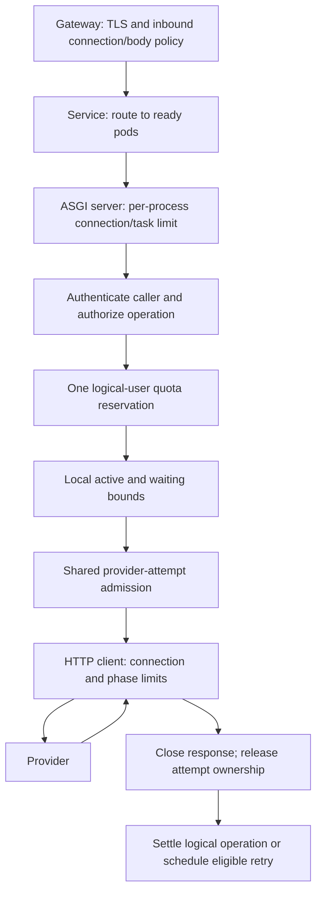

# Part 5: Compose one request path with owned capacity

> **Who this is for**: Readers who have run [Part 3](03_call_patterns.md) and understand
> [fleet quota conservation](04_kubernetes.md). Local execution is complete; a Kubernetes
> deployment additionally needs the controller, image distribution and TLS fixtures stated below.

The API has a local endpoint and an endpoint that reads an order from a provider. When the
provider fails globally, the local endpoint still works. This distinction determines health,
routing and recovery more reliably than a diagram that marks the entire process unhealthy.

## Run the application before adding the cluster

The [complete app](examples/safe_call_app.py) creates one HTTP client and `BoundedCaller`
in lifespan. Its default transport is a local mock, so no credentials or provider account
are needed. In the [Part 3 environment](03_call_patterns.md#run-one-operation-before-studying-the-policy):

```bash
python -m pytest -q fundamentals/fastapi/safe_and_scalable_api_calls/examples/test_safe_call_app.py
python -m pip install uvicorn
uvicorn --app-dir fundamentals/fastapi/safe_and_scalable_api_calls/examples safe_call_app:app --host 127.0.0.1 --port 8000 --limit-concurrency 100 --timeout-graceful-shutdown 20
```

In a second terminal, `curl http://127.0.0.1:8000/orders/ord_42` returns
`{"order":"ord_42","status":"paid"}`. `/local`, `/ready` and `/live` return successful JSON.
The tests construct the same app with a provider-wide outage: the order route returns 502,
while the other three keep returning 200. Setting its local drain state changes readiness
to 503 and refuses new order work without failing liveness.

The mock-backed default is a failure lab, not a live provider integration. To deploy actual
provider work, replace its transport with the verified provider adapter, configure a fixed
origin and credentials, and exercise the real transport contract described in Part 3.

## Follow one admitted request through the owners



Gateway limits protect entry infrastructure. Authentication establishes the principal before
user/tenant policy; never key a trusted quota solely from an arbitrary inbound tenant header.
User quota and provider quota measure different things, so keep their ownership distinct.
Each retry returns through provider-attempt admission while retaining the original logical
reservation and total deadline. [Part 9](09_distributed_admission_control.md) supplies the
shared adapter; [Part 10](10_llm_token_economics.md) extends durable usage settlement.

Only await asynchronous Redis/database clients on the event loop. A synchronous network
call inside middleware blocks unrelated requests. The local app deliberately keeps these
policies behind explicit adapters rather than embedding a second divergent retry loop.

## Health means different things at three boundaries

| Signal | Question | Provider outage alone |
|---|---|---|
| Liveness | Is this process unable to make useful progress and likely helped by restart? | Keep live |
| Readiness | Can this pod accept its promised traffic now? | Keep ready for unaffected routes |
| Endpoint outcome | Can this specific dependency-backed operation complete? | Return its sanitized 502/503/504 policy |

A pod-local startup failure or drain can make readiness false. A shared provider outage
usually affects every pod; marking all unready removes unrelated capacity and cannot repair
the provider. If the *entire* service contract depends on that provider, document that narrower
readiness contract explicitly and evaluate the routing consequence.

`--limit-concurrency` is a Uvicorn process boundary, not a fleet quota or tenant scheduler.
Multiple worker processes multiply it. `--timeout-keep-alive` concerns idle connection reuse,
not an in-flight operation's total deadline. Keep the application's clocks from Part 2.

## Complete Gateway wiring needs a controller, workload, Service and certificate

Gateway API is a routing API, not an installed data plane. For this example the GatewayClass
selects Envoy Gateway; install a supported controller/CRD release using its
[versioned quick start](https://gateway.envoyproxy.io/docs/tasks/quickstart/) and record that
version in your deployment lock. The controller name below is its documented identifier
(checked 2026-10-30). Other controllers need their own class and supported policy extensions.

Build the supplied local image from the repository root:

```bash
docker build -t safe-calls:lab -f fundamentals/fastapi/safe_and_scalable_api_calls/examples/Dockerfile fundamentals/fastapi/safe_and_scalable_api_calls/examples
```

Distribute it to the disposable cluster (for kind: `kind load docker-image safe-calls:lab`).
For a registry deployment, replace the image with a tested immutable digest. In a disposable
namespace, create a lab certificate and Secret before applying the manifest:

```bash
kubectl create namespace safe-calls-lab
openssl req -x509 -newkey rsa:2048 -nodes -days 1 -keyout /tmp/notes-calls.key -out /tmp/notes-calls.crt -subj '/CN=api.example.test' -addext 'subjectAltName=DNS:api.example.test'
kubectl -n safe-calls-lab create secret tls calls-tls --cert=/tmp/notes-calls.crt --key=/tmp/notes-calls.key
kubectl apply -f fundamentals/fastapi/safe_and_scalable_api_calls/examples/gateway.yaml
```

The [complete manifest](examples/gateway.yaml) includes GatewayClass, Gateway, HTTPRoute,
Deployment and Service. The route references the Service port, its selector matches the
pod labels, and the Gateway listener references the certificate in its own namespace.
No rate policy is implied by those routing objects. Configure controller-specific shared
limits separately and test total admission while scaling the gateways from one to two.

Inspect `Accepted`, `ResolvedRefs` and `Programmed` conditions and the Gateway address:

```bash
kubectl get gatewayclass notes-envoy -o yaml
kubectl -n safe-calls-lab get gateway calls -o yaml
kubectl -n safe-calls-lab get httproute calls -o yaml
kubectl -n safe-calls-lab rollout status deployment/calls --timeout=120s
```

Then use the address reported by your controller with `curl --cacert /tmp/notes-calls.crt
--resolve api.example.test:443:ADDRESS https://api.example.test/orders/ord_42`.
A successful response exercises host routing and verified TLS, rather than disabling certificate
checks to make an incomplete fixture appear healthy. Controller installation and this cluster
check must be run in the target environment; local TestClient tests do not prove them.

## Workload limits and shutdown share a real deadline

The manifest uses one server process per pod. Twenty local provider slots and forty waiting
slots bound the caller; the ASGI cap also covers requests that have not reached that caller.
Memory/CPU requests and limits are a starting lab budget, not throughput claims. Load-test
with actual payload sizes and dependency duration before sizing production.

For a 30-second termination grace, five seconds of routing convergence leaves at most
25 seconds for work and closing. The example server allows 20 seconds of graceful shutdown,
leaving five seconds for client close and other cleanup. Do not independently assign thirty
seconds to every layer and expect the same thirty-second platform clock to contain them.

```mermaid
sequenceDiagram
 participant K as Orchestrator
 participant LB as Gateway and endpoints
 participant API as API process
 participant H as Owned HTTP client
 K->>LB: Remove terminating endpoint
 Note over LB,API: Allow bounded routing convergence
 K->>API: SIGTERM within total grace
 API->>API: Refuse new work; drain admitted tasks
 API->>H: Close after owned requests finish or cancel
 API-->>K: Exit before grace deadline
```

Cancellation cleanup should release owned responses and leases, cancel and join child tasks,
and then close shared clients. Shield only bounded cleanup that must complete despite the
parent cancellation; shielding provider work lets it escape the deadline. A close operation
that itself stalls also needs a bound and an observable failure. The advanced streaming
chapters demonstrate producer/response teardown; the canonical [shutdown lab](../../../operations/deployment/docker_and_deployment.md)
exercises real process signals. A forced kill still requires durable operation recovery.

## Diagnose capacity without turning it into an outage multiplier

If all order routes return 503 from shared provider admission, inspect provider budget and
lease state before adding pods. If one pod rejects locally while others are idle, inspect
routing skew and per-process load. If pool wait rises inside already admitted work, inspect
response ownership and HTTP protocol capacity. Increasing retries in any of these queues
adds demand without creating the missing resource.

During the injected provider outage, the app's `/local` route remains an explicit acceptance
check. Roll back a broken provider adapter or pause only the affected operation, then verify
provider attempt count, local waiter count and endpoint latency. After unknown writes,
reconcile the original operation identities; readiness recovery is not business recovery.

## Production-readiness checks

- Pin and test the application, SDK and transport versions; inspect retry defaults on upgrade.
- Authenticate before tenant policy and keep credentials/payloads out of logs and quota keys.
- Bound inbound bytes, pending requests, provider attempts, response bytes and total time.
- Exercise two processes against the shared admission owner, including a lost admission reply.
- Verify TLS, Service/route references, health policy and shutdown under the real controller.
- Alert on user outcome and queue/lease age; retain bounded labels for reason/provider/route.
- Test compatible rollback and reconcile uncertain effects before reopening affected work.

## Recap

- One request crosses several owners; no limit silently substitutes for another.
- Dependency health, pod readiness and process liveness are separate decisions.
- Gateway objects need a real controller, certificate and matching workload wiring.
- Drain and cleanup must fit inside one platform deadline while durable recovery handles interruption.

## Check yourself

**Every provider call fails but `/local` still works. Should liveness restart every pod?**

<details><summary>Reasoned answer</summary>

No. Restarting healthy processes cannot repair a shared provider and destroys useful capacity.
Fail the affected operation and apply its retry/admission policy while local routes remain available.

</details>

**Does putting a rate limiter in front of a Service make its counter cluster-wide?**

<details><summary>Reasoned answer</summary>

No. Counter ownership determines scope. Two gateway replicas with independent counters can
admit twice the intended allowance; test and configure a shared decision explicitly.

</details>

### Try it

Extend the app outage test with a locally exhausted gate. Leave the expected HTTP status and
provider-attempt count blank. Hint: the provider must not be called when admission fails.

<details><summary>Solution</summary>

Fill all local active and waiting capacity, call the order route, expect 503 LOCAL_OVERLOAD
and no additional provider attempt. Release fixture-owned permits afterward; `/live` stays 200.

</details>

**Next**: [Failure-domain isolation and advanced recovery](06_advanced_patterns.md).
