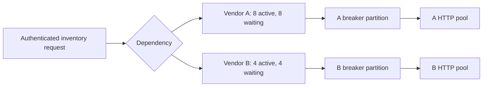

# Part 6: Keep one slow dependency from consuming the service

> **Role:** implementation and conditional resilience patterns. Read [the bounded caller](03_call_patterns.md) and [production operation](05_production_architecture.md) first. You should understand a task, a cancellation deadline, an HTTP response owner and the difference between a logical operation and an attempt.
>
> **Outcome:** isolate a failing dependency, admit a single recovery probe, cancel every owned hedge, and bound priority work. Python 3.14, HTTPX 0.28.1 and Redis 7.4 are the tested baseline; source pins are in the linked laboratory.

Vendor A normally answers inventory lookups in 80 ms. During an incident its p99 reaches
four seconds. Vendor B still answers in 90 ms, but requests for B now fail too: A has
occupied every shared permit. Retrying A faster makes this worse. We will change one
part of this incident at a time and measure which resource each change protects.

## 1. Partition the resource before adding a policy

A **bulkhead** is a capacity partition. Give A and B separate `BoundedCaller` instances,
with capacities 8 and 4 and bounded waiter populations. A can occupy eight slots; its
ninth caller waits briefly or is rejected. B retains four. HTTP connection pools must
also fit this topology: independent caller gates over one tiny pool can still contend
at the transport layer. Use separate clients when transport isolation is required.

The path below describes one request for A. A denied local request never contacted A,
so its queue timeout is not evidence of A's health.



There are two choices here: which work shares capacity, and which observations share
health state. A breaker for `A/account1/regionEU/inventory` may be useful when that
account or endpoint fails independently. A single breaker for every provider would
turn A's incident into an intentional outage for B. Many tiny tenant breakers, on the
other hand, may each lack enough traffic to make useful decisions.

A process-local breaker can reduce latency without a coordination dependency. A shared
breaker is appropriate when the fleet must coordinate scarce probes or account-wide
health; it also puts Redis availability in the admission path. It is not a universal
requirement that every replica share one breaker.

## 2. A breaker consumes eligible observations

A circuit breaker temporarily refuses attempts after sufficient failure evidence.
In the supplied fixture the rule is **three consecutive eligible failures**, not an
error-rate sliding window. Closed permits ordinary work; open rejects until a cooldown;
half-open admits one leased probe. A successful current probe closes the circuit.

| Result | Fixture policy | Why |
|---|---|---|
| 502/503/504 or admitted provider read failure | Failure | The selected dependency failed work it received |
| Valid complete response | Success | Positive evidence for this partition |
| Local queue/HTTP pool timeout | Neutral | The application could not admit/send work |
| Caller cancellation | Neutral | The user stopped waiting; provider health is unknown |
| Authentication/validation 4xx | Neutral, investigate separately | Credentials or request meaning needs correction |
| 429 | Account rate policy, usually separate from availability | More probe traffic can worsen quota exhaustion |

Classify a single admitted attempt, or explicitly document that a breaker observes a
whole operation. A three-attempt caller which eventually succeeds conceals two attempt
failures from an outer breaker. For per-attempt observations, call with
`max_attempts=1` at the owned attempt boundary and put the retry decision outside that
observation. Preserve one total deadline and the core caller's retry-safety rules.

The lifecycle has two distinct waits: an open cooldown and a half-open probe lease.

```mermaid
stateDiagram-v2
  Closed --> Open: Three eligible consecutive failures
  Open --> HalfOpen: Cooldown ends; atomic probe claim
  HalfOpen --> Closed: Current live probe succeeds
  HalfOpen --> Open: Current live probe fails
  HalfOpen --> HalfOpen: Expired probe replaced with new generation
```



Expiry permits a replacement probe; it does not authorize the old probe's evidence.

A shared probe needs more than `SET lock NX`. Suppose A acquires probe generation 7,
pauses for a second, and its 500 ms lease expires. B acquires generation 8. A returning
success must not close B's circuit or delete B's ownership. The atomic record operation
compares **both generation and probe token**, and rejects expired probe evidence.

```mermaid
sequenceDiagram
  participant A as Probe A
  participant R as Redis breaker
  participant B as Probe B
  A->>R: allow: generation 7, token A, 500 ms
  Note over A,R: Lease expires while A is paused
  B->>R: allow: generation 8, token B
  A->>R: success for generation 7
  R-->>A: stale evidence ignored
  B->>R: eligible failure for generation 8
  R->>R: open generation 9; cooldown starts
  A->>R: late cleanup for token A
  R-->>A: cannot change generation 9
```

[SharedBreaker in the complete source](examples/advanced_resilience.py) implements the
transition in one Redis script. Server `TIME` supplies the lease clock. Its closed-state
success advances the generation, invalidating older outstanding evidence; consequently
this is a deliberately conservative consecutive-evidence policy, not a statistical
health estimator. Shared rate windows need a separately specified sample/window policy.
Redis scripts execute atomically, and registered scripts must reload after cache loss;
these guarantees and the Redis 7 effects-replication baseline are covered in
[Redis's scripting documentation](https://redis.io/docs/latest/develop/programmability/eval-intro/).

Do not delete the breaker key during routine operation: resetting its generation can
make an old ticket look current. For migration, use a new versioned partition key and
drain old attempts. An ambiguous `allow` reply can consume a probe lease; this fixture
fails the call and lets the short lease expire rather than dispatching an uncertain probe.

## 3. Hedge only after paying for the second attempt

A **hedge** starts a second equivalent request when the first is unusually slow. If the
first succeeds before 50 ms, no duplicate starts. Otherwise a second independently
admitted attempt races it; the first *successful* result wins. A fast error must not beat
a slower success. Every losing task is cancelled and awaited before the owner returns.

The critical ownership shape is this excerpt from [the runnable implementation](examples/advanced_resilience.py):

```python
# Structural excerpt: tasks are created inside hedge(), whose full definition is linked.
try:
    # Start primary; wait without transferring ownership to an unobserved shield.
    # Start secondary only after delay or an early primary failure.
    # Inspect successes while retaining both tasks.
    ...
finally:
    for task in tasks:
        task.cancel()
    await finish(asyncio.gather(*tasks, return_exceptions=True))
```

`finish` owns the cleanup task while awaiting it, including a second cancellation of the
parent. It does not make a non-cooperative task interruptible; clients, cleanup calls
and provider operations still require bounded transport timeouts. Never use
`wait_for(shield(primary), delay)` and then forget primary if the caller disconnects
during the delay. The fixture cancels before the hedge delay and asserts primary stopped.

The race owns both tasks even when cancellation arrives before the secondary exists.

```mermaid
sequenceDiagram
  participant C as Caller
  participant H as Hedge owner
  participant A as Primary
  participant B as Secondary
  C->>H: begin one read operation
  H->>A: independently admitted attempt
  Note over H,A: 50 ms passes without success
  H->>B: separately admitted attempt
  B-->>H: successful result
  H->>A: cancel losing attempt
  A-->>H: response closed; task joined
  H-->>C: return B result
```

If C cancels before 50 ms, the same finally block cancels and joins A without starting B.

Each factory passed to `hedge` must use its own admitted caller. Do not call raw HTTPX
from the second factory and bypass shared attempt accounting. A hedge against the same
provider costs two provider attempts and may consume two usage reservations. Two different
providers can require two business effects even with identical idempotency keys: their
deduplication stores are independent. Restrict hedging to reads or an explicitly safe
operation; cancellation is not evidence that a remote effect or bill was undone.

For a p95 of 50 ms, hedging every request after 50 ms would duplicate roughly 5% of
requests under that measured distribution. During an outage the duplication fraction
can jump dramatically. Cap hedge volume separately, disable it under saturation, and
include it in [the durable budget](10_llm_token_economics.md). Measure the reduction in
p99 against added attempts and provider cost before enabling it broadly.

## 4. Queue deadlines end when execution begins

A priority queue lets a small amount of admitted work wait for a worker. It does not
create capacity. [PriorityWork](examples/advanced_resilience.py) has a maximum cardinality,
uses nonblocking insertion to avoid an unbounded population of blocked `put()` callers,
and attaches a latest-start time to each item. The worker checks that time before
calling the factory. The factory then owns its separate execution deadline.

The lower integer priority wins; a monotonically increasing sequence breaks ties without
comparing coroutine objects. A cancelled submitter leaves a cancelled future. The
worker skips it, and checks `future.done()` again before completing a result because a
caller can cancel during execution. Every dequeue reaches `task_done()` in `finally`.
Request errors become that request's result error; cancellation of the worker propagates.

This is an **ephemeral** queue: cancellation after execution starts abandons the
response while bounded execution may finish. Keep worker tasks owned by application
lifespan; on shutdown stop admission, drain within the shutdown budget, cancel/join
workers, then call `abandon_pending()`. Never put accepted durable business jobs here.
Priority must come from the verified tenant's server-side plan, not `?tier=premium`.
Strict priority can starve background work; reserve some worker capacity or use a
weighted fair scheduler when every class must progress.

Redis `BZPOPMIN` atomically removes an item. If the worker dies after removal, there is
nothing left to redeliver. A distributed priority score is therefore not a durable
queue contract. Use a broker with acknowledgement and reclaim semantics or the
[durable job state machine](../../../background_work/foundations/03_minimal_durable_task.md)
(the collection's background-work path describes the complete transaction and lease).
Treat any priority broker message as a hint to durable job state, and fence stale owners.

## 5. Conditional policies after the measured baseline

| Policy | When it helps | Boundary to preserve |
|---|---|---|
| Adaptive concurrency | Latency rises before errors; measured headroom changes | Change one partition slowly; set min/max; exclude admission wait from provider latency |
| Batching | Provider accepts bounded groups with lower per-item overhead | Bound items, bytes and formation delay; map each result/error back to its operation |
| Cache/fallback | Stale inventory is acceptable for this read | Define maximum staleness and label degraded data; never fake payment success |
| Priority shedding | Premium interactive traffic must retain a reserved share | Authenticate tier; expose rejection reason; avoid permanent starvation |
| Retry budget | A dependency outage multiplies attempts | Atomically reserve retry starts; a read-then-increment ratio check races |

An adaptive controller that counts local queue wait as provider latency can lower
concurrency because of the very queue it created, shrinking capacity repeatedly. Record
queue wait, admitted duration and response-read duration separately. Increase cautiously
when latency and errors are stable; cut quickly on credible overload; roll back the
controller independently of the hard fixed cap. Small batches smooth overhead, but a
large batch can delay every result behind one slow element. Preserve per-item deadlines.

## 6. Run and operate the incident laboratory

From this directory's `examples` subdirectory, create a local environment and services:

```bash
python3.14 -m venv .venv
.venv/bin/pip install -r advanced_requirements.txt
docker compose -p advanced-notes-repair -f advanced_compose.yaml up -d --wait
.venv/bin/python -m pytest -q advanced_test_streaming.py advanced_test_redis.py
```

The tests exercise cancellation before hedge creation, first-error/second-success,
cancelled priority futures, final shared permit races, script-cache flush, and a probe
whose expired generation cannot overwrite its successor. Redis and PostgreSQL use
loopback ports 57379 and 57432. These are disposable laboratory services, not a
production deployment. When finished with Parts 6–11:

```bash
docker compose -p advanced-notes-repair -f advanced_compose.yaml down -v
```

For production, review this checklist with concrete dashboard values:

- Each failure domain has a documented capacity and breaker partition, bounded waiters,
  and an independently visible rejection reason.
- Breaker transitions, current generation, probe age and ignored stale completions are
  observable; alerts distinguish Redis failure from provider failure.
- Hedge fraction, duplicate provider cost, cancelled-task cleanup latency and outstanding
  owners are measured. Saturation disables speculative work before ordinary work.
- Queue depth and oldest age have alerts. A full queue sheds promptly; a dead worker is
  restarted by lifespan supervision, with durable work recovered from its real store.
- Rollouts version script/key contracts; stopping a canary leaves no orphaned tasks.
  Logs contain operation IDs and classifications, never credential headers or raw prompts.

If A is open while B is healthy, inspect the partition key before tuning thresholds.
If active permits remain nonzero after client cancellations, inspect ownership/join
paths before raising capacity. More capacity can hide a leak briefly and amplify its cost.

## Recap

Bulkheads isolate scarce resources. Breakers suppress attempts using scoped evidence.
Hedges spend extra admitted work to reduce tail latency. Priority queues bound waiting
and do not provide durability. All four depend on explicit lifetime ownership.

## Check yourself

<details><summary>An old probe succeeds after a newer probe failed. Can it close the circuit?</summary>
No. Its generation and token no longer own the transition. The atomic comparison must
reject it even if the old result looks healthy; otherwise stale evidence defeats recovery.
</details>

<details><summary>A premium request waits 100 ms in a local queue and times out. Should A's breaker count it?</summary>
No provider attempt occurred. Record an admission rejection; counting it as provider
failure couples the breaker to your own saturation and can open a healthy dependency.
</details>

## Try it

Change the hedge fixture so both factories fail, then cancel the caller before the delay.
Before running it, predict the number of created tasks in each case. Add assertions for
zero unfinished owned tasks and unchanged admission counts. Next, make a priority factory
last longer than its *queue* deadline but shorter than its execution deadline: it should
succeed if it began before the queue deadline. Explain why one timeout around both phases
would violate that policy.

Scaffold: in `test_cancel_hedge_before_delay_and_first_failure`, retain the primary
`stopped` event and leave `assert stopped._____()` incomplete. For the all-failure case,
use two factories that each raise `ValueError`.

Hint: cleanup is joined before the caller sees cancellation; an all-failure result contains
both observed errors rather than returning the first completed task as success.

<details><summary>Reasoned solution</summary>
Use `assert stopped.is_set()`. Before the delay only one provider task exists and it must
be finished after the cancelled hedge is awaited. With both candidates failing, expect
an `ExceptionGroup` containing both errors and no unfinished hedge tasks. A queue deadline
checks when execution may start; it must not cancel work already executing within its own
separate deadline.
</details>

**Next:** [Own a finite stream](07_streaming_patterns.md). **Back:** [learning map](README.md).
