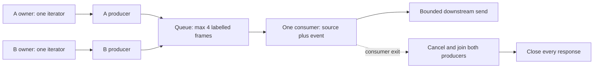

# Part 8: Coordinate several streams without losing their owners

> **Role:** deep dive and implementation. Start with [the finite SSE owner](07_streaming_patterns.md). You should be able to trace admission, headers, a retained parser iterator, disconnect and awaited close.
>
> **Outcome:** select the first useful provider stream, close every loser immediately, merge bounded labelled events, and distinguish replay from provider-specific resumability.

Our search assistant can consult providers A and B. We want one fast answer, or an
explicit comparison containing both answers. These are different products: a race
selects one source; a merge preserves both source identities. Neither can be implemented
safely by returning an anonymous async generator and forgetting who opened each response.

## 1. An owner contains progress, not just a URL

[StreamOwner](examples/advanced_streaming.py) holds a response, one byte iterator, its
partial-frame buffer and semantic outcome. `open()` creates the iterator once.
`next()` advances it. The first-read task returns `(owner, first_frame)`, so the consumer
continues from exactly that position.

Creating a new `response.aiter_lines()` after reading the first line is not a continuation
contract. The first iterator may already have buffered bytes or decoder state; a second
can encounter an already-consumed stream or lose buffered data. HTTPX's manual-streaming
[ownership rules](https://www.python-httpx.org/async/) also require closing the response
regardless of how many iterators the application constructed. Keep one.

An owner is useful even before `open()` completes. It starts with `response=None`;
`close()` is idempotent and checks whether a response exists. If status validation fails,
`open()` closes what it acquired. The outer lifetime still calls close: redundant close
of the same owner is safer than guessing whether an inner generator's cleanup started.

## 2. Race the first useful item

[First-stream selection](examples/advanced_stream_racing.py) starts one first-read task
per candidate. A candidate must open successfully and yield a `delta` with the expected
shape. Empty EOF and an immediate done marker are not useful answers. An early failed
provider does not win the race; selection continues while another candidate can succeed.

Once there is a winner, cancel unfinished first-read tasks, **join every first-read task**,
and close every nonwinner response. The set of completed tasks can contain several
successes. Closing only tasks still marked pending leaks a loser which completed in the
same event-loop turn.

```mermaid
sequenceDiagram
  participant R as Race owner
  participant A as Provider A owner
  participant B as Provider B owner
  participant C as Consumer
  R->>A: open; first next()
  R->>B: open; first next()
  A-->>R: delta A0
  B-->>R: delta B0 in same turn
  R->>R: stable tie break chooses A
  R->>B: close immediately, including completed first-read
  R-->>C: A owner + A0
  C->>A: next() on retained iterator
  A-->>C: A1, then more for 60 seconds
  C->>R: consumer exits or disconnects
  R->>A: awaited close
```

B closes during selection, not sixty seconds later when A finishes. The test deliberately
makes both first-read tasks complete without a delay, asserts one owner is already
closed inside the winner's context, then continues A's same iterator through its next
two deltas and done marker.

Use the context manager for the complete consumer lifetime:

```python
# Integration excerpt inside a pre-admitted response owner; client and send_frame are owned by it.
async with first_stream([
    StreamOwner(client, '/provider-a'),
    StreamOwner(client, '/provider-b'),
], timeout=5) as (winner, first):
    await send_frame(first)
    while (frame := await winner.next()) is not None:
        await send_frame(frame)
        if frame.kind == 'done':
            break
```

The full helpers and deterministic providers are in
[advanced_stream_racing.py](examples/advanced_stream_racing.py) and
[advanced_test_streaming.py](examples/advanced_test_streaming.py). This excerpt does not
claim to be a standalone endpoint; Part 7 owns the ASGI response, send deadlines,
authentication and disconnect watcher. Replace its single-provider body with this
context only after reserving the fan-out resources described next.

## 3. Admission must describe the fan-out before headers

A two-provider race can temporarily hold two live responses, even though only one
answer reaches the client. Reserve capacity for two before opening either, or acquire
each provider's independent reservation before starting that provider. If the second
reservation fails, the first must be unwound or an explicitly documented one-provider
fallback selected. Do not partially acquire and then wait forever for the other half.

A local `WeightedGate.lease(weight=2)` reserves two units atomically for the whole race
in one process. It conservatively keeps that reservation until winner cleanup. Releasing
the loser portion early requires a different owner API with separately tracked leases;
do not call `release()` twice against a single opaque weighted lease. Fleet provider
limits in [Part 9](09_distributed_admission_control.md) require one attempt admission per
actual provider call. Financial reservation in [Part 10](10_llm_token_economics.md) must
include both possible billed generations.

Admission decisions use verified tenant/tier and planned resources. The number of chunks
which might eventually arrive is unknown and cannot justify a pre-header rate decision.
A dynamic overload signal can reject new streams; it cannot retroactively turn a running
200 response into 429. Existing streams need an in-band error or explicit cancellation
policy. Document whether a fallback means reduced quality, stale data or fewer sources.

Do not wrap `BoundedCaller.request_json()` around a stream. Its contract is to read a
bounded JSON body and close it. Reuse its admission concepts with a stream owner whose
lease lasts through the entire body. A request-scoped HTTPX client must not close while
an owner still needs its response; the application lifespan owns shared clients.

## 4. Merge with source identity and bounded supervision

For the comparison product, [merged_stream](examples/advanced_stream_racing.py) owns a
producer task for each named source. Every queue entry is `(source_id, Frame)`. The queue
holds at most four entries, and each provider parser bounds a retained frame to 4096
bytes. A slow consumer fills the queue, which blocks producer puts and slows upstream
reads rather than allocating memory without limit.



Each producer reports either done, a sanitized error or missing-terminal error. The
consumer removes that source from its pending set only on a terminal event. An error
from B need not erase useful A output; the comparison UI can mark B failed while A
continues. If the product requires all-or-nothing success, choose fail-fast semantics
and cancel the remaining sources after the first error instead. That choice belongs in
the protocol, not in an accidental `gather()` exception policy.

A producer's `finally` closes its owner. It must not try to enqueue a completion sentinel
unconditionally during cancellation: a full queue plus a disconnected consumer would
make cleanup wait forever. The context exit instead cancels/joins all producers and
closes all owners directly. This also works if the consumer reads one frame and stops.
Use the context manager even when breaking early; abandoning the returned iterator alone
is not a complete lifetime protocol.

The merge helper bounds buffering, not total operation duration. Place it inside the
Part 7 total-deadline/response owner. The test verifies a bad source yields a labelled
error while the healthy source reaches done, and an early consumer exit closes both
still-running drip streams. It does not require a real provider or credential.

## 5. Transform one representation, then serialize once

Inside the application use `Frame(kind, data)`, not a mixture of raw bytes, bare JSON
strings and lines prefixed with `data:`. `Frame.encode()` produces one client SSE frame.
A source-labelled merge should encode deltas with that source and include source identity
on its terminal/error messages as well; the example yields `(source, frame)` so the
response adapter retains that identity for every event, including done.

The fixture's done marker is recognized before JSON parsing. A missing done marker is
unknown completion. A known protocol failure is failed; caller disconnect is cancelled;
provider done is done. Keep client delivery separately: a provider can finish while the
browser disconnects before it receives the final frame. None of these statuses supplies
missing token usage, which has its own reconciliation contract.

Chunk transformations also affect latency. Buffering until a sentence boundary can
improve display quality but requires a bounded character count and flush deadline; a
provider might never emit punctuation. Redaction across chunk boundaries needs retained
bounded context because a sensitive string can be split between two chunks. Do not log
unredacted intermediate frames. For signatures/checksums, define whether they cover
provider bytes or the transformed client representation; those are different objects.

## 6. Replay is not automatically resumable provider execution

There are three distinct ways a connection can recover:

| Contract | Required durable state | What a reconnect does |
|---|---|---|
| Browser event replay | Stored client events with monotonic sequence IDs | Send events after `Last-Event-ID` from the same logical operation |
| Provider-supported resume | Provider operation ID and documented cursor/offset | Continue or retrieve that provider operation within its retention window |
| New generation | New admitted provider attempt and explicit UI replacement | Start new output; previous text may differ and cost may repeat |

An arbitrary `resume_from=last_chunk` parameter cannot make a provider support resume.
The provider must document cursor ordering, retention, authorization, duplicate events,
terminal states and whether resumption re-executes work. Read that endpoint's contract;
do not invent a generic LLM cursor API. This fixture intentionally supports no provider
resume. Its local fake stream is a new generation on every open.

For browser replay, persist events under `(tenant, operation_id, sequence)` and authorize
that operation on reconnect. Save the terminal event too. If the requested sequence has
expired, return an explicit gap/restart decision rather than silently skipping history.
A reconnecting browser must deduplicate event IDs; transport delivery can repeat the
last acknowledged event. `Last-Event-ID` belongs to the client event stream protocol,
whose semantics are specified in the
[HTML SSE standard](https://html.spec.whatwg.org/multipage/server-sent-events.html#the-last-event-id-header).
It does not by itself reveal a provider cursor or resume a crashed worker.

## 7. Test and operate the fan-out

Use the environment from Part 7:

```bash
cd examples
.venv/bin/python -m pytest -q advanced_test_streaming.py
```

The tests cover simultaneous winners, continuation on the retained iterator, immediate
loser closure, failed and empty first candidates, labelled merge failure and early exit.
Combine these with the ASGI disconnect/total/idle/send tests before changing the response
implementation. Add provider-contract tests for your real dialect and supported resume
endpoint; neither is implied by the local fixture's passing tests.

Production checks should include candidate count, candidate admission failure, winner
source, time to first useful frame, loser lifetime after selection, merge queue occupancy,
per-source outcomes, total duplicate spend, cleanup duration and unknown final usage.
Use bounded provider/model labels, not prompt text or arbitrary user IDs in metrics.
Authenticate the caller before fan-out, restrict provider targets to trusted configuration,
and protect event replay with the same tenant authorization as the original operation.

If both provider bills remain high after racing, inspect whether losers close immediately
and whether provider cancellation actually stops billing. If a stream hangs after B
fails, inspect whether its terminal/error event reached the queue. If output skips words
after the first chunk, inspect iterator ownership and decoder buffering. Roll out provider
adapters behind a small canary and retain the previous wire parser until replay retention
has passed; persisted client events may outlive the process version which created them.

## Recap

A multi-provider stream owns several responses and tasks before it owns a winner.
Retain one iterator per response, close all losers immediately, bound merge queues and
carry source identity through terminal events. Treat browser replay, provider resume and
new generation as distinct contracts with distinct cost and durability requirements.

## Check yourself

<details><summary>Both providers return their first item together. A wins and runs for 60 seconds. When does B close?</summary>
Immediately during selection, even though B's first-read task is already complete.
Only closing unfinished tasks misses this race and retains B's connection and capacity.
</details>

<details><summary>A browser sends Last-Event-ID 18. Can we pass 18 to any provider and continue?</summary>
No. It identifies an event in your client stream. Replay needs stored events from the
same authorized operation; provider continuation requires that provider's own documented
operation/cursor contract.
</details>

## Try it

Change one candidate to return `[DONE]` without text while the other returns a useful
first delta. Predict the winner and every owner's closed state, then run the fixture.
Next set the merge queue to one item and stop consuming after the first delta. Assert
all producer tasks finish and all responses close; explain why a sentinel put in a
cancelled producer's finally block could deadlock that changed case.

Scaffold: start with `owners = [StreamOwner(client, '/empty'), StreamOwner(client, '/ok')]`
and fill in `assert winner is owners[___]`; inside the context assert the other owner is
closed. Repeat `merged_stream(..., max_buffer=1)` and break after `anext(events)`.

Hint: a useful first frame must be a delta. The context owns producer teardown even when
the consumer stops before any terminal event.

<details><summary>Reasoned solution</summary>
The useful owner is index 1; index 0 closes during selection. Both close on context exit.
A one-item merge queue may already be full when the consumer exits, so producer cleanup
must close directly and cancellation must be joined. Awaiting a final sentinel put would
need a consumer which no longer exists and could prevent cleanup forever.
</details>

**Next:** [Fleet admission](09_distributed_admission_control.md). **Back:** [learning map](README.md).
