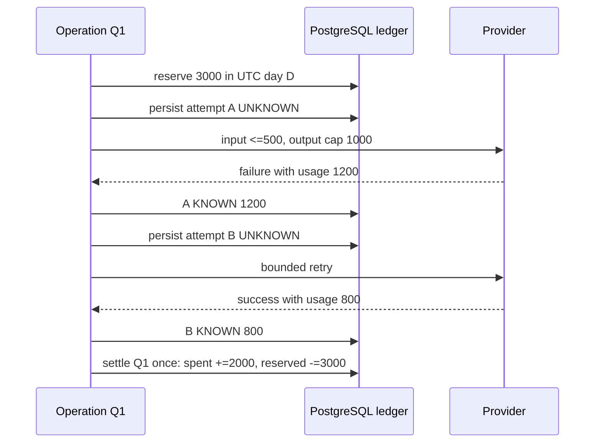
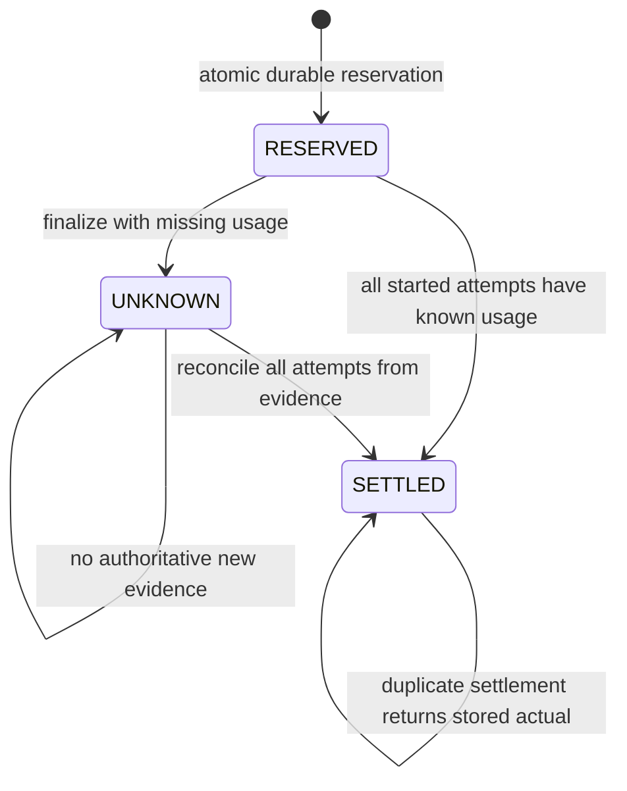

# Part 10: Reserve a durable budget for every attempt

> **Role:** implementation tutorial. Prerequisites: [fleet attempt admission](09_distributed_admission_control.md), SQL transactions, and the difference between provider progress and semantic completion in [Part 7](07_streaming_patterns.md).
>
> **Outcome:** persist one logical reservation, enforce a bounded attempt plan, account for failed attempts as well as success, and reconcile unknown usage after cancellation or process loss.

Alice has a daily token allowance. Two requests both read “1,000 tokens remaining,”
each generate 800, and both increment the counter afterward. The final counter is
accurate but the policy was already violated. A correct hard budget must reserve
capacity before spending it. A local `finally` that refunds unused tokens still fails
when the process disappears before that block runs.

Our running operation Q1 reserves for at most two attempts. Attempt A consumes 1,200
tokens and fails; attempt B consumes 800 and succeeds. The provider total is 2,000.
Charging only B's final successful result undercounts the provider bill by 1,200.

## 1. Decide which budget is hard

A token budget, a monetary provider budget and a customer product allowance are related
but distinct. Input/output prices can differ, cached input can have different pricing,
and tool, storage or other charges may not be expressed as text tokens. Store the
provider/model/pricing version and usage dimensions needed for reconciliation. Do not
bake a current public price into a timeless tutorial; pricing and billed categories
belong to the selected provider contract and must be verified when integrating it.

| Policy | Reservation | Consequence |
|---|---|---|
| Soft estimate | Typical input/output usage | Efficient utilization, but overshoot is allowed and monitored |
| Hard token ceiling | Maximum supported input + enforced output, for every possible attempt | Conservative capacity, bounded by the provider's actual token contract |
| Hard monetary ceiling | Worst-case price across every allowed usage dimension and attempt | More conservative; requires complete billing semantics |
| Product charge for successful answer | Product-specific rule, independent of provider ledger | Failed provider attempts still cost the business |

The fixture implements a hard **total-token** ledger for a deterministic provider whose
input count is exact and output cap is enforced. It does not pretend that a rough
characters/4 estimate is a hard upper bound for an arbitrary tokenizer. For a real
provider, validate the input with that model's supported tokenizer/counting contract,
set the provider's actual output-limit field, include billed reasoning/tool/cache units
where relevant, and constrain the model choice. If those bounds cannot be established,
label the policy soft or reserve a conservative contractual maximum.

## 2. Persist identity and the original window

[The PostgreSQL schema](examples/advanced_db.py) has three budget tables:

- `advanced_budget_windows`: `(tenant, window_date)`, spent, reserved and ceiling.
- `advanced_budget_ops`: Q1's immutable tenant, original UTC day, input/output caps,
  maximum attempts, total reservation, state and eventual actual total.
- `advanced_budget_attempts`: `(operation_id, attempt)` with UNKNOWN or KNOWN usage.

[reserve()](examples/advanced_budget.py) takes a transaction-scoped advisory lock for
Q1's identity, then creates or verifies its operation record. A guarded window update
adds the reservation only when `spent + reserved + new_reservation <= ceiling`. Competing
operations serialize on the window row; no read/compare/write gap remains. The operation
and reservation commit together. PostgreSQL's [row/advisory lock semantics](https://www.postgresql.org/docs/17/explicit-locking.html)
are the synchronization mechanism, rather than an in-process Python lock.

For input cap 500, output cap 1,000, and two attempts, Q1 reserves 3,000 tokens:

```text
reservation = max_attempts × (input_cap + output_cap)
            = 2 × (500 + 1000)
            = 3000
window invariant: spent + reserved <= ceiling
```

Replaying the same Q1 on the next UTC day returns its original record. Settlement never
calls `today()` to choose a bucket. If Q1 reserved in October 30 and completes October
31, October 30's obligation is reduced. A new operation on October 31 has a new identity
and a different window. This avoids both refunding the wrong day and hiding unpaid work.

The fixture uses a globally unique server operation ID, never an unscoped client key.
[Part 11](11_idempotency.md) explains how to bind client keys to tenant/endpoint/body and
recover the same operation. Ceiling values are server policy; the API caller cannot
raise its own allowance by supplying a larger number. An existing window's ceiling is
not silently overwritten by a later reserve call.

## 3. Unknown before dispatch, known only from evidence

Before a provider attempt starts, `start_attempt(Q1, 0, input_tokens)` locks Q1, verifies
its state and attempt index, checks the input cap, and inserts attempt 0 as UNKNOWN.
That transaction commits **before** dispatch. It returns the required output cap for
the provider adapter. A duplicate start for the same attempt fails the unique constraint;
it is not permission to send the request again.



Recording usage is idempotent only if repeated evidence agrees. A second report of 800
for B is harmless; 900 conflicts and triggers investigation. Usage exceeding the enforced
reservation is a contract breach, not a number to clamp silently. Keep the reservation
and alert rather than hiding the discrepancy.

The ledger distinguishes operation finalization from individual attempt reports. Normal
retry orchestration records A's known usage and then starts B while Q1 is RESERVED.
Only after the attempt plan has ended does `settle()` close Q1 or mark it UNKNOWN. It
must not settle after A and then start B; SETTLED/UNKNOWN operations reject new starts.

## 4. Settlement is a guarded transaction

The operation state machine below retains obligations when information is missing.



`settle()` locks Q1. If any started attempt is UNKNOWN, it preserves the whole reservation
and marks the operation UNKNOWN. Otherwise it totals every attempt, subtracts the original
reservation from the original window, adds actual usage once, and persists SETTLED plus
that total in the same transaction. Retrying after a lost settlement reply reads the
stored total instead of debiting again.

The full reservation remains held while unknown, including capacity for unused attempts.
This is intentionally conservative. A more efficient design can split confirmed spend
and residual obligation, but must move both atomically and never refund an unknown
attempt. The simpler fixture makes its invariant easy to inspect.

A process can die after provider work but before recording usage. Its attempt row was
already UNKNOWN and its reservation was already durable, so restart does not manufacture
zero usage. A recovery worker lists old RESERVED/UNKNOWN operations, queries supported
provider operation/usage APIs or reconciles authoritative billing events, records each
attempt's evidence, then calls the same guarded settlement. If no such evidence exists,
retain the obligation or apply an explicit conservative write-off policy approved by
the product's accounting rules; do not infer zero from a missing response.

## 5. Retries, streams and cancellation must expose usage

The canonical bounded JSON caller owns retries and transport cleanup, but its ordinary
return value exposes only the successful JSON result. Wrapping it in a reservation
context and charging that result cannot discover usage from earlier failed attempts.
A provider-specific usage adapter must observe each actual attempt, including failure
bodies/headers and provider request IDs. Use an explicit single-attempt call boundary or
extend the adapter with an attempt event contract; avoid hidden retries inside SDKs.

The executable [budget demonstration](examples/advanced_budget_demo.py) models that
adapter explicitly: each attempt is started durably, the fake provider reports 1,200
then 800, and the ledger records both. The fixture does not make real LLM calls. For
an actual adapter, keep one total deadline, the same bounded local/shared admission
rules, an enforced provider output cap, and a maximum attempt count matching the durable
reservation. A hedge is another potentially billed attempt even if its output loses.

Streaming usage often arrives late. A browser disconnect after several deltas can
prevent receiving final usage. Provider done, socket EOF, cancelled task and missing
usage are separate facts. Closing the HTTP stream releases capacity, but does not
refund the token obligation. A cleanup `finally` can mark known local state during
cooperative cancellation; it cannot guarantee persistence after `SIGKILL` or machine
loss. The pre-dispatch UNKNOWN row is the protection against those failures.

Customer charging can intentionally ignore failed attempts while the provider ledger
still records them. Preserve both numbers: provider cost 2,000 and product charge perhaps
800. Conflating them makes margin and retry cost invisible. Never claim retries are free
merely because a remote business operation supports idempotency.

## 6. Run the durable failure laboratory

Use the environment and services from Part 9:

```bash
cd examples
.venv/bin/python advanced_db.py
.venv/bin/python advanced_budget_demo.py
.venv/bin/python -m pytest -q advanced_test_postgres.py
```

Expected demonstration output includes failed attempt 0 with 1,200 usage, successful
attempt 1 with 800, and `{'spent': 2000, 'reserved': 0}`. The tests use unique tenant and
operation IDs, two independent PostgreSQL connections for the last-budget race, and a
child process which exits with code 17 after committing an attempt start.

The acceptance cases assert:

| Changed condition | Required state |
|---|---|
| Duplicate settlement | Spent increases once; stored actual is replayed |
| Completion crosses midnight | Only the original window changes |
| Failed A 1200 then successful B 800 | Actual total is 2000 |
| Missing usage, cancellation, process death | UNKNOWN remains; reservation is not refunded |
| Later authoritative usage arrives | UNKNOWN transitions to SETTLED once |
| Two operations race for final 1000 tokens | Exactly one reservation succeeds |

The cancellation test cancels owned provider work after a durable attempt start and
verifies ledger retention; the process-loss test exits without cleanup. Neither requires
assuming that a Python `finally` ran. The fake provider's billing evidence is deterministic;
real provider billing reconciliation remains an integration-specific dependency.

## 7. Operate the financial boundary

Monitor confirmed provider usage, reserved obligation, age/count of UNKNOWN operations,
reservation utilization, failed-attempt spend, hedge spend, reconciliation lag and
provider-vs-ledger differences. An old large UNKNOWN population reduces available
budget even if current traffic is low; that is a reconciliation incident, not evidence
that capacity should be reset. Reconcile in bounded batches and record every adjustment.

Use bounded provider/model/feature metric labels. Tenant-level reporting belongs in
an access-controlled ledger/reporting store when tenant cardinality is large. Prompts,
credentials and raw billing payloads should not appear in general request logs. Limit
who can alter ceilings, erase evidence or apply a write-off; retain an audit trail.

For cost forecasting, separate estimated pace from hard enforcement. With a monthly
ceiling of $10,000 and $6,200 spent after 18 days, a trailing pace of $280/day projects
$9,560 after another 12 days. A forecast can warn before a hard limit denies requests,
but does not replace the atomic reservation. Compare fast and slow burn windows so a
brief incident and a sustained pricing/model change are both visible.

Retry budgets additionally bound amplification: a policy allowing at most ten retry
starts per hundred originals needs an atomic admission operation, not `GET ratio` then
`INCR`. Partition it by the failure domain, retain a minimum sample policy, and treat
hedges consistently. A retry ratio cap controls traffic; the durable per-operation cap
controls worst-case committed usage. Keep both within the provider's real pricing model.

Before production, exercise database outage before reserve, crash after reserve/start,
usage report duplication, delayed reconciliation, window rollover and cap exhaustion.
Back up ledger records, version provider adapters and pricing interpretation, and
migrate states without converting UNKNOWN to zero. New model features can add billing
dimensions; block that model until reservation and reconciliation understand them.

## Recap

Reserve a complete enforced attempt budget before work. Persist UNKNOWN before each
dispatch, record all attempts, and settle once against the original window. Missing
usage is an outstanding obligation. Product charging and provider spending are separate.

## Check yourself

<details><summary>A fails after 1200 tokens; B succeeds with 800. What should provider accounting record?</summary>
2000, even if the customer product policy charges only for B. Every attempt may consume
provider resources; a final-success-only result cannot reconstruct the full cost.
</details>

<details><summary>A process dies after output but before settlement. Can recovery release the reservation because no usage was saved?</summary>
No. The pre-dispatch attempt is UNKNOWN. Recovery must obtain evidence or apply an
explicit conservative policy; absence of a saved report is not proof of zero usage.
</details>

## Try it

Modify the fixture so attempt B reports no usage and Q1 crosses midnight. Predict spent,
reserved and state in both days before running it. Then deliver B's usage twice and
settle twice. Assert one debit of 2,000 in the original day and no mutation of the new day.

Scaffold: retain A's `record_usage(op, 0, 1200)`, replace B's report with
`record_usage(op, 1, None)`, then fill in `assert settle(op) is _____`. Query both
`window_date` rows before supplying B's later usage.

Hint: settlement uses the saved day, and UNKNOWN keeps the entire conservative reservation.

<details><summary>Reasoned solution</summary>
The first settlement returns `None`: original-day spent remains zero and reserved remains
3000, with Q1 UNKNOWN; no new-day bucket is created by settlement. After B reports 800,
settlement records 2000 spent and zero reserved in the original day. Repeating the report
and settlement returns the stored 2000 without another debit.
</details>

**Next:** [Recover one idempotent operation](11_idempotency.md). **Back:** [learning map](README.md).
