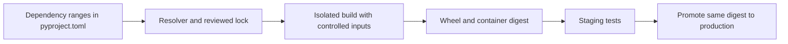

# Separate dependency intent, a resolved environment and a release artifact

Role: decision guide. Prerequisites: basic Python, virtual environments and the
[deployment overview](../../operations/deployment/docker_and_deployment.md).
For an application, keep dependency ranges as intent, resolve a reviewed lock for deployment,
and build one artifact that moves unchanged through environments. A reusable library usually
publishes compatible dependency ranges so its consumers can resolve a shared environment.

## Why the same commit can produce different code

The document service declares `httpx>=0.27,<1`. On Monday its resolver picks one compatible version;
on Friday a newer compatible version exists. The commit did not change, but the installed graph
can. An exact direct pin still leaves transitive dependencies free unless the full graph is resolved.
A lock records selected versions and artifacts for its supported environments. It does not pin the
operating system, interpreter, compiler or every build-time input by itself.

A minimal project metadata excerpt shows intent and the build boundary:

```toml
[build-system]
requires = ["setuptools>=77"]
build-backend = "setuptools.build_meta"

[project]
name = "document-service-example"
version = "0.1.0"
requires-python = ">=3.11"
dependencies = ["httpx>=0.27,<1"]
```

This is an explanatory excerpt, not a complete package: source layout, package discovery and a
resolved build/runtime environment are still required. The build frontend invokes the backend to
produce a wheel. A wheel is an installable distribution; a source distribution requires a build
step. A native-extension wheel also has interpreter/platform compatibility tags, so a wheel built
for one Linux/Python combination may not install on another.
[PyPA project metadata](https://packaging.python.org/en/latest/guides/writing-pyproject-toml/)
and [packaging tutorial](https://packaging.python.org/en/latest/tutorials/packaging-projects/), checked 2026-10-30.

The release path has distinct state at each step:



Rebuilding after staging creates another artifact, even from the same commit. Promote the tested
digest instead. An editable local install points imports at the source tree; it can hide a missing
file in the wheel. Therefore the release test installs the built wheel into a clean environment
and imports it from outside the repository directory.

## Choose a workflow the project can maintain

| Situation | Choice | Verification |
|---|---|---|
| One application | Existing maintained lock workflow, committed lock, frozen/sync install | Fresh install produces the reviewed graph |
| Published library | Compatible runtime ranges; locked development/test environment | Test minimum supported and current compatible dependency sets |
| Native extensions | Build/test wheels for deployed interpreter and OS targets | Install and import in the actual target image |
| Restricted network deployment | Reviewed wheelhouse/internal index and artifact hashes | Offline installation succeeds with no source build surprises |

Do not combine multiple resolvers that silently rewrite each other's graphs. Review lock changes
like code: unexpected packages, index locations, transitive upgrades and supported Python/platform
markers matter. Hash verification detects an artifact differing from the expected bytes; it does
not prove those expected bytes are benign. Use trusted package sources, vulnerability scanning and
provenance checks as separate controls. Keep credentials out of package-index URLs in logs.

Before shipping, record interpreter/base-image versions, lock and artifact hashes, run dependency
consistency checks, and execute import/startup tests from the installed artifact. “Works only from
the repository root” usually points to missing package data, import path leakage or editable-install
assumptions. Repair packaging and rebuild; do not patch files into an already tested image. Rollback
selects the previous complete artifact, including dependencies.

## What's changing

Checked 2026-10-30: `pylock.toml` is the standardized PEP 751 lock format. Tool support and platform
scope still matter. The pip changelog labels its lock command and pylock input support experimental;
keep a working project workflow until the required producer/installer path is tested.
[Specification](https://packaging.python.org/en/latest/specifications/pylock-toml/),
[pip changelog](https://pip.pypa.io/en/stable/news/).

**Decision exercise:** a library supports Python 3.11 and 3.13, but its application lock was generated
only for macOS/Python 3.13. Can the lock prove a Linux/Python 3.11 deployment will work?

<details><summary>Answer</summary>

No. Environment markers and available wheel tags can change the resolved/installable graph. Produce
and verify a lock/artifact path that includes the actual deployment target, then install and test
there. A successful local resolution is evidence for that local environment only.

</details>
