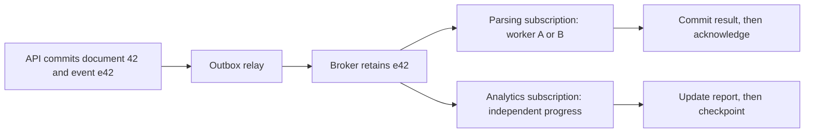

# Choose a broker by what must survive

**Role: decision guide.** Prerequisites: the [durable job lesson](../../background_work/foundations/03_minimal_durable_task.md) and ordinary HTTP request handling. This path assumes Python 3.11+; product guarantees below were checked on 2026-10-30.

## Start with the obligation, then choose the transport

Tenant 7 submits document 42. The API promises to parse it even if the worker restarts. A queue distributes that obligation among competing workers: one delivery is normally assigned to one consumer, and successful acknowledgement makes it eligible for removal. A second requirement, “analytics must reconstruct last month's processing,” needs retained history independently of whether today's worker finished. That is a log requirement.

**Pub/sub** describes fanout: multiple subscribers receive a publication. It does not specify durability. Redis Pub/Sub loses a notification for a disconnected subscriber; a retained stream can let independent consumers catch up. A **stream** is an ordered sequence, but ordering scope, retention and consumer progress depend on the product. “Streaming” alone is not a recovery contract.

The same event needs separate consumption state when parsing and analytics are independent:

Two workers inside the parsing subscription share work. Analytics needs its own queue, group or durable consumer; adding it as a competing parser would steal work instead of observing every event. The outbox makes the API-to-broker handoff recoverable; [contracts and outbox](05_message_contracts_and_outbox.md) develops that boundary.

## Pick the simplest system that meets the recovery requirement

| Workload | Starting point | Why; boundary that changes the choice |
|---|---|---|
| A few durable jobs owned by one PostgreSQL service | Database job table | Submission and business state share a commit; polling and database load limit growth |
| AWS worker queue, minimal broker operations | [SQS](03_sqs.md) | Managed delivery and visibility leases; routing/fanout needs additional subscriptions/services |
| Task queues with exchange routing | [RabbitMQ](02_rabbitmq.md) | Explicit routing and consumer acknowledgements; classic/quorum work queues are not an arbitrary replay log |
| Long retained history and many independent readers | [Kafka](../kafka/README.md) | Partitioned logs, offsets and stream ecosystem; partition design and operational ownership matter |
| Durable subject routing and bounded replay | [NATS JetStream](../nats_jetstream/README.md) | Subjects plus durable consumers; validate retention policy and acknowledgement mode |
| Existing Redis deployment and bounded retained work | [Redis Streams](../redis/02_pubsub_and_streams.md) | Consumer groups and pending recovery; persistence, trimming and failover still constrain loss |
| Ephemeral UI refresh hint | Redis Pub/Sub or Core NATS | Missing a hint is acceptable because authoritative state can be fetched |
| Wake a PostgreSQL poller after commit | `LISTEN/NOTIFY` plus durable table | Notification reduces idle delay; it is not the stored obligation |

A broker's audit history is not automatically a compliant audit store: administrators can delete topics, retention expires, and personal-data deletion may conflict with indefinite retention. Define access, retention and tamper evidence separately.

For `LISTEN/NOTIFY`, commit the job row and emit its ID in the same transaction. A connected listener wakes and queries the table; an offline listener misses the signal but its periodic poll still finds the row. Establish `LISTEN` and commit it before inspecting initial state to close the startup race. Notifications are delivered after commit; long listener transactions delay reception and queue cleanup. The default payload must be shorter than 8,000 bytes: send an ID, not a document. [PostgreSQL NOTIFY](https://www.postgresql.org/docs/current/sql-notify.html) and [LISTEN](https://www.postgresql.org/docs/current/sql-listen.html).

## Read delivery claims at the effect boundary

Suppose the worker commits result `r42`, then crashes before acknowledging `e42`. The broker cannot distinguish this from a worker that crashed before committing. It must redeliver to avoid losing unfinished work.

| Claim | What it permits | Application consequence |
|---|---|---|
| At-most-once | A lost attempt is not retried | Accept loss or reconcile from another durable source |
| At-least-once | One logical message can arrive repeatedly | Collapse duplicates using durable event identity |
| Effectively-once | Retries occur, but one logical business effect is retained | Commit the deduplication record and local effect atomically |
| Exactly-once within a transaction scope | A specific subsystem atomically commits defined state | Do not extend that claim to an unrelated email, payment or database |

Use `(consumer_name, event_id)` for independent consumer deduplication. A trace ID joins diagnostics; it is not necessarily unique per business event. Keep deduplication records at least as long as the permitted replay horizon. If replay can reach six months but deduplication expires after seven days, old side effects can happen again.

For an external side effect, a local inbox cannot alone make the remote write atomic. Supply the provider's stable idempotency key or persist an intent and reconcile ambiguous outcomes. Kafka's [delivery semantics](../kafka/reliability/01_delivery_semantics.md) and [durable consumer effects](../kafka/reliability/02_durable_consumer_effect_idempotency.md) own the deeper implementation.

## Capacity is unfinished work plus its age

At 20 documents/s and a 5-second average parse, roughly 100 parses are concurrently in progress at equilibrium. If downstream capacity is 80, pulling 500 deliveries only hides 420 jobs inside workers; it does not increase useful throughput. Bound prefetch or receive concurrency to actual processing capacity. Apply per-tenant admission control before one tenant consumes all slots.

Measure oldest unprocessed age alongside queue depth. A depth of 100 can be normal at 1,000/s and disastrous at 1/minute. For a retained log, measure consumer lag and time remaining before retention removes needed records. Alert when delay threatens the user promise or retention headroom, with queue/group ownership and a runbook. Scale only after checking provider quota, database contention and poison-message retries.

A poison message fails deterministically. Move it to a restricted parking lot after a bounded attempt policy, retain event ID and failure class, and repair the cause before controlled replay. Dead letters are pending operational work, not successful delivery. Replay needs a rate limit, an audit trail and deduplication. Never log raw document contents to diagnose a malformed envelope.

## Validate the choice before production

Use the same workload across candidates: payload sizes, tenant skew, consumer crash timing, disconnected producers and peak recovery backlog. Count committed business results as well as acknowledged messages. Test broker outage, worker death after commit, retention expiry, credential denial and a poison event. The success condition is a known outcome for each accepted document, including a visible terminal failure; raw messages/s alone cannot establish that.

Budget broker storage/replication, request charges, cross-zone transfer, empty polling, dead-letter retention and operator time. Use separate producer and consumer identities, TLS, destination-scoped permissions and encrypted storage where required. Rehearse a broker/client upgrade with the actual queue policies and rollback constraints.

**Production readiness:** know who owns accepted work; bound queue age and retry attempts; demonstrate duplicate collapse; rehearse replay; validate retention and access; and document recovery when the broker cannot be reached.

## Decision exercise

A new analytics consumer must rebuild six months of results, but parsing events are deleted after acknowledgement. Can adding another parsing worker solve this?

Answer

No. It would compete for current work and still have no retained history. Give analytics an independent retained source: a log with sufficient retention, an export of authoritative database state plus subsequent events, or a separate durable subscription. If historical events were never retained, the broker cannot invent them. Choose the initial snapshot boundary so updates during the export are not lost.

## What's changing

Checked 2026-10-30: **GA / add to notes:** SQS standard-queue fair scheduling uses `MessageGroupId` to identify tenants; it does not add FIFO ordering. [Fair queues](https://docs.aws.amazon.com/AWSSimpleQueueService/latest/SQSDeveloperGuide/sqs-fair-queues.html). **GA / add to notes:** RabbitMQ 4.3 added quorum delayed retries; 4.4 adds delayed/deferred messages and zone-aware placement. Validate the deployed release before choosing those mechanisms. [4.4 release](https://www.rabbitmq.com/blog/2026/10/20/rabbitmq-4.4-release). Existing Kafka and JetStream courses retain their own release-specific baselines.
