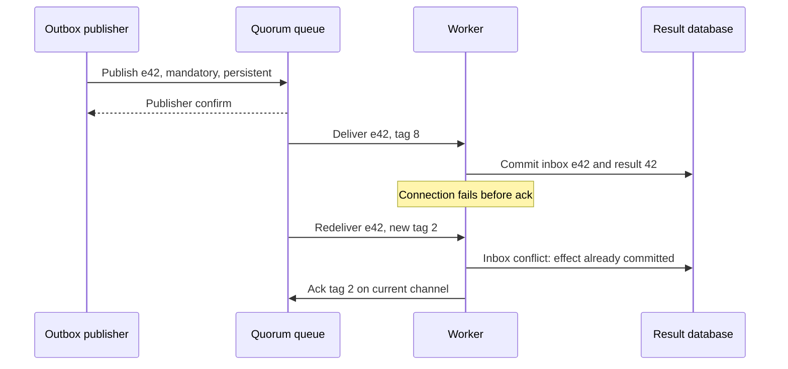

# RabbitMQ: confirm publication, then acknowledge the effect

**Role: implementation.** Read [broker selection](01_broker_decision_guide.md) first. Python example: Pika 1.x, AMQP 0-9-1 and RabbitMQ 4.x quorum queues. The local lab is a single-node experiment; it does not demonstrate high availability.

## Two acknowledgements protect two different handoffs

The document service publishes `e42` to RabbitMQ. A **publisher confirm** tells the publisher the broker accepted responsibility under the queue's durability rules. Later, a worker's **consumer acknowledgement** tells the broker it may remove that delivery. Between those signals, the broker owns pending delivery; neither signal independently proves the document was parsed.

An **exchange** routes publications into queues using bindings. A direct exchange matches a routing key exactly; a topic exchange matches patterns; a fanout exchange copies to every bound queue. Workers on the same queue compete. Independent subscribers need separate queues. The built-in default exchange routes by queue name, which keeps the first lab small.

## Complete one local round trip

Use a disposable local RabbitMQ, bound only to loopback. In one terminal:

```bash
docker run --rm --name notes-rabbitmq -p 127.0.0.1:5672:5672 rabbitmq:4.4
```

Wait for the broker's startup-complete log. In another terminal, from the repository root:

```bash
python3 -m venv /tmp/notes-rabbitmq-venv
/tmp/notes-rabbitmq-venv/bin/python -m pip install 'pika>=1.3,<2'
/tmp/notes-rabbitmq-venv/bin/python infrastructure/messaging/examples/rabbit_round_trip.py
```

Success prints `confirmed e42` followed by `effect committed; delivery acknowledged`. Connection refusal means the broker is not listening yet; `PRECONDITION_FAILED` on declaration usually means a same-named queue already exists with different properties. Use a fresh disposable broker instead of deleting a production queue. The example uses the broker's local-only `guest` account and plaintext loopback connection exclusively for this lab; production requires TLS and dedicated destination-scoped credentials.

The complete [example](examples/rabbit_round_trip.py) declares a durable quorum queue and publishes a persistent message with publisher confirms and `mandatory=True`. Mandatory publication makes unroutable delivery observable instead of silently losing it. The worker validates the envelope, commits an idempotent local SQLite effect, and acknowledges with the delivery tag from that channel. The database is in memory for the experiment: restarting the script loses its deduplication state. Use the [durable inbox transaction](05_message_contracts_and_outbox.md) in production.

Stop the disposable broker when finished:

```bash
docker stop notes-rabbitmq
```

The container uses `--rm`; stopping it discards this lab's broker state. Broker execution requires Docker access and is recorded separately from the executed local inbox example.

## Locate the crash before deciding what to retry

This sequence shows why the result can commit even when the broker still owes delivery:



Delivery tags belong to a channel, so tag 8 cannot be carried across reconnects. A redelivery flag is a transport hint, not a deduplication key. On an ambiguous publisher failure, retry the persisted event ID; on an ambiguous consumer failure, let durable deduplication decide. [RabbitMQ acknowledgement and confirm semantics](https://www.rabbitmq.com/docs/confirms), checked 2026-10-30.

A three-member quorum queue normally needs a majority available to make progress. Losing two members sacrifices availability to preserve the consensus history. Replicas on one machine do not protect against that machine's loss. Place members across appropriate failure domains, retain spare disk capacity and test leader replacement. [Quorum queues](https://www.rabbitmq.com/docs/quorum-queues).

## Match in-flight delivery to useful concurrency

For a push consumer with four processing slots, start with a measured prefetch near four rather than 1,000. Prefetch bounds unacknowledged deliveries, not their byte size or the downstream connection pool. Large payloads or an unavailable provider can still exhaust memory. Keep document bytes in authorized object storage and send a small reference.

The lab uses `basic_get` for one explicit delivery, so prefetch is not its flow-control mechanism. A long-lived worker should use consumption APIs and keep connection I/O responsive. Do not block Pika's connection thread for a long parse; use the client's supported thread-safe callback mechanism to acknowledge on the owning connection thread, or choose an async client and bound processing tasks. Heartbeats cannot be serviced by a blocked connection loop.

Measure ready and unacknowledged counts separately. Growing ready count with busy consumers suggests insufficient capacity; a large fixed unacknowledged count with no completions suggests stuck processing or acknowledgements. Compare those with oldest work age, effect latency, connection churn, redelivery rate and disk alarms. A broker flow-control alarm can explain blocked publication even while the network is healthy.

## Park failures instead of creating a redelivery storm

Immediate `nack(requeue=True)` can create a hot loop when all workers encounter the same unavailable dependency. Use bounded retry delay and jitter, and a durable attempt/deadline policy. RabbitMQ 4.3+ quorum delayed retry can supply broker-side delay; older deployments need a deliberately configured retry topology or an application scheduler. Verify version semantics before copying policy keys.

A **dead-letter exchange** routes rejected or expired messages elsewhere; it needs an existing exchange, binding and queue. Configure mutable settings with policies where possible. This policy is an explanatory operator excerpt: it assumes `documents.failed` already exists and is bound to a restricted parking queue.

```bash
rabbitmqctl set_policy document-failures '^documents\.parse$' \
  '{"dead-letter-exchange":"documents.failed","delivery-limit":8}' \
  --apply-to quorum_queues --priority 10
```

The delivery limit bounds repeated unsuccessful deliveries; it is not a wall-clock expiry for accepted work. Test a deliberately invalid envelope and verify it arrives in the parking queue with failure metadata. A missing destination or ordinary dead-letter forwarding failure can lose a message: quorum **at-least-once dead-lettering** requires its documented configuration, including the appropriate overflow mode, and target capacity. Merely naming a DLX does not enable that guarantee. [Dead-letter exchanges](https://www.rabbitmq.com/docs/dlx).

Pause affected consumption before investigating poison data. Record the stable event ID and safe error class, fix the handler/schema, then replay a small rate-limited batch. Keep tenant-sensitive payloads out of ordinary logs and limit parking-queue read permissions.

## Ship with a recovery contract

Test crash before effect, after effect/before ack, publish confirm loss, unroutable publication, queue-policy mismatch, broker restart and parking-destination outage. Assert one committed effect per event, eventual delivery or explicit parked state, and bounded resource use. A unit test mocking `basic_ack` cannot prove any of those broker behaviors.

Upgrade by checking server/client compatibility, feature flags, queue type and disk headroom, then rehearsing on restored non-production data. Do not assume a durable queue survives disk loss or that a newer on-disk format supports binary downgrade. Keep rollback at the application/configuration layer where broker downgrade is unsupported.

**Production readiness:** dedicated users and TLS; confirms plus returned-message handling; durable inbox; bounded prefetch and retries; parking destination with tested forwarding semantics; quorum placement; age-based alerts; and an upgrade/restore rehearsal.

## What's changing

Checked 2026-10-30. **DEPRECATED / changes baseline:** classic mirrored queues were removed in RabbitMQ 4.0; select quorum queues or streams instead of copying old mirroring policies. Quorum queues also acquired a default delivery limit of 20 in 4.0, so an unconfigured poison-message path can discard work. [Quorum guide](https://www.rabbitmq.com/docs/quorum-queues). **GA / add to notes:** 4.3 added delayed retry and granular consumer timeouts; 4.4 adds delayed/deferred publications and zone-aware placement. [4.3](https://www.rabbitmq.com/blog/2026/04/23/rabbitmq-4.3-release), [4.4](https://www.rabbitmq.com/blog/2026/10/20/rabbitmq-4.4-release). These optional features do not remove the inbox boundary.

## Recap

- Confirms end the publisher handoff; acknowledgements end one consumer delivery.
- A committed effect followed by connection loss produces a legitimate duplicate.
- Prefetch limits work held by push consumers; retry policy limits repeated failure.
- A dead-letter route needs tested storage and forwarding guarantees.

## Check yourself

**Q: The worker committed `e42`, lost its connection, then received tag 2. Which tag should it acknowledge?**

<details><summary>Answer</summary>

Tag 2 on the new delivery's channel, after checking the durable inbox. The old tag identifies an earlier channel-local delivery. Reusing it can close the channel without settling the current message.

</details>

**Q: Ready depth is low but unacknowledged depth and oldest work age keep growing. Should you only add publishers?**

<details><summary>Answer</summary>

No. Consumers have already taken the work. Inspect stuck processing, blocked connection loops and missing acknowledgements; reduce prefetch and protect the downstream dependency before increasing arrival rate.

</details>

## Try it

Change the lab to close the connection after committing the effect but before acknowledging. Keep the effect database on disk in a temporary directory, reconnect, and consume the redelivery. Hint: event identity survives; delivery tags do not.

<details><summary>Worked solution</summary>

Replace the in-memory SQLite database with one temporary file reused across attempts. After the first commit, close RabbitMQ without acknowledging. Reopen the connection/channel and retrieve the same queue's delivery. The inbox insert conflicts, so skip the effect and acknowledge the new delivery tag. The result table still contains one row. Delete the lab database only after the experiment; deleting it between attempts invalidates the deduplication test.

</details>
