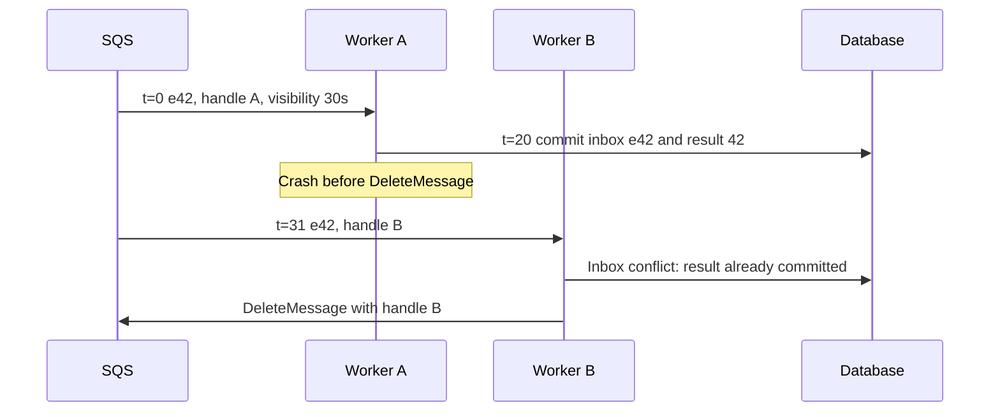

# SQS: a receive grants time to finish, not exclusive ownership forever

**Role: implementation.** Prerequisites: [broker selection](01_broker_decision_guide.md), [contracts and atomic consumer effects](05_message_contracts_and_outbox.md), and basic Python. The operational example uses Boto3 and an existing sandbox queue. SQS is an AWS service; the local exercise below needs neither an account nor network access.

## Trace one document through a visibility lease

At `t=0`, worker A receives event `e42` and a receipt handle. With 30 seconds of visibility, other receives normally cannot see that delivery until `t=30`. A must commit the result and delete the message using the handle from that receive. Receiving is not deletion.

If A pauses for 35 seconds, worker B can receive `e42`. A might still be executing. The lease does not kill A or prevent its database write. For standard queues, duplicate deliveries are possible even during visibility, so visibility is a scheduling mechanism rather than an exclusive application lock. [SQS visibility timeout](https://docs.aws.amazon.com/AWSSimpleQueueService/latest/SQSDeveloperGuide/sqs-visibility-timeout.html), checked 2026-10-30.

Observe why the inbox remains necessary even with a generous visibility setting:



Deletion settles the transport obligation after the database has settled the business effect. The new receipt handle is needed for the current delivery; a message ID is not a deletion handle. The same local [inbox demonstration](examples/inbox_demo.py) used by RabbitMQ works here because transaction atomicity is independent of the broker.

```bash
python3 infrastructure/messaging/examples/inbox_demo.py
```

Expected output: `applied duplicate applied result=ready count=1`. This executes duplicate collapse and rollback recovery, not SQS delivery semantics.

## Choose standard or FIFO from the ordering requirement

A standard queue suits independent document parses. Work may arrive out of order and more than once. FIFO adds order within `MessageGroupId`; separate groups can advance independently. Use a document or other aggregate key when its changes must be ordered. One group for the entire service serializes progress behind the slowest message.

FIFO producer deduplication remembers a deduplication ID for a five-minute interval. It does not make a remote payment or database update atomic with `DeleteMessage`. A consumer that commits then crashes can still process the same logical work again. Retain a durable application idempotency key beyond the service's send-deduplication interval. [FIFO queues](https://docs.aws.amazon.com/AWSSimpleQueueService/latest/SQSDeveloperGuide/sqs-fifo-queues.html) and [outage recovery](https://docs.aws.amazon.com/AWSSimpleQueueService/latest/SQSDeveloperGuide/designing-for-outage-recovery-scenarios.html).

For tenant 7 document 42, a FIFO producer could use `MessageGroupId="tenant-7-document-42"` and `MessageDeduplicationId="e42"`. Reusing `e42` for document version 4 would suppress a genuinely new publication within the interval. Generate event identity at the business transition, then persist it through transport retries.

## Receive only what the worker has capacity to finish

This **explanatory adapter excerpt** assumes `sqs` is a configured Boto3 client using workload credentials, `queue_url` identifies a sandbox queue, and `apply_event_atomically` owns the durable inbox transaction taught above. It omits application-specific parsing and connection setup, not the commit-before-delete boundary.

```python
response = sqs.receive_message(
    QueueUrl=queue_url,
    MaxNumberOfMessages=1,
    WaitTimeSeconds=20,
    VisibilityTimeout=60,
    MessageSystemAttributeNames=["ApproximateReceiveCount"],
)
for message in response.get("Messages", []):
    apply_event_atomically(message["Body"])
    sqs.delete_message(
        QueueUrl=queue_url,
        ReceiptHandle=message["ReceiptHandle"],
    )
```

If `apply_event_atomically` raises, this path does not delete the event. Visibility eventually expires, allowing another attempt. If deletion fails after commit, a retry finds the inbox record. Configure the SDK read timeout longer than the 20-second long poll. Long polling reduces empty receives and their request cost; an empty result is normal and is not proof the queue will remain empty. [SQS best practices](https://docs.aws.amazon.com/AWSSimpleQueueService/latest/SQSDeveloperGuide/sqs-best-practices.html).

Set visibility above the measured ordinary processing time plus commit/delete margin. For variable-length work, renew before expiry with `ChangeMessageVisibility`, using the current handle and bounded extension policy. A failed renewal means the attempt may overlap another worker: use attempt fencing for mutable job ownership, and idempotency for side effects. SQS's maximum visibility horizon is 12 hours from the receive; an extension does not restart that overall horizon. Very long workflows need durable job/workflow state rather than endlessly extending a queue delivery. [Visibility guidance](https://docs.aws.amazon.com/AWSSimpleQueueService/latest/SQSDeveloperGuide/sqs-visibility-timeout.html).

A batch of ten is useful only when ten processing slots are available. Their visibility timers start on receive, including time spent waiting inside the worker. Also inspect every entry of send/delete batch responses: a successful HTTP response can contain failed entries. The SDK's HTTP retry configuration is another retry layer; include it when computing total attempts and deadline.

## Make retry and parking policies visible

For a short transient dependency failure, retry at the worker/job layer with bounded exponential backoff and jitter, keeping the transport lease alive only while the attempt remains authorized. Alternatively, release or postpone delivery with a controlled visibility change. Do not immediately release every failing message in a tight loop. Track logical attempts durably if the business budget must be exact; `ApproximateReceiveCount` is transport evidence.

Configure a DLQ and a reviewed redrive policy. This is the value of the queue's `RedrivePolicy` attribute, an explanatory JSON example with an illustrative account ID:

```json
{
  "deadLetterTargetArn": "arn:aws:sqs:eu-west-1:123456789012:documents-dlq",
  "maxReceiveCount": "5"
}
```

Five receives is a policy choice, not a universal default. Test whether ordinary transient failures recover within it. For standard queues, expiry retains the original enqueue timestamp when moving to a DLQ, so choose DLQ retention longer than the source retention; FIFO resets that timestamp on transfer. Moving a failed FIFO event aside also breaks a strict sequence of business effects. If version 3 cannot be skipped before version 4, park the whole aggregate or reconcile its state instead of blindly proceeding. [SQS DLQ semantics](https://docs.aws.amazon.com/AWSSimpleQueueService/latest/SQSDeveloperGuide/sqs-dead-letter-queues.html).

The operational success signal is one durable result or an explicit parked/failed job for every accepted document. Queue emptiness alone can also mean retention expired and work was lost. Reconcile queue outcomes against authoritative job rows.

## Diagnose age, saturation and cost together

Monitor visible backlog, in-flight work, oldest-message age, DLQ depth, receive/delete error rate and committed results per second. CloudWatch queue metrics are approximate; use application timestamps for the customer-facing completion SLI. A rising in-flight count with low completions suggests stalled processing or overfetching. A low visible count with many waiting jobs can indicate an expired retention period, wrong queue URL, access failure or a relay that never published.

Increase consumer concurrency only within database and provider quotas. Bound tenant arrival rates; a shared queue does not itself implement a paid plan's quota. Budget requests, payload units, retention, encryption-key usage and network paths. Prefer small immutable object references to document bytes, but verify tenant ownership and reference lifetime during processing.

Grant producers only send access and consumers only the receive/delete/change-visibility actions they need on exact queues; account for encryption-key permissions. Use TLS and workload identity. During incident replay, keep parking-queue access restricted and redact payloads in delivery logs.

Test on a sandbox queue: crash after commit before delete, pause past visibility, make the downstream service fail, deny permission, and redrive a small parked batch. Verify duplicate collapse, bounded attempts and no cross-tenant effects. Do not point these tests at production queues. Cloud-side tests are not executed by this repository's local demonstration.

**Production readiness:** correct queue type and group key; durable idempotency; visibility and renewal budget; DLQ retention/redrive; least-privilege identity; age and completion monitoring; downstream capacity limits; and a replay/reconciliation runbook.

## What's changing

Checked 2026-10-30. **GA / add to notes:** the maximum SQS payload increased from 256 KiB to 1 MiB in August 2025; this does not make queue storage a good document store. [AWS announcement](https://aws.amazon.com/about-aws/whats-new/2025/08/amazon-sqs-max-payload-size-1mib/). **GA / add to notes:** standard-queue fair queues use tenant `MessageGroupId` values to reduce noisy-neighbor dwell time; they do not serialize tenants or enforce quotas. [Fair queues](https://docs.aws.amazon.com/AWSSimpleQueueService/latest/SQSDeveloperGuide/sqs-fair-queues.html).

## Recap

- Visibility delays another receive; it does not fence a paused worker's effects.
- Commit the inbox and result before deleting with the current receipt handle.
- FIFO orders a group and deduplicates sends within a window; external effects still need idempotency.
- DLQ and retention policies must preserve a recoverable outcome for accepted work.

## Check yourself

**Q: Processing takes 45 seconds, visibility is 30, and you add workers. What new failure becomes more likely?**

<details><summary>Answer</summary>

Another worker can receive the same event at 30 seconds while the first is still running. More capacity can increase overlapping attempts rather than useful throughput. Increase/renew the lease within a bounded policy, keep idempotency, and fence mutable attempt ownership.

</details>

**Q: Can a five-minute FIFO send-deduplication window replace a six-month replay inbox?**

<details><summary>Answer</summary>

No. The guarantees cover different intervals and boundaries. A replay months later is outside send deduplication, and a consumer crash can redeliver even within it. Retain business deduplication for the permitted replay horizon or run replay into an isolated projection.

</details>

## Try it

In a sandbox, extend visibility to 60 seconds and deliberately pause the worker for 70 seconds. Predict the result with and without durable inbox state before running it. Hint: visibility expiry changes delivery eligibility, not database state.

<details><summary>Worked solution</summary>

After 60 seconds another receive may return the event. Both attempts can reach the database. With a unique inbox key and effect in one transaction, only one effect commits; without it, both can write or invoke a remote side effect. Record both receipt handles, safe event IDs and final row count. Do not use a real external side effect for this experiment.

</details>
