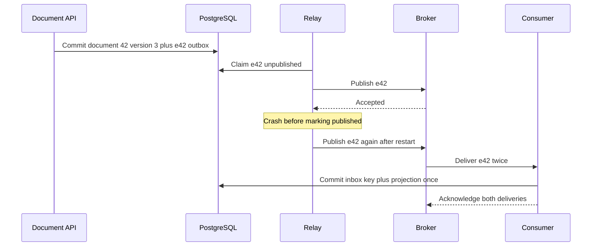

# Keep event identity stable across every retry

**Role: foundation.** Read [broker selection](01_broker_decision_guide.md) and [database transactions](../../fundamentals/database/01_databases_and_schemas.md). This lesson connects broker-independent contracts to the existing [polling outbox](../kafka/reliability/04_transactional_outbox_and_cdc.md) and [CDC relay](../kafka/reliability/06_cdc_outbox_relay.md) implementations.

## One event is a fact, even when it has many deliveries

Document 42 changes from `pending` to `parsed`. The application emits event `e42` describing that completed transition. A retry of the same publication retains `e42`; a later deletion of document 42 gets a new event ID. Otherwise a consumer cannot distinguish transport repetition from new business work.

This explanatory envelope uses CloudEvents 1.0 context fields and application-specific tenant/version data:

```json
{
  "specversion": "1.0",
  "id": "e42",
  "source": "/document-service",
  "type": "com.example.document.parsed.v1",
  "subject": "tenants/7/documents/42",
  "time": "2026-10-30T12:00:00Z",
  "datacontenttype": "application/json",
  "data": {
    "tenant_id": 7,
    "document_id": 42,
    "document_version": 3,
    "result_ref": "results/7/42/v3.json",
    "correlation_id": "request-91"
  }
}
```

`source` plus `id` identifies the event; `type` selects a meaning and compatible payload interpretation. `document_version` orders changes to this document, not every event in the system. `correlation_id` relates events caused by one request; it does not replace event identity. An event timestamp can be delayed or skewed and is not an ordering lock. CloudEvents standardizes the envelope, not authorization or payload compatibility. [CloudEvents 1.0.2 specification](https://github.com/cloudevents/spec/blob/v1.0.2/cloudevents/spec.md), checked 2026-10-30.

The tenant field is a routing assertion from an authenticated producer. Consumers must validate that the producer may emit for that tenant and that the referenced resource belongs to it. Do not fetch arbitrary URLs supplied by a message: use an allowlisted storage namespace and service identity. References also need retention long enough for delayed processing and replay.

## Change contracts without forcing every consumer to deploy together

Suppose v1 consumers require `document_id` and `result_ref`. Adding optional `language` works only if those consumers tolerate unknown fields and the default meaning is defined. Renaming `result_ref` to `artifact_url` breaks them even if both strings look reasonable. Changing “pages” from physical pages to extracted sections breaks meaning without changing JSON shape.

Keep a fixture for the oldest retained v1 event and test both old and new consumers against it. Introduce a new event type/version for incompatible meaning, deploy consumers that accept it before switching producers, and retain old decoding until replay no longer needs it. Version the payload separately from CloudEvents' `specversion`, which describes the envelope protocol. The [Kafka schema lesson](../kafka/application_design/05_schema_registry_and_serialization.md) teaches registry enforcement; registry compatibility does not prove unchanged business meaning.

## Commit publication intent with the business change

Directly committing a result and then publishing leaves a crash gap. Reversing the order publishes a result that might never commit. An outbox makes the local business update and event intent one database transaction. A relay publishes the intent later.

Watch which state survives each crash:



The outbox closes the **missing-event** gap, while the inbox closes the **duplicate-local-effect** gap. The relay must wait for the transport's acceptance signal before marking published. Acceptance still does not mean a consumer completed its effect. The outbox may publish duplicates after an ambiguous timeout or crash, so consumers remain idempotent. [AWS outbox guidance](https://docs.aws.amazon.com/prescriptive-guidance/latest/cloud-design-patterns/transactional-outbox.html).

The canonical [polling implementation](../kafka/reliability/04_transactional_outbox_and_cdc.md) owns SQL, claims and publish checkpoints. For RabbitMQ, the publish signal is a publisher confirm plus handling unroutable returns; for SQS it is successful `SendMessage`, with per-entry results inspected for batch sends. Replacing Kafka's API does not change the database transaction boundary. If several relays run concurrently, prove per-document sequence preservation; claiming rows independently can reorder publications. Partition ownership or a per-aggregate sequence protocol is needed when order matters.

## The inbox must share the effect's transaction

For consumer `search-v1`, the unique inbox key is `(source, event_id, consumer_name)`. In one transaction, insert this key and update the search projection. If the insert conflicts, the prior successful transaction already owns the effect; acknowledge the duplicate. If the update fails, roll back the key too, so a retry can perform the work. Merely checking a key before a separate write has a race between two consumers.

Run the local transaction demonstration from the repository root:

```bash
python3 infrastructure/messaging/examples/inbox_demo.py
```

It prints `applied duplicate applied result=ready count=1`. The first event applies once, the second delivery is suppressed, and a failed transaction leaves no inbox key so retry succeeds. SQLite is used only to make the atomicity experiment self-contained; it does not exercise broker delivery or PostgreSQL concurrency. Read the [durable effect chapter](../kafka/reliability/02_durable_consumer_effect_idempotency.md) for the production transaction and race tests.

If the effect is an email or an external API call, the local inbox cannot atomically commit that remote outcome. Write an outbound intent in the same transaction and use a provider idempotency key or reconciliation. A transaction around network I/O does not create a distributed transaction.

## Operate retained obligations explicitly

Observe oldest unpublished outbox age, relay errors, duplicate rate, inbox storage and projection lag. A growing outbox with healthy consumers points to the relay/publisher path; a drained outbox with stale projections points downstream. Do not delete unpublished rows to clear an alert. Repair routing or credentials, then resume at a bounded rate.

Deduplication retention must cover permitted redelivery and replay. Rebuilding a projection should use a fresh consumer name and isolated output, otherwise the old inbox correctly suppresses every replayed event. Conversely, do not assign a fresh consumer identity to an email sender and replay history without a separate side-effect policy.

**Production readiness:** version and validate envelopes; keep references accessible during replay; atomically persist intent; test crash after publish and crash after effect; bound replay; constrain producer and consumer permissions; and rehearse contract rollback with old retained events.

## Recap

- A stable event ID survives publication retries; a new business transition gets a new ID.
- The outbox commits work owed to a transport with the business state.
- An inbox and local effect share one transaction so failed attempts remain retryable.
- External effects and replay require an explicit boundary beyond local deduplication.

## Check yourself

**Q: A relay times out after `SendMessage`. Should its retry generate a new ID?**

<details><summary>Answer</summary>

No. The original send may have succeeded. Keep the persisted event ID so either one or two deliveries have the same logical identity. Generating a new ID converts uncertainty about delivery into two apparently distinct events.

</details>

**Q: Search needs rebuilding after its table was lost, but its inbox survived. What changes?**

<details><summary>Answer</summary>

Build an isolated projection with a new consumer identity/checkpoint, validate it, and switch readers. Reusing the old inbox suppresses events whose effects no longer exist. Do not globally remove deduplication state for unrelated consumers with irreversible effects.

</details>
