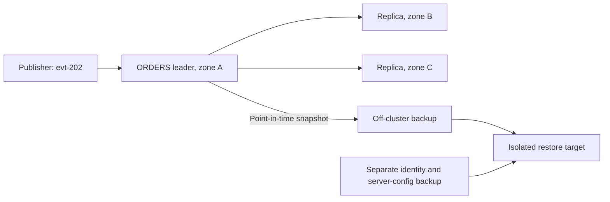

# Operate JetStream Around Quorum, Disk, and Backlog

> **Who this is for**: engineers taking ownership of JetStream availability and recovery.

## Start with three explicit objectives

For an `ORDERS` stream, write down values before choosing topology:

```text
availability: continue after one server loss
replay:       retain 24 hours at the measured peak rate
recovery:     restore the stream and credentials in a tested target time
```

A three-replica stream on three JetStream-enabled servers can tolerate one replica loss while a
quorum remains. That does not prove 24-hour retention fits disk, nor that operator and account
identity can be recovered.

---

## 1. Replication protects a stream through quorum

JetStream uses Raft groups for replicated stream and consumer state. With replication factor
`R=3`, two replicas form a quorum; one unavailable server is tolerated. `R=5` can tolerate two but
adds storage, network, and commit latency. Put replicas in distinct failure domains or three copies
can disappear with one node or zone.

Replication is selected per stream. A three-node cluster does not automatically make an `R=1`
stream durable, and clustering Core NATS routes is not evidence that JetStream data is replicated.
The [official clustering guide](https://docs.nats.io/learn/topologies/jetstream-in-a-cluster)
separates those layers.

> **Core:** use `R=3` as the normal production starting point, then change it only from an explicit
> failure-domain and latency requirement.

---

The stream quorum and the backup are different failure domains:



Two live replicas can keep the stream writable after one node fails. They also replicate a delete,
so only the independent point-in-time copy can recover the pre-delete state. Restoring credentials
is a separate task from restoring messages.

## 2. Disk capacity must satisfy both steady state and recovery

Use local, high-performance persistent storage for file-backed streams. Bound each stream with age
and bytes, set account and server storage limits, and reserve headroom for bursts, compaction,
catch-up, and snapshots. A volume at 95% utilization has no useful recovery margin even if the
steady-state calculation fits.

For example, 500 messages/second × 1,024 bytes × 86,400 seconds is 44.24 GB of payload per
replica for one day. R3 stores about 132.71 GB across the cluster before indexes/protocol overhead.
A 30% planning margin raises that to about 172.52 GB; validate real bytes and catch-up traffic under
peak load. An `MaxAge=24h` setting cannot promise a full day if the byte cap evicts older records first.

Measure:

- stored bytes, messages, and oldest-message age per stream;
- publish rate and publish acknowledgment latency;
- consumer pending, acknowledgment-pending, and redelivery counts;
- replica leader, lag, and current/offline state;
- host disk latency, free bytes, CPU, memory, and network saturation.

The monitoring port exposes endpoints such as `/healthz`, `/varz`, and `/jsz`; the
[monitoring endpoint reference](https://docs.nats.io/learn/monitoring/monitoring-endpoints) explains
their scopes. Do not expose that unauthenticated HTTP port publicly.

> **Key insight**: stream health is the intersection of quorum, writable storage, and consumer
> progress; a green TCP connection proves none of the three.

---

## 3. Backlog age is usually more actionable than message count

Ten thousand pending messages could be seconds or hours of work. Alert on the age of the oldest
unprocessed business event when possible, then add count and redelivery rate for diagnosis.

```text
page:  no stream quorum, publish rejection, disk near exhaustion
page:  oldest required work exceeds its service-level objective
ticket: sustained growth with enough time and disk to intervene
```

Correlate backlog with downstream latency and worker concurrency. Scaling workers during a database
incident can amplify the failure; `MaxAckPending` and bounded fetches are the brake.

---

## 4. Replication and backup solve different failures

Replication keeps serving through node failure and faithfully replicates accidental deletion.
A **stream snapshot** creates a portable point-in-time backup of stream configuration and data.
Back up account/operator identity and server configuration separately; stream bytes alone may be
unusable when credentials and trust roots are lost.

### Restore the actual ORDERS bytes into a separate server

Keep the first-round-trip `nats-notes` server running. Pause fixture publishers so message count and
sequence range describe one stable snapshot. These Bash commands use the course's CLI image and
create a new recovery target; the original stream is never deleted:

```bash
set -euo pipefail
backup_dir=$(mktemp -d)
docker run --rm --network container:nats-notes \
  --user "$(id -u):$(id -g)" -v "$backup_dir:/backup" natsio/nats-box:0.19.7 \
  nats stream backup ORDERS /backup/orders --consumers

docker run --rm -d --name nats-notes-restore nats:2.14.6 -js -sd /data
# Bound readiness to 30 attempts; fail before restore if JetStream stays unavailable.
ready=0
for attempt in $(seq 1 30); do
  if docker run --rm --network container:nats-notes-restore natsio/nats-box:0.19.7 \
    nats stream ls --json >/dev/null 2>&1; then ready=1; break; fi
  sleep 1
done
test "$ready" -eq 1
docker run --rm --network container:nats-notes-restore \
  -v "$backup_dir:/backup:ro" natsio/nats-box:0.19.7 \
  nats stream restore /backup/orders

docker run --rm --network container:nats-notes-restore natsio/nats-box:0.19.7 \
  nats stream info ORDERS --json
docker run --rm --network container:nats-notes-restore natsio/nats-box:0.19.7 \
  nats consumer add ORDERS restore-check --pull --deliver all --ack explicit --defaults
docker run --rm --network container:nats-notes-restore natsio/nats-box:0.19.7 \
  nats consumer next ORDERS restore-check --count 1 --ack
docker stop nats-notes-restore
```

Compare restored `state.messages`, `first_seq`, and `last_seq` with the snapshot metadata and
original quiesced stream; the first fixture payload must still contain `ord-42`. A fresh verification
consumer proves readable history without moving the restored business consumer's checkpoint.
Record elapsed restore time against the target. Preserve `backup_dir` until the comparison passes,
then remove that lab directory explicitly. The isolated R1 target tests backup readability, not R3
availability. For production also restore account/operator identity into the isolated environment,
authenticate with a test user, and prove its allowed/denied operations before routing traffic.
[Backup workflow](https://docs.nats.io/learn/backup-recovery/stream-backup-restore), checked 2026-10-30.

Do not treat filesystem-level copying of a live store directory as a portable logical backup.

> **Production:** pin a supported server series, read upgrade notes, back up before changes, and use
> rolling upgrades that preserve stream quorum. Test client reconnect behavior during the roll.

---

## What's changing: rehearse the 2.15 transition

Checked 2026-10-30: **GA, optional migration**. The course's 2.14.6 lab is a historical pin; take a
production 2.14 line through at least 2.14.7 before 2.15. Inventory stream/consumer counts, take a
verified backup, roll nodes while preserving quorum and defer scale/move updates during mixed
versions. After all nodes converge, exercise a controlled move/evacuation and recheck lag. Version
2.15 introduces desired-state reconciliation, evacuation APIs and backup v2; plan consumer limits
explicitly because the new per-stream default is 1,000. Rehearse rollback only to a compatible
2.14.7+ build, including desired-state cleanup and configuration changes from the upgrade guide;
replacing binaries alone is not a recovery plan.
[2.15 migration guide](https://docs.nats.io/release-notes/upgrade-to-2.15).

## 5. What breaks, and when not to self-host

⚠️ Losing quorum makes replicated stream writes unavailable even while clients can connect to Core
NATS. Publish acknowledgments and `/jsz` state expose the difference.

⚠️ Disk latency spikes first appear as publish-ack latency, replica lag, and growing consumer
backlog. CPU dashboards alone miss the bottleneck.

Do not self-host when the team cannot own quorum incidents, storage forecasts, security upgrades,
and restore drills. A managed NATS service or an already-operated durable broker may be the safer
system even when JetStream's API is attractive.

> **Edge case:** mirrors, sources, gateways, and leaf nodes address cross-cluster or edge movement.
> Introduce them only after defining data ownership, consistency expectations, and failover writes;
> they are not a transparent multi-region switch.

---

## Recap

- R3 needs two available replicas to progress; cluster membership alone does not set R3.
- Capacity must cover retention, replication and recovery headroom.
- Snapshots recover a past state; identity/configuration need independent backup and tests.

## Check yourself

**Q: Three servers are healthy but ORDERS is R1. Does losing its data server preserve stream writes?**

<details><summary>Answer</summary>

No. Only that server has the stream replica. A three-server cluster is not evidence that each stream has three copies.

</details>

**Q: A replicated accidental purge reaches every replica. Which recovery asset can restore the earlier events?**

<details><summary>Answer</summary>

A verified point-in-time snapshot outside the cluster failure domain. A live replica or mirror can reproduce the same deletion.

</details>

## Try it

For 500 messages/s at 1,024 bytes over 24 hours, fill the payload storage estimate for R3 and a 30% margin, then run the isolated restore.

Hint: Multiply bytes per replica by three before adding margin; verify counts and one payload.

<details><summary>Worked solution</summary>

About 44.24 GB per replica, 132.71 GB total, 172.52 GB with the stated margin before measurement-specific adjustments. Restore must match snapshot sequence/count and permit the sample read within the recovery target.

</details>


**Next**: [Security and Multitenancy](07_security_and_multitenancy.md)
