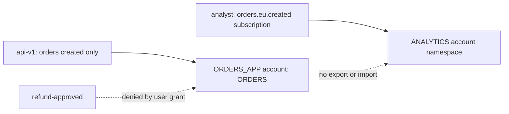

# Secure JetStream at Connection, Subject, and Account Boundaries

> **Who this is for**: engineers moving from a trusted local server to shared production NATS.

## Walk the unauthorized publish before choosing controls

Suppose a compromised reporting service can connect and publish `orders.eu.refund-approved`.
Because the `ORDERS` stream captures `orders.>`, the forged event is durable and every authorized
consumer may process it. Encryption alone does not prevent this; the attacker is already a client.

The defense needs three distinct decisions:

```text
TLS verifies/encrypts the network peer
credentials authenticate which NATS user connected
subject permissions authorize what that user may publish or subscribe
```

---

## 1. Grant applications the smallest subject surface

A publisher that only creates orders should publish `orders.*.created`, not `orders.>`. A worker
should subscribe only to its delivery subjects and publish only the acknowledgment or application
subjects required by its client protocol. JetStream management uses API subjects under `$JS.API.>`;
do not grant broad management access to ordinary publishers.

This illustrative static configuration shows the shape; use generated credentials rather than
literal passwords in a repository:

```hcl
accounts {
  ORDERS_APP {
    jetstream: enabled
    users: [
      {
        user: order_api
        password: $ORDER_API_PASSWORD
        permissions: {
          publish: ["orders.*.created"]
          subscribe: ["_INBOX.>"]
        }
      }
    ]
  }
}
```

The reply inbox permission is needed because request/reply operations—including publish
acknowledgments—receive server responses on an inbox. Test the actual client calls with the proposed
permissions; a connection succeeding does not prove the JetStream API exchange is authorized.

> **Core:** authenticate every production client and allow only the publish, subscribe, and reply
> subjects required by its concrete interactions.

> **Production:** for larger installations, prefer operator, account, and user JWTs managed with
> `nsc` so trust and limits are signed rather than copied into every server configuration.

---

### Run the grant, denial and credential-overlap experiment

The complete [security_demo.py](examples/security_demo.py) starts a disposable loopback-only NATS
server with generated temporary credentials and two accounts. It provisions ORDERS as the account
administrator, then uses `api-v1` with exactly the publisher permissions above. `api-v2` has the
same grant for the overlap phase. An analyst in a different account subscribes to the same subject
text and sees none of the order account's publications.

```bash
uv run --with 'nats-py==2.15.0' python infrastructure/nats_jetstream/examples/security_demo.py
```

Require `PASS: created allowed; refund denied; accounts isolated; v1 revoked; v2 works`. The test
checks an explicit permission error for refund publication, not just a timeout. It then removes
v1 from the mounted configuration, reloads the server, rejects a new v1 connection and publishes
with v2. All four authorized events remain in ORDERS; the forbidden refund adds no record. The
fixture removes its container and temporary credentials in cleanup. Plaintext is confined to this
loopback experiment; it does not test production certificate trust.

## 2. Accounts are isolation domains, not naming prefixes

A NATS **account** isolates subject namespaces, connections, subscriptions, and JetStream resources.
Two accounts may each use `orders.created` without seeing each other. Explicit exports and imports
cross that boundary; a subject prefix such as `tenant_a.orders` inside one account does not provide
the same isolation.



The dotted account crossing has no configured export/import, so identical subject strings do not
connect these users. Within ORDERS_APP, the publisher's narrower subject grant supplies a second
boundary. Neither boundary depends on a friendly naming convention.

Use separate accounts when tenants require independent quotas, administrators, or blast radius.
Use users and subject permissions inside one account when services share one governed event domain.

Account-level JetStream limits bound storage, memory, streams, and consumers so one tenant cannot
consume the whole cluster. Server-wide limits remain necessary because account maxima can sum to
more physical capacity than exists.

> **Key insight**: subjects partition routing inside an account; accounts partition trust and
> resource ownership across clients.

---

## 3. TLS and credential rotation need observable failure modes

Require TLS for client, route, gateway, and leaf-node links that cross an untrusted network. Verify
server names and trust roots in clients; disabling certificate verification turns encryption into
an unauthenticated tunnel.

Rotate user credentials with overlap: issue the new credential, deploy clients, observe old-identity
connections drain, then revoke the old credential. **Success signal:** authentication failures stay
at baseline, all expected services reconnect with the new identity, and the old credential is
rejected in a controlled test.

For TLS rollout, mount the issuing CA and server certificate/key, set `tls { cert_file, key_file }`
in server configuration, and connect with a CA-trusting SSL context whose hostname matches the
certificate SAN. In staging, require three observations: valid CA/name connects, an untrusted CA
fails, and a wrong hostname fails. Keep the old CA during a planned trust overlap, deploy new trust
before new server certificates, then remove old trust only after reconnect metrics and negative
probes pass. Credential overlap does not substitute for certificate verification. Record those TLS
checks separately from the plaintext permission fixture.

Never log seed keys, bearer credentials, JWT user credentials, or full connection URLs containing
secrets. Logs should identify the public user/account identity and authorization decision instead.

---

## 4. What breaks, and when not to share an account

⚠️ Granting publish to `>` lets a compromised service forge application events and target NATS
control subjects. The stream accepting a message is not proof that the publisher was legitimate.

⚠️ Exposing port `8222` publicly leaks topology, connection, subscription, and JetStream metadata.
Bind monitoring privately and put authentication in the collection path.

Do not share one account across mutually untrusted tenants or teams with independent compliance
boundaries. Subject conventions are valuable organization, but they are not a security boundary
without enforced permissions.

> **Edge case:** response permissions can grant temporary publish rights to reply subjects for
> request/reply services. Use them instead of a permanent broad inbox grant when the exact service
> interaction warrants the added policy complexity.

The [official security deep dive](https://docs.nats.io/learn/security/) covers centralized and
decentralized authentication, accounts, and TLS.

---

## Recap

- TLS establishes transport trust; credentials establish user identity; permissions authorize subjects.
- Accounts isolate namespaces even when subject text is identical.
- Rotation overlaps reviewed grants, proves the new identity, then verifies rejection of the old one.

## Check yourself

**Q: The client can connect and publish orders.eu.created, but its request/reply times out. Is orders.> the fix?**

<details><summary>Answer</summary>

No. Inspect the reply inbox and exact JetStream API subjects used by the client. Grant only the missing operation, then repeat the forbidden-refund test to prove the boundary remains.

</details>

**Q: Two tenants use different subject prefixes in one account. Are they isolated without permissions?**

<details><summary>Answer</summary>

No. Prefixes organize names; enforced grants or separate account namespaces create the boundary.

</details>

## Try it

Change the fixture publisher grant to orders.eu.created only. Predict the result for orders.us.created and fill the negative assertion.

Hint: Require a permission error and unchanged stored-message count, not merely timeout.

<details><summary>Worked solution</summary>

EU creation succeeds; US creation and refund publication are denied. An analyst in the separate account still sees neither event.

</details>


**Next**: [When to Use JetStream](08_when_to_use_jetstream.md)
