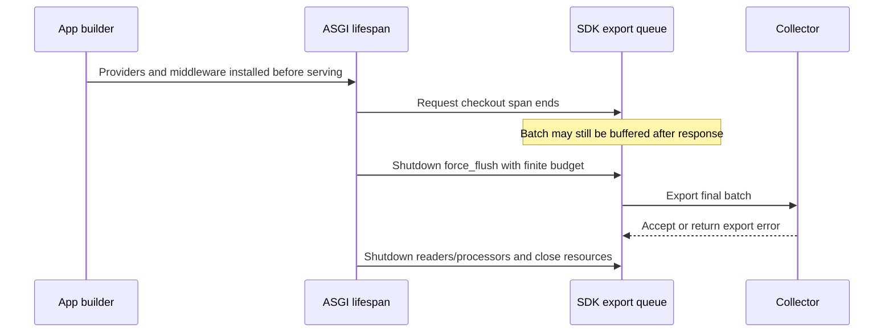

# Python SDK Setup

> **Who this is for**: Engineers adding OpenTelemetry to a Python/FastAPI service — tracing setup, metrics instruments, auto-instrumentation libraries, and how to wire it all into application startup.

---

## Quick local proof: emit one span before configuring a backend

```python
from opentelemetry import trace
from opentelemetry.sdk.trace import TracerProvider
from opentelemetry.sdk.trace.export import ConsoleSpanExporter, SimpleSpanProcessor

provider = TracerProvider()
provider.add_span_processor(SimpleSpanProcessor(ConsoleSpanExporter()))
trace.set_tracer_provider(provider)

with trace.get_tracer("notes.quickstart").start_as_current_span("checkout"):
    pass
provider.shutdown()
```

Run the file after installing `opentelemetry-api` and `opentelemetry-sdk`. Standard output should
contain `"name": "checkout"`; no output means the provider or processor was not installed. The
console exporter is only a local proof. The sections below add service identity, batched OTLP
export, metrics, FastAPI instrumentation, and shutdown flushing.

> **Key insight**: Instrumentation creates telemetry in process; a provider, processor/reader, and
> exporter are the separate path that makes it observable elsewhere.

---

## 1. Installation

```bash
# Core SDK
pip install opentelemetry-api opentelemetry-sdk

# OTLP exporter (gRPC — most common)
pip install opentelemetry-exporter-otlp-proto-grpc

# Prometheus exporter (if exposing /metrics for scraping)
pip install opentelemetry-exporter-prometheus
pip install prometheus-client

# Auto-instrumentation for FastAPI + common dependencies
pip install opentelemetry-instrumentation-fastapi
pip install opentelemetry-instrumentation-sqlalchemy
pip install opentelemetry-instrumentation-httpx
pip install opentelemetry-instrumentation-redis
```

---

## 2. The Resource

Always define a `Resource` before setting up any provider. Every span and metric emitted by the process will carry these attributes.

```python
from opentelemetry.sdk.resources import Resource, SERVICE_NAME

resource = Resource.create({
    SERVICE_NAME: "orders-api",          # required — backends group by this
    "service.version": "1.4.2",          # optional but useful
    "deployment.environment.name": "production",
})
```

`SERVICE_NAME` is the one attribute every backend requires. If you omit it, your data shows up as `unknown_service` in most UIs. `deployment.environment.name` is the current semantic-conventions key for environment.

---

## 3. Tracing Setup

### Core pattern

```python
import os
from opentelemetry import trace
from opentelemetry.sdk.trace import TracerProvider
from opentelemetry.sdk.trace.export import BatchSpanProcessor
from opentelemetry.exporter.otlp.proto.grpc.trace_exporter import OTLPSpanExporter

def setup_tracing(resource: Resource) -> None:
    provider = TracerProvider(resource=resource)
    provider.add_span_processor(
        BatchSpanProcessor(
            OTLPSpanExporter(
                endpoint=os.getenv("OTEL_EXPORTER_OTLP_ENDPOINT", "https://otel-collector:4317"),
            )
        )
    )
    trace.set_tracer_provider(provider)
```

### BatchSpanProcessor vs SimpleSpanProcessor

| Processor | Behavior | Use |
|---|---|---|
| `BatchSpanProcessor` | Buffers spans and exports in background batches | Production — non-blocking |
| `SimpleSpanProcessor` | Exports each span immediately and synchronously | Tests and local dev only |

Always use `BatchSpanProcessor` in production. Synchronous export adds latency to every span end.

### Getting a tracer

```python
tracer = trace.get_tracer(__name__)
```

`__name__` scopes the tracer to the current module. You can have multiple tracers across modules — they all feed into the same `TracerProvider`.

### Creating spans

```python
# Context manager — span ends when block exits
with tracer.start_as_current_span("process-order") as span:
    span.set_attribute("order.id", order_id)
    span.set_attribute("order.amount_cents", amount)
    result = process(order_id)

# Nested spans — OTel propagates parent automatically via context
with tracer.start_as_current_span("validate-payment") as span:
    with tracer.start_as_current_span("charge-card"):
        charge()
```

### Recording errors on spans

```python
from opentelemetry.trace import StatusCode

with tracer.start_as_current_span("risky-operation") as span:
    try:
        do_work()
    except Exception as e:
        span.set_status(StatusCode.ERROR, str(e))
        span.record_exception(e)
        raise
```

If an exception escapes the `with` block, the SDK records it and marks the span as error by default. The manual pattern above is still important when you catch the exception yourself and want the span to reflect the failure.

---

## 4. Metrics Setup

### Core pattern

```python
import os
from opentelemetry import metrics
from opentelemetry.sdk.metrics import MeterProvider
from opentelemetry.sdk.metrics.export import PeriodicExportingMetricReader
from opentelemetry.exporter.otlp.proto.grpc.metric_exporter import OTLPMetricExporter

def setup_metrics(resource: Resource) -> None:
    reader = PeriodicExportingMetricReader(
        OTLPMetricExporter(
            endpoint=os.getenv("OTEL_EXPORTER_OTLP_ENDPOINT", "https://otel-collector:4317"),
        ),
        export_interval_millis=30_000,  # push metrics every 30s
    )
    provider = MeterProvider(resource=resource, metric_readers=[reader])
    metrics.set_meter_provider(provider)
```

For Prometheus scrape instead of OTLP push, see [03 — Metrics Export Methods](03_metrics_export_methods.md).

### Getting a meter

```python
meter = metrics.get_meter(__name__)
```

### Metric instruments

The current Python API has seven instrument types. Choose based on what the value represents.
A synchronous Gauge receives `set(value)` from the application; an observable gauge invokes a
callback during collection. [Python metrics API](https://opentelemetry-python.readthedocs.io/en/latest/api/metrics.html), checked 2026-10-30.

| Instrument | Created With | When to Use | Example |
|---|---|---|---|
| `Counter` | `create_counter` | Monotonically increasing count | `http_requests_total` |
| `UpDownCounter` | `create_up_down_counter` | Value that goes up and down | `active_connections` |
| `Histogram` | `create_histogram` | Distribution of values | `request_duration_ms` |
| `Gauge` (synchronous) | `create_gauge` | Current value supplied by the application (`set`) | `queue_depth` |
| `Gauge` (observable) | `create_observable_gauge` | Snapshot of current state (polled) | `cpu_usage_percent` |
| `ObservableCounter` | `create_observable_counter` | Count gathered via callback | `system.cpu.time` |
| `ObservableUpDownCounter` | `create_observable_up_down_counter` | UpDownCounter gathered via callback | `process.open_files` |

### Counter — track events

```python
request_counter = meter.create_counter(
    name="http_server_requests_total",
    description="Total HTTP requests handled",
    unit="1",
)

# Record a value with labels (called "attributes" in OTel)
request_counter.add(1, {"route": "/checkout", "method": "POST", "status": "200"})
```

### Histogram — track distributions

```python
request_duration = meter.create_histogram(
    name="http_server_request_duration_ms",
    description="Request latency",
    unit="ms",
)

request_duration.record(142.5, {"route": "/checkout", "method": "POST"})
```

Histograms are the right instrument for latency. They let the backend compute distribution queries such as p50/p95/p99. In Prometheus-style backends, those percentile queries depend on the histogram buckets you export.

### Observable Gauge — current state

```python
import psutil

def get_cpu_usage(_: metrics.CallbackOptions):
    yield metrics.Observation(psutil.cpu_percent() / 100, {})

meter.create_observable_gauge(
    name="system.cpu.utilization",
    callbacks=[get_cpu_usage],
    description="Host CPU utilization fraction",
    unit="1",
)
```

Observable instruments are polled by the SDK on the export interval. Use them for values that already exist somewhere (system stats, pool sizes) rather than values you are counting.

---

## 5. Auto-Instrumentation in FastAPI

Auto-instrumentation patches framework internals at startup. You get spans for every request, status codes, and route attributes without manual code.

```python
from contextlib import asynccontextmanager
from fastapi import FastAPI

from opentelemetry.sdk.resources import Resource, SERVICE_NAME
from opentelemetry.instrumentation.fastapi import FastAPIInstrumentor
from opentelemetry.instrumentation.sqlalchemy import SQLAlchemyInstrumentor
from opentelemetry.instrumentation.httpx import HTTPXClientInstrumentor

from opentelemetry import trace, metrics
from opentelemetry.sdk.trace import TracerProvider
from opentelemetry.sdk.trace.export import BatchSpanProcessor
from opentelemetry.exporter.otlp.proto.grpc.trace_exporter import OTLPSpanExporter
from opentelemetry.sdk.metrics import MeterProvider
from opentelemetry.sdk.metrics.export import PeriodicExportingMetricReader
from opentelemetry.exporter.otlp.proto.grpc.metric_exporter import OTLPMetricExporter

import os

resource = Resource.create({SERVICE_NAME: os.getenv("SERVICE_NAME", "my-service")})


def init_telemetry(app: FastAPI) -> tuple[TracerProvider, MeterProvider]:
    # Tracing
    trace_provider = TracerProvider(resource=resource)
    trace_provider.add_span_processor(
        BatchSpanProcessor(
            OTLPSpanExporter(
                endpoint=os.getenv("OTEL_EXPORTER_OTLP_ENDPOINT", "https://otel-collector:4317"),
            )
        )
    )
    trace.set_tracer_provider(trace_provider)

    # Metrics
    metric_reader = PeriodicExportingMetricReader(
        OTLPMetricExporter(
            endpoint=os.getenv("OTEL_EXPORTER_OTLP_ENDPOINT", "https://otel-collector:4317"),
        )
    )
    meter_provider = MeterProvider(resource=resource, metric_readers=[metric_reader])
    metrics.set_meter_provider(meter_provider)

    # Instrument this FastAPI app instance explicitly.
    FastAPIInstrumentor.instrument_app(app)

    # If you have a SQLAlchemy engine, instrument it explicitly.
    # SQLAlchemyInstrumentor().instrument(engine=engine)

    # HTTPX can instrument all clients created after this call.
    HTTPXClientInstrumentor().instrument()
    return trace_provider, meter_provider


@asynccontextmanager
async def lifespan(app: FastAPI):
    try:
        yield
    finally:
        trace_provider, meter_provider = app.state.telemetry
        # Export queues are independent of HTTP response completion.
        trace_provider.force_flush(timeout_millis=3000)
        meter_provider.force_flush(timeout_millis=3000)
        meter_provider.shutdown(timeout_millis=3000)
        trace_provider.shutdown()
        HTTPXClientInstrumentor().uninstrument()


app = FastAPI(lifespan=lifespan)
app.state.telemetry = init_telemetry(app)  # before ASGI builds the middleware stack
```

> **Production:** install middleware instrumentation while constructing the app, before the ASGI
> middleware stack is built. Lifespan startup is too late for middleware additions in supported
> Starlette versions. Lifespan owns cleanup. Give exporters finite network timeouts and reserve
> shutdown time for flushing; a flush timeout is telemetry-loss evidence, not success.

For SQLAlchemy, instrument either specific engines with `SQLAlchemyInstrumentor().instrument(engine=engine)` or rely on the `opentelemetry-instrument` launcher for broader auto-instrumentation. Programmatic SQLAlchemy setup usually needs a real engine object, not just a bare `instrument()` call.

The lifecycle explains why a returned HTTP 200 does not certify exported telemetry:



Ending a span makes it eligible for export. The batch queue and network can still fail later.
The local [lifecycle_demo.py](examples/lifecycle_demo.py) uses an in-memory exporter to assert that
`checkout` survives shutdown. From the repository root:

```bash
uv run --with fastapi --with httpx --with opentelemetry-sdk --with opentelemetry-instrumentation-fastapi \
  python infrastructure/observability/examples/lifecycle_demo.py
```

Require `PASS: HTTP 200 before export; checkout exported by lifespan shutdown`; the next chapter's OTLP experiment tests the network handoff.

### What auto-instrumentation produces

| Library | What You Get |
|---|---|
| `FastAPIInstrumentor` | Span per request, plus HTTP attributes (see semconv note below) |
| `SQLAlchemyInstrumentor` | Span per query, `db.statement`, `db.system` attributes |
| `HTTPXClientInstrumentor` | Span per outbound HTTP call, propagates trace context in headers |
| `RedisInstrumentor` | Span per Redis command |

> **HTTP semantic-conventions naming**: The HTTP semconv is now stable and renamed the
> request attributes — `http.method` → `http.request.method`, `http.status_code` →
> `http.response.status_code`, and `http.url` split into `url.path` + `url.query`
> (`http.route` is unchanged). By default the instrumentation still emits the **old**
> names for backward compatibility. Set `OTEL_SEMCONV_STABILITY_OPT_IN=http` to emit only
> the stable names, or `http/dup` to emit both during a phased migration. Write your
> dashboards, filters, and Collector processors against whichever set you opt into — and
> note that the Collector `filter`/`attributes` examples in [04](04_collector_config.md)
> reference `http.route`, which is stable under both naming schemes.

### Filtering health check spans

Health check endpoints create noise in trace backends. Exclude them:

```python
FastAPIInstrumentor.instrument_app(
    app,
    excluded_urls="health,readiness,liveness,metrics"
)
```

---

## 6. Propagating Trace Context

When your service calls another service over HTTP, OTel can propagate the trace context so both sides appear in the same trace tree. `HTTPXClientInstrumentor` does this automatically by injecting `traceparent` headers into outbound requests.

For manual propagation:

```python
from opentelemetry.propagate import inject, extract
from opentelemetry import context

# Inject into outbound headers
headers = {}
inject(headers)
response = httpx.post(url, headers=headers)

# Extract from inbound headers (FastAPI does this for you via the instrumentor)
ctx = extract(request.headers)
token = context.attach(ctx)
try:
    with tracer.start_as_current_span("handle-request", context=ctx):
        ...
finally:
    context.detach(token)
```

---

## 7. Adding Trace IDs to Structured Logs

If you use `structlog`, inject the current span's trace ID so logs can be correlated with traces in your backend.

```python
import structlog
from opentelemetry import trace

def add_trace_context(logger, method, event_dict):
    span = trace.get_current_span()
    ctx = span.get_span_context()
    if ctx.is_valid:
        event_dict["trace_id"] = format(ctx.trace_id, "032x")
        event_dict["span_id"] = format(ctx.span_id, "016x")
    return event_dict

structlog.configure(
    processors=[
        add_trace_context,
        structlog.processors.JSONRenderer(),
    ]
)
```

With this in place, every log line emitted during a request carries the trace ID. In Groundcover or any backend that indexes both logs and traces, you can click from a log line directly into the trace.

## Recap

- A resource identifies the emitting service and accompanies its telemetry.
- Install framework instrumentation before the middleware stack is built.
- Span end and export are separate events; shutdown owns flushing and closing providers.

## Check yourself

**Q: One request succeeds and the process exits before the periodic export. Did HTTP success prove the span reached storage?**

<details><summary>Answer</summary>

No. The span can remain buffered after the response. Flush/shutdown with a finite exporter deadline and inspect actual export evidence; process termination can still lose queued telemetry.

</details>

**Q: A measurement is the current queue depth, supplied when it changes. Which instrument matches it?**

<details><summary>Answer</summary>

A synchronous Gauge with set(value). A Counter would incorrectly accumulate snapshots; an observable gauge fits when collection should call back to read existing state.

</details>

## Try it

Run lifecycle_demo.py, then remove the shutdown flush and keep the long batch interval. Predict the assertion that exposes lost final telemetry.

Hint: HTTP 200 and exporter contents are intentionally checked at different times.

<details><summary>Worked solution</summary>

The before-shutdown exporter is empty. The final check requires checkout after cleanup; without a working flush/shutdown path it can fail even though the endpoint succeeded. Keep provider.shutdown so threads/resources close.

</details>
