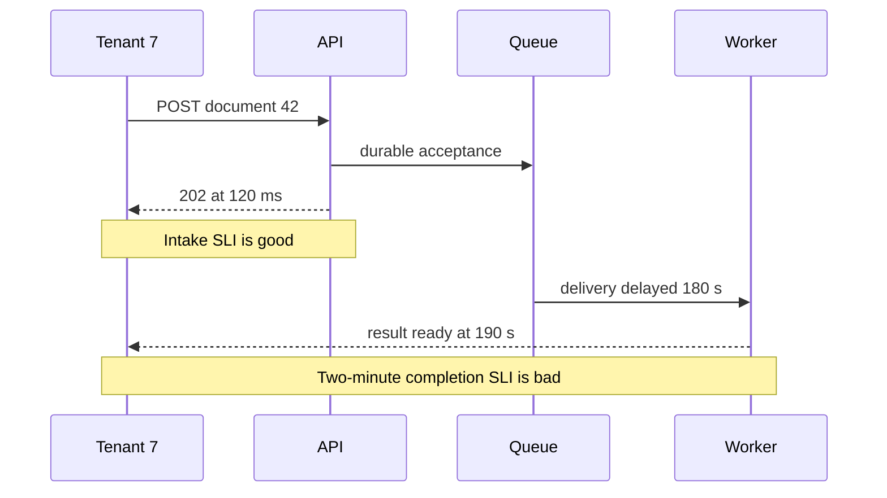

# Alert when users are losing the service they need

**Role: implementation.** Read the [OpenTelemetry primer](01_opentelemetry_primer.md) and [metrics export paths](03_metrics_export_methods.md) first. This lesson turns telemetry from a document API into a measurable promise, an alert and a diagnostic path. It assumes basic ratios, HTTP status codes and the existing instrumentation lessons.

## Start with an outcome, then count it

Tenant 7 submits document 42. A `202 Accepted` proves intake succeeded; it does not prove extraction finished. Define separate objectives for API intake and asynchronous completion. Otherwise a healthy HTTP dashboard can hide a queue that never drains.

**Monitoring** checks known conditions. **Observability** is the ability to investigate internal behavior using emitted evidence. **Alerting** selects conditions requiring action. An **SLI** is a measured indicator of service behavior; an **SLO** is the target over a specified window; an **SLA** is a separate agreement with consequences. An internal SLO is not automatically a customer contract.

For intake, choose this explicit example contract:

- Eligible: authenticated, valid `POST /documents` attempts observed at the edge, including server overload rejections.
- Good: an eligible attempt durably accepted within 500 ms.
- Target: 99.9% good over a rolling 30-day window.
- Exclusions: malformed or unauthorized client requests, classified before measurement; not arbitrary exclusions invented after an incident.

For completion, measure valid accepted jobs reaching a terminal successful result within two minutes, using the acceptance timestamp. Report failure and timeout cohorts; do not count only jobs that finished, because stuck jobs would vanish from the denominator. Late completion must not erase the original deadline miss.

The following trace distinguishes two user experiences.



The same document is good for intake and bad for completion. That is not contradictory: the indicators represent different promises. For the remainder, use the intake SLI so the arithmetic is reproducible.

## Convert failures into budget consumption

An error budget is the tolerated fraction of bad eligible events: `1 - 0.999 = 0.001`. At one million eligible attempts, 1,000 may be bad while meeting this objective. The budget is a decision aid for reliability and release work, not permission to cause avoidable outages.

Run this standard-library example from a shell:

```bash
python3 - <<'PY'
slo = 0.999
eligible = 1_000_000
bad = 500
allowed = eligible * (1 - slo)
print(f"allowed bad attempts: {allowed:.0f}")
print(f"budget consumed: {bad / allowed:.0%}")
error_ratio = 0.0144
burn = error_ratio / (1 - slo)
print(f"burn rate: {burn:.1f}x")
print(f"30-day budget fraction burned in one hour: {burn / (30 * 24):.0%}")
PY
```

Expected output is `1000`, `50%`, `14.4x`, and `2%` with the labels shown. A burn rate of 1 consumes budget at the sustainable rate; 14.4 consumes it 14.4 times faster. The time-based budget fraction assumes traffic comparable to the objective window's average. Request-count budgets under highly varying traffic need actual eligible-event counts for exact accounting. The [SRE alerting chapter](https://sre.google/workbook/alerting-on-slos/) develops multiwindow alerts and their precision/detection trade-offs.

A 1-hour window limits noise; a 5-minute window confirms that the problem is still occurring. Requiring both reduces pages for a resolved spike that remains in the long window. Add a slower multiwindow condition, such as 6x over 6 hours and 30 minutes, for sustained degradation. Thresholds are starting points to test against the service's traffic and response time.

## Make the metric contract match the promise

Define a custom edge counter `document_intake_total{service="documents",outcome="good|bad"}`. Every eligible attempt increments exactly one outcome, including deadline misses and overload rejections. Initialize both label values to zero. This is an illustrative metric name, not a metric automatically exported by FastAPI or OTel. Use a stable route label, never document IDs, raw URLs or tenant IDs as unbounded labels.

Below is an **alert-rule example** for that counter. It needs your Prometheus data source and routing configuration; it has not been exercised against a live server here.

```yaml
groups:
  - name: document-intake
    rules:
      - record: service:intake_bad:ratio_rate5m
        expr: |
          sum by (service) (rate(document_intake_total{outcome="bad"}[5m]))
          / sum by (service) (rate(document_intake_total[5m]))
      - record: service:intake_bad:ratio_rate1h
        expr: |
          sum by (service) (rate(document_intake_total{outcome="bad"}[1h]))
          / sum by (service) (rate(document_intake_total[1h]))
      - alert: DocumentIntakeFastBudgetBurn
        expr: |
          (service:intake_bad:ratio_rate1h > 14.4 * 0.001)
          and on (service)
          (service:intake_bad:ratio_rate5m > 14.4 * 0.001)
        labels:
          severity: page
          owner: documents-oncall
        annotations:
          summary: Document intake is rapidly consuming its error budget
          runbook: operations/incident_response/02_runbooks.md
```

The ratio aggregates counts before dividing, so a low-volume Pod does not receive the same weight as a high-volume Pod. `and on (service)` pairs matching services, not unrelated series. No traffic produces an undefined ratio, not proof of health. Add separate telemetry-absence/scrape alerts and low-volume synthetic checks. For a low-volume service, one failure may produce a high ratio: decide whether to page using user impact, repeated synthetic failures and response urgency rather than silently suppressing every small denominator.

Prometheus evaluates rules and sends alerts to an alert manager; routing, grouping, inhibition and notification delivery are a separate configured path. A rule firing in the UI is not evidence a human was notified. [Alert-rule semantics](https://prometheus.io/docs/prometheus/latest/configuration/alerting_rules/).

## Page for action; use tickets for slower work

A page needs a time-sensitive action with an owner who can perform it. Rapid budget burn, imminent data loss and a security incident can meet that criterion. Gradual capacity pressure with days to respond generally needs a ticket. Severity and paging are related but distinct: a severe historical incident whose impact ended does not need to keep waking responders.

CPU-only pages often identify a resource without identifying harm. CPU utilization is useful evidence when linked to saturation or exhaustion; low CPU does not establish healthy I/O. Conversely, a symptom alert such as elevated user errors is useful precisely because it captures impact, even before the cause is known. Avoid alerts on incidental internal symptoms with no action or user consequence. Group repeated Pod failures into one service incident, preserving component detail in the dashboard.

Use **RED** for request services: rate, errors, duration. Use **USE** for resources: utilization, saturation, errors. For a DB pool, utilization is checked-out connections divided by capacity; saturation is queued acquisition demand; errors include acquisition timeouts. These measures explain why the SLI worsened.

## Build a path from page to evidence

Arrange the service overview around good/bad events, latency, traffic and budget consumption. The dependency view breaks out DB pool waits, queue age, Redis and provider failures. A deployment view overlays image/config revisions and flags. An incident view pins the affected interval and tenant cohorts without exposing sensitive documents.

From a latency exemplar, follow a trace to the slow DB or provider span; then query logs by trace ID to see the failure classification. Sampling can omit rare traces, and instrumentation can fail with the application, so keep independent edge/synthetic evidence. Logs should contain stable IDs and operational state, not document contents or credentials.

## Verify both alarm and silence

Use [promtool rule tests](https://prometheus.io/docs/prometheus/latest/configuration/unit_testing_rules/) with synthetic input series for: sustained fast burn, an ended spike, counter reset, zero traffic, missing telemetry, and a healthy high-volume service beside an unhealthy low-volume one. Assert alert labels and the time it fires/resolves. `promtool check rules` checks parsing; it does not establish that those cases behave correctly.

In staging, route a test alert to a test destination, confirm receipt, acknowledge it and follow the runbook. During a controlled failure, check the page arrives before the chosen impact budget is exhausted. If the rule fires but nobody receives it, diagnose routing/muting and notification credentials; changing the expression will not fix delivery.

Production readiness requires an agreed denominator, independent visibility for missing telemetry, low-cardinality metrics, owners and escalation, tested rules/routing, and regular deletion or repair of unactionable alerts. Keep telemetry retention and cardinality within a budget: a unique document label multiplies series and can impair the system meant to diagnose incidents.

**What's changing — checked 2026-10-30:** **GA:** native histograms are stable from Prometheus 3.8; scraping still requires the documented configuration in Prometheus 3.x. Do not replace classic histogram queries without checking SDK, collector, storage and dashboard support. This chapter's counter-ratio alert does not require histograms. [Native histogram specification](https://prometheus.io/docs/specs/native_histograms/).

## Recap

- Define eligible and good events before selecting a metric or threshold.
- Intake and completion can have different outcomes for the same document.
- Burn rate turns an error fraction into the speed of budget consumption.
- A page needs urgency, ownership and a tested notification path.

**Check yourself: completion success is 100%, but users report documents stuck overnight. What is the likely denominator bug?**

<details><summary>Answer</summary>

Counting only completed jobs excludes the stuck jobs. Count accepted eligible jobs by deadline cohort, then determine whether each finished on time. An unfinished job past its deadline is a miss even before it becomes terminal.

</details>

**Check yourself: the long-window burn is high but the short-window burn is healthy. Why might a page stop?**

<details><summary>Answer</summary>

The high-error interval may have ended. Requiring both windows asks whether substantial budget was consumed and whether the burn continues. Keep historical impact visible and investigate through a ticket or incident review without paging indefinitely for resolved traffic.

</details>

**Try it:** Change the objective to 99.95% while keeping a 0.5% observed error ratio. Compute burn rate and explain the alert effect.

<details><summary>Worked solution</summary>

The tolerated fraction is 0.0005; observed error ratio is 0.005. Burn is 10x. Against 99.9% the same traffic was 5x. Tightening an SLO changes operational urgency even when the measured errors are unchanged, so agree the objective with service owners before changing alert constants.

</details>
