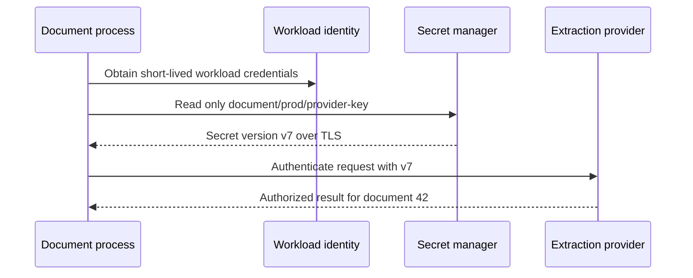

# A secret is a credential with an owner, a lifetime and a revocation path

**Role: foundation.** Prerequisite: [typed configuration](../../fundamentals/core_concepts/runtime/configuration.md). This chapter covers the lifecycle around that configuration boundary. It does not replace the existing [database privilege lesson](../../fundamentals/database/10_database_access_security.md) or deployment identity setup.

## Separate choosing a value from granting authority

The document service needs a provider URL and an API key. The URL chooses a destination; the key grants authority at that destination. Both are configuration inputs, but leaking them has different consequences. A secret manager stores sensitive values under access policy and audit; it cannot stop the running application from leaking a secret after retrieval.

Start with a concrete configuration boundary. The deployment supplies ordinary settings and a secret reference; workload identity authorizes fetching the referenced secret. The application validates the result, constructs the provider client and keeps the value out of responses and logs.



The workload credential is the **bootstrap** authority: it opens the manager, which returns the provider credential. Replacing the provider key with a long-lived manager token in a Docker image merely moves the original problem. Prefer the runtime's workload identity where supported, and restrict which secret it can retrieve. Development, staging and production should have distinct credentials and grants.

A `.env` file is a useful local-development input, not the repository's production secret distribution mechanism. Ignore it in version control, use fake values in `.env.example`, and avoid copying it into image layers or build context. A deleted line remains in Git history and a later image layer can retain earlier contents. Production can use protected mounted files, runtime injection or a secret service; the important property is controlled delivery outside the built artifact.

## Choose a manager from the lifecycle you need

| Need | Starting point | Operational question before choosing |
|---|---|---|
| AWS application with managed credential rotation | AWS Secrets Manager | Which target supports rotation, how is it tested, and what remains valid during rollout? |
| AWS named configuration and some encrypted values | SSM Parameter Store `SecureString` | Who owns credential rotation and consumption refresh? |
| Dynamic database credentials or centrally leased access | Vault | Who operates authentication, lease renewal, revocation and the highly available cluster? |
| Managed developer-to-runtime environment distribution | Doppler | How are service tokens scoped and updates delivered to running workloads? |
| Existing 1Password vaults with application secret access | 1Password automation/Connect | Who protects the runtime token and cache, and how quickly do updates propagate? |

Parameter Store supports encrypted `SecureString` values but is not automatically a database-password rotation workflow. Vault dynamic secrets have leases; a static KV value is not inherently a leased target credential. Doppler and 1Password can simplify delivery, but the target system still decides whether the old key remains valid. Compare the full lifecycle instead of only the retrieval API. Primary references checked 2026-10-30: [Secrets Manager](https://docs.aws.amazon.com/secretsmanager/latest/userguide/best-practices.html), [Parameter Store](https://docs.aws.amazon.com/systems-manager/latest/userguide/systems-manager-parameter-store.html), [Vault leases](https://developer.hashicorp.com/vault/docs/concepts/lease), [Doppler secrets](https://docs.doppler.com/docs/secrets), [1Password Connect](https://www.1password.dev/connect).

## Rotate the target and its consumers in the right order

At `t=0`, all workers use provider key v7. At `t=10`, the manager stores v8, but existing clients still hold v7. If the provider revokes v7 immediately, those workers fail even though the manager's latest value is correct. Rotation is a coordination protocol, not just changing a stored string.

When the target supports two active keys, use this sequence:

| Step | Target accepts | Consumers use | Success evidence |
|---|---|---|---|
| Create v8 | v7 and v8 | v7 | Restricted v8 canary authenticates |
| Publish v8 reference/version | v7 and v8 | Mixed during refresh | New clients report safe version label v8 |
| Drain/refresh old clients | v7 and v8 | v8 | No v7 usage after maximum refresh/connection interval |
| Revoke v7 | v8 | v8 | v7 negative test fails; normal requests succeed |

Do not log the key to identify the version; record a nonsecret version identifier. Refreshing a file or environment source does not automatically reconstruct an already-created client. Decide whether the application hot-reloads, replaces connection pools or rolls processes. For database passwords, established sessions may continue after credential rotation; test both new authentication and existing-session behavior.

For a single-active-key target, use its supported rotation mechanism and plan for the refresh gap: pause affected intake if needed, update the target and manager, refresh clients, verify authentication and resume. Do not claim zero downtime without a tested overlap mechanism. If v8 is defective, rolling the manager pointer back only works while v7 is still valid and uncompromised.

## Cache within the credential's valid lifetime

Fetching a secret on every request adds latency, cost and dependency on manager availability. Cache deliberately, but track the version and freshness deadline. If a cache refresh fails, using the last known valid value may preserve availability only under an explicit maximum-staleness policy. Never extend use beyond an enforced lease or emergency revocation expectation merely because retrieval is unavailable.

A Vault lease describes validity and renewal policy. Renewing extends it within allowed limits; it does not promise unlimited lifetime. A process must handle renewal denial by obtaining a fresh credential and replacing affected connections before expiry. Revocation asks the backend to invalidate the credential; failed backend revocation must be detected and remediated. [Vault lease semantics](https://developer.hashicorp.com/vault/docs/concepts/lease).

For a 30-minute credential, refreshing at minute 29 with a two-minute outage leaves no time to recover. Refresh earlier with jitter and reserve a margin for retries and client reconstruction. Monitor time to expiry and refresh failures, not secret values. A process that cannot obtain valid startup credentials should fail readiness for the affected capability, rather than silently sending anonymous requests or falling back to a development key.

## Emergency revocation is different from routine rotation

Suppose a provider key appears in a screenshot. Assume copies may exist. Revoke it at the provider, issue a replacement with the minimum required authority, update the manager, invalidate caches/restart clients as necessary, and verify the old key no longer works. Removing the screenshot or deleting a Git commit does not revoke authority.

Use a restricted test identity or provider audit facility to verify revocation; do not paste the exposed key into an incident chat or shell history. Review access logs for misuse and determine which data/actions the credential allowed. If the manager's bootstrap credential leaked, revoke it too and inspect every secret that identity could read. A broad wildcard grant expands the incident from one provider key to an entire environment.

Prepare emergency manager access through a separately controlled break-glass process with audit and expiry. It must be testable when the ordinary identity path is unavailable. Keep the recovery procedure's owner and credentials separated so the runbook itself does not expose the means to bypass access control.

## Prevent leakage before and after retrieval

Use secret scanning in local checks and CI, plus provider-side push protection where available. Scan history and artifacts as appropriate, not only the latest source diff. A scan is detection, not a revocation action, and scanners cannot recognize every custom credential. [GitHub secret scanning](https://docs.github.com/en/code-security/concepts/secret-security/secret-scanning).

Prefer allowlisted log fields such as `provider`, `error_class`, `request_id` and `secret_version`. Redacting keys named `password` is insufficient when a URL, exception message or arbitrary JSON field embeds a token. Disable HTTP header/body capture where it would collect authorization or document content, review tracing instrumentation, and test the error path as well as success. Avoid command-line secret arguments, shell tracing, crash dumps, debug pages and screenshots showing environment values.

This complete local test demonstrates a log boundary using a deliberately fake secret. Run from the repository root:

```bash
python3 infrastructure/messaging/examples/secret_log_boundary.py
```

It prints `safe diagnostic: provider_auth_failed version=v8`; the test asserts the fake key is absent. It does not prove third-party SDKs never log headers. Add capture tests around the actual SDK, request/response middleware and exception handlers used by the service.

## Observe lifecycle failures without revealing the credential

| Symptom | Check | Recovery |
|---|---|---|
| All new workers get access denied | Workload identity, secret resource policy, encryption-key grants | Restore the intended narrow grant; do not add a global read permission |
| Only old workers fail after rotation | Cached version and client/pool lifetime | Refresh/drain the old clients; verify overlap policy |
| Failures appear at a fixed interval | Lease expiry, renewal errors and clock/timing margin | Reissue credentials and repair renewal before resuming |
| Manager is healthy but target rejects v8 | Target rotation step and secret version | Test v8 against the actual target; restore an uncompromised valid version if possible |
| Revoked key still works | Target revocation and established sessions | Enforce target-specific session invalidation and investigate delay |

Test wrong environment identity, missing secret, malformed value, rotation under load, refresh outage, expiry, denied renewal and emergency revocation in a sandbox. Measure both continuity for authorized calls and rejection of the retired credential. Do not call a rotation successful solely because the manager reports a new version.

**Production readiness:** inventoried owners and consumers; minimum read grants; no embedded runtime credentials; tested rotation/refresh; lease and cache limits; negative revocation tests; secret-safe diagnostics; CI scanning; and an audited emergency access path. Budget manager API requests and cache infrastructure, but never save request cost by keeping credentials beyond their allowed lifetime.

## What's changing

Checked 2026-10-30. **GA:** Cognito user-pool app clients support on-demand secret rotation and up to two active client secrets. Apply the overlap sequence above: create v8, refresh confidential clients, prove v8 authentication, then retire v7 and verify its rejection. A browser or mobile public client still cannot safely hold a client secret. [Cognito announcement](https://aws.amazon.com/about-aws/whats-new/2026/02/amazon-cognito-client-secret-lifecycle/).

Checked 2026-10-30. **GA / add to notes:** AWS Workload Credentials Provider, formerly Secrets Manager Agent, exposes a local service for cached secret access and additional credential/certificate workflows. Its local endpoint still needs its documented token and network protections; it does not eliminate workload authorization or refresh policy. [Official provider documentation](https://docs.aws.amazon.com/secretsmanager/latest/userguide/workload-credentials-provider.html). Existing SDK retrieval remains a valid baseline where a sidecar/agent adds unnecessary operational state.

## Recap

- A secret grants authority; configuration validation alone does not manage its lifetime.
- Rotation changes the target, stored version and running consumers in a deliberate sequence.
- Caches improve availability only within a defined validity and revocation boundary.
- Revocation happens at the authority; deleting leaked text does not disable its copies.

## Check yourself

**Q: Every pod has the new mounted secret file, but half still get authentication failures. What state might be stale?**

<details><summary>Answer</summary>

The provider client or connection pool may have captured the old value at startup. File replacement does not reconstruct those objects. Compare safe version labels, refresh/drain clients, and verify the target still supports the intended overlap window.

</details>

**Q: A valid cached lease expires in 30 seconds while the manager is unreachable. Should a successful call extend the cache lifetime?**

<details><summary>Answer</summary>

No. Successful use does not renew a lease. The application must stop relying on the credential at its enforced validity boundary, degrade the affected capability and recover through a fresh authorized issuance. Otherwise it invents authority the issuer did not grant.

</details>
