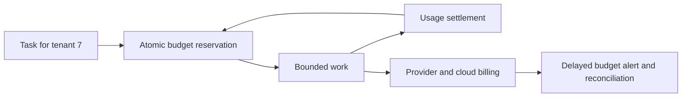

# Measure cost per useful result and control work before it starts

Role: decision guide. Prerequisites: [pool capacity](../../fundamentals/database/05_connection_pooling.md),
[token economics](../../fundamentals/fastapi/safe_and_scalable_api_calls/10_llm_token_economics.md)
and [SLIs/SLOs](../../infrastructure/observability/05_alerting_and_slos.md).
An SLI is a measured service outcome; an SLO is its target. Cost improvements must preserve that
outcome. Start with cost per accepted document, then use resource metrics to explain it.

## A cheaper request can produce a more expensive product

Use illustrative accounting units, not vendor prices. A workflow spends 100 units on 100 attempts
but accepts only 50 documents: cost per accepted document is 2. Another spends 150 units on 100
attempts and accepts all 100: unit cost is 1.5. Looking only at price per attempt chooses the worse
product. Include failed calls, retries, indexing, storage, egress and shared infrastructure in the
appropriate numerator; define which useful results count in the denominator.

A simple monthly allocation example:

| Component | Measured cost units | Allocation basis |
|---|---:|---|
| Provider calls | 300 | Recorded usage by tenant and workflow |
| PostgreSQL | 200 | Shared baseline plus measured workload share |
| Redis | 80 | Shared baseline plus memory/traffic share |
| Object storage and egress | 120 | Stored bytes, requests and transferred bytes |
| Total | 700 | 10,000 accepted documents → 0.07 units each |

An allocation basis is an accounting model, not a claim of physical precision. Idle capacity and
shared minimums do not disappear because one tenant made no calls. Document how they are assigned.

## Separate delayed accounting from immediate admission

Cloud budgets detect spend and trends from billing data. They are not a transactional check before
each provider call. AWS Budgets updates can lag hours, so a fast loop can exceed a target before an
alert arrives. [AWS Budgets update behavior](https://docs.aws.amazon.com/cost-management/latest/userguide/budgets-managing-costs.html), checked 2026-10-30.

The two feedback loops operate at different speeds:

Before work, reserve a conservative envelope in the application budget store. Afterward, settle
actual measured usage and reconcile uncertain outcomes. Billing reports catch estimation drift and
unattributed costs. The [LLM safety/cost chapter](../../architecture/llm_systems/05_safety_cost_and_observability.md)
works through concurrent reservation arithmetic. A notification alone is not a hard spending cap.

Tag resources with stable service, environment, owner and cost-center identifiers. Activate relevant
cost-allocation tags where the billing platform requires it; existing resource tags alone may not
appear in reports. Tenant attribution often belongs in application usage records because a shared
PostgreSQL instance cannot have a separate resource tag for every row.
[AWS allocation guidance](https://docs.aws.amazon.com/whitepapers/latest/tagging-best-practices/building-a-cost-allocation-strategy.html).

## Resize the bottleneck you measured

If PostgreSQL CPU is low but I/O latency and lock waits dominate, buying more CPU may not help.
Inspect query plans, storage, vacuum and long transactions first. Lowering Redis memory below its
working set can trigger eviction, increase database misses and raise total cost. A larger cache is
valuable only if the saved downstream work exceeds its extra cost and stale-data risk.

For LLM work, compare total input/output/cache usage, attempts per task, model quality and context
length. Batching fits jobs whose latency target tolerates delayed completion; measure partial failures
and reconciliation cost. A smaller model is a candidate only after the same eval gates pass. Use
[load testing](../testing/14_load_and_performance_testing.md) to verify a proposed capacity change
under realistic concurrency and dependency limits.

A cost-spike runbook compares deploy/prompt revisions, traffic, retry counts, cache misses and
unattributed resources. Disable the offending workflow or cap admission, preserve usage records,
then repair and replay within a bounded budget. Avoid automatically stopping shared stateful services
based only on a delayed spend alarm: an outage or recovery can cost more than the saved compute.

Before production, verify that duplicate settlements cannot double-charge a tenant, one tenant
cannot spend another's budget, missing usage is tracked as uncertain, and alerts have an owner.
Review cost per accepted task alongside latency/error SLOs after every sizing change. No fixed
prices are embedded here; use the selected region, contract and current provider rate card.

**Decision exercise:** Redis downsizing saves 30 units but increases PostgreSQL and provider work
by 70 units, while accepted tasks stay constant. Was the experiment successful?

Answer

No. End-to-end spend rises by 40 units and useful output is unchanged. Restore the previous capacity
if the result is repeatable, then investigate cache keys, TTL and workload before another sizing change.
A resource-local saving is not a system saving.

