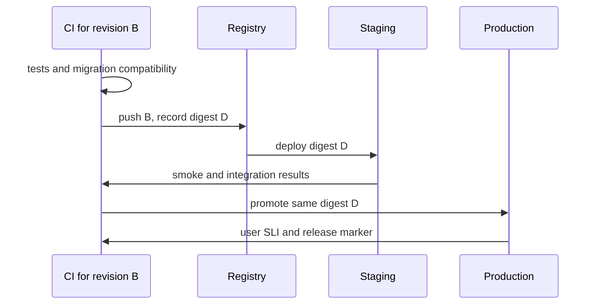

# Ship one tested revision and keep a recovery path

**Role: implementation.** Read [container deployment](docker_and_deployment.md), [testing in CI](../testing/11_coverage_and_ci.md), and [Alembic](../../fundamentals/database/06_alembic.md) first. This chapter assumes a Python service with a committed dependency lock, automated tests, and an image build. It teaches release decisions; the workflow below must be adapted to an application's actual commands and cloud account.

## Follow the artifact from commit to users

The document API currently runs revision A. Revision B adds a `processing_version` field. Passing B's unit tests proves something about B in a test environment; it does not prove B can share a database with A during a rollout.

**Continuous integration (CI)** checks changes together frequently. **Continuous delivery** keeps a verified change deployable, with a deliberate promotion decision. **Continuous deployment** automatically promotes changes that pass the gates. **Release management** also controls when users see the behavior, who owns it, and how to recover. A feature flag can separate deploying B from enabling B's feature.

This sequence follows one image digest, not a tag whose contents may change between environments.



The staging result applies to production's bytes because both use D. Rebuilding B for production can change dependencies or base images, invalidating that inference. Configuration still differs, so promotion needs a production smoke test too.

## Establish the smallest usable pipeline

Start with CI that installs from the application's committed lock and runs its real checks. The following is a **workflow anatomy example**, not a workflow for this notes repository: it assumes `requirements-dev.lock`, `app/`, `tests/unit/`, `tests/integration/`, `pyproject.toml` configuration, a Dockerfile, and an integration fixture that provisions an isolated database. The lock contains hashes and includes pytest, Ruff, mypy, and pip-audit. If your project uses uv, replace installation with its frozen-lock command rather than maintaining two lockfiles.

```yaml
name: verify
on:
  pull_request:
  push:
    branches: [main]
permissions:
  contents: read
jobs:
  check:
    runs-on: ubuntu-latest
    timeout-minutes: 20
    steps:
      - uses: actions/checkout@v4
        with:
          persist-credentials: false
      - uses: actions/setup-python@v5
        with:
          python-version: '3.12'
      - run: python -m pip install --require-hashes -r requirements-dev.lock
      - run: python -m ruff format --check app tests
      - run: python -m ruff check app tests
      - run: python -m mypy app
      - run: python -m pytest tests/unit
      - run: python -m pytest tests/integration
      - run: python -m pip_audit -r requirements-dev.lock
      - run: docker build --tag documents:ci .
```

`uses` runs another repository's action; `run` executes a shell command on the runner. `permissions` bounds the job token. `timeout-minutes` bounds a stuck test. The major-version action references above are readable examples: resolve reviewed releases to full commit SHAs in a real protected workflow and automate reviewed pin updates. A dependency audit is only one gate: scan the built image and secrets as well, and review scanner findings against your risk policy. A green dependency scan does not establish a clean container or a secure application.

The success signal is a run in which every required check executes and passes for the commit being promoted. “Green” is misleading if integration tests were skipped or branch protection requires only a different job name. Exercise the gate with a deliberately failing change in a disposable branch.

## Give each stage evidence and an owner

| Stage | Evidence retained | What blocks promotion |
|---|---|---|
| Format, lint, types, unit tests | Tool versions, results, commit | Failed required check or missing check |
| Integration and migrations | Empty-database upgrade; upgrade from a production-shaped schema; old/new app compatibility | Failed invariant, unexpected rewrite, long lock wait |
| Build and scan | Digest, source revision, dependency inventory, scanner result | Unapproved critical exposure or untraceable build |
| Staging deploy | Applied config revision and image digest | Wrong digest, failed startup, failing representative transaction |
| Production promotion | Environment authorization and recorded operator/run | Missing owner, unavailable recovery capacity |
| Smoke and watch window | Synthetic result, SLI comparison, logs and deployment marker | Error/latency regression or missing telemetry |

Promote only from a trusted branch or reviewed release tag. Untrusted pull-request code must not execute with production credentials; be particularly careful with privileged workflow triggers that check out contributor code. Retain artifact provenance and vulnerability decisions with the release. These practices support a repeatable secure-development process; a workflow alone does not establish compliance with [NIST SSDF](https://csrc.nist.gov/Projects/ssdf).

## Bind deployment authority to the intended environment

Use separate development, staging, and production environments and identities. Environment-specific settings include endpoints, capacity and feature flags; environment-specific secrets include credentials. A protected `production` environment can require reviewers and constrain branches before a job obtains its secrets; availability depends on repository visibility and plan. Verify the actual settings rather than assuming the YAML creates protection rules. [GitHub environment documentation](https://docs.github.com/en/actions/how-tos/deploy/configure-and-manage-deployments/manage-environments).

The **explanatory excerpt** below belongs inside a deployment workflow with a successful build job. Its omitted steps are provider-specific identity exchange, deployment by verified digest, and smoke verification; it does not deploy anything by itself.

```yaml
jobs:
  deploy:
    needs: build
    environment: production
    runs-on: ubuntu-latest
    permissions:
      contents: read
      id-token: write
    concurrency:
      group: production-release
      cancel-in-progress: false
    steps:
      - run: echo "Insert reviewed provider identity and deploy steps here"
```

OIDC allows the job to exchange a short-lived identity token for narrowly scoped cloud credentials. `id-token: write` permits requesting that token; it does **not** grant cloud access. The cloud trust policy must validate issuer, expected audience, and the intended repository/environment subject, while the role policy limits deployment actions and resources. Reject a token from the wrong repository or environment in a staging identity test. Never print the token to diagnose it.

**What's changing — checked 2026-10-30:** GitHub documents immutable OIDC subject claims containing owner/repository IDs for newly created repositories and relevant renames/transfers from July 15, 2026; older repositories can retain the earlier format. This is a **GA identity-format change**: construct the trust policy from the repository's actual configured claims, not a copied legacy `repo:owner/name:environment:production` string. [OIDC reference](https://docs.github.com/en/actions/reference/security/oidc).

## Name artifacts so rollback identifies bytes

A commit-SHA tag connects an image to source; a semantic version names a product release. An environment tag such as `production` is a mutable pointer useful for humans, not an immutable deployment input. Record the image digest, application revision, migration revision and configuration revision together. Configure registry immutability where available and retain the previous working digest through the recovery window.

Do not put secrets into build arguments or image layers. Changing a secret should update the secret version and the consuming process according to its reload contract, not require rebuilding the application with the secret inside it.

## Expand first; contract only after old readers are gone

For `processing_version`, first add a nullable column, deploy B that tolerates null and writes the new value, backfill bounded batches, validate completeness, and only then enforce the new requirement in a later release. A remains usable while B rolls out because its expected columns still exist.

| Phase | A can run? | B can run? | Recovery boundary |
|---|---|---|---|
| Add compatible column | Yes | Yes, handles null | App rollback remains available |
| Backfill in bounded batches | Yes | Yes | Pause/resume backfill; check data invariant |
| Remove old field or representation | Possibly no | Yes | Old application may no longer be compatible |

A migration transaction can still wait behind a long transaction and block subsequent work. Set reviewed lock/statement timeouts, inspect blockers and rehearse on production-like volume. Run one coordinated migration job, not a migration in every replica's startup. [Alembic's production patterns](../../fundamentals/database/06_alembic.md) own the commands and locking details.

“Rollback” is four different operations: deploy the old **app** digest; restore the previous **config** version; execute a proven **schema** reversal; or reconcile/repair **data** already changed. Dropping a new column loses its data; an old image cannot unsend a webhook. Treat irreversible data changes as a forward-repair plan with backups and an owner, not as a promised `downgrade()`.

## Choose how much new behavior users see

| Strategy | How B meets traffic | Choose when | Main cost or failure |
|---|---|---|---|
| Rolling | Replace a few A replicas at a time | A and B can coexist | Shared DB compatibility; overlap consumes capacity |
| Blue-green | Prepare full B fleet, switch routing | Fast routing reversal matters | Double capacity; background workers can accidentally run twice |
| Canary | Send a bounded cohort to B | You can compare representative user outcomes | Small samples hide rare errors; tenant mix can bias comparison |
| Feature flag | Deploy B, enable a behavior separately | Fast behavior disable is useful | Forgotten flags and mixed execution paths need tests |

A kill switch must work independently of the failing dependency. For example, disabling LLM enrichment can keep uploads and document status available while a provider fails. Test the disabled path before relying on it.

After promotion, check startup, authenticated read/write for a synthetic tenant, queue completion, and absence of cross-tenant access. A `/health` response alone misses broken business behavior. Compare [SLIs](../../infrastructure/observability/05_alerting_and_slos.md) by revision over a watch window long enough to see meaningful traffic and delayed jobs. Choose the window from job duration and traffic volume, not a universal five-minute rule.

## Rehearse release recovery

In staging, inject a B-only error after a compatible migration. Stop promotion, disable B's feature if that contains impact, restore A's digest/config, then verify an old and newly created document. Measure time to detect and restore, and verify pending jobs remain recoverable. If A cannot read B's rows, the rehearsal has exposed a compatibility gate failure; repair that before deployment.

A release is ready when:

- Required checks executed for the promoted revision; staging and production use the same digest.
- Runtime identity is scoped; secrets are environment-specific; the previous artifact remains available.
- Migration lock risk and old/new compatibility have been rehearsed with realistic data.
- Capacity includes rollout overlap, connection pools and worker concurrency.
- A named owner watches user outcomes and can disable or reverse the release.
- Recovery instructions distinguish app, config, schema and data changes.

Do not deploy with a failed gate, unknown artifact, untested irreversible migration, or absent recovery owner. A justified emergency release should record which risk was accepted and by whom, then restore the missing evidence afterward.

## Recap

- Tests qualify a revision; immutable promotion preserves the identity of the tested bytes.
- Mixed-version operation makes database compatibility a release property.
- OIDC constrains deployment identity only when cloud trust and role permissions are scoped.
- A rollout succeeds when user behavior remains healthy; process health is only an input.
- App rollback does not reverse data effects.

**Check yourself: B wrote a new enum value that A cannot parse. Does retaining A's image ensure rollback?**

<details><summary>Answer</summary>

No. The artifact exists, but A cannot interpret current data. Keep the new value disabled until all relevant readers support it, or prepare a reviewed data repair. Removing B's pods alone leaves the incompatible rows.

</details>

**Check yourself: a canary has zero errors after ten requests. Is it ready for full traffic?**

<details><summary>Answer</summary>

That sample gives little evidence about a rare failure or a tenant-specific path. Compare representative routes, tenants and delayed work, and set a minimum evidence window before promotion. The canary limits initial exposure; it does not automatically produce enough evidence.

</details>

**Try it:** Design the migration stages for renaming `source_url` to `source_uri`. Start with both columns and identify when each application revision reads and writes each field. Hint: rolling replicas and delayed jobs may run older code.

<details><summary>Worked solution</summary>

Add `source_uri`, but keep `source_url` authoritative while any old application or worker can still write it. Deploy compatible code that reads the old field and writes both. Backfill in bounded batches, then retire or fence every old writer and reconcile disagreements again; an old writer may have changed `source_url` after an earlier backfill. Only after that reconciliation switch reads to `source_uri`. Retain dual writes through the old-reader rollback window, then remove the old field in a separate release. An alternative is a reviewed database synchronization mechanism that covers every writer, with its own conflict policy. If old jobs may live indefinitely, migrate their payloads or maintain the decoder; elapsed time alone is insufficient.

</details>
