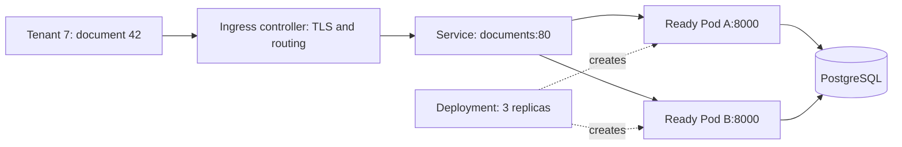
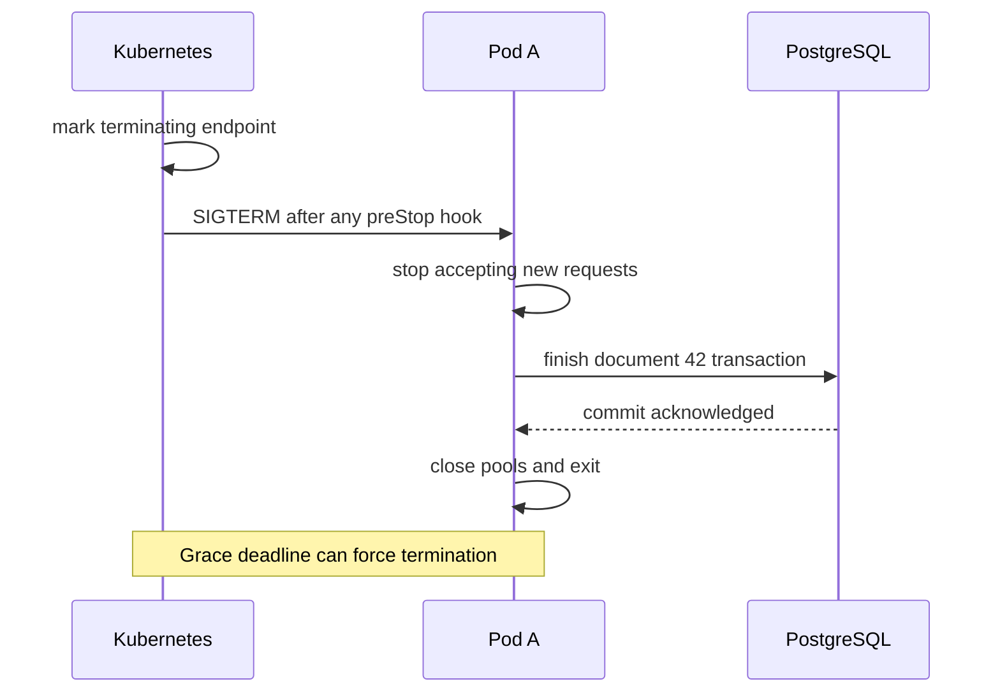

# Keep a FastAPI service healthy while replicas change

**Role: implementation.** Prerequisites: [containers, health endpoints and signals](docker_and_deployment.md), [release compatibility](02_ci_cd_and_releases.md), and [database connection budgets](../../fundamentals/database/05_connection_pooling.md). The examples use stable Kubernetes APIs and an application image you supply. They do not provision a cluster or an ingress controller.

## Understand which controller owns each decision

Document 42 arrives while revision B is replacing A. The request must reach a ready process; its database transaction must finish even if that process is asked to exit. Kubernetes coordinates processes and routing, but it cannot infer when the business operation is complete.

A **Pod** contains one or more co-scheduled containers. A **Deployment** maintains a desired number of application Pods through ReplicaSets. A **Service** gives a stable network destination and selects Pod endpoints by labels. An **Ingress** describes HTTP routing implemented by an installed ingress controller; creating the object alone creates no functioning edge. Gateway API is another routing API that also requires an implementation.

This topology shows the boundary between selecting a process and processing a document.



The Service's labels decide which Pods belong to the application. Readiness decides which selected Pods should receive new ordinary traffic. Neither establishes that a response committed a database change; the application still owns that transaction.

## Start with a runtime contract you can inspect

The following **manifest example** assumes a `documents` namespace already exists and a pushed application image. Replace `registry.example.com/documents:reviewed-release` with your verified image digest before applying. The application exposes `/live`, `/ready`, and `/startup` on port 8000, uses UID 10001, writes temporary files only under `/tmp`, and requires no Kubernetes API access. The baseline intentionally omits database credentials: provide the application's actual secret references before using a real database-backed image.

```yaml
apiVersion: apps/v1
kind: Deployment
metadata:
  name: documents
  namespace: documents
spec:
  replicas: 3
  minReadySeconds: 10
  progressDeadlineSeconds: 300
  strategy:
    type: RollingUpdate
    rollingUpdate:
      maxSurge: 1
      maxUnavailable: 0
  selector:
    matchLabels:
      app: documents
  template:
    metadata:
      labels:
        app: documents
    spec:
      automountServiceAccountToken: false
      terminationGracePeriodSeconds: 45
      securityContext:
        runAsNonRoot: true
        runAsUser: 10001
        fsGroup: 10001
      containers:
        - name: api
          image: registry.example.com/documents:reviewed-release
          ports:
            - name: http
              containerPort: 8000
          securityContext:
            allowPrivilegeEscalation: false
            readOnlyRootFilesystem: true
            capabilities:
              drop: [ALL]
            seccompProfile:
              type: RuntimeDefault
          resources:
            requests:
              cpu: 250m
              memory: 256Mi
            limits:
              cpu: '1'
              memory: 512Mi
          startupProbe:
            httpGet: {path: /startup, port: http}
            periodSeconds: 2
            failureThreshold: 30
          readinessProbe:
            httpGet: {path: /ready, port: http}
            periodSeconds: 5
          livenessProbe:
            httpGet: {path: /live, port: http}
            periodSeconds: 10
          volumeMounts:
            - name: tmp
              mountPath: /tmp
      volumes:
        - name: tmp
          emptyDir:
            sizeLimit: 256Mi
---
apiVersion: v1
kind: Service
metadata:
  name: documents
  namespace: documents
spec:
  selector:
    app: documents
  ports:
    - port: 80
      targetPort: http
```

`maxSurge: 1` permits an extra B Pod; `maxUnavailable: 0` keeps rollout availability while replacing A. The scheduler still needs enough capacity for the extra Pod. A stalled rollout does not automatically roll back when `progressDeadlineSeconds` elapses; the release controller/operator must react to the failed progress condition. [Deployment semantics](https://kubernetes.io/docs/concepts/workloads/controllers/deployment/).

Save your adapted manifest as `documents.yaml`. In the intended staging context, the verification commands are:

```bash
kubectl apply --dry-run=server -f documents.yaml
kubectl apply -f documents.yaml
kubectl -n documents rollout status deployment/documents --timeout=5m
kubectl -n documents get pods -l app=documents
kubectl -n documents get endpointslices -l kubernetes.io/service-name=documents
```

Success means three ready Pods, completed rollout and ready endpoint addresses, followed by an authenticated synthetic transaction through the real ingress. `Pending` often indicates insufficient resources; `ImagePullBackOff` indicates an unavailable image or registry authorization problem; ready Pods with no matching endpoints suggest a selector/port mismatch. Server dry-run checks admission, not whether the image or health endpoints work.

## Make restart, startup and traffic decisions separately

A startup probe gives initialization time before liveness and readiness probes run. Readiness failure withdraws a Pod from normal traffic; liveness failure triggers a container restart. A slow shared database is not repaired by restarting every API Pod. Keep liveness focused on whether this process can make progress, and make readiness dependency checks bounded and intentional. If every Pod refuses traffic during a shared outage, clients still need overload responses and retry discipline. [Probe behavior](https://kubernetes.io/docs/tasks/configure-pod-container/configure-liveness-readiness-startup-probes/).

For the example, startup allows roughly 60 seconds of failed checks. That is a chosen application budget, not a guarantee that startup always takes 60 seconds. Inject a 20-second startup delay in staging: the process should remain running, become ready after initialization and avoid restart loops. Inject a permanently broken initialization: the Pod should never serve document requests.

## Budget resources across the entire rollout

A **request** is the quantity used for scheduling; a **limit** constrains runtime consumption. CPU can be throttled when its limit is reached; memory-limit pressure can end in an OOM kill. A low CPU request can fit many Pods on a node even when they compete at peak load. [Resource management](https://kubernetes.io/docs/concepts/configuration/manage-resources-containers/).

With three replicas, one Uvicorn process per Pod and a pool maximum of 10, normal application connections can reach 30. One surge Pod raises the non-terminating rollout subtotal to 40. Terminating Pods can retain their pools during draining, and Kubernetes can temporarily have more Pods than `replicas + maxSurge`; reserve additional connections for that measured overlap. An HPA maximum of 12 raises the steady subtotal to 120 before surge, terminating Pods and migration/administrative connections. Autoscaling the API into a database connection failure is a predictable result of budgeting each tier separately.

A **HorizontalPodAutoscaler (HPA)** changes replica count using observed metrics. CPU utilization targets are relative to CPU requests; without suitable requests the target is not meaningful. For an I/O-bound service, bounded in-flight requests or queue age may explain saturation better, but custom/external metrics require an adapter and tested metric semantics. Scale-down stabilization reduces oscillation; it does not repair unlimited demand. [HPA mechanics](https://kubernetes.io/docs/concepts/workloads/autoscaling/horizontal-pod-autoscale/).

Measure request latency, CPU throttling, memory working set, event-loop delay and pool waits together. If latency rises while CPU is quiet and pool wait is high, adding API replicas can worsen the shared bottleneck. Reduce admission or optimize the database path first.

## Drain requests and leased work before exit

During termination, endpoint updates and the shutdown signal propagate asynchronously. A request already in flight may remain after new routing stops. The app should stop accepting new work, drain bounded requests, close clients and exit before the grace period expires. A `preStop` hook, if used for measured routing propagation delay, consumes the same termination budget; a fixed sleep alone is not graceful shutdown.

The sequence below shows why a 45-second grace period must exceed the application's own drain budget.



For workers, stop fetching new messages first. Finish and acknowledge committed work, or release/allow expiry of the lease so another worker can retry. Never acknowledge uncommitted work just to achieve a clean exit. Test termination during a request and immediately after a durable worker effect; the request outcome must be interpretable and the retry must not duplicate that effect.

A **PodDisruptionBudget** limits supported voluntary evictions, such as a node drain. It does not constrain a Deployment's own rolling update and cannot prevent a node failure. With three replicas, `minAvailable: 2` allows one voluntary disruption when all are healthy. If only two are healthy, drain waits; investigate instead of reflexively deleting the budget. Spread replicas across failure domains when availability requires it. [Disruption semantics](https://kubernetes.io/docs/concepts/workloads/pods/disruptions/).

## Give configuration and scheduled work explicit lifetimes

A ConfigMap holds non-secret configuration. A Secret holds sensitive values, but base64 representation is not encryption: restrict RBAC, enable appropriate encryption at rest and avoid plaintext secret manifests in Git. Environment variables are fixed for the process lifetime; updating the Secret does not change a running process's environment. Mounted updates still need application reload behavior. Version configuration, roll consumers deliberately and verify the effective non-sensitive revision.

Use a **Job** for a bounded batch run, such as one coordinated migration. Use a **CronJob** to create Jobs on a schedule. Neither means the business operation happens exactly once: make effects idempotent and keep durable progress. `concurrencyPolicy: Forbid` prevents overlap for that CronJob's Jobs, not all other ways the task can be invoked. A delayed or missed schedule needs an explicit business policy: catch up, skip, or reconcile.

## Test the failures before using autoscaling as recovery

| Symptom | Inspect | First safe response |
|---|---|---|
| Restart count grows | Last termination reason, previous logs, probe timing | Fix failed startup/liveness policy or memory cause; preserve evidence |
| `OOMKilled` during uploads | Body limits, spool use, concurrency, memory peak | Bound uploads/concurrency; measure before raising limits |
| Rollout waits with `Pending` | Scheduler events, requests, quotas, surge capacity | Restore capacity or choose a reviewed rollout budget |
| HPA adds Pods but latency worsens | DB/Redis/provider limits and pool waits | Cap concurrency and replicas; address shared bottleneck |
| Requests fail during drain | Termination times, ingress behavior, app deadlines | Fit drain within grace; retest under traffic |

Production readiness means known resource and connection ceilings; useful probes; digest-pinned images; restricted identities/network paths; tested termination and voluntary disruption; and a rollback rehearsal. Use a managed application platform instead if running Kubernetes adds operational complexity without a needed scheduling or platform capability.

**What's changing — checked 2026-10-30:** use the [supported release list](https://kubernetes.io/releases/) for cluster upgrade planning rather than treating the example's stable APIs as a support guarantee. The [v1.36 release notes](https://kubernetes.io/blog/2026/04/22/kubernetes-v1-36-release/) include **PREVIEW** workload-aware scheduling capabilities; ordinary API replicas here do not require those feature gates. New scheduler features do not replace application concurrency limits.

## What is changing: resource metrics API versions

**GA — Kubernetes 1.37, checked 2026-10-30:** `metrics.k8s.io/v1` is stable. The API still needs an
installed metrics implementation such as metrics-server and a registered APIService; a control-plane
upgrade alone does not install resource metrics. Kubernetes 1.37's HPA still uses `v1beta1`, so serve
both during migration rather than deleting the beta endpoint as soon as `v1` appears.
[Official metrics API migration](https://kubernetes.io/blog/2026/08/27/kubernetes-v1-37-metrics-api-ga/).

On your authorized test cluster, inspect discovery and both serving paths before changing HPA:

```bash
kubectl get --raw /apis/metrics.k8s.io/
kubectl get apiservice v1.metrics.k8s.io v1beta1.metrics.k8s.io
kubectl top pods
kubectl describe hpa document-api
```

If `top` succeeds through v1 while HPA reports missing metrics, inspect whether v1beta1 remains
available and whether CPU requests are present. Neither API version changes the connection-budget
calculation above. These are cluster inspection commands, not evidence this repository deployed one.

## Recap

- Deployment selects a replica target; Service and readiness determine traffic candidates.
- Startup, liveness and readiness answer different questions and have different consequences.
- Replica growth multiplies connection and dependency demand.
- Shutdown is a timed protocol, and forced termination remains possible.

**Check yourself: three Pods pass liveness but all fail readiness. What will a restart accomplish?**

<details><summary>Answer</summary>

Nothing is established by that evidence. Readiness could reflect a shared database outage while each process remains healthy. Diagnose the readiness reason and dependency state; a restart storm may add reconnection load without restoring service.

</details>

**Check yourself: a PDB allows no evictions. Will it stop the Deployment updating its Pods?**

<details><summary>Answer</summary>

No. The Deployment rollout uses its own availability settings. The PDB protects supported voluntary eviction operations; use `maxUnavailable`, capacity and readiness to control a rollout.

</details>

**Try it:** Increase the HPA maximum to 8, retain one surge Pod, and allow 12 DB connections per Pod. Determine the connection budget before deploying.

<details><summary>Worked solution</summary>

Eight target replicas plus one surge Pod account for 108 connections, but this is not a hard upper bound. Terminating Pods may still hold pools while replacements start: add `12 × maximum concurrently draining Pods` under your measured rollout/shutdown policy, then administrative, migration and other services' connections. If draining overlap is not bounded, enforce an aggregate connection/admission limit rather than claiming a fixed ceiling. Compare the resulting budget with usable database capacity. Reduce pool size or maximum replicas, add an appropriate pooler, or increase proven database capacity before rollout. Multiple Uvicorn processes multiply per-Pod pools again.

</details>
