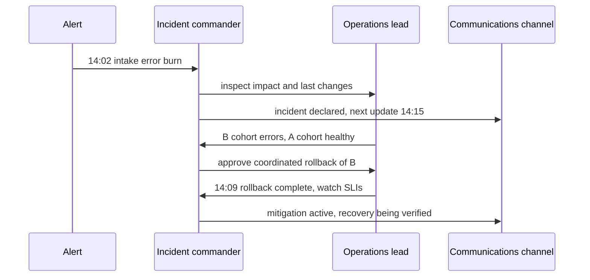

# Coordinate an incident before changing the system

**Role: foundation.** Prerequisites: [SLIs and actionable alerts](../../infrastructure/observability/05_alerting_and_slos.md) and [release recovery](../deployment/02_ci_cd_and_releases.md). This chapter teaches the human coordination around a failing document service. It does not define your organization's contractual response times.

## Declare impact while the cause is still uncertain

At 14:02 UTC, intake errors rise to 8% after revision B. Two engineers independently restart workers and roll back the API. Both actions sound plausible, but now nobody can tell which change affected the error rate. An incident process prevents that loss of control.

An **incident** is an unplanned degradation requiring coordinated response. The **incident commander** keeps priorities, roles and decisions coherent; the **operations lead** coordinates technical changes; the **communications lead** gives stakeholders accurate updates. In a small team, one person may hold multiple roles, but name the responsibilities explicitly and hand them off as load grows. [Google's incident-management chapter](https://sre.google/sre-book/managing-incidents/) explains the separation of coordination, technical work and communication.

A responder can declare an incident from observed impact without knowing the root cause. Early declaration creates a shared workspace and recruits help; it is not an assertion that the whole system is down.

## Assign severity by consequences

Use this example rubric as a starting point and agree it with your own service owners before an incident.

| Level | Example impact | Response |
|---|---|---|
| SEV1 | Broad outage, ongoing data loss, or cross-tenant exposure | Immediate incident command and relevant security/data specialists |
| SEV2 | Material degradation affecting a subset of customers or a core path | On-call response; coordinate additional owners as needed |
| SEV3 | Bounded issue with a practical workaround and no urgent integrity risk | Ticket with owner and scheduled investigation |

A single tenant losing confidential data can be SEV1 even when global availability is 99.99%. Global request counts do not measure confidentiality or customer-specific harm. Reassess severity when evidence changes, recording why. Do not wait for a perfect percentage before containing an apparent exposure.

## Work a controlled loop

The sequence below follows revision B without assuming B is the cause.



The commander does not need to approve every read-only query. The coordination point is a production change that could conflict with another change or affect evidence. Recording the hypothesis and expected signal lets the team evaluate the action afterward.

Use the loop **detect → declare → mitigate → communicate → verify resolution → review**. Diagnosis continues throughout. Mitigation restores an acceptable user experience; it need not explain every causal detail. Disabling optional extraction can restore document intake while the provider issue remains unresolved. Resolution requires verifying impact has ended, including queued work and data correctness, rather than only seeing an error chart fall after traffic stopped.

## Keep one live incident record

A useful opening record is a small concrete artifact:

```text
Incident: DOC-2026-014
Declared: 2026-10-30 14:03 UTC
Severity: SEV2; 8% of valid intake attempts failing
Commander: primary on-call
Operations: API owner; database owner joining
Communications: support lead
Known: failures concentrated on revision B; document reads healthy
Unknown: whether accepted jobs were affected
Current action: compare A/B traces; freeze unrelated deployments
Next update: 14:15 UTC
```

Append timestamped observations, hypothesis changes, commands/config revisions, decisions, metrics links and the result of each intervention. Separate facts from hypotheses. Use UTC or one explicitly declared zone and preserve source timestamps; mixing local times can invert the apparent order of events.

Capture enough evidence to reconstruct behavior without copying document contents, tokens or unnecessary personal data into chat. Retain access-controlled logs and link them. A communication update should state known impact, current mitigation and next update time; avoid claiming a cause or recovery deadline that evidence does not support.

## Escalate before the responder becomes the bottleneck

The on-call schedule needs a primary, backup, coverage handoff and a tested escalation path. If the primary does not acknowledge within the team's agreed interval, escalate to backup. If progress stalls, recruit the dependency owner or incident commander; repeatedly waking the same exhausted person is not a recovery plan.

A handoff names the new owner, who explicitly acknowledges, and transfers impact, timeline, current hypothesis, actions already attempted, active changes and next decision. Until acknowledged, the prior owner retains responsibility. Rehearse this with a tabletop: one responder becomes unavailable during a rollback, and another must reconstruct the state from the record.

Production readiness means severity examples, ownership and fallback contacts, access that works under an identity-provider outage according to organizational policy, a communication template, and an exercised escalation/hand-off. Measure detection, acknowledgment and mitigation intervals to locate process delays; comparing responders by raw incident speed encourages premature closure.

## Recap

- Declare from observed impact; root-cause certainty comes later.
- Named roles keep simultaneous technical changes from obscuring evidence.
- Severity includes integrity and confidentiality, not only availability.
- Recovery includes delayed work, and ownership changes require an explicit handoff.

**Check yourself: errors fall because clients stop retrying, but document completion remains stalled. Is the incident resolved?**

<details><summary>Answer</summary>

No. Fewer attempts shrink observed errors while accepted work is still failing its completion promise. Check queue age, completion cohorts and a fresh synthetic operation. Restore service and account for the backlog before closing.

</details>

**Check yourself: only one tenant is affected by a cross-tenant download. Should it stay SEV3 because volume is low?**

<details><summary>Answer</summary>

No. Confidentiality impact can justify the highest response tier regardless of request volume. Contain access, preserve evidence with restricted handling and engage the security owner. Determine the real scope rather than deriving severity solely from an aggregate SLI.

</details>

Sources checked: 2026-10-30. The role model is a stable operational pattern; notification tooling and contact paths must be verified in the actual organization.
