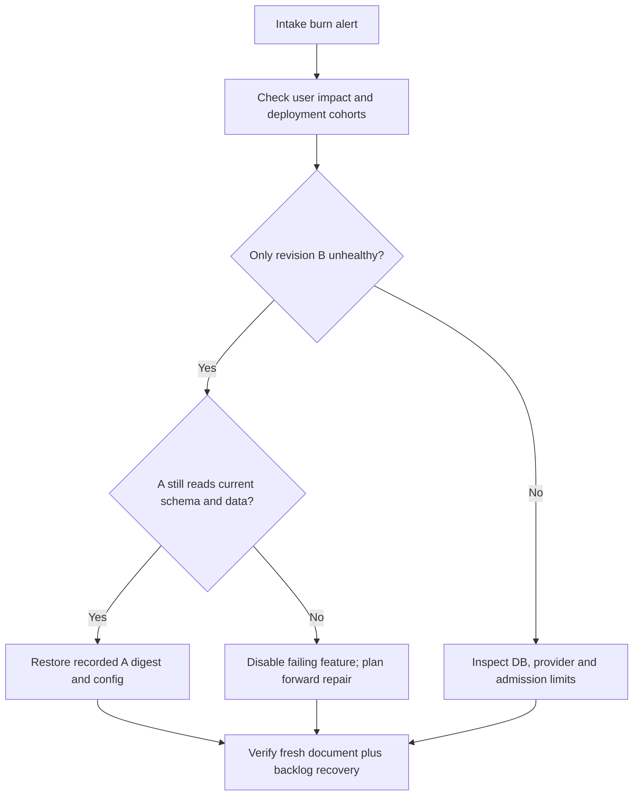

# Make the next safe action visible in a runbook

**Role: implementation.** Read [incident roles](01_on_call_and_severity.md), [connection pooling](../../fundamentals/database/05_connection_pooling.md), and [release recovery](../deployment/02_ci_cd_and_releases.md). A runbook is a bounded decision procedure for a known symptom, including evidence, expected results and stop conditions. It is not a list of commands to run regardless of context.

## Start from the page the responder actually sees

`DocumentIntakeFastBudgetBurn` fires at 14:02. The error dashboard shows database pool timeouts after revision B. The runbook's job is to distinguish an application connection leak, legitimate saturation and a shared database incident before someone blindly scales the API.

Use a standard header:

```text
Runbook: document intake error-budget burn
Owner: documents-oncall; backup: platform-oncall
Trigger: DocumentIntakeFastBudgetBurn
Scope: production document intake; reads and async completion checked separately
Required access: read dashboards/logs; deployment changes through release workflow
Last rehearsal: record actual date and exercise link
Stop/escalate: suspected data exposure, unexplained data loss, or unsafe schema rollback
```

A stale rehearsal date is useful evidence. Do not replace it with “reviewed today” unless the procedure was actually exercised.

## Example: errors rose after a release

1. **Confirm impact.** Compare eligible attempts and bad-event ratio over the same interval. Check a synthetic request and intake/completion separately. If the metric disappeared, investigate telemetry loss; a missing series is not zero errors.
2. **Bound the change.** Record active image digest, configuration revision, flag changes and migration revision. Compare B and A by route and tenant cohort. Timing alone is a hypothesis; a B-only regression is stronger evidence.
3. **Inspect the constrained resource.** Compare DB pool checkout waits, connections in use, transaction duration and database health. A full pool plus many idle-in-transaction sessions differs from a full pool doing useful work. Use the [PostgreSQL operations guide](../../fundamentals/database/09_postgresql_operations.md) for transaction/blocker diagnosis.
4. **Choose one mitigation.** If the evidence identifies B and A remains schema/data compatible, restore the recorded previous image/config through the release workflow. If shared capacity is saturated, reduce admission or disable optional expensive work first. Scaling API replicas adds contenders unless database capacity can support them.
5. **Verify and watch.** Check good/bad events, latency and pool waits, then submit a synthetic document and observe its terminal result. Track accepted jobs and oldest age until backlog returns to normal. Record whether the predicted improvement occurred.

This decision tree shows what changes the next action.



A rollback is justified by both the failure comparison and compatibility. Without the second condition, a familiar command can replace partial degradation with a total outage.

## Put inspection before mutation

These read-only commands illustrate the Kubernetes branch. They assume the intended current context and the `documents` namespace; inspect the first command's output before continuing. They do not authorize changing production.

```bash
kubectl config current-context
kubectl -n documents get deployment documents
kubectl -n documents rollout history deployment/documents
kubectl -n documents get pods -l app=documents
kubectl -n documents get events --sort-by=.lastTimestamp
```

The first observable is the expected cluster name. Stop on a context mismatch. Deployment history and Pod states identify active revisions and runtime symptoms, but may not contain application configuration or database migration state; consult the release record too. If access fails, use the tested escalation path rather than borrowing another person's credential.

Avoid a universal `rollout undo` command in a shared runbook: the previous Deployment revision may not be the last verified application/config pair. Use the exact digest and configuration from the release record. The [Deployment documentation](https://kubernetes.io/docs/concepts/workloads/controllers/deployment/) defines revision behavior; the release guide defines your compatibility gate.

For a suspected data-corruption incident, preserve affected identifiers and timestamps, stop the harmful writer when safe and engage the data owner. Repair in a reviewed, idempotent procedure with before/after counts. Do not use a production restore as an improvised first action: restoring the whole database can discard healthy writes and needs the [recovery plan](../../fundamentals/database/08_backup_and_recovery.md).

## Test the runbook as a product

In a staging exercise, inject a bounded pool leak or a slower query into B. Give the responder only the page and runbook. Observe whether they find the correct deployment, distinguish pool wait from server execution, select a compatible recovery and verify document completion. Record elapsed time and ambiguous steps.

A successful exercise ends with the expected service behavior, preserved data invariants and a usable timeline. A responder reaching the end of the page without an outcome means the runbook lacks a success signal. Rehearse after changing identity, deployment platform, metric names or ownership; those changes can invalidate commands even when the failure mechanism is unchanged.

Production readiness requires an owner, trigger, prerequisites/access, bounded diagnostics, reversible mitigation, stop/escalation conditions, verification, cleanup and a real rehearsal record. Keep incident-specific secrets and personal data out of examples. Prefer a short branch with a clear outcome over an encyclopedic page nobody can navigate under pressure.

## Recap

- A runbook begins with a symptom and narrows it using observable evidence.
- Every mutation needs a predicted result, a boundary and a recovery path.
- Rollback requires data compatibility as well as a previous artifact.
- Rehearsals reveal missing access and ambiguous reasoning before an outage.

**Check yourself: the runbook says to double replicas when pool waits rise. What premise is missing?**

<details><summary>Answer</summary>

Whether the database has spare capacity and whether each replica adds another pool. If the shared DB is already saturated, more replicas add connections and work. Measure the constrained tier and bound admission before scaling into the bottleneck.

</details>

**Check yourself: errors disappear after rollback but oldest-job age continues rising. What remains?**

<details><summary>Answer</summary>

Intake recovery does not establish worker recovery. Investigate worker compatibility, leases, retries and dependency health, and verify a newly accepted job plus the old cohort. The incident remains open for the affected completion promise.

</details>

**Try it:** Add a branch for “API is healthy, extraction provider returns 429.” State a mitigation and its success signal.

<details><summary>Worked solution</summary>

Bound worker concurrency and retries to the provider quota, pause optional enrichment or return an explicit pending/degraded state. Preserve accepted work durably. Success requires reduced 429s, no retry amplification, a bounded oldest-job age or an explicitly communicated delay, and recovery of completion after quota returns. Increasing API replicas does not increase the provider's quota.

</details>

Sources checked: 2026-10-30. The diagnostic method also follows [Google SRE effective troubleshooting](https://sre.google/sre-book/effective-troubleshooting/).
