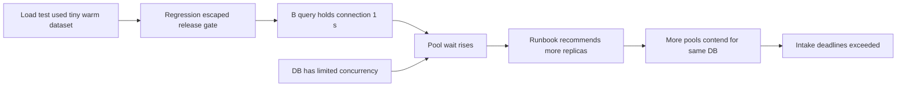

# Turn an incident into a tested system improvement

**Role: foundation.** Prerequisites: [incident coordination](01_on_call_and_severity.md) and [runbooks](02_runbooks.md). A postmortem reconstructs impact and causal conditions so the team can reduce recurrence and recovery time. It is useful after an outage, a near miss, an integrity incident or a surprisingly difficult recovery, according to agreed triggers.

## Explain why the decision made sense at the time

During DOC-2026-014, a responder doubled API replicas because the dashboard showed pool waits. The added pools increased database contention. “The responder should have known better” predicts no useful prevention: the dashboard hid total connections, and the runbook recommended scaling without checking the shared limit.

A **blameless** review examines decisions in their available context while still assigning clear ownership to improvements. It does not mean suppressing mistakes or writing “nobody could have prevented this.” Separate the triggering change, the conditions that amplified it, and the barriers that failed to detect or contain it. [Google's postmortem chapter](https://sre.google/sre-book/postmortem-culture/) describes learning from failures without discouraging reporting.

## Build the account from evidence

Use the live incident record, deployment/config revisions, metric intervals, traces, dependency notices and communication timestamps. Mark uncertainty and preserve links under appropriate access controls. The written timeline should distinguish when impact began from when it was detected; otherwise detection delay disappears.

A compact worked account follows one failure through recovery:

| UTC time | Observation or action | Evidence / interpretation |
|---|---|---|
| 14:00 | B begins rollout | Release record identifies digest and config |
| 14:01 | DB transaction time rises | B query holds connections longer; cause under investigation |
| 14:02 | Intake burn alert fires | Edge good/bad counts establish impact |
| 14:04 | Replicas doubled | Pool maximum doubles; DB waits worsen |
| 14:07 | Team stops scaling and restores A | Old/new schema compatible |
| 14:09 | Intake returns to baseline | Fresh synthetic transaction succeeds |
| 14:18 | Delayed accepted jobs finish | Completion cohorts and queue age verified |

The hypothetical incident lasted longer for asynchronous users than for intake users. Report both intervals, affected eligible counts and uncertainty in the scope; do not describe “nine minutes of impact” if completion was delayed for eighteen.

## Replace one root cause with a causal explanation

The diagram separates the triggering query change from the conditions that made it a service incident.

Changing the query addresses one trigger. Testing realistic data catches similar regressions; a pool-budget dashboard and conditional runbook limit the impact when another trigger occurs. These improvements operate at different points in the causal chain, so they are complementary rather than duplicate action items.

Use a counterfactual carefully: “Would the incident still have happened if this condition were absent?” Support the answer with a replay, benchmark or explicit uncertainty. A diagram is an explanation hypothesis until evidence supports its edges. Do not turn temporal correlation into certainty merely to close the document.

## Write actions that can be finished and verified

| Weak action | Reviewable replacement | Acceptance evidence |
|---|---|---|
| Be more careful with queries | DB owner adds a production-shaped query benchmark before the next query rollout | B's regression fails the benchmark; corrected query passes |
| Improve monitoring | API owner publishes total possible connections across HPA and surge states | Dashboard agrees with configured process/pool limits in rehearsal |
| Fix runbook | On-call owner adds shared-capacity branch and stop condition | Unfamiliar responder chooses bounded admission in an exercise |
| Improve communication | Incident lead adds a completion-impact field to the update template | Next tabletop reports intake and completion separately |

Each action has one accountable owner, due date, priority and a test of completion. Prioritize barriers with meaningful risk reduction over a long list of weak tasks. If an action is deferred, record the remaining risk and owner; an unchecked task is not a completed improvement.

A useful review document contains a short impact statement, detection and resolution account, timeline, causal analysis, what helped/hindered, corrective actions, and links to evidence. Share the learning with teams facing the same failure mode while keeping customer data and sensitive operational details restricted.

## Close the learning loop

The postmortem meeting is not the final gate. Track actions to implementation, rehearse the repaired runbook and rerun the representative load experiment. Check that the correction does not introduce a new failure, such as admission controls rejecting all small tenants while a large tenant uses the capacity.

Measure incident patterns over time: repeat mechanisms, detection gaps, recovery friction and overdue actions. Raw incident counts can rise when reporting improves; treating fewer reports as the goal discourages the evidence needed for reliability. A small near miss can justify a review when it reveals a serious failed barrier, while a routine fully understood transient may need only a brief record.

## Recap

- Reconstruct decisions using the evidence available at the time.
- Distinguish trigger, amplifiers and failed barriers rather than blaming one person.
- Report impact for every affected promise, including delayed work.
- An action improves reliability only when implemented and tested.

**Check yourself: the slow query is fixed. Why keep the runbook action?**

Answer

The query was one trigger. A future dependency slowdown can again create pool waits, and the same scaling instruction could amplify it. Repairing the decision procedure reduces impact across multiple triggers.

**Check yourself: the timeline says “errors resolved at 14:09,” but a tenant's accepted job finishes at 14:18. Which timestamp belongs in the impact summary?**

Answer

Both, with the affected promise named. Intake recovered at 14:09; completion impact lasted until its affected cohort recovered or was otherwise reconciled. Collapsing them hides user-visible delay and distorts recovery measurement.

Sources checked: 2026-10-30. This is a stable review method; the incident and times above are a worked teaching example, not a report of a real outage.
