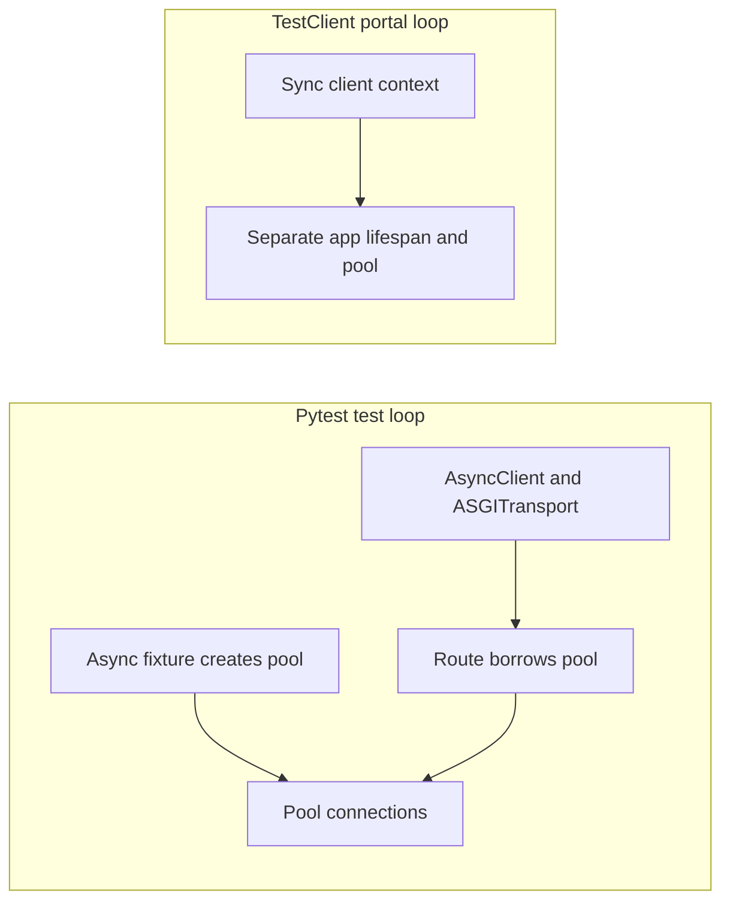

# 04 — Endpoint Testing

> **Who this is for**: FastAPI engineers who need to verify routing, validation, middleware, dependencies, and response contracts through in-process HTTP.

> **Purpose**: Exercise your FastAPI routes through HTTP — parameters, middleware, validation, status codes — without a real network.

> **Key insight**: In-process HTTP tests exercise the application protocol boundary, but they do not prove production DNS, TLS, proxy, or socket behavior.

This is where FastAPI's testability pays off: the ASGI app is a callable, so you can drive it in-process with no server running.

---

## The Two Approaches

| Feature | `TestClient` (sync) | `httpx.AsyncClient` (async) |
|---------|---------------------|----------------------------|
| Import | `from fastapi.testclient import TestClient` | `from httpx import AsyncClient, ASGITransport` |
| Test style | `def test_x():` | `async def test_x():` |
| Event loop | Creates its own | Uses pytest-asyncio's loop |
| Lifespan events | Supported via `with TestClient(...)` | Use `asgi-lifespan`'s `LifespanManager` |
| Async dependencies | Works (runs in thread) | Works natively |
| Async fixtures (DB session, etc.) | Awkward — needs bridging | First-class |
| When to use | Simple sync endpoints, scripts | Async endpoints, async fixtures, async DB |

**Default to `AsyncClient`** in an async codebase. A context-managed `TestClient` owns a blocking portal and event loop for the context, reusing it across its requests. That loop is still different from the loop used by async pytest fixtures; do not pass a pooled async connection between them.

---

This diagram tracks the owner of an async pool, not the spelling of the client API:



The upper path can share the fixture's pool. The lower path creates and closes its own resources;
passing the upper pool into it crosses loop ownership even if both calls occur in the same process.

## Sync Testing with TestClient

```python
from fastapi.testclient import TestClient
from app.main import app


def test_read_root():
    with TestClient(app) as client:
        response = client.get("/")
        assert response.status_code == 200
        assert response.json() == {"message": "hello"}
```

`TestClient` wraps your ASGI app and runs it in a thread. The `with` block triggers `lifespan` startup/shutdown — **don't skip it** (see "Lifespan" below).

> **Why `fastapi.testclient` and not `starlette.testclient`?** FastAPI re-exports Starlette's `TestClient`. Both work. Using `fastapi.testclient` makes the import consistent with the rest of your FastAPI code and future-proofs against Starlette path changes.

---

## Async Testing with httpx.AsyncClient

```python
import pytest
from httpx import AsyncClient, ASGITransport
from app.main import app


async def test_read_root():
    transport = ASGITransport(app=app)
    async with AsyncClient(transport=transport, base_url="http://test") as client:
        response = await client.get("/")
        assert response.status_code == 200
        assert response.json() == {"message": "hello"}
```

With `asyncio_mode = "auto"` set ([02 — Setup](02_setup.md)), no `@pytest.mark.asyncio` decorator is needed.

This pattern exercises requests in-process. It does **not** trigger ASGI lifespan events by itself; if startup/shutdown matters, use the `LifespanManager` pattern below.

---

## Why ASGITransport?

`ASGITransport` connects httpx directly to your ASGI app **in-process** — no real HTTP server, no real network. The `base_url` is required by httpx to build URLs but is never actually contacted.

```python
# This does NOT make a real HTTP request.
# It calls your app's ASGI interface directly.
transport = ASGITransport(app=app)
```

### Common Mistake: Forgetting ASGITransport

```python
# ❌ Wrong — this makes a REAL HTTP request to http://test
async with AsyncClient(base_url="http://test") as client:
    response = await client.get("/")  # ConnectionError

# ✅ Correct — routes through your ASGI app in-process
transport = ASGITransport(app=app)
async with AsyncClient(transport=transport, base_url="http://test") as client:
    response = await client.get("/")  # hits your app
```

---

## Lifespan Events

If your app uses `lifespan` for startup/shutdown (DB pool, Redis connect, background schedulers), the client must trigger it.

```python
# app/main.py
from contextlib import asynccontextmanager
from fastapi import FastAPI

@asynccontextmanager
async def lifespan(app: FastAPI):
    app.state.pool = await create_pool()
    try:
        yield
    finally:
        await app.state.pool.close()

app = FastAPI(lifespan=lifespan)
```

### Sync

```python
# ❌ Lifespan not triggered — app.state.pool is unset
client = TestClient(app)
client.get("/")  # AttributeError: 'State' has no attribute 'pool'

# ✅ Use the context manager
with TestClient(app) as client:
    client.get("/")  # startup ran
```

### Async

```python
from asgi_lifespan import LifespanManager

# ❌ AsyncClient + ASGITransport does not trigger lifespan by itself
async with AsyncClient(transport=ASGITransport(app=app), base_url="http://test") as client:
    await client.get("/")  # app.state.pool is unset

# ✅ LifespanManager sends startup/shutdown events around the client
async with LifespanManager(app) as manager:
    transport = ASGITransport(app=manager.app)
    async with AsyncClient(transport=transport, base_url="http://test") as client:
        await client.get("/")  # startup ran
```

> **If your endpoints unexpectedly 500 with `AttributeError` on `app.state.something`, you forgot the `with TestClient(...)` or `LifespanManager(...)`.** This is the single most common "works in prod, breaks in tests" symptom.

---

## Exercising Real HTTP Semantics

The ASGI client handles everything an HTTP client would — headers, cookies, query params, bodies, files:

```python
async def test_headers_and_params(client):
    response = await client.get(
        "/items",
        params={"category": "books", "limit": 20},
        headers={"Authorization": "Bearer test-token", "X-Request-ID": "abc"},
    )
    assert response.status_code == 200


async def test_json_body(client):
    response = await client.post("/users", json={"username": "alice"})
    assert response.status_code == 201


async def test_file_upload(client):
    response = await client.post(
        "/upload",
        files={"file": ("test.txt", b"hello", "text/plain")},
    )
    assert response.status_code == 201


async def test_cookies(client):
    response = await client.get("/me", cookies={"session": "abc123"})
    assert response.status_code == 200
```

---

## Testing WebSockets

`TestClient` has a sync context manager for WebSocket routes:

```python
def test_websocket_echo():
    with TestClient(app) as client:
        with client.websocket_connect("/ws") as ws:
            ws.send_text("hello")
            assert ws.receive_text() == "hello"
```

For async WebSocket tests, `httpx` does not speak WebSocket — use `TestClient` in a sync test, or a library like `websockets` connecting to a real test server.

---

## Test stream closure when upgrading Starlette

**GA — Starlette 1.9:** `TestClient.stream()` returns before the application finishes; closing an
unfinished stream cancels the application. A normal fully consumed response and an abandoned stream
therefore have different cleanup paths. Pin the supported stack and test an event stream that yields
one frame then waits; close it early and assert its generator's `finally` runs and its resources are
released. A response-body assertion alone cannot prove disconnect cleanup. HTTPX2 migration and
its transport fixtures are a separate compatibility check from this server lifecycle change.
[Starlette release notes](https://starlette.dev/release-notes/), checked 2026-10-30.

## Choosing a Client: Decision Matrix

| Your situation | Use |
|----------------|-----|
| Pure sync app, sync fixtures | `TestClient` |
| Async app, async DB session fixture | `AsyncClient + ASGITransport`; add `LifespanManager` if startup/shutdown matters |
| Mixed (some tests sync, some async) | `AsyncClient` as default, `TestClient` for WebSocket |
| Need to mirror production HTTP stack | Neither — spin up a real server (out of scope) |

Pick one and stick with it in `conftest.py`. See [07 — Fixtures](07_fixtures.md).

---

## Next

- [05 — Dependency Overrides](05_dependency_overrides.md) — swap real dependencies (DB, auth) for test doubles through FastAPI's DI system.

## Recap and retrieval

- ASGITransport drives request/response behavior without DNS, TCP or TLS.
- Lifespan owns startup and shutdown; constructing an HTTP client alone does not send those events.
- Async pooled resources and their tests must share a loop, or be constructed separately per loop.

**The in-process health test passes but deployed TLS negotiation fails. What evidence is missing?**

<details><summary>Reasoned answer</summary>

A real-server/proxy TLS check. ASGITransport bypasses that boundary; the passing app test still supports its narrower claim.

</details>

**Two requests share with TestClient(app). Does each necessarily get a new loop?**

<details><summary>Reasoned answer</summary>

No. The context owns a reusable portal/loop. Its loop is still distinct from an async pytest fixture loop.

</details>

**Try it:** Give lifespan an append-only startup/shutdown list and add two client requests. Leave the context manager blank.

Hint: ASGITransport does not send lifespan messages.

<details><summary>Worked solution</summary>

Wrap AsyncClient inside LifespanManager; assert startup before requests and shutdown after exit. A separate real-server check is needed for TLS.

</details>
