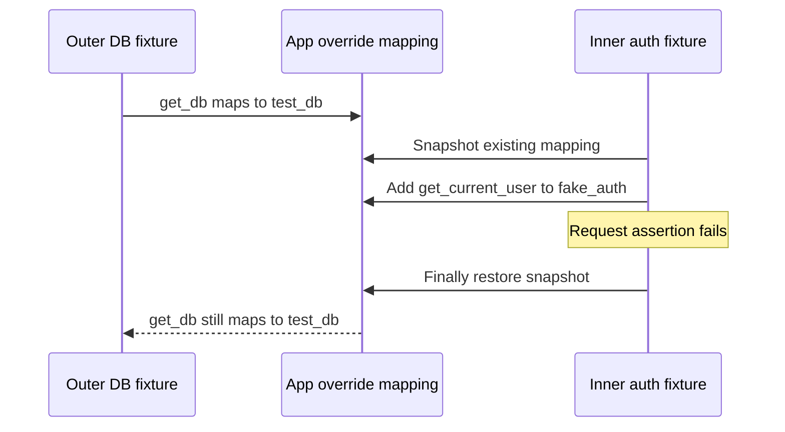

# 05 — Dependency Overrides

> **Who this is for**: FastAPI engineers replacing database, identity, or settings dependencies in
> tests without changing endpoint code.

## Smallest observable override

```python
previous = app.dependency_overrides.copy()
app.dependency_overrides[get_current_user] = lambda: User(id="test-user")
try:
    with TestClient(app) as client:
        response = client.get("/me")
        assert response.json() == {"id": "test-user"}
finally:
    app.dependency_overrides.clear()
    app.dependency_overrides.update(previous)
```

The visible result is the fake identity in the response; seeing a production user means the
endpoint depends on a different callable object or the override was installed on another app.

> **Key insight**: FastAPI overrides replace callable identities in one app's dependency graph, so
> isolation depends on installing and restoring the exact mapping for each test.

`dependency_overrides` is FastAPI's answer to "how do I test this without the real database". If your service uses `Depends(...)` cleanly, overriding is usually a two-line change. If testing is painful, the problem is almost always in how dependencies are wired.

---

## The Core Mechanism

`app.dependency_overrides` is a dictionary that maps original dependencies to replacement callables.

```python
app.dependency_overrides[original_dependency] = fake_dependency
```

When FastAPI resolves `Depends(original_dependency)` during a request, it calls `fake_dependency` instead. The override:

- Is global to the `app` object (affects every request during tests).
- Applies to any endpoint that depends on `original_dependency`, directly or transitively.
- Must have a compatible signature — parameter names and types matter if the replacement also uses `Depends`.

---

## Overriding a Database Session

Production code:

```python
# app/dependencies.py
from sqlalchemy.orm import Session

def get_db():
    db = SessionLocal()
    try:
        yield db
    finally:
        db.close()

# app/routers/users.py
@router.get("/users/{user_id}")
def get_user(user_id: int, db: Session = Depends(get_db)):
    user = db.query(User).filter(User.id == user_id).first()
    if not user:
        raise HTTPException(status_code=404)
    return user
```

Test code:

```python
# tests/conftest.py
import pytest
from sqlalchemy import create_engine
from sqlalchemy.orm import sessionmaker
from app.main import app
from app.dependencies import get_db
from app.models import Base

SQLALCHEMY_TEST_URL = "sqlite:///./test.db"
engine = create_engine(SQLALCHEMY_TEST_URL)
TestingSessionLocal = sessionmaker(bind=engine)

def override_get_db():
    db = TestingSessionLocal()
    try:
        yield db
    finally:
        db.close()

@pytest.fixture(autouse=True)
def install_test_db_override():
    """Install the DB override for every test and restore prior state afterward."""
    previous = app.dependency_overrides.get(get_db)
    app.dependency_overrides[get_db] = override_get_db
    try:
        yield
    finally:
        if previous is None:
            app.dependency_overrides.pop(get_db, None)
        else:
            app.dependency_overrides[get_db] = previous
```

For the full real-DB vs transaction-rollback story, see [08 — Database Testing](08_database_testing.md).

---

## Overriding Authentication

Production code:

```python
# app/dependencies.py
async def get_current_user(token: str = Depends(oauth2_scheme)):
    user = await verify_token(token)
    if not user:
        raise HTTPException(status_code=401)
    return user
```

Test code — bypass real token verification:

```python
# tests/conftest.py
from app.dependencies import get_current_user

def override_get_current_user():
    return {"id": 1, "username": "testuser", "role": "admin"}

app.dependency_overrides[get_current_user] = override_get_current_user
```

Now every endpoint that depends on `get_current_user` receives the fake user **without needing a real token**.

### Parameterizing the Fake User

Hard-coding `"admin"` means every test runs as admin. For tests that cover role-based access, make the override per-test:

```python
# tests/conftest.py
import pytest
from app.dependencies import get_current_user
from app.main import app


@pytest.fixture
def as_user():
    """Return a function that installs a fake current_user override."""
    def _as_user(user_id: int = 1, role: str = "user"):
        def override():
            return {"id": user_id, "username": f"u{user_id}", "role": role}
        app.dependency_overrides[get_current_user] = override
    return _as_user


# tests/test_admin.py
async def test_admin_can_access(client, as_user):
    as_user(role="admin")
    response = await client.get("/admin/stats")
    assert response.status_code == 200


async def test_regular_user_rejected(client, as_user):
    as_user(role="user")
    response = await client.get("/admin/stats")
    assert response.status_code == 403
```

The `reset_dependency_overrides` autouse fixture (below) cleans up between tests.

---

## Critical: Clean Up Overrides

Overrides mutate a shared dictionary on the `app` object. Without cleanup, one test's override leaks into every later test — often silently, because the "wrong" override still returns *something*, just not what the next test expects.

```python
# ❌ Wrong — override leaks into later tests
def test_something():
    app.dependency_overrides[get_db] = fake_db
    client = TestClient(app)
    response = client.get("/users/1")
    assert response.status_code == 200
    # override is still active for the NEXT test!
```

```python
# ✅ Restore enclosing overrides even if the request fails
def test_something():
    previous = app.dependency_overrides.copy()
    app.dependency_overrides[get_db] = fake_db
    try:
        with TestClient(app) as client:
            response = client.get("/users/1")
            assert response.status_code == 200
    finally:
        app.dependency_overrides.clear()
        app.dependency_overrides.update(previous)
```

```python
# ✅✅ Better — snapshot and restore the mapping for every test
# tests/conftest.py
@pytest.fixture(autouse=True)
def reset_dependency_overrides():
    previous = app.dependency_overrides.copy()
    try:
        yield
    finally:
        app.dependency_overrides.clear()
        app.dependency_overrides.update(previous)
```

`autouse=True` means the fixture runs for every test automatically. Snapshot/restore matters when
another fixture installs a baseline override such as the test database: a bare `clear()` would
erase that baseline after the first test and allow later tests to call the production dependency.

> **Do this in `conftest.py` once, for the whole project.** Debugging a test suite where override state leaks between tests is among the least rewarding activities in software.

---

Follow a nested override through failure to see why cleanup restores rather than merely empties:



The inner fixture owns only its temporary changes. Restoring the snapshot preserves the outer
fixture's connection boundary; clearing everything can silently re-enable a production dependency.

## Overriding Only for a Block

Sometimes you want the override to last only for a specific `with` block, not the whole test:

```python
from contextlib import contextmanager

@contextmanager
def override(dep, replacement):
    original = app.dependency_overrides.get(dep)
    app.dependency_overrides[dep] = replacement
    try:
        yield
    finally:
        if original is None:
            app.dependency_overrides.pop(dep, None)
        else:
            app.dependency_overrides[dep] = original


async def test_two_users_in_one_test(client, make_user):
    with override(get_current_user, lambda: {"id": 1, "role": "admin"}):
        response = await client.get("/admin/users")
        assert response.status_code == 200

    with override(get_current_user, lambda: {"id": 2, "role": "user"}):
        response = await client.get("/admin/users")
        assert response.status_code == 403
```

Nesting and restoring the previous value matters when several fixtures each install their own overrides.

---

## Override vs Mock vs Real Dependency

| Approach | Best for | Trade-off |
|----------|----------|-----------|
| `dependency_overrides` | Anything reached via `Depends(...)` | Only works at the FastAPI boundary |
| `unittest.mock.patch` | Non-DI dependencies, module-level functions | Patch path is fragile — see [09](09_mocking_external.md) |
| Real dependency + test DB | Integration coverage | Slower, needs infra |

> **Prefer `dependency_overrides` over `patch`** when testing FastAPI endpoints. It's explicit, doesn't rely on import paths, and matches how FastAPI actually resolves dependencies.

---

## When Override Isn't Enough

If a dependency is instantiated *inside* the endpoint (not via `Depends`), you cannot override it — you have to either refactor to inject it or fall back to `patch`:

```python
# ❌ Not testable via dependency_overrides
@router.post("/pay")
async def pay(request: PayRequest):
    stripe_client = stripe.Client(api_key=settings.stripe_key)  # hardcoded
    return await stripe_client.charge(...)
```

```python
# ✅ Testable — stripe_client is a dependency
def get_stripe_client() -> stripe.Client:
    return stripe.Client(api_key=settings.stripe_key)

@router.post("/pay")
async def pay(request: PayRequest, stripe_client = Depends(get_stripe_client)):
    return await stripe_client.charge(...)
```

Refactoring for testability is a feature, not a chore. If you cannot test a piece of code cleanly, that is usually a signal about the production design too.

---

## Next

- [06 — Async Testing](06_async_testing.md) — pytest-asyncio configuration, async fixtures, the sync/async pitfalls.

## Recap and retrieval

- Overrides map exact dependency callable identities to replacements.
- Installing on a different app or callable leaves the production edge unchanged.
- Cleanup restores the enclosing mapping so nested fixtures retain their guarantees.

**An outer fixture installs a test database and an inner test installs fake auth. What does inner cleanup restore?**

<details><summary>Reasoned answer</summary>

The prior mapping including the outer database override. Clearing the dictionary alone can reconnect later requests to the real dependency.

</details>

**A wrapper has the same name as get_db. Will it match a Depends(get_db) key?**

<details><summary>Reasoned answer</summary>

Only if it is the same callable object. Names are descriptive; dictionary key identity controls replacement.

</details>

**Try it:** Start with {get_db: test_db}, install fake auth in an inner context, then raise an exception. Fill in cleanup.

Hint: Snapshot before mutation and use finally.

<details><summary>Worked solution</summary>

Clear and update from the snapshot in finally. Assert get_db still maps to test_db and fake auth is absent after the exception.

</details>
