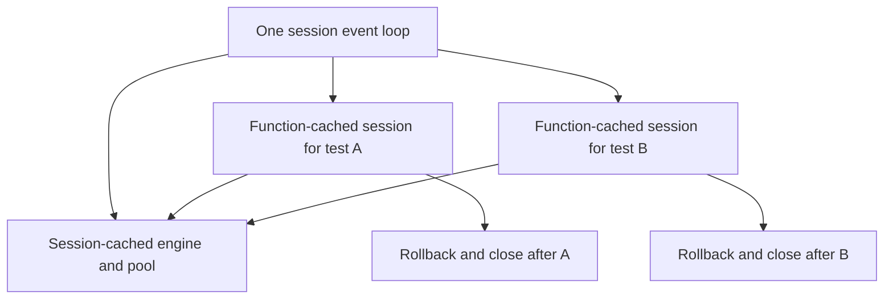

# 06 — Async Testing

> **Who this is for**: Python engineers testing `async def` application code, fixtures, and cancellation behavior with pytest.

> **Purpose**: Run `async def test_*` functions through pytest-asyncio without fighting the event loop. Understand the sync/async pitfalls that bite everyone.

> **Key insight**: An async test is valid only when pytest owns and awaits the coroutine on the intended event loop; creating a coroutine object is not execution.

---

## Configuring pytest-asyncio

`pytest-asyncio` defaults to **strict** mode — it only handles tests marked `@pytest.mark.asyncio`. In an async-first codebase that means decorating every test. The **auto** mode treats every `async def test_*` as an async test.

```toml
# pyproject.toml
[tool.pytest.ini_options]
asyncio_mode = "auto"
```

With auto mode:

```python
# No decorator needed — pytest-asyncio detects async automatically
async def test_async_endpoint(client):
    response = await client.get("/async-endpoint")
    assert response.status_code == 200
```

Without auto mode (default strict):

```python
import pytest

@pytest.mark.asyncio
async def test_async_endpoint(client):
    response = await client.get("/async-endpoint")
    assert response.status_code == 200
```

> **Auto mode is usually the right default for asyncio-only FastAPI projects.** Strict mode is useful when your suite mixes async frameworks and you want the marker/plugin boundary to be explicit.

---

## Async Fixtures

In auto mode, `async def` fixtures are picked up as async automatically:

```python
import pytest
from httpx import AsyncClient, ASGITransport
from app.main import app


@pytest.fixture
async def client():
    transport = ASGITransport(app=app)
    async with AsyncClient(transport=transport, base_url="http://test") as c:
        yield c


async def test_get_users(client):
    response = await client.get("/users")
    assert response.status_code == 200
```

If your app depends on `lifespan` startup/shutdown, wrap the client fixture with `asgi-lifespan`'s `LifespanManager`; the HTTPX `ASGITransport` does not send lifespan events on its own. See [04 — Endpoint Testing](04_endpoint_testing.md#lifespan-events).

In strict mode you must use `@pytest_asyncio.fixture` (note: the `pytest_asyncio` namespace, not `pytest`):

```python
import pytest_asyncio

@pytest_asyncio.fixture
async def client():
    ...
```

If you see `TypeError: object AsyncGenerator can't be used in 'await' expression`, you are in strict mode with an undecorated async fixture.

---

## Event-Loop Scope

By default, pytest-asyncio runs async tests in a function-scoped event loop. Async fixture loop scope is configurable; set it explicitly for expensive higher-scoped fixtures so future plugin defaults do not surprise you:

```python
import pytest_asyncio


@pytest_asyncio.fixture(scope="session", loop_scope="session")
async def engine():
    engine = create_async_engine(TEST_DB_URL)
    yield engine
    await engine.dispose()
```

Cache lifetime and loop ownership are separate. A session-cached engine may contain asyncpg
connections created on its session loop. Function-cached sessions can share that loop, but cannot
use those connections from new function loops. Align *every dependent fixture and test*:

```python
import pytest
import pytest_asyncio
from sqlalchemy.ext.asyncio import async_sessionmaker

@pytest_asyncio.fixture(scope="function", loop_scope="session")
async def db_session(engine):
    async with engine.connect() as connection:
        transaction = await connection.begin()
        factory = async_sessionmaker(bind=connection, join_transaction_mode="create_savepoint")
        try:
            async with factory() as session:
                yield session
        finally:
            await transaction.rollback()

@pytest.mark.asyncio(loop_scope="session")
async def test_query(db_session):
    from sqlalchemy import text
    assert await db_session.scalar(text("SELECT 1")) == 1
```

Any async client or application lifespan fixture that uses this session also declares
`loop_scope="session"`. The session object is new per test, so its mutable state resets; the loop
remains the engine's owner. Alternatively create and dispose the engine within each function loop,
or deliberately use SQLAlchemy `NullPool` where no connection crosses loops. A wider fixture cache
by itself does not solve loop affinity. [SQLAlchemy multiple loops](https://docs.sqlalchemy.org/en/20/orm/extensions/asyncio.html#using-multiple-asyncio-event-loops), checked 2026-10-30.

---

These two lifetimes are intentionally different:



A and B get different sessions and transactions, while both borrow connections on the engine's
loop. Fixture reuse and loop reuse solve different problems and should be configured separately.

## Common Pitfall: Mixing Sync and Async

```python
# ❌ Wrong — sync test calling async fixture
def test_something(client):  # client is an AsyncClient whose methods must be awaited
    response = client.get("/users")  # coroutine object; no request executed

# ✅ Correct — async test with async fixture
async def test_something(client):
    response = await client.get("/users")
```

```python
# ❌ This doesn't work — coroutine is never awaited
def test_async_endpoint():
    result = some_async_function()  # returns coroutine object
    assert result == expected       # comparing coroutine to value

# ✅ Make the test async
async def test_async_endpoint():
    result = await some_async_function()
    assert result == expected
```

> **Symptom to watch for:** your test passes but you see a `RuntimeWarning: coroutine ... was never awaited` in pytest output. In the sync example above the test body *did* run: it created an application coroutine without awaiting it, so that coroutine’s body did not run. Find the unawaited call; the warning alone does not prove pytest skipped the test. Treat any `coroutine was never awaited` warning as a test bug.

---

## Testing Timeouts and Cancellation

When your code uses `asyncio.timeout`, the test should still assert the right exception type — it is `TimeoutError` (built-in) in Python 3.11+, not `asyncio.TimeoutError` (which is now an alias).

```python
import asyncio
import pytest


async def test_slow_endpoint_times_out():
    never_completes = asyncio.Event()

    with pytest.raises(TimeoutError):
        async with asyncio.timeout(0.1):
            await never_completes.wait()
```

The event makes the incomplete condition explicit; the timeout only bounds how long the test may
wait. Do not coordinate two tasks with `sleep()` and hope CI schedules them in the intended order.
Use events or barriers to force the interleaving, then assert after both tasks have joined.

---

## Testing Background Tasks

FastAPI's `BackgroundTasks` runs after the response is sent. In tests, `TestClient` blocks until those tasks complete, so you can assert their side effects:

```python
from fastapi import BackgroundTasks

@router.post("/signup")
async def signup(bg: BackgroundTasks):
    bg.add_task(send_welcome_email, user_id=1)
    return {"ok": True}


async def test_signup_queues_email(client, mocker):
    spy = mocker.patch("app.routers.signup.send_welcome_email")
    response = await client.post("/signup")
    assert response.status_code == 200
    spy.assert_called_once_with(user_id=1)
```

This proves the in-process `BackgroundTasks` mechanism only. It does not prove that a separate
worker discovers, deserializes, retries, or acknowledges durable work. For Dramatiq or another task
queue, use a fake or in-memory broker for application and adapter tests, then keep a smaller marked
integration profile with the production broker family and a real worker for delivery semantics.
The [failure-injection guide](../../background_work/reliability/06_failure_injection_and_testing.md)
owns crash, redelivery, fencing, and recovery tests.

---

## `anyio` Backends

If your app uses `anyio` rather than raw asyncio, consider AnyIO's built-in pytest plugin instead. It supports both asyncio and trio backends in the same suite:

```python
import pytest

@pytest.mark.anyio
async def test_on_both_backends():
    ...

@pytest.fixture(params=["asyncio", "trio"])
def anyio_backend(request):
    return request.param
```

Most FastAPI projects stay on asyncio. Do not enable both pytest-asyncio auto mode and AnyIO auto mode in the same suite; use explicit `@pytest.mark.anyio` tests when the two plugins coexist.

---

## Debugging Flaky Async Tests

A test that sometimes passes and sometimes fails is usually one of:

- **Shared event loop state** — an unclosed session, a pending task not awaited.
- **Missing `await`** — silently skipped work (look for `coroutine was never awaited`).
- **Timer-based assertions** — `asyncio.sleep(0.1)` then asserting "it finished in 100ms" under CI load.
- **Task-order dependence** — two `asyncio.gather`'d coroutines with implicit ordering.

Re-run with `pytest-randomly` using several seeds to see if order matters. If so, the bug is in test isolation, not in the code under test.

---

## Next

- [07 — Fixtures](07_fixtures.md) — shared state across tests, factory patterns, scope selection.

## Recap and retrieval

- Calling async code creates a coroutine; awaiting it executes its body.
- Fixture cache lifetime and event-loop ownership are independent choices.
- A pooled connection must stay on its creating loop, and spawned tasks must be awaited or cancelled and joined.

**A session engine warms an asyncpg pool, then a function-loop test borrows it. Is session caching sufficient?**

<details><summary>Reasoned answer</summary>

No. Run dependent tests and fixtures on the session loop, or create/dispose an engine per function loop. Cache scope does not transfer connection ownership.

</details>

**An unawaited-coroutine warning appears in a sync test. Did the test body run?**

<details><summary>Reasoned answer</summary>

It may have run and created the unexecuted application coroutine. Diagnose the specific call rather than assuming pytest skipped the test.

</details>

**Try it:** Keep a session-cached engine but create a new session per test. Fill in fixture and test loop scopes.

Hint: Object lifetime and loop lifetime are distinct.

<details><summary>Worked solution</summary>

Use function cache plus session loop for the session/client fixtures, session cache plus session loop for the engine, and session-loop marks for dependent tests.

</details>
