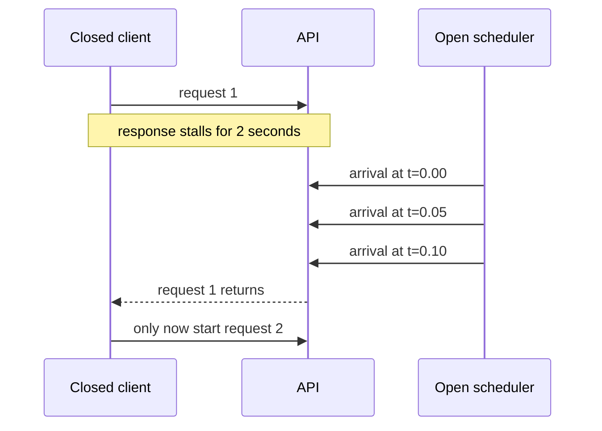

# Measure the capacity users can actually use

**Role: implementation.** Prerequisites: [endpoint tests](04_endpoint_testing.md), [database pooling](../../fundamentals/database/05_connection_pooling.md), and [SLIs](../../infrastructure/observability/05_alerting_and_slos.md). A correctness suite asks whether a document request behaves properly. A performance experiment asks whether it still does so under a stated arrival pattern, data volume and resource budget.

## Choose the question before choosing a tool

Our document API must accept 20 submissions per second, with 95% accepted within 500 ms and fewer than 1% failed during a controlled capacity test. These are **test thresholds**, not a replacement for the production SLO. We also need to know whether its queue drains after a burst.

| Experiment | Changed condition | What to learn |
|---|---|---|
| Load | Expected traffic and realistic mix | Whether the planned capacity meets the objective |
| Stress | Demand rises beyond planned capacity | Which limit fails first and whether overload stays bounded |
| Spike | Sudden jump, then recovery | Admission, scaling delay and backlog behavior |
| Soak | Sustained demand over hours | Leaks, pool churn, disk growth, token refresh and maintenance effects |

Use k6 when an explicit arrival-rate workload and threshold-based exit status fit CI. Locust is useful for Python-authored user journeys and stateful behavior. `hey` and `wrk` are convenient single-endpoint probes; their default traffic models and limited business assertions can hide a realistic request mix. `pytest-benchmark` compares small Python operations, not an entire deployment's network and database capacity. Choose one workload model deliberately rather than treating all tools' “concurrency” settings as equivalent.

## Why a slow service can make a test look healthier

A **closed** workload has a fixed set of clients: each waits for its current request before starting another. At 20 clients and a 100 ms response, the upper bound without think time is about 200 requests/s. At a 2-second response, those same clients offer only about 10 requests/s. The test reduces pressure just when the service slows.

An **open** workload schedules arrivals independently of completion. It better represents an arrival rate that continues during a slowdown. Missing the waiting requests can produce **coordinated omission**, under-reporting the latency users would experience. Arrival scheduling is not magic: the generator must have enough workers, and dropped arrivals must be reported. [k6 workload models](https://grafana.com/docs/k6/latest/using-k6/scenarios/concepts/open-vs-closed/).

The diagram changes only response time, so the source of the misleading result is visible.



The closed client cannot reveal the delay of arrivals it never generated. Use closed clients when the real population behaves that way, and an open model when arrivals continue independently.

## Run a bounded arrival-rate experiment

This **complete k6 script** targets an existing staging fixture: authenticated tenant 7 can read seeded document 42 at `GET /documents/42`, returning JSON with numeric `id: 42`. Adapt the assertion to your actual API before using it. The read path avoids generating durable work during the first experiment; test creation separately with unique idempotency keys and cleanup.

Save as `documents-load.js`. Use an isolated deployment you are authorized to load, seeded with production-shaped data and a short-lived test credential. The script defaults to loopback, caps duration and concurrency, and does not log credentials or response bodies.

```javascript
import http from 'k6/http';
import { check } from 'k6';

const base = __ENV.BASE_URL || 'http://127.0.0.1:8000';
if (!__ENV.TEST_TOKEN) throw new Error('TEST_TOKEN is required');
export const options = {
  scenarios: {
    reads: {
      executor: 'constant-arrival-rate',
      rate: 20,
      timeUnit: '1s',
      duration: '30s',
      preAllocatedVUs: 20,
      maxVUs: 50,
    },
  },
  thresholds: {
    http_req_duration: ['p(95)<500'],
    http_req_failed: ['rate<0.01'],
    checks: ['rate==1'],
    dropped_iterations: ['count==0'],
  },
};
export default function () {
  const response = http.get(`${base}/documents/42`, {
    headers: { Authorization: `Bearer ${__ENV.TEST_TOKEN}` },
    timeout: '5s',
    tags: { name: 'GET /documents/:id' },
  });
  check(response, {
    'authorized document returned': (r) => {
      if (r.status !== 200) return false;
      try { return r.json('id') === 42; }
      catch (_) { return false; }
    },
  });
}
```

With `TEST_TOKEN` already provided by your test secret mechanism:

```bash
k6 run documents-load.js
```

Success is a zero exit code, every threshold passed, the expected 20/s offered workload and no dropped iterations. A body assertion catches a fast `200` login page or wrong response as a failure. A check by itself records a result; the `checks` threshold makes failures fail this test. [k6 thresholds](https://grafana.com/docs/k6/latest/using-k6/thresholds/).

Failure is evidence to classify, not merely a reason to increase the threshold. Dropped iterations may mean too few generator workers or an overloaded generator. Timeouts are failed requests and must remain in the report. A low p95 among completed responses does not erase the timed-out population.

## Make the environment resemble the disputed decision

A loopback smoke run verifies the script and assertions. It cannot establish production capacity. For a capacity conclusion, keep TLS, ingress, network placement, authentication, representative payload sizes, query selectivity and database volume. Record cache state: a repeatedly read document 42 becomes a hot-cache experiment. Add an intentional hot/cold mix drawn from a seeded corpus without placing IDs into metric labels.

For writes, assign a unique document/idempotency key per logical operation, then retry the same key only when testing retry behavior. Reusing one key for every arrival measures deduplication, not new-document throughput. Track queue age and end-to-end completion as well as the intake response. Provider simulators should reproduce latency, rate limits and failure modes; real providers require an explicit quota and cost budget.

Capacity limits compose. If 20 requests/s each hold a DB connection for 50 ms, average concurrent DB occupancy is approximately `20 × 0.05 = 1`. If a new query holds it for one second, average occupancy becomes 20 before bursts. A pool of 10 must queue or reject. Increasing API workers does not create DB capacity; it creates more contenders. Observe pool waits, DB locks, Redis latency, provider 429s and application admission limits during the same interval.

## Read percentiles without losing the failures

p50 is the median; p95 means roughly 95% of the measured observations are at or below that latency; p99 exposes a rarer tail. Maximum is the worst observed value and is sensitive to duration and sample size. A p99 from 100 requests barely characterizes a tail. Never average Pod p99 values to obtain a service p99: merge the underlying distributions or histogram counts.

Record offered rate, achieved rate, successful and failed counts, percentiles, timeout count, dropped arrivals, resource limits and generator utilization. Repeat stable load steps and compare uncertainty. Warm up deliberately, then measure a fixed interval; also run cold-start cases separately. A faster run after all data entered cache is not proof the code change improved the query.

## Put only repeatable signals into merge gates

Use a small deterministic benchmark in CI for a regression such as a parser doubling CPU time, and a bounded staging load smoke test for gross failures. Dedicated performance runs should compare the same resource allocation, data snapshot and traffic mix. Fail a regression gate on a repeatable meaningful difference, not a single noisy shared-runner measurement.

Run long soaks and disruptive stress tests on a schedule or before capacity/release decisions, with owners, stop conditions and spend limits. Stop when agreed error, queue-age or resource thresholds threaten the test environment's recovery. Then prove recovery: offered traffic falls, queued work drains, memory stabilizes and new requests succeed. A service that survives peak load but never drains afterward has not passed.

**What's changing — checked 2026-10-30:** k6 has a documented major-version stability policy and a 2.x release line. Pin the generator version in performance history and review major upgrades before comparing baselines; experimental modules carry weaker guarantees. This example uses core HTTP and arrival-rate APIs. [Stability policy](https://grafana.com/docs/k6/latest/reference/versioning-and-stability-guarantees/), [release notes](https://grafana.com/docs/k6/latest/release-notes/). Locust's current [user/task API](https://docs.locust.io/en/stable/writing-a-locustfile.html) remains an alternative for Python-based scenarios.

## Recap

- A performance result applies to a traffic model, data shape and resource allocation.
- Waiting clients reduce offered traffic when responses slow; independent arrivals expose a different failure.
- Correct bodies, failures and dropped arrivals belong beside latency percentiles.
- Shared dependency limits often determine capacity before the API's CPU does.
- Recovery after demand falls is part of the result.

**Check yourself: p95 improves after a deployment, but achieved throughput halves and timeouts double. Did performance improve?**

<details><summary>Answer</summary>

The surviving requests may be faster while more users fail. Compare the same offered workload and include timeouts, errors and dropped arrivals. A closed generator may also have reduced demand as the service slowed. The percentile alone cannot establish improvement.

</details>

**Check yourself: all requests use the same idempotency key and report high write throughput. What did you measure?**

<details><summary>Answer</summary>

Mostly duplicate handling or cached results. Give each new logical write a distinct key and preserve that key only across retries of that write. Verify durable row counts and completion outcomes alongside HTTP metrics.

</details>

**Try it:** Change the read experiment into a burst test: 20/s, then 80/s for a bounded interval, then 20/s. Keep a fixed database budget. Decide which additional success signal is required.

<details><summary>Worked solution</summary>

Use a ramping-arrival-rate scenario with explicit stages and enough bounded VUs. Preserve error and dropped-arrival thresholds, record admission rejections, and measure queue/pool wait recovery after the burst. The service must return to its baseline latency and backlog within an agreed interval; merely finishing the test process does not prove recovery.

</details>
